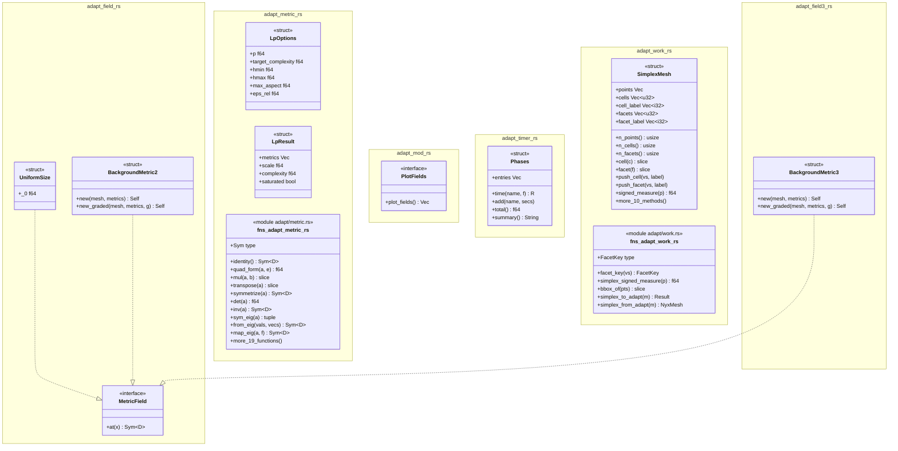

# Metric fields: code

C4 level 4 (code) of the component **Metric fields** (`femcore.metric`) in the container **femcore** (crate `femcore`). [Component view of the container](../../3-components/femcore.md) · [All code pages](../README.md)

> Riemannian metrics in 2D and 3D, metric fields, the simplex working mesh and per-phase timers.

**Decisions:** [ADR 7](../../../adr/0007-metric-adaptation-and-structured-pml.md), [ADR 5](../../../adr/0005-native-mixed-cell-mesh.md)  
**Size:** 6 files, 1846 lines.

## Files

| File | Lines | What it says about itself |
|---|---:|---|
| `crates/femcore/src/adapt/field.rs` | 188 | Metric fields: anything that can return the requested metric at a point. |
| `crates/femcore/src/adapt/field3.rs` | 147 | Metric field of a tetrahedral background mesh: per-vertex metrics interpolated log-Euclideanly inside the tetrahedra (the 3D counterpart of `BackgroundMetric2`), used to carry the metric of a start mesh to the vertices that adaptation cr... |
| `crates/femcore/src/adapt/metric.rs` | 1010 | Riemannian metrics for mesh adaptation, generic over dimension `D` (2 or 3). |
| `crates/femcore/src/adapt/mod.rs` | 25 | Adaptation stack. See the milestone table in `docs/STATUS.md`. |
| `crates/femcore/src/adapt/timer.rs` | 38 | Per-phase wall-clock timers, so every long operation reports where its time went. |
| `crates/femcore/src/adapt/work.rs` | 438 | Simplex meshes (triangles for `D = 2`, tetrahedra for `D = 3`). |

## What it uses

| Target | Modules | Items |
|---|---|---|
| [Mesh](./mesh.md) | mesh | SimplexMesh |
| [Runtime services](./runtime.md) | par |  |

## Used by

| Component | Modules | Items |
|---|---|---|
| [Adaptation drivers](./adaptdrive.md) | adapt::field, adapt::metric, adapt::timer, adapt::work | MetricField, Phases, SimplexMesh, Sym |
| [Adaptation operators](./adaptops.md) | adapt::field, adapt::metric, adapt::work | MetricField, SimplexMesh, Sym, edge_length, facet_key, simplex_signed_measure |
| [Error estimators](./estimators.md) | adapt, adapt::field, adapt::field3, adapt::metric, adapt::work | BackgroundMetric2, BackgroundMetric3, LpOptions, PlotFields, Sym, complexity_for_elements, intersect, isotropic +5 |
| [Fixtures and test kit](./fixtures.md) | adapt::metric, adapt::work | SimplexMesh, Sym |
| [Mesh](./mesh.md) | adapt::metric, adapt::work | FacetKey, SimplexMesh, Sym, det, edge_length, facet_key, identity, length +1 |
| [Meshing validation harness](./meshcheck.md) | adapt::work | bbox_of |
| [Meshing facade](./meshing.md) | adapt, adapt::field, adapt::field3, adapt::metric, adapt::work | BackgroundMetric2, BackgroundMetric3, MetricField, Sym, intersect, isotropic, simplex_from_adapt, simplex_to_adapt +1 |
| [3D meshing](./meshing3d.md) | adapt::field3, adapt::metric, adapt::work | BackgroundMetric3, SimplexMesh, Sym, isotropic, simplex_to_adapt |
| [Structured absorbing layers](./structpml.md) | adapt::work | FacetKey, SimplexMesh, bbox_of, facet_key, simplex_to_adapt |
| [physics: Result and frame](../physics/result.md) | adapt | PlotFields |

## Class diagram

Public types with their public fields (or variants) and methods, free functions per file as a `module` box; arrows are field types and `impl Trait`. Capped at 36 types and a few members each; the table below is complete.

## Public items

| Kind | Item | File:line | Signature or summary |
|---|---|---|---|
| trait | `MetricField` | `adapt/field.rs:12` | methods: `at` —  A metric defined everywhere in the domain. |
| struct | `UniformSize` | `adapt/field.rs:23` | fields: `_0` —  Uniform isotropic size `h` everywhere. |
| struct | `BackgroundMetric2` | `adapt/field.rs:32` |  Metric interpolated from per-vertex values on a triangle mesh. |
| fn | `BackgroundMetric2::new` | `adapt/field.rs:44` | `pub fn new(mesh: &SimplexMesh<2>, metrics: &[Sym<2>]) -> Self` |
| fn | `BackgroundMetric2::new_graded` | `adapt/field.rs:91` | `pub fn new_graded(mesh: &SimplexMesh<2>, metrics: &[Sym<2>], g: f64) -> Self` —  Like [`BackgroundMetric2::new`] but first grades the vertex metrics so that the requested |
| struct | `BackgroundMetric3` | `adapt/field3.rs:8` |  |
| fn | `BackgroundMetric3::new` | `adapt/field3.rs:19` | `pub fn new(mesh: &SimplexMesh<3>, metrics: &[Sym<3>]) -> Self` |
| fn | `BackgroundMetric3::new_graded` | `adapt/field3.rs:51` | `pub fn new_graded(mesh: &SimplexMesh<3>, metrics: &[Sym<3>], g: f64) -> Self` —  Like [`BackgroundMetric3::new`] but first grades the vertex metrics so that the requested size grows by at most `g` per unit |
| type | `Sym` | `adapt/metric.rs:23` | `<const D: usize>` —  Symmetric `D x D` matrix (full storage, row-major). |
| fn | `identity` | `adapt/metric.rs:26` | `pub fn identity<const D: usize>() -> Sym<D>` —  Identity matrix. |
| fn | `quad_form` | `adapt/metric.rs:35` | `pub fn quad_form<const D: usize>(a: &Sym<D>, e: &[f64; D]) -> f64` —  `e^T a e`. |
| fn | `mul` | `adapt/metric.rs:48` | `pub fn mul<const D: usize>(a: &Sym<D>, b: &Sym<D>) -> [[f64` —  Matrix product `a * b`. |
| fn | `transpose` | `adapt/metric.rs:62` | `pub fn transpose<const D: usize>(a: &[[f64; D]; D]) -> [[f64` —  Transpose. |
| fn | `symmetrize` | `adapt/metric.rs:73` | `pub fn symmetrize<const D: usize>(a: &[[f64; D]; D]) -> Sym<D>` —  Force exact symmetry: `(a + a^T) / 2`. |
| fn | `det` | `adapt/metric.rs:86` | `pub fn det<const D: usize>(a: &Sym<D>) -> f64` —  Determinant (closed form for `D = 2, 3`). |
| fn | `inv` | `adapt/metric.rs:98` | `pub fn inv<const D: usize>(a: &Sym<D>) -> Sym<D>` —  Inverse by cofactors (`D = 2, 3`). |
| fn | `sym_eig` | `adapt/metric.rs:129` | `pub fn sym_eig<const D: usize>(a: &Sym<D>) -> ([f64` —  Eigen-decomposition of a symmetric matrix by cyclic Jacobi rotations. |
| fn | `from_eig` | `adapt/metric.rs:185` | `pub fn from_eig<const D: usize>(vals: &[f64; D], vecs: &Sym<D>) -> Sym<D>` —  `V diag(vals) V^T`. |
| fn | `map_eig` | `adapt/metric.rs:199` | `pub fn map_eig<const D: usize>(a: &Sym<D>, f: impl Fn(f64) -> f64) -> Sym<D>` —  Apply a scalar function to the eigenvalues of `a`. |
| fn | `isotropic` | `adapt/metric.rs:205` | `pub fn isotropic<const D: usize>(h: f64) -> Sym<D>` —  Isotropic metric of size `h` (`M = h^-2 I`). |
| fn | `from_sizes` | `adapt/metric.rs:215` | `pub fn from_sizes<const D: usize>(h: &[f64; D], dirs: &Sym<D>) -> Sym<D>` —  Metric with the requested sizes `h[k]` along the orthonormal directions `dirs[.][k]`. |
| fn | `sizes` | `adapt/metric.rs:220` | `pub fn sizes<const D: usize>(m: &Sym<D>) -> ([f64` —  Requested sizes and directions: `(h, dirs)` with `h[k] = lambda_k^{-1/2}` and sizes ascending. |
| fn | `length` | `adapt/metric.rs:226` | `pub fn length<const D: usize>(m: &Sym<D>, e: &[f64; D]) -> f64` —  Length of vector `e` in metric `m`. |
| fn | `edge_length` | `adapt/metric.rs:233` | `pub fn edge_length<const D: usize>(ma: &Sym<D>, mb: &Sym<D>, e: &[f64; D]) -> f64` —  Length of the edge `e` between two vertices carrying metrics `ma` and `mb`, assuming the |
| fn | `intersect_flag` | `adapt/metric.rs:244` | `pub fn intersect_flag<const D: usize>(m1: &Sym<D>, m2: &Sym<D>) -> (Sym<D>, bool)` —  Intersection of two metrics by simultaneous reduction: the metric whose unit ball is the |
| fn | `intersect` | `adapt/metric.rs:260` | `pub fn intersect<const D: usize>(m1: &Sym<D>, m2: &Sym<D>) -> Sym<D>` —  Intersection of two metrics (see [`intersect_flag`]). |
| fn | `log_spd` | `adapt/metric.rs:265` | `pub fn log_spd<const D: usize>(m: &Sym<D>) -> Sym<D>` —  Matrix logarithm of an SPD matrix. |
| fn | `exp_sym` | `adapt/metric.rs:270` | `pub fn exp_sym<const D: usize>(m: &Sym<D>) -> Sym<D>` —  Matrix exponential of a symmetric matrix. |
| fn | `log_euclid_mean` | `adapt/metric.rs:275` | `pub fn log_euclid_mean<const D: usize>(items: &[(f64, Sym<D>)]) -> Sym<D>` —  Log-Euclidean weighted mean `exp(sum w_i log M_i)` (weights should sum to 1). |
| fn | `grow` | `adapt/metric.rs:290` | `pub fn grow<const D: usize>(m: &Sym<D>, dist: f64, g: f64) -> Sym<D>` —  Metric obtained by letting the requested sizes of `m` grow linearly over a distance `dist`: |
| fn | `grade` | `adapt/metric.rs:304` | `pub fn grade<const D: usize>( metrics: &mut [Sym<D>], points: &[[f64; D]], edges: &[[u32; 2]], g: f64, max_passes: usize, ) -> usize` —  Gradation of a vertex-based metric field over the given edges. |
| fn | `unit_simplex_measure` | `adapt/metric.rs:340` | `pub fn unit_simplex_measure(d: usize) -> f64` —  Metric volume of an ideal (unit-edge) simplex: `sqrt(3)/4` in 2D, `sqrt(2)/12` in 3D. |
| fn | `complexity_for_elements` | `adapt/metric.rs:349` | `pub fn complexity_for_elements(n_elements: f64, d: usize) -> f64` —  Complexity (integral of `sqrt(det M)`) that makes a unit mesh of about `n_elements` cells. |
| fn | `elements_for_complexity` | `adapt/metric.rs:354` | `pub fn elements_for_complexity(complexity: f64, d: usize) -> f64` —  Approximate number of elements of a unit mesh for a metric field of the given complexity. |
| fn | `complexity` | `adapt/metric.rs:359` | `pub fn complexity<const D: usize>(metrics: &[Sym<D>], vol: &[f64]) -> f64` —  Complexity of a vertex-based metric field using lumped vertex volumes. |
| struct | `LpOptions` | `adapt/metric.rs:365` | fields: `p`, `target_complexity`, `hmin`, `hmax`, `max_aspect`, `eps_rel` —  Options for [`lp_metrics`]. |
| struct | `LpResult` | `adapt/metric.rs:397` | fields: `metrics`, `scale`, `complexity`, `saturated` —  Result of [`lp_metrics`]. |
| fn | `lp_metrics` | `adapt/metric.rs:453` | `pub fn lp_metrics<const D: usize>(hess: &[Sym<D>], vol: &[f64], opt: &LpOptions) -> LpResult<D>` —  Hessian to metric with optimal L^p scaling and complexity targeting. |
| fn | `lp_metrics_with_threads` | `adapt/metric.rs:458` | `pub fn lp_metrics_with_threads<const D: usize>( hess: &[Sym<D>], vol: &[f64], opt: &LpOptions, nt: usize, ) -> LpResult<D>` —  [`lp_metrics`] with an explicit thread count. |
| fn | `lp_metrics_unfused` | `adapt/metric.rs:595` | `pub fn lp_metrics_unfused<const D: usize>(hess: &[Sym<D>], vol: &[f64], opt: &LpOptions) -> Vec<Sym<D>>` —  Straightforward multi-pass version of [`lp_metrics`] for benchmarking and tests. |
| trait | `PlotFields` | `adapt/mod.rs:22` | methods: `plot_fields` —  What the estimators read of a result: the plot fields of every solution as `(flat name, values per dof)`. Implemented for the result |
| struct | `Phases` | `adapt/timer.rs:7` | fields: `entries` —  Ordered list of `(phase, seconds)`; repeated phases accumulate. |
| fn | `Phases::time` | `adapt/timer.rs:13` | `pub fn time<R>(&mut self, name: &str, f: impl FnOnce() -> R) -> R` —  Run `f` and record its duration under `name`. |
| fn | `Phases::add` | `adapt/timer.rs:21` | `pub fn add(&mut self, name: &str, secs: f64)` —  Add `secs` to phase `name`. |
| fn | `Phases::total` | `adapt/timer.rs:29` | `pub fn total(&self) -> f64` —  Total of all phases. |
| fn | `Phases::summary` | `adapt/timer.rs:34` | `pub fn summary(&self) -> String` —  One-line summary such as `eig 1.2 ms, scale 0.1 ms`. |
| type | `FacetKey` | `adapt/work.rs:13` |  Sorted, padded vertex tuple identifying a facet (edge in 2D, triangle or quad in 3D). |
| fn | `facet_key` | `adapt/work.rs:16` | `pub fn facet_key(vs: &[u32]) -> FacetKey` —  Build the orientation-independent key of a facet with 2 to 4 vertices. |
| struct | `SimplexMesh` | `adapt/work.rs:26` | fields: `points`, `cells`, `cell_label`, `facets`, `facet_label` —  Conforming simplex mesh in `D` dimensions. |
| fn | `simplex_signed_measure` | `adapt/work.rs:231` | `pub fn simplex_signed_measure<const D: usize>(p: &[[f64; D]]) -> f64` —  Signed area (2D) or volume (3D) of the simplex with the given `D + 1` vertices. |
| fn | `bbox_of` | `adapt/work.rs:251` | `pub fn bbox_of<const D: usize>(pts: &[[f64; D]]) -> [[f64` —  Bounding box of a point set. |
| fn | `simplex_to_adapt` | `adapt/work.rs:316` | `pub fn simplex_to_adapt<const D: usize>(m: &NyxMesh) -> Result<SimplexMesh<D>, String>` —  A nyx simplex mesh of dimension `D` as the mesher's mesh. |
| fn | `simplex_from_adapt` | `adapt/work.rs:334` | `pub fn simplex_from_adapt<const D: usize>(m: &SimplexMesh<D>) -> NyxMesh` —  The mesher's simplex mesh as a nyx mesh (edges and numbering of unknowns are rebuilt). |
| fn | `SimplexMesh::n_points` | `adapt/work.rs:44` | `pub fn n_points(&self) -> usize` —  Number of vertices. |
| fn | `SimplexMesh::n_cells` | `adapt/work.rs:49` | `pub fn n_cells(&self) -> usize` —  Number of cells. |
| fn | `SimplexMesh::n_facets` | `adapt/work.rs:54` | `pub fn n_facets(&self) -> usize` —  Number of labelled boundary facets. |
| fn | `SimplexMesh::cell` | `adapt/work.rs:59` | `pub fn cell(&self, c: usize) -> &[u32]` —  Vertex ids of cell `c`. |
| fn | `SimplexMesh::facet` | `adapt/work.rs:64` | `pub fn facet(&self, f: usize) -> &[u32]` —  Vertex ids of boundary facet `f`. |
| fn | `SimplexMesh::push_cell` | `adapt/work.rs:69` | `pub fn push_cell(&mut self, vs: &[u32], label: i32)` —  Append a cell. |
| fn | `SimplexMesh::push_facet` | `adapt/work.rs:76` | `pub fn push_facet(&mut self, vs: &[u32], label: i32)` —  Append a boundary facet. |
| fn | `SimplexMesh::signed_measure` | `adapt/work.rs:83` | `pub fn signed_measure(p: &[[f64; D]]) -> f64` —  Signed measure (area in 2D, volume in 3D) of a simplex given by its vertices. |
| fn | `SimplexMesh::measure` | `adapt/work.rs:88` | `pub fn measure(&self, c: usize) -> f64` —  Signed measure of cell `c`. |
| fn | `SimplexMesh::total_measure` | `adapt/work.rs:98` | `pub fn total_measure(&self) -> f64` —  Sum of all (signed) cell measures. |
| fn | `SimplexMesh::orient_positive` | `adapt/work.rs:104` | `pub fn orient_positive(&mut self) -> usize` —  Swap two vertices of every negatively oriented cell so that all measures are positive. |
| fn | `SimplexMesh::bbox` | `adapt/work.rs:116` | `pub fn bbox(&self) -> [[f64` —  Axis-aligned bounding box `[min, max]` per axis. |
| fn | `SimplexMesh::edges` | `adapt/work.rs:121` | `pub fn edges(&self) -> Vec<[u32` —  All unique edges as sorted pairs, in sorted order (deterministic). |
| fn | `SimplexMesh::cell_facets` | `adapt/work.rs:138` | `pub fn cell_facets(&self, c: usize) -> [[u32` —  Facets of cell `c` (the face opposite vertex `i` is returned at index `i`). |
| fn | `SimplexMesh::facet_cells` | `adapt/work.rs:154` | `pub fn facet_cells(&self) -> HashMap<FacetKey, Vec<u32>>` —  Facet-to-cell incidence: key of every facet and the cells that contain it. |
| fn | `SimplexMesh::boundary_keys` | `adapt/work.rs:166` | `pub fn boundary_keys(&self) -> Vec<FacetKey>` —  Facets that belong to exactly one cell, sorted by key (deterministic). |
| fn | `SimplexMesh::vertex_volumes` | `adapt/work.rs:175` | `pub fn vertex_volumes(&self) -> Vec<f64>` —  Lumped vertex volumes: each cell gives `measure / (D + 1)` to each of its vertices. |
| fn | `SimplexMesh::check` | `adapt/work.rs:189` | `pub fn check(&self) -> Result<(), String>` —  Structural and geometric validity check (Tier A properties): |

Trait implementations in this component: `UniformSize: MetricField`, `BackgroundMetric2: MetricField`, `BackgroundMetric3: MetricField`, `LpOptions: Default`
