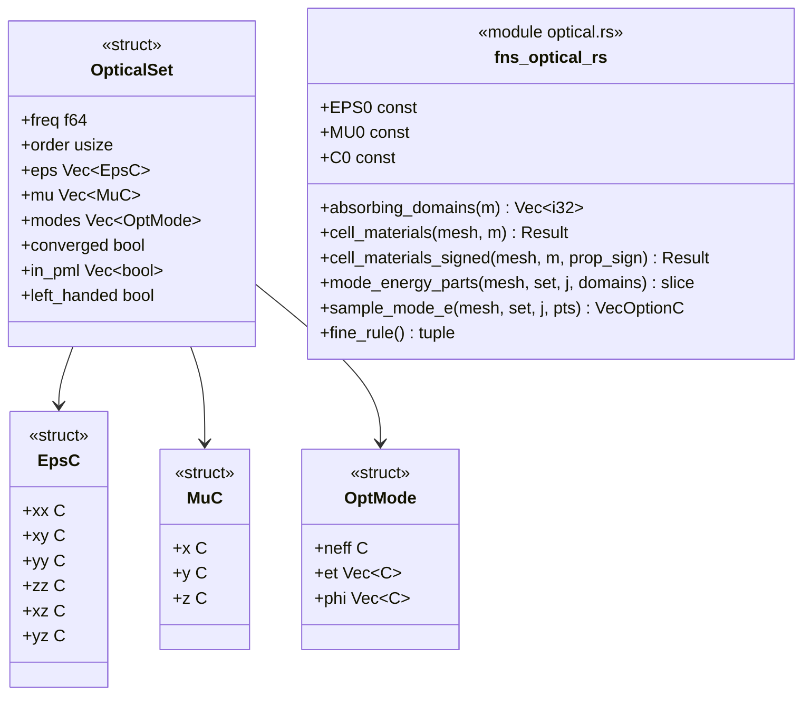

# Optical mode sets: code

C4 level 4 (code) of the component **Optical mode sets** (`femcore.optical`) in the container **femcore** (crate `femcore`). [Component view of the container](../../3-components/femcore.md) · [All code pages](../README.md)

> Optical modes of a 2D cross-section as a field-evaluable set with the material data to evaluate them.

**Decisions:** [ADR 21](../../../adr/0021-polarization-analysis-from-complex-fields.md), [ADR 9](../../../adr/0009-kernels-are-three-stages.md), [ADR 45](../../../adr/0045-ems-moves-into-nyx-ems.md)  
**Size:** 1 file, 253 lines.

## Files

| File | Lines | What it says about itself |
|---|---:|---|
| `crates/femcore/src/optical.rs` | 253 |  |

## What it uses

| Target | Modules | Items |
|---|---|---|
| [Finite-element basics](./fem.md) | edge, fem, pml, props | CellData, cell_data, edge_basis, stretch, tri_g |
| [Matrices and vectors](./lacore.md) | linalg::csr, linalg::csr::assembly | C, c |
| [Mesh](./mesh.md) | mesh | SimplexMesh |
| [Frame and sections](./section.md) | section | PROP_SIGN, local_tensor_signed |

## Used by

| Component | Modules | Items |
|---|---|---|
| [analysis: Field samples](../analysis/samples.md) | optical | fine_rule |
| [ems: Axisymmetric kernel](../ems/axisym.md) | optical | EPS0, MU0, fine_rule |
| [ems: Mode kernel](../ems/modes.md) | optical | C0 |
| [ems: Complex-mode kernel](../ems/modescx.md) | optical | EpsC, MuC, cell_materials |
| [ems: Optical mode sets](../ems/optical.md) | optical | OptMode, OpticalSet, cell_materials_signed |

## Class diagram

Public types with their public fields (or variants) and methods, free functions per file as a `module` box; arrows are field types and `impl Trait`. Capped at 36 types and a few members each; the table below is complete.

## Public items

| Kind | Item | File:line | Signature or summary |
|---|---|---|---|
| const | `EPS0` | `optical.rs:18` | `f64` |
| const | `MU0` | `optical.rs:19` | `f64` |
| const | `C0` | `optical.rs:21` | `f64` —  Speed of light in vacuum (m/s). |
| struct | `EpsC` | `optical.rs:24` | fields: `xx`, `xy`, `yy`, `zz`, `xz`, `yz` |
| struct | `MuC` | `optical.rs:35` | fields: `x`, `y`, `z` |
| fn | `absorbing_domains` | `optical.rs:43` | `pub fn absorbing_domains(m: &Materials) -> Vec<i32>` —  Domain labels of all active perfectly matched layers (`x`, `y`, or `z` != `PmlDir::Off`). |
| fn | `cell_materials` | `optical.rs:53` | `pub fn cell_materials(mesh: &SimplexMesh, m: &Materials) -> Result<(Vec<EpsC>, Vec<MuC>), String>` —  Complex material tensors of every cell including the PML stretching, in the local axes of the mode solvers (`section::local_tensor`). |
| fn | `cell_materials_signed` | `optical.rs:58` | `pub fn cell_materials_signed(mesh: &SimplexMesh, m: &Materials, prop_sign: f64) -> Result<(Vec<EpsC>, Vec<MuC>), String>` —  As `cell_materials` for a propagation axis along `prop_sign * y` (only the reciprocity test uses a sign other than `PROP_SIGN`). |
| struct | `OptMode` | `optical.rs:118` | fields: `neff`, `et`, `phi` —  One guided mode: effective index and the edge-element / Lagrange coefficients. |
| struct | `OpticalSet` | `optical.rs:126` | fields: `freq`, `order`, `eps`, `mu`, `modes`, `converged`, `in_pml`, `left_handed` —  The optical modes of a cross-section with the material data needed to evaluate their fields. |
| fn | `mode_energy_parts` | `optical.rs:187` | `pub fn mode_energy_parts(mesh: &SimplexMesh, set: &OpticalSet, j: usize, domains: Option<&BTreeSet<i32>>) -> [f64` —  The integrals of `\|Ex\|^2`, `\|Ey\|^2` and `\|Ez\|^2` of optical mode `j` over the cells outside the PML (restricted to `domains` if given). |
| fn | `sample_mode_e` | `optical.rs:206` | `pub fn sample_mode_e(mesh: &SimplexMesh, set: &OpticalSet, j: usize, pts: &[[f64; 2]]) -> Vec<Option<[C` —  The electric field `(Ex, Ey, Ez)` of optical mode `j` at the points `pts` (x, y) of the cross-section; `None` outside the mesh. |
| fn | `fine_rule` | `optical.rs:236` | `pub fn fine_rule() -> (Vec<[f64` —  The 4 x 6-point rule on the four sub-triangles of a triangle (24 points, degree 4 on each part). |
