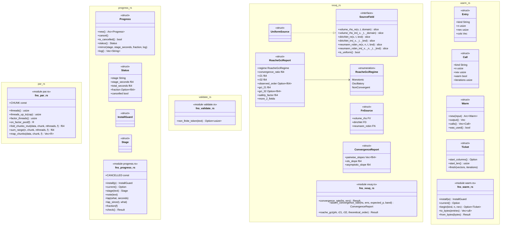

# Runtime services: code

C4 level 4 (code) of the component **Runtime services** (`femcore.runtime`) in the container **femcore** (crate `femcore`). [Component view of the container](../../3-components/femcore.md) · [All code pages](../README.md)

> The unified fixed-chunk worker pool (`par.rs`), stage log and cancel, the warm-start context of the shift-and-invert eigensolvers (ADR 96), refusal of NaN and infinity, and shared VVUQ MMS/convergence/GCI helpers.

**Decisions:** [ADR 9](../../../adr/0009-kernels-are-three-stages.md), [ADR 11](../../../adr/0011-determinism-by-fixed-chunks.md), [ADR 96](../../../adr/0096-a-sweep-may-start-each-point-from-the-modes-of-the-one-before.md), [ADR 132](../../../adr/0132-vvuq-asme-six-pillar-code-verification.md), [ADR 133](../../../adr/0133-vvuq-error-budgets-gci-provenance-and-uq.md)  
**Size:** 6 files, 1275 lines.

## Files

| File | Lines | What it says about itself |
|---|---:|---|
| `crates/femcore/src/lib.rs` | 55 |  |
| `crates/femcore/src/par.rs` | 168 |  |
| `crates/femcore/src/progress.rs` | 297 |  |
| `crates/femcore/src/validate.rs` | 48 |  |
| `crates/femcore/src/vvuq.rs` | 417 |  |
| `crates/femcore/src/warm.rs` | 290 |  |

## What it uses

| Target | Modules | Items |
|---|---|---|
| [Matrices and vectors](./lacore.md) | linalg::par, linalg::scalar | C64, Scalar, chunk_map, for_chunks_mut, for_each_mut, worth_parallel |

## Used by

| Component | Modules | Items |
|---|---|---|
| [analysis: cQED quantization and TLS participation](../analysis/cqed.md) | par | map_chunks |
| [analysis: Mode figures](../analysis/figures.md) | par | map_chunks |
| [dfs: Physics adapter](../dfs/adapter.md) | progress | Progress |
| [dfs: Shared helpers](../dfs/common.md) | progress, vvuq | SourceField, check |
| [dfs: Electrostatics kernel](../dfs/electro.md) | par, vvuq | SourceField, UniformSource, threads |
| [dfs: Heat kernel](../dfs/heat.md) | vvuq | SourceField, UniformSource |
| [dfs: Magnetostatics kernel](../dfs/magneto.md) | vvuq | SourceField, UniformSource |
| [dfs: Typed problem](../dfs/problem.md) | validate | non_finite_token |
| [ems: Physics adapter](../ems/adapter.md) | progress | Progress |
| [ems: 3D cavity kernel](../ems/cavity.md) | par, progress, vvuq | SourceField, UniformSource, lap, threads |
| [ems: Driven frequency-domain and PROM](../ems/driven.md) | par, progress | check, map_chunks |
| [ems: Native mixed-cell EM](../ems/mixed.md) | progress | note |
| [ems: Mode kernel](../ems/modes.md) | progress | note |
| [ems: Complex-mode kernel](../ems/modescx.md) | progress | check, note |
| [ems: Typed problem](../ems/problem.md) | validate | non_finite_token |
| [engine: Commands](../engine/commands.md) | par, progress | factor_threads, install, note, stage, threads |
| [engine: Job runner and queue](../engine/jobs.md) | progress, vvuq, warm | Call, Progress, RoacheGciRegime, RoacheGciReport, Warm, from_bytes, install, roache_gci +2 |
| [engine: Meshing seam](../engine/meshing.md) | progress | CANCELLED, Progress, install, stage |
| [engine: Registry and facade](../engine/registry.md) | progress | Progress |
| [engine: Results files](../engine/resultsIO.md) | par, progress | Progress, factor_threads, install, note, stage, threads |
| [Adaptation drivers](./adaptdrive.md) | progress | check |
| [Error estimators](./estimators.md) | par | map_chunks, threads |
| [Finite-element basics](./fem.md) | par, progress | check, lap_since, stage, threads, threads_up_to |
| [Matrices and vectors](./lacore.md) | par | threads |
| [Direct solvers](./ladirect.md) | par | factor_threads |
| [Linear algebra driver](./ladriver.md) | par, progress, warm | begin, map_chunks, on_factor_pool, threads |
| [Eigensolvers](./laeigen.md) | par, progress, warm | begin, check, threads |
| [Time, nonlinear, sweeps](./laother.md) | par, progress | check, map_chunks, on_factor_pool |
| [Preconditioners](./laprecond.md) | par, progress | check, lap_since, map_chunks, note, stage, threads |
| [Mesh](./mesh.md) | par | threads |
| [Meshing facade](./meshing.md) | progress | note |
| [3D meshing](./meshing3d.md) | par, progress | check, lap, map_chunks, threads |
| [Metric fields](./metric.md) | par |  |
| [physics: Physics trait and registry](../physics/trait.md) | progress | Progress |
| [sms: Physics adapter](../sms/adapter.md) | progress | Progress |
| [sms: Piezoelectric kernel](../sms/piezo.md) | par, progress | CANCELLED, check, map_chunks, threads |
| [sms: Absorbing-layer kernel](../sms/pml.md) | par | threads |
| [sms: Typed problem](../sms/problem.md) | validate | non_finite_token |
| [sms: Solid kernel](../sms/solid.md) | par, progress, vvuq | SourceField, UniformSource, check, lap_since, threads |

## Class diagram

Public types with their public fields (or variants) and methods, free functions per file as a `module` box; arrows are field types and `impl Trait`. Capped at 36 types and a few members each; the table below is complete.

## Public items

| Kind | Item | File:line | Signature or summary |
|---|---|---|---|
| fn | `threads` | `par.rs:23` | `pub fn threads() -> usize` —  Number of worker threads of the shared pool (and the number of pieces large loops are split into). |
| fn | `threads_up_to` | `par.rs:35` | `pub fn threads_up_to(cap: usize) -> usize` —  `threads()` capped at `cap` (some kernels stop scaling earlier). |
| fn | `factor_threads` | `par.rs:44` | `pub fn factor_threads() -> usize` —  Threads used for sparse factorisations (supernodal Cholesky/LU of faer). They scale only to about 8 threads and |
| fn | `on_factor_pool` | `par.rs:50` | `pub fn on_factor_pool<R: Send>(f: impl FnOnce() -> R + Send) -> R` —  Runs `f` (a sparse factorisation) on the factorisation pool: faer takes the number of threads of the pool it is called in. |
| const | `CHUNK` | `par.rs:64` | `usize` —  Chunk length used by default. |
| fn | `fold_chunks_mut` | `par.rs:69` | `pub fn fold_chunks_mut<T: Send, F>(data: &mut [T], chunk: usize, nthreads: usize, f: F) -> f64` —  `f` must only touch its own chunk. With `nthreads == 1`, or fewer than two chunks, everything |
| fn | `sum_range` | `par.rs:102` | `pub fn sum_range<F>(n: usize, chunk: usize, nthreads: usize, f: F) -> f64` —  Sum of `f(i)` over `0..n`, evaluated in fixed chunks and combined in chunk order. |
| fn | `map_chunks` | `par.rs:119` | `pub fn map_chunks<T: Sync, R: Send, F: Fn(&[T]) -> R + Sync>(data: &[T], chunk: usize, f: F) -> Vec<R>` —  Evaluates `f` on fixed `chunk`-sized slices of `data` on the shared worker pool, returning results in chunk order. |
| const | `CANCELLED` | `progress.rs:30` | `&str` —  The error text of a cancelled solve. |
| struct | `Progress` | `progress.rs:44` |  Shared state of one job. Create with `Progress::new()`. |
| struct | `Status` | `progress.rs:53` | fields: `stage`, `stage_seconds`, `total_seconds`, `fraction`, `cancelled` —  A snapshot for display. |
| fn | `install` | `progress.rs:143` | `pub fn install(p: &Arc<Progress>) -> InstallGuard` —  Makes `p` the progress of the current thread until the returned guard is dropped. |
| struct | `InstallGuard` | `progress.rs:148` |  |
| fn | `current` | `progress.rs:160` | `pub fn current() -> Option<Arc<Progress>>` —  The progress installed on this thread, if any. |
| struct | `Stage` | `progress.rs:171` |  A running stage: its line stands in the log from the start ("... running") and gets its duration when the guard is |
| fn | `stage` | `progress.rs:180` | `pub fn stage(text: impl Into<String>) -> Stage` —  Starts a stage with a plain-language description, e.g. `stage(format!("assembling the stiffness matrix: {n} unknowns"))`. |
| fn | `note` | `progress.rs:220` | `pub fn note(text: impl Into<String>)` —  Adds a line to the stage log (and to the display), e.g. `"iteration 30: residual 3.1e-6"`. |
| fn | `lap` | `progress.rs:232` | `pub fn lap(what: &str, seconds: f64)` —  Timing of a finished piece of work: `what` (the label) took `seconds`. Labels that start with four spaces are |
| fn | `lap_since` | `progress.rs:243` | `pub fn lap_since(t: &mut std::time::Instant, what: &str)` —  `lap` for the time since `t`, then restarts `t` (the helper the kernels use between their stages). |
| fn | `fraction` | `progress.rs:249` | `pub fn fraction(f: f64)` —  Fraction (0..1) of the current stage that is done, for a progress bar. |
| fn | `check` | `progress.rs:256` | `pub fn check() -> Result<(), String>` —  `Err("cancelled")` when the watcher asked to stop; call it once per iteration of a long loop. |
| fn | `Progress::new` | `progress.rs:65` | `pub fn new() -> Arc<Progress>` |
| fn | `Progress::cancel` | `progress.rs:70` | `pub fn cancel(&self)` —  Asks the solver to stop at its next check. |
| fn | `Progress::is_cancelled` | `progress.rs:74` | `pub fn is_cancelled(&self) -> bool` |
| fn | `Progress::status` | `progress.rs:78` | `pub fn status(&self) -> Status` |
| fn | `Progress::mirror` | `progress.rs:87` | `pub fn mirror(&self, stage: &str, stage_seconds: f64, fraction: Option<f64>, log: Option<Vec<String>>)` —  Shows the state of work done in another process (a worker, productivity plan P4): the stage it is in and for how long, the fraction |
| fn | `Progress::log` | `progress.rs:102` | `pub fn log(&self) -> Vec<String>` —  The finished-stage lines and notes so far. |
| fn | `non_finite_token` | `validate.rs:13` | `pub fn non_finite_token(text: &str) -> Option<usize>` —  Byte position of the first bare `NaN` / `inf` token outside quotes in a `Debug` string. |
| trait | `SourceField` | `vvuq.rs:11` | methods: `volume_rhs_re`, `volume_rhs_im`, `dirichlet_re`, `dirichlet_im`, `neumann_robin_re`, `neumann_robin_im`, `is_uniform` —  Zero-sized default compiles away to zero overhead in production builds; |
| struct | `UniformSource` | `vvuq.rs:47` |  Production zero-sized source (all MMS callbacks compile away). |
| struct | `FnSource` | `vvuq.rs:72` | fields: `volume_rhs`, `dirichlet`, `neumann_robin` —  Closure-backed [`SourceField`] adapter for MMS integration tests. |
| struct | `ConvergenceReport` | `vvuq.rs:99` | fields: `pairwise_slopes`, `ols_slope`, `asymptotic_slope` —  Observed convergence summary across `>= 3` grids or step sizes. |
| fn | `convergence_rate` | `vvuq.rs:110` | `pub fn convergence_rate(hs: &[f64], errs: &[f64]) -> Result<ConvergenceReport, String>` —  Computes pairwise and OLS log-log convergence rates over strictly decreasing positive |
| fn | `assert_convergence_rate` | `vvuq.rs:174` | `pub fn assert_convergence_rate( hs: &[f64], errs: &[f64], expected_p: f64, band: (f64, f64), ) -> ConvergenceReport` —  Asserts strictly decreasing positive `hs`, finite positive `errs`, and that both |
| enum | `RoacheGciRegime` | `vvuq.rs:204` | variants: `Monotonic`, `Oscillatory`, `NonConvergent` —  Convergence regime classified by Roache's 3-grid Grid Convergence Index (VVUQ Layer 3, §5.3). |
| struct | `RoacheGciReport` | `vvuq.rs:215` | fields: `regime`, `convergence_ratio`, `r21`, `r32`, `observed_order`, `gci_21`, `gci_32`, `safety_factor`, `in_asymptotic_range`, `extrapolated_value` —  Result of a 3-grid Roache Grid Convergence Index calculation on grids `h1 < h2 < h3`. |
| fn | `roache_gci` | `vvuq.rs:240` | `pub fn roache_gci( phi: [f64; 3], r21: f64, r32: f64, theoretical_order: f64, ) -> Result<RoacheGciReport, String>` —  Computes Roache's 3-grid GCI for scalar QoIs `[phi1, phi2, phi3]` ordered fine-to-coarse (`h1 < h2 < h3`) |
| struct | `Entry` | `warm.rs:30` | fields: `kind`, `n`, `nev`, `cols` —  The modes one eigensolve found: its kind, the number of unknowns, the number of modes asked for, and the vectors (columns). |
| struct | `Call` | `warm.rs:39` | fields: `kind`, `n`, `nev`, `warm`, `iterations` —  What one eigensolve did with a warm context, for the run's record. |
| struct | `Warm` | `warm.rs:50` |  The warm context of one solve: the entries of the previous solve (input), the ones this solve leaves (output) and what each call did. |
| fn | `install` | `warm.rs:84` | `pub fn install(w: &Arc<Warm>) -> InstallGuard` —  Makes `w` the warm context of the current thread until the guard is dropped. |
| struct | `InstallGuard` | `warm.rs:89` |  |
| fn | `current` | `warm.rs:101` | `pub fn current() -> Option<Arc<Warm>>` —  The context installed on this thread, if any. |
| struct | `Ticket` | `warm.rs:106` |  One eigensolve's share of the context: what to start from and where to leave its modes. |
| fn | `begin` | `warm.rs:116` | `pub fn begin(kind: &'static str, n: usize, nev: usize) -> Option<Ticket>` —  Takes the next place of the installed context for an eigensolve of `kind` on `n` unknowns asking for `nev` modes; `None` without a context. |
| fn | `to_bytes` | `warm.rs:161` | `pub fn to_bytes(entries: &[Option<Entry>]) -> Vec<u8>` —  The entries as bytes (little endian), for a worker process: a count, then for each a presence byte and the kind, sizes and numbers. |
| fn | `from_bytes` | `warm.rs:188` | `pub fn from_bytes(bytes: &[u8]) -> Result<Vec<Option<Entry>>, String>` —  Reads what `to_bytes` wrote; an error says what is wrong (a file of another version, a truncated one). |
| fn | `Warm::new` | `warm.rs:59` | `pub fn new(input: Vec<Option<Entry>>) -> Arc<Warm>` —  A context whose solve starts from `input` (empty: a cold first point that only records). |
| fn | `Warm::output` | `warm.rs:64` | `pub fn output(&self) -> Vec<Option<Entry>>` —  The entries this solve left, in the order of its eigensolves (a solve that failed or was not made leaves a gap). |
| fn | `Warm::calls` | `warm.rs:69` | `pub fn calls(&self) -> Vec<Call>` —  What every eigensolve did, in order. |
| fn | `Warm::was_used` | `warm.rs:74` | `pub fn was_used(&self) -> bool` —  True when at least one eigensolve of this solve started from the previous solve's modes. |
| fn | `Ticket::start_columns` | `warm.rs:130` | `pub fn start_columns<T: Scalar>(&self) -> Option<Vec<T>>` —  The columns of the previous solve's modes, one after the other (`k * n` numbers), or `None` for a cold start. |
| fn | `Ticket::start_len` | `warm.rs:136` | `pub fn start_len(&self) -> usize` —  How many columns the start has (0 for a cold start). |
| fn | `Ticket::finish` | `warm.rs:141` | `pub fn finish<'a, T: Scalar + 'a>(self, vectors: impl Iterator<Item = &'a [T]>, iterations: usize)` —  Records the modes this eigensolve found (the first `nev` of them) and how it went. |

Trait implementations in this component: `InstallGuard: Drop`, `Stage: Drop`, `UniformSource: SourceField`, `InstallGuard: Drop`
