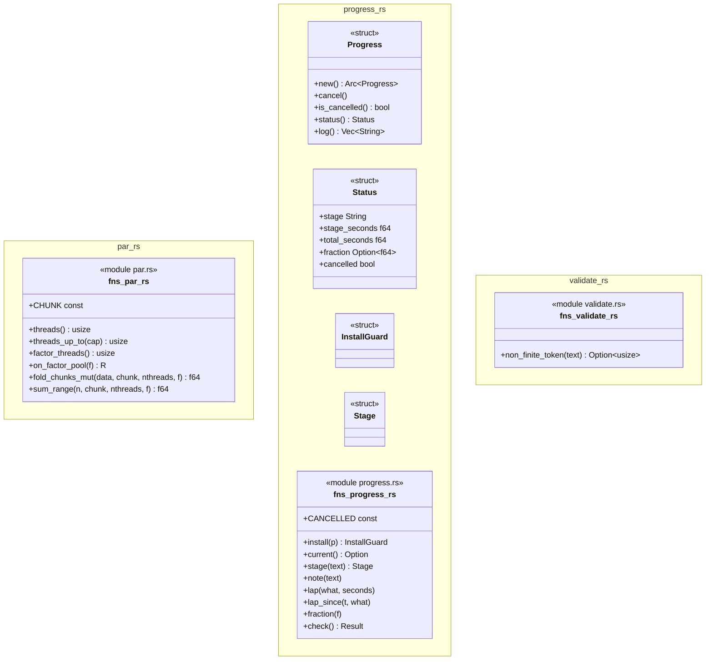

# Runtime services: code

C4 level 4 (code) of the component **Runtime services** (`femcore.runtime`) in the container **femcore** (crate `femcore`). [Component view of the container](../../3-components/femcore.md) · [All code pages](../README.md)

> The shared worker pool, stage log and cancel, and refusal of NaN and infinity.

**Decisions:** [ADR 9](../../../adr/0009-kernels-are-three-stages.md), [ADR 11](../../../adr/0011-determinism-by-fixed-chunks.md)  
**Size:** 4 files, 519 lines.

## Files

| File | Lines | What it says about itself |
|---|---:|---|
| `crates/femcore/src/lib.rs` | 45 | femcore: finite elements for the nyx application, in pure Rust. docs/HOW_IT_WORKS.md explains the whole chain in plain language; this is the map of the modules. |
| `crates/femcore/src/par.rs` | 150 | The one shared pool of worker threads used by every parallel loop of the solvers. |
| `crates/femcore/src/progress.rs` | 278 | What a running solve is doing, and a way to stop it. |
| `crates/femcore/src/validate.rs` | 46 |  |

## What it uses

Nothing outside the component (the standard library and external crates are not listed).

## Used by

| Component | Modules | Items |
|---|---|---|
| [dfs: Physics adapter](../dfs/adapter.md) | progress | Progress |
| [ems: Physics adapter](../ems/adapter.md) | progress | Progress |
| [ems: 3D cavity kernel](../ems/cavity.md) | par, progress | lap, threads_up_to |
| [ems: Mode kernel](../ems/modes.md) | progress | note |
| [ems: Complex-mode kernel](../ems/modescx.md) | progress | check, note |
| [engine: Commands](../engine/commands.md) | progress | install, stage |
| [engine: Job runner](../engine/jobs.md) | progress | Progress, install, stage |
| [engine: Meshing seam](../engine/meshing.md) | progress | CANCELLED, stage |
| [engine: Registry and facade](../engine/registry.md) | progress | Progress |
| [engine: Results files](../engine/resultsIO.md) | progress | Progress, install, stage |
| [Adaptation drivers](./adaptdrive.md) | progress | check |
| [Finite-element basics](./fem.md) | par, progress | check, lap_since, stage, threads, threads_up_to |
| [Matrices and vectors](./lacore.md) | par | threads |
| [Linear algebra driver](./ladriver.md) | par, progress | on_factor_pool, threads |
| [Eigensolvers](./laeigen.md) | par, progress | check, threads |
| [Preconditioners](./laprecond.md) | par, progress | check, lap_since, note, stage, threads |
| [Mesh](./mesh.md) | par | threads |
| [3D meshing](./meshing3d.md) | par, progress | check, lap, threads |
| [Metric fields](./metric.md) | par |  |
| [physics: Physics trait and registry](../physics/trait.md) | progress | Progress |
| [sms: Physics adapter](../sms/adapter.md) | progress | Progress |
| [sms: Typed problem](../sms/problem.md) | validate | non_finite_token |
| [sms: Solid kernel](../sms/solid.md) | par, progress | lap_since, threads_up_to |

## Class diagram

Public types with their public fields (or variants) and methods, free functions per file as a `module` box; arrows are field types and `impl Trait`. Capped at 36 types and a few members each; the table below is complete.

## Public items

| Kind | Item | File:line | Signature or summary |
|---|---|---|---|
| fn | `threads` | `par.rs:21` | `pub fn threads() -> usize` —  Number of worker threads of the shared pool (and the number of pieces large loops are split into). |
| fn | `threads_up_to` | `par.rs:33` | `pub fn threads_up_to(cap: usize) -> usize` —  `threads()` capped at `cap` (some kernels stop scaling earlier). |
| fn | `factor_threads` | `par.rs:42` | `pub fn factor_threads() -> usize` —  Threads used for sparse factorisations (supernodal Cholesky/LU of faer). They scale only to about 8 threads and |
| fn | `on_factor_pool` | `par.rs:48` | `pub fn on_factor_pool<R: Send>(f: impl FnOnce() -> R + Send) -> R` —  Runs `f` (a sparse factorisation) on the factorisation pool: faer takes the number of threads of the pool it is called in. |
| const | `CHUNK` | `par.rs:62` | `usize` —  Chunk length used by default. |
| fn | `fold_chunks_mut` | `par.rs:67` | `pub fn fold_chunks_mut<T: Send, F>(data: &mut [T], chunk: usize, nthreads: usize, f: F) -> f64` —  `f` must only touch its own chunk. With `nthreads == 1`, or fewer than two chunks, everything |
| fn | `sum_range` | `par.rs:100` | `pub fn sum_range<F>(n: usize, chunk: usize, nthreads: usize, f: F) -> f64` —  Sum of `f(i)` over `0..n`, evaluated in fixed chunks and combined in chunk order. |
| const | `CANCELLED` | `progress.rs:28` | `&str` —  The error text of a cancelled solve. |
| struct | `Progress` | `progress.rs:42` |  Shared state of one job. Create with `Progress::new()`. |
| struct | `Status` | `progress.rs:51` | fields: `stage`, `stage_seconds`, `total_seconds`, `fraction`, `cancelled` —  A snapshot for display. |
| fn | `install` | `progress.rs:124` | `pub fn install(p: &Arc<Progress>) -> InstallGuard` —  Makes `p` the progress of the current thread until the returned guard is dropped. |
| struct | `InstallGuard` | `progress.rs:129` |  |
| fn | `current` | `progress.rs:141` | `pub fn current() -> Option<Arc<Progress>>` —  The progress installed on this thread, if any. |
| struct | `Stage` | `progress.rs:152` |  A running stage: its line stands in the log from the start ("... running") and gets its duration when the guard is |
| fn | `stage` | `progress.rs:161` | `pub fn stage(text: impl Into<String>) -> Stage` —  Starts a stage with a plain-language description, e.g. `stage(format!("assembling the stiffness matrix: {n} unknowns"))`. |
| fn | `note` | `progress.rs:201` | `pub fn note(text: impl Into<String>)` —  Adds a line to the stage log (and to the display), e.g. `"iteration 30: residual 3.1e-6"`. |
| fn | `lap` | `progress.rs:213` | `pub fn lap(what: &str, seconds: f64)` —  Timing of a finished piece of work: `what` (the label) took `seconds`. Labels that start with four spaces are |
| fn | `lap_since` | `progress.rs:224` | `pub fn lap_since(t: &mut std::time::Instant, what: &str)` —  `lap` for the time since `t`, then restarts `t` (the helper the kernels use between their stages). |
| fn | `fraction` | `progress.rs:230` | `pub fn fraction(f: f64)` —  Fraction (0..1) of the current stage that is done, for a progress bar. |
| fn | `check` | `progress.rs:237` | `pub fn check() -> Result<(), String>` —  `Err("cancelled")` when the watcher asked to stop; call it once per iteration of a long loop. |
| fn | `Progress::new` | `progress.rs:63` | `pub fn new() -> Arc<Progress>` |
| fn | `Progress::cancel` | `progress.rs:68` | `pub fn cancel(&self)` —  Asks the solver to stop at its next check. |
| fn | `Progress::is_cancelled` | `progress.rs:72` | `pub fn is_cancelled(&self) -> bool` |
| fn | `Progress::status` | `progress.rs:76` | `pub fn status(&self) -> Status` |
| fn | `Progress::log` | `progress.rs:83` | `pub fn log(&self) -> Vec<String>` —  The finished-stage lines and notes so far. |
| fn | `non_finite_token` | `validate.rs:11` | `pub fn non_finite_token(text: &str) -> Option<usize>` —  Byte position of the first bare `NaN` / `inf` token outside quotes in a `Debug` string. |

Trait implementations in this component: `InstallGuard: Drop`, `Stage: Drop`
