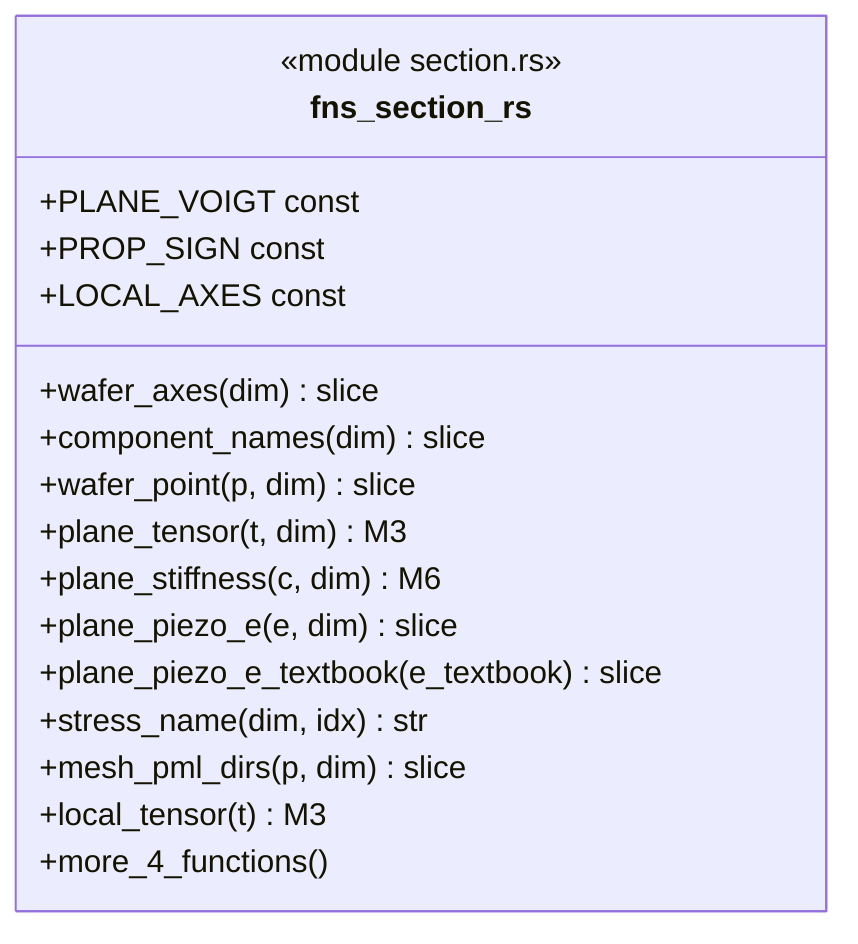

# Frame and sections: code

C4 level 4 (code) of the component **Frame and sections** (`femcore.section`) in the container **femcore** (crate `femcore`). [Component view of the container](../../3-components/femcore.md) · [All code pages](../README.md)

> The one place that knows the wafer axes (x lateral, z normal, waves along +y).

**Decisions:** [ADR 1](../../../adr/0001-one-public-wafer-frame.md)  
**Size:** 1 file, 284 lines.

## Files

| File | Lines | What it says about itself |
|---|---:|---|
| `crates/femcore/src/section.rs` | 284 |  |

## What it uses

| Target | Modules | Items |
|---|---|---|
| [Finite-element basics](./fem.md) | props |  |
| [Material specification](./material.md) | material | M3, M6 |
| [Mesh](./mesh.md) | mesh | SimplexMesh |

## Used by

| Component | Modules | Items |
|---|---|---|
| [dfs: Shared helpers](../dfs/common.md) | section | plane_tensor, wafer_point |
| [dfs: Electrostatics kernel](../dfs/electro.md) | section | component_names |
| [dfs: Heat kernel](../dfs/heat.md) | section | component_names |
| [dfs: Magnetostatics kernel](../dfs/magneto.md) | section | component_names |
| [ems: Axisymmetric kernel](../ems/axisym.md) | section | plane_tensor |
| [ems: 3D cavity kernel](../ems/cavity.md) | section | axes_of_3d_periodic |
| [ems: Driven frequency-domain and PROM](../ems/driven.md) | section | axes_of_3d_periodic |
| [ems: Native mixed-cell EM](../ems/mixed.md) | section | wafer_point |
| [ems: Mode kernel](../ems/modes.md) | section | local_component, local_tensor |
| [ems: Complex-mode kernel](../ems/modescx.md) | section | local_component, local_tensor |
| [ems: Optical mode sets](../ems/optical.md) | section | PROP_SIGN, is_left_handed, local_tensor_signed |
| [engine: Commands](../engine/commands.md) | section | wafer_point |
| [Expressions](./expr.md) | section | wafer_point |
| [Finite-element basics](./fem.md) | section | mesh_pml_dirs, wafer_point |
| [Optical mode sets](./optical.md) | section | PROP_SIGN, local_tensor_signed |
| [sms: Cross-section study kernel](../sms/crosssection.md) | section | plane_stiffness |
| [sms: Low-reflecting boundary](../sms/lrb.md) | section | plane_stiffness |
| [sms: Piezoelectric kernel](../sms/piezo.md) | section | component_names, plane_piezo_e, plane_stiffness, plane_tensor, stress_name, wafer_axes, wafer_point |
| [sms: Absorbing-layer kernel](../sms/pml.md) | section | plane_stiffness, wafer_axes, wafer_point |
| [sms: Solid kernel](../sms/solid.md) | section | component_names, plane_stiffness, plane_tensor, stress_name, wafer_axes, wafer_point |

## Class diagram

Public types with their public fields (or variants) and methods, free functions per file as a `module` box; arrows are field types and `impl Trait`. Capped at 36 types and a few members each; the table below is complete.

## Public items

| Kind | Item | File:line | Signature or summary |
|---|---|---|---|
| fn | `wafer_axes` | `section.rs:27` | `pub fn wafer_axes(dim: usize) -> &'static [usize]` —  Wafer axis (0 = x, 1 = y, 2 = z) of each axis of a mesh of dimension `dim`. |
| fn | `component_names` | `section.rs:36` | `pub fn component_names(dim: usize) -> &'static [&'static str]` —  Wafer name of each component of a vector field on a mesh of dimension `dim`: `["x", "z"]` on a cross-section. |
| fn | `wafer_point` | `section.rs:45` | `pub fn wafer_point(p: &[f64], dim: usize) -> [f64` —  The wafer coordinates `(x, y, z)` of a mesh point (`y = 0` on a cross-section). |
| fn | `plane_tensor` | `section.rs:54` | `pub fn plane_tensor(t: &M3, dim: usize) -> M3` —  A wafer tensor in the axes (x, z, y) of a cross-section (the identity on a 3D mesh), see the module documentation. |
| const | `PLANE_VOIGT` | `section.rs:64` | `[usize` —  For each entry of the Voigt order of the axes (x, z, y) of a cross-section, (xx, zz, yy, xz, zy, xy), the entry of the wafer Voigt order |
| fn | `plane_stiffness` | `section.rs:68` | `pub fn plane_stiffness(c: &M6, dim: usize) -> M6` —  A wafer stiffness (Voigt order xx, yy, zz, xy, yz, xz, engineering shear) in the Voigt order of the axes (x, z, y) of a cross-section; |
| fn | `plane_piezo_e` | `section.rs:83` | `pub fn plane_piezo_e(e: &[[f64; 6]; 3], dim: usize) -> [[f64` —  A wafer piezoelectric stress-charge matrix `e_iJ` (solver Voigt columns `xx, yy, zz, xy, yz, xz`) in the axes `(x, z, y)` and |
| fn | `plane_piezo_e_textbook` | `section.rs:100` | `pub fn plane_piezo_e_textbook(e_textbook: &[[f64; 6]; 3]) -> [[f64` —  A piezoelectric stress-charge matrix `e_iJ` in **textbook Voigt order** `(xx, yy, zz, yz, xz, xy)` permuted to the |
| fn | `stress_name` | `section.rs:113` | `pub fn stress_name(dim: usize, idx: usize) -> &'static str` —  Wafer name of stress component `idx` of the solid kernels (their Voigt order: wafer order in 3D, `PLANE_VOIGT` on a cross-section). |
| fn | `mesh_pml_dirs` | `section.rs:119` | `pub fn mesh_pml_dirs(p: &Pml, dim: usize) -> [PmlDir` —  The directions of a perfectly matched layer along the axes of a mesh: (x, z) on a cross-section, (x, y, z) in 3D. |
| const | `PROP_SIGN` | `section.rs:128` | `f64` —  Sign of the propagation axis of the mode solvers against wafer y: everything propagates along `+y`. |
| const | `LOCAL_AXES` | `section.rs:131` | `[(usize, f64)` —  The wafer axis behind each axis of the local frame (lateral, normal, propagation) and its sign. |
| fn | `local_tensor` | `section.rs:134` | `pub fn local_tensor(t: &M3) -> M3` —  A wafer tensor in the local axes (lateral, normal, propagation) of the mode solvers. |
| fn | `local_tensor_signed` | `section.rs:139` | `pub fn local_tensor_signed(t: &M3, prop_sign: f64) -> M3` —  As `local_tensor` for a propagation axis along `prop_sign * y` (the reciprocity test runs a guide both ways). |
| fn | `is_left_handed` | `section.rs:144` | `pub fn is_left_handed(prop_sign: f64) -> bool` —  Whether the local triple (lateral, normal, propagation) of a mode solver with propagation `prop_sign * y` is left-handed. |
| fn | `local_component` | `section.rs:159` | `pub fn local_component(i: usize) -> (&'static str, f64)` —  Wafer name and sign of a component of a field written in the local axes: `0` lateral -&gt; `x`, `1` normal -&gt; `z`, `2` propagation -&gt; `y`. |
| fn | `axes_of_3d_periodic` | `section.rs:168` | `pub fn axes_of_3d_periodic(periodic: &[Periodic], mesh: &SimplexMesh) -> ([usize` —  The three axes of a 3D problem that play the roles of the cross-section: `(lateral, normal, propagation)` as indices of x, y, z, |
