# Structured absorbing layers: code

C4 level 4 (code) of the component **Structured absorbing layers** (`femcore.structpml`) in the container **femcore** (crate `femcore`). [Component view of the container](../../3-components/femcore.md) · [All code pages](../README.md)

> Structured PML around a box-shaped, cylindrical, spherical, or geom-model mesh: prisms, hexahedra, quads, labels.

**Decisions:** [ADR 7](../../../adr/0007-metric-adaptation-and-structured-pml.md), [ADR 52](../../../adr/0052-structured-absorbing-layers-in-3d.md), [ADR 5](../../../adr/0005-native-mixed-cell-mesh.md), [ADR 128](../../../adr/0128-structured-curvilinear-pml-and-open-boundaries.md)  
**Size:** 6 files, 4918 lines.

## Files

| File | Lines | What it says about itself |
|---|---:|---|
| `crates/femcore/src/meshing/pml3.rs` | 69 | Structured absorbing layers around a tetrahedral mesh in a box: prisms on the faces, hexahedra on the edges and corners, the labels and `Pml` entries the solvers read, and the simplex mesh they run on today. |
| `crates/femcore/src/meshing/pml_box.rs` | 1130 | Structured PML generator around a box-shaped physical mesh. |
| `crates/femcore/src/meshing/pml_cyl.rs` | 1318 |  |
| `crates/femcore/src/meshing/pml_geom.rs` | 776 |  |
| `crates/femcore/src/meshing/pml_geom3.rs` | 955 |  |
| `crates/femcore/src/meshing/pml_sphere.rs` | 670 |  |

## What it uses

| Target | Modules | Items |
|---|---|---|
| [container `geom` (geom)](../../3-components/geom.md) | eval, model | Evaluated, PmlCoordKind, PmlGrowMode, PmlRole, RegionKind |
| [Finite-element basics](./fem.md) | fem, fem_mixed, props | CurvedTet, IsoparametricCell, LagrangeSpace, Materials, Pml, PmlDir, lagrange_ref_nodes, quad_rule_collapsed, quad_rule_mixed |
| [Mesh](./mesh.md) | mesh, mesh::cells, mesh::exchange, mesh::mixed, mesh::quality | CellMesh, CellType, Mesh, MixedDiscretisation, SimplexMesh, SplitReport, canonical_quad_face, cell_scaled_jacobian_min |
| [Meshing facade](./meshing.md) | meshing::geomdrive | MeshedGeom |
| [3D meshing](./meshing3d.md) | meshing::adapt3d, meshing::curve3 | FaceTable, MIN_SCALED_JACOBIAN |
| [Metric fields](./metric.md) | adapt::work | FacetKey, SimplexMesh, bbox_of, facet_key, simplex_to_adapt |

## Used by

| Component | Modules | Items |
|---|---|---|
| [engine: Meshing seam](../engine/meshing.md) | meshing::pml_geom3 | Native3, structured_pml_3d_native_with_curved |
| [Meshing validation harness](./meshcheck.md) | meshing::pml_box | PmlMesh |
| [Meshing facade](./meshing.md) | meshing::pml_geom | PmlMode, PmlReport, mixed_cell_scaled_jacobian_min, structured_pml, structured_pml_native_with_curved, structured_pml_with_curved |
| [3D meshing](./meshing3d.md) | meshing::pml_geom, meshing::pml_geom3 | Native3, PmlReport, structured_pml_3d_native_with_curved, structured_pml_3d_with_curved |

## Class diagram

Public types with their public fields (or variants) and methods, free functions per file as a `module` box; arrows are field types and `impl Trait`. Capped at 36 types and a few members each; the table below is complete.

```mermaid
classDiagram
  namespace meshing_pml3_rs {
    class PmlBox {
        <<struct>>
        +mesh SimplexMesh
        +split SplitReport
        +pml BTreeMap
        +layout PmlMesh~3~
    }
    class fns_meshing_pml3_rs {
        <<module meshing/pml3.rs>>
        +add_pml_3d(phys, spec, strength, order, re) Result
        +apply_materials(pb, materials)
    }
  }
  namespace meshing_pml_box_rs {
    class PmlSpec {
        <<struct>>
        +thickness slice
        +layers slice
        +grading f64
        +label_base i32
        +label_stride i32
        +outer_label Option~i32~
        +tol f64
        +interface_box Option
        +uniform(thickness, layers) Self
        +region_index(code) usize
        +region_code(index) slice
        +label(code, material) i32
        +decode(label) Optioni8
        +layer_offsets(a, s) Vec~f64~
    }
    class PmlRegion {
        <<struct>>
        +code slice
        +bbox slice
        +labels Vec
        +n_directions() usize
    }
    class PmlMesh {
        <<struct>>
        +mesh CellMesh~D~
        +regions Vec
        +n_physical_cells usize
        +n_physical_points usize
        +interface slice
        +spec PmlSpec~D~
    }
    class fns_meshing_pml_box_rs {
        <<module meshing/pml_box.rs>>
        +layers_for_size(thickness, h) usize
        +build_pml(phys, spec) Result
        +build_pml_with_sheets(phys, spec, interior_sheets) Result
        +propagate_cartesian_edge_nodes(built, phys, spec, phys_edge_nodes, phys_qp_edges)
        +pml_domains(pml, strength, order, re) BTreeMap
        +ExtrudedSheetQuads type
    }
  }
  namespace meshing_pml_cyl_rs {
    class CylPmlSpec2d {
        <<struct>>
        +center slice
        +r_in f64
        +thickness f64
        +layers usize
        +grading f64
        +curved bool
        +label_base i32
        +label_stride i32
        +more_2_fields
        +new(center, r_in, thickness, layers) Self
        +layer_offsets() Vec~f64~
        +label(material) i32
        +decode(label) Option~i32~
    }
    class CylPmlMesh2d {
        <<struct>>
        +mesh CellMesh~2~
        +n_physical_cells usize
        +n_physical_points usize
        +spec CylPmlSpec2d
    }
    class CylRegionRole {
        <<enumeration>>
        RadialShell
        EndCapMin
        EndCapMax
        CornerAnnulusMin
        CornerAnnulusMax
        +from_index(idx) Option~Self~
    }
    class CylPmlSpec3d {
        <<struct>>
        +center slice
        +axis slice
        +r_in f64
        +z_range slice
        +r_thickness f64
        +r_layers usize
        +z_min_thickness f64
        +z_min_layers usize
        +more_8_fields
        +uniform(center, axis, r_in, z_range, thickness, layers) Self
        +radial_active() bool
        +z_min_active() bool
        +z_max_active() bool
        +r_offsets() Vec~f64~
        +z_min_offsets() Vec~f64~
        +z_max_offsets() Vec~f64~
        +label(role, material) i32
        +more_1_methods()
    }
    class CylPmlMesh3d {
        <<struct>>
        +mesh CellMesh~3~
        +n_physical_cells usize
        +n_physical_points usize
        +extruded_sheets Vec
        +spec CylPmlSpec3d
    }
    class fns_meshing_pml_cyl_rs {
        <<module meshing/pml_cyl.rs>>
        +graded_offsets(thickness, layers, grading) Vec~f64~
        +build_pml_annulus_2d(phys, spec) Result
        +build_pml_cylinder_3d(phys, spec) Result
        +build_pml_cylinder_3d_with_edges_and_sheets(phys, spec, phys_edge_nodes, interior_sheets) Result
        ~relax_against_phys_tets(pts, phys_tets, fixed_nodes, cand) usize
    }
  }
  namespace meshing_pml_geom_rs {
    class PmlMode {
        <<enumeration>>
        Auto
        Structured
        Inline
        +is_structured(has_pml_regions) bool
    }
    class PmlReport {
        <<struct>>
        +physical_cells usize
        +layer_quads usize
        +dropped_cells usize
        +layers slice
        +layers3 slice
        +min_pml_scaled_jacobian Option~f64~
        +empty(physical_cells) Self
    }
    class Native {
        <<enumeration>>
        Unchanged
        Cells
    }
    class fns_meshing_pml_geom_rs {
        <<module meshing/pml_geom.rs>>
        +mixed_cell_scaled_jacobian_min(cm, md, ci) f64
        +compute_min_pml_scaled_jacobian(cm, pml_start_cell) Option~f64~
        +structured_pml(g) Result
        +structured_pml_with_curved(g, curved) Result
        +structured_pml_native(g) Result
        +structured_pml_native_with_curved(g, curved) Result
    }
  }
  namespace meshing_pml_geom3_rs {
    class Native3 {
        <<enumeration>>
        Unchanged
        Cells
    }
    class fns_meshing_pml_geom3_rs {
        <<module meshing/pml_geom3.rs>>
        +structured_pml_3d(g) Result
        +structured_pml_3d_with_curved(g, curved) Result
        +structured_pml_3d_native(g) Result
        +structured_pml_3d_native_with_curved(g, curved) Result
    }
  }
  namespace meshing_pml_sphere_rs {
    class SpherePmlSpec2d {
        <<struct>>
        +center_z f64
        +r_in f64
        +thickness f64
        +layers usize
        +grading f64
        +curved bool
        +label_base i32
        +label_stride i32
        +more_4_fields
        +new(center_z, r_in, thickness, layers) Self
        +layer_offsets() Vec~f64~
        +label(material) i32
        +decode(label) Option~i32~
    }
    class SpherePmlMesh2d {
        <<struct>>
        +mesh CellMesh~2~
        +n_physical_cells usize
        +n_physical_points usize
        +spec SpherePmlSpec2d
    }
    class SpherePmlSpec3d {
        <<struct>>
        +center slice
        +r_in f64
        +thickness f64
        +layers usize
        +grading f64
        +curved bool
        +label_base i32
        +label_stride i32
        +more_2_fields
        +new(center, r_in, thickness, layers) Self
        +layer_offsets() Vec~f64~
        +label(material) i32
        +decode(label) Option~i32~
    }
    class SpherePmlMesh3d {
        <<struct>>
        +mesh CellMesh~3~
        +n_physical_cells usize
        +n_physical_points usize
        +spec SpherePmlSpec3d
    }
    class fns_meshing_pml_sphere_rs {
        <<module meshing/pml_sphere.rs>>
        +build_pml_semicircle_2d(phys, spec) Result
        +build_pml_sphere_3d(phys, spec) Result
        +build_pml_sphere_3d_with_edges(phys, spec, phys_edge_nodes) Result
    }
  }
  PmlBox --> PmlMesh
  PmlMesh --> PmlRegion
  PmlMesh --> PmlSpec
  CylPmlMesh2d --> CylPmlSpec2d
  CylPmlMesh3d --> CylPmlSpec3d
  Native --> PmlReport
  Native3 --> PmlReport
  SpherePmlMesh2d --> SpherePmlSpec2d
  SpherePmlMesh3d --> SpherePmlSpec3d
```

## Public items

| Kind | Item | File:line | Signature or summary |
|---|---|---|---|
| struct | `PmlBox` | `meshing/pml3.rs:24` | fields: `mesh`, `split`, `pml`, `layout` |
| fn | `add_pml_3d` | `meshing/pml3.rs:37` | `pub fn add_pml_3d(phys: &SimplexMesh, spec: &PmlSpec<3>, strength: f64, order: f64, re: f64) -> Result<PmlBox, String>` —  Adds structured layers to the tetrahedral mesh `phys`. `strength`, `order` and `re` are the stretch `s = re - j strength t^order` of |
| fn | `apply_materials` | `meshing/pml3.rs:54` | `pub fn apply_materials(pb: &PmlBox, materials: &mut Materials)` —  Gives every layer domain the material data of the physical domain it continues and its `Pml` entry. Domains of `materials` that are not |
| struct | `PmlSpec` | `meshing/pml_box.rs:35` | fields: `thickness`, `layers`, `grading`, `label_base`, `label_stride`, `outer_label`, `tol`, `interface_box` —  Layer specification. Axis `a`, side `s` (0 = minimum, 1 = maximum face of the box); a side |
| fn | `layers_for_size` | `meshing/pml_box.rs:133` | `pub fn layers_for_size(thickness: f64, h: f64) -> usize` —  Layers needed to resolve `thickness` with cells of normal size about `h` (at least 1). |
| struct | `PmlRegion` | `meshing/pml_box.rs:139` | fields: `code`, `bbox`, `labels` —  One PML region. |
| struct | `PmlMesh` | `meshing/pml_box.rs:158` | fields: `mesh`, `regions`, `n_physical_cells`, `n_physical_points`, `interface`, `spec` —  Output of [`build_pml`]. |
| fn | `build_pml` | `meshing/pml_box.rs:248` | `pub fn build_pml<const D: usize>(phys: &SimplexMesh<D>, spec: &PmlSpec<D>) -> Result<PmlMesh<D>, String>` —  Build the structured PML around `phys` (see the module docs). |
| type | `ExtrudedSheetQuads` | `meshing/pml_box.rs:566` |  Extruded conductive `Op::Sheet` `Quad4` facets `(quad_verts, sheet_label)`. |
| fn | `build_pml_with_sheets` | `meshing/pml_box.rs:572` | `pub fn build_pml_with_sheets( phys: &SimplexMesh<3>, spec: &PmlSpec<3>, interior_sheets: &[([u32; 3], i32)], ) -> Result<(PmlMesh<3>, ExtrudedSheetQuads), String>` —  Builds a 3D structured Cartesian PML via [`build_pml`] AND extrudes interior 2D conductive `Op::Sheet` |
| fn | `propagate_cartesian_edge_nodes` | `meshing/pml_box.rs:744` | `pub fn propagate_cartesian_edge_nodes( built: &mut PmlMesh<3>, phys: &SimplexMesh<3>, spec: &PmlSpec<3>, phys_edge_nodes: &[([u32; 2], [f64; 3])], phys_qp_edges: &[[u32; 2]], )` —  Transfers physical curved `edge_nodes` (and `qp_edges`) onto `built.mesh`, propagating any curved |
| fn | `pml_domains` | `meshing/pml_box.rs:839` | `pub fn pml_domains<const D: usize>(pml: &PmlMesh<D>, strength: f64, order: f64, re: f64) -> std::collections::BTreeMap<i32, crate::props::Pml>` —  The `Pml` of every domain label of a PML mesh, keyed by label, to merge into `ProblemSpec::optical_pml`. |
| fn | `PmlSpec::uniform` | `meshing/pml_box.rs:57` | `pub fn uniform(thickness: f64, layers: usize) -> Self` —  The same `thickness` and number of `layers` on every side, uniform spacing. |
| fn | `PmlSpec::region_index` | `meshing/pml_box.rs:72` | `pub fn region_index(code: &[i8; D]) -> usize` —  Index of a region code `c` in `0..3^D`: `sum (c_a + 1) 3^a`. The all-zero code (the |
| fn | `PmlSpec::region_code` | `meshing/pml_box.rs:83` | `pub fn region_code(mut index: usize) -> [i8` —  Inverse of [`PmlSpec::region_index`]. |
| fn | `PmlSpec::label` | `meshing/pml_box.rs:93` | `pub fn label(&self, code: &[i8; D], material: i32) -> i32` —  PML label for region `code` and physical material label `material`. |
| fn | `PmlSpec::decode` | `meshing/pml_box.rs:99` | `pub fn decode(&self, label: i32) -> Option<([i8` —  Inverse of [`PmlSpec::label`]: `(region code, material)`, or `None` for a physical label. |
| fn | `PmlSpec::layer_offsets` | `meshing/pml_box.rs:111` | `pub fn layer_offsets(&self, a: usize, s: usize) -> Vec<f64>` —  Positions of the layer interfaces on side `(a, s)` as distances from the box face, |
| fn | `PmlRegion::n_directions` | `meshing/pml_box.rs:151` | `pub fn n_directions(&self) -> usize` —  Number of stretched directions (1 on faces, 2 on edges, 3 at corners). |
| fn | `graded_offsets` | `meshing/pml_cyl.rs:19` | `pub fn graded_offsets(thickness: f64, layers: usize, grading: f64) -> Vec<f64>` —  Geometric layer offsets `0.0 ..= thickness` (`layers + 1` entries) with width growth ratio `grading`. |
| struct | `CylPmlSpec2d` | `meshing/pml_cyl.rs:61` | fields: `center`, `r_in`, `thickness`, `layers`, `grading`, `curved`, `label_base`, `label_stride`, `outer_label`, `tol` —  Specification for a 2D planar concentric cylindrical annulus PML (`R_in <= r <= R_in + thickness`). |
| struct | `CylPmlMesh2d` | `meshing/pml_cyl.rs:120` | fields: `mesh`, `n_physical_cells`, `n_physical_points`, `spec` —  Output of [`build_pml_annulus_2d`]. |
| fn | `build_pml_annulus_2d` | `meshing/pml_cyl.rs:129` | `pub fn build_pml_annulus_2d(phys: &SimplexMesh<2>, spec: &CylPmlSpec2d) -> Result<CylPmlMesh2d, String>` —  Extrudes the circular boundary `r = R_in` of `phys` radially into `N_r` concentric rings of [`CellType::Quad`]. |
| enum | `CylRegionRole` | `meshing/pml_cyl.rs:310` | variants: `RadialShell`, `EndCapMin`, `EndCapMax`, `CornerAnnulusMin`, `CornerAnnulusMax` —  Canonical sub-domain roles of a 3D Cylindrical PML. |
| struct | `CylPmlSpec3d` | `meshing/pml_cyl.rs:338` | fields: `center`, `axis`, `r_in`, `z_range`, `r_thickness`, `r_layers`, `z_min_thickness`, `z_min_layers`, `z_max_thickness`, `z_max_layers`, `grading`, `curved`, ... —  Specification for a 3D cylindrical PML (barrel `Prism`s + endcap `Prism`s + corner rim `Hex`es). |
| struct | `CylPmlMesh3d` | `meshing/pml_cyl.rs:440` | fields: `mesh`, `n_physical_cells`, `n_physical_points`, `extruded_sheets`, `spec` —  Output of [`build_pml_cylinder_3d`]. |
| fn | `build_pml_cylinder_3d` | `meshing/pml_cyl.rs:475` | `pub fn build_pml_cylinder_3d(phys: &SimplexMesh<3>, spec: &CylPmlSpec3d) -> Result<CylPmlMesh3d, String>` —  Builds a 3D structured cylindrical PML around `phys` (no pre-existing curved edges or interior sheets). |
| fn | `build_pml_cylinder_3d_with_edges_and_sheets` | `meshing/pml_cyl.rs:482` | `pub fn build_pml_cylinder_3d_with_edges_and_sheets( phys: &SimplexMesh<3>, spec: &CylPmlSpec3d, phys_edge_nodes: &[([u32; 2], [f64; 3])], interior_sheets: &[([u32; 3], i32)], ) -> Result<CylPmlMesh3d, String>` —  Builds a 3D structured cylindrical PML around `phys`, preserving `phys_edge_nodes` on interior `Tet`s, |
| fn | `relax_against_phys_tets` | `meshing/pml_cyl.rs:1197` | `pub(crate) fn relax_against_phys_tets( pts: &[[f64; 3]], phys_tets: &[[u32; 4]], fixed_nodes: &BTreeMap<[u32; 2], [f64; 3]>, cand: &mut Vec<([u32; 2], [f64; 3])>, ) -> usize` —  Relaxes newly proposed `k = 0` interface edge midpoints against incident physical `Tet`s only, |
| fn | `CylPmlSpec2d::new` | `meshing/pml_cyl.rs:85` | `pub fn new(center: [f64; 2], r_in: f64, thickness: f64, layers: usize) -> Self` —  Creates a 2D annulus PML spec with uniform grading (`1.0`) and `tol = 1e-4`. |
| fn | `CylPmlSpec2d::layer_offsets` | `meshing/pml_cyl.rs:101` | `pub fn layer_offsets(&self) -> Vec<f64>` —  Radial layer offsets `0.0 ..= thickness` (`layers + 1` values). |
| fn | `CylPmlSpec2d::label` | `meshing/pml_cyl.rs:106` | `pub fn label(&self, material: i32) -> i32` —  Encodes PML domain label for physical `material`. |
| fn | `CylPmlSpec2d::decode` | `meshing/pml_cyl.rs:112` | `pub fn decode(&self, label: i32) -> Option<i32>` —  Decodes PML domain label back to physical `material`, or `None` for physical cells. |
| fn | `CylRegionRole::from_index` | `meshing/pml_cyl.rs:324` | `pub fn from_index(idx: i32) -> Option<Self>` |
| fn | `CylPmlSpec3d::uniform` | `meshing/pml_cyl.rs:374` | `pub fn uniform(center: [f64; 3], axis: [f64; 3], r_in: f64, z_range: [f64; 2], thickness: f64, layers: usize) -> Self` —  Creates a full 3D cylindrical PML with identical `thickness` and `layers` on the barrel and both endcaps. |
| fn | `CylPmlSpec3d::radial_active` | `meshing/pml_cyl.rs:396` | `pub fn radial_active(&self) -> bool` |
| fn | `CylPmlSpec3d::z_min_active` | `meshing/pml_cyl.rs:401` | `pub fn z_min_active(&self) -> bool` |
| fn | `CylPmlSpec3d::z_max_active` | `meshing/pml_cyl.rs:406` | `pub fn z_max_active(&self) -> bool` |
| fn | `CylPmlSpec3d::r_offsets` | `meshing/pml_cyl.rs:410` | `pub fn r_offsets(&self) -> Vec<f64>` |
| fn | `CylPmlSpec3d::z_min_offsets` | `meshing/pml_cyl.rs:414` | `pub fn z_min_offsets(&self) -> Vec<f64>` |
| fn | `CylPmlSpec3d::z_max_offsets` | `meshing/pml_cyl.rs:418` | `pub fn z_max_offsets(&self) -> Vec<f64>` |
| fn | `CylPmlSpec3d::label` | `meshing/pml_cyl.rs:422` | `pub fn label(&self, role: CylRegionRole, material: i32) -> i32` |
| fn | `CylPmlSpec3d::decode` | `meshing/pml_cyl.rs:427` | `pub fn decode(&self, label: i32) -> Option<(CylRegionRole, i32)>` |
| enum | `PmlMode` | `meshing/pml_geom.rs:21` | variants: `Auto`, `Structured`, `Inline` —  How the absorbing layers of a model are meshed. |
| struct | `PmlReport` | `meshing/pml_geom.rs:46` | fields: `physical_cells`, `layer_quads`, `dropped_cells`, `layers`, `layers3`, `min_pml_scaled_jacobian` —  Summary of structured absorbing-layer generation. |
| fn | `mixed_cell_scaled_jacobian_min` | `meshing/pml_geom.rs:76` | `pub fn mixed_cell_scaled_jacobian_min<const D: usize>( cm: &CellMesh<D>, md: &MixedDiscretisation, ci: usize, ) -> f64` —  Evaluates the minimum normalized scaled Jacobian in `[-1, 1]` of cell `ci` in `md` (accounting for |
| fn | `compute_min_pml_scaled_jacobian` | `meshing/pml_geom.rs:169` | `pub fn compute_min_pml_scaled_jacobian<const D: usize>( cm: &CellMesh<D>, pml_start_cell: usize, ) -> Option<f64>` —  Computes the minimum normalized scaled Jacobian across all PML cells `pml_start_cell..cm.n_cells()`. |
| fn | `structured_pml` | `meshing/pml_geom.rs:185` | `pub fn structured_pml(g: MeshedGeom) -> Result<(MeshedGeom, PmlReport), String>` —  Replaces or extrudes the absorbing layers of a meshed model (`2D` or `3D`), keeping the uncut |
| fn | `structured_pml_with_curved` | `meshing/pml_geom.rs:190` | `pub fn structured_pml_with_curved(g: MeshedGeom, curved: bool) -> Result<(MeshedGeom, PmlReport), String>` —  Like [`structured_pml`], with explicit `curved` control for concentric curvilinear shells. |
| enum | `Native` | `meshing/pml_geom.rs:218` | variants: `Unchanged`, `Cells` —  What [`structured_pml_native`] returns. |
| fn | `structured_pml_native` | `meshing/pml_geom.rs:226` | `pub fn structured_pml_native(g: MeshedGeom) -> Result<Native, String>` —  Builds uncut 2D mixed `Tri` + `Quad` structured absorbing layers (`curved = false`). |
| fn | `structured_pml_native_with_curved` | `meshing/pml_geom.rs:232` | `pub fn structured_pml_native_with_curved(g: MeshedGeom, curved: bool) -> Result<Native, String>` —  Builds uncut 2D mixed `Tri` + `Quad` structured absorbing layers across Cartesian, Cylindrical |
| fn | `PmlMode::is_structured` | `meshing/pml_geom.rs:35` | `pub fn is_structured(self, has_pml_regions: bool) -> bool` —  True when structured absorbing-layer generation is active for a model with `has_pml_regions`. |
| fn | `PmlReport::empty` | `meshing/pml_geom.rs:62` | `pub fn empty(physical_cells: usize) -> Self` |
| enum | `Native3` | `meshing/pml_geom3.rs:28` | variants: `Unchanged`, `Cells` —  What [`structured_pml_3d_native`] returns. |
| fn | `structured_pml_3d` | `meshing/pml_geom3.rs:37` | `pub fn structured_pml_3d(g: MeshedGeom) -> Result<(MeshedGeom, PmlReport), String>` —  Replaces or extrudes the absorbing layers of a meshed 3D model, storing the uncut `CellMesh<3>` in |
| fn | `structured_pml_3d_with_curved` | `meshing/pml_geom3.rs:43` | `pub fn structured_pml_3d_with_curved( g: MeshedGeom, curved: bool, ) -> Result<(MeshedGeom, PmlReport), String>` —  Like [`structured_pml_3d`], with explicit `curved` control for concentric curvilinear shells. |
| fn | `structured_pml_3d_native` | `meshing/pml_geom3.rs:68` | `pub fn structured_pml_3d_native(g: MeshedGeom) -> Result<Native3, String>` —  Builds uncut 3D mixed `Tet` + `Prism` + `Hex` structured absorbing layers, inferring `curved` from `g.mesh`. |
| fn | `structured_pml_3d_native_with_curved` | `meshing/pml_geom3.rs:75` | `pub fn structured_pml_3d_native_with_curved(g: MeshedGeom, curved: bool) -> Result<Native3, String>` —  Builds uncut 3D mixed `Tet` + `Prism` + `Hex` structured absorbing layers across Cartesian, Cylindrical, |
| struct | `SpherePmlSpec2d` | `meshing/pml_sphere.rs:40` | fields: `center_z`, `r_in`, `thickness`, `layers`, `grading`, `curved`, `label_base`, `label_stride`, `axis_label_north`, `axis_label_south`, `outer_label`, `tol` —  Specification for a 2D axisymmetric spherical semicircle PML (`R_in <= R <= R_in + thickness`, `r >= 0`). |
| struct | `SpherePmlMesh2d` | `meshing/pml_sphere.rs:102` | fields: `mesh`, `n_physical_cells`, `n_physical_points`, `spec` —  Output of [`build_pml_semicircle_2d`]. |
| fn | `build_pml_semicircle_2d` | `meshing/pml_sphere.rs:112` | `pub fn build_pml_semicircle_2d(phys: &SimplexMesh<2>, spec: &SpherePmlSpec2d) -> Result<SpherePmlMesh2d, String>` —  Extrudes the outer semicircle `R = R_in` (`r >= 0`) of `phys` radially into `N_R` rings of [`CellType::Quad`], |
| struct | `SpherePmlSpec3d` | `meshing/pml_sphere.rs:355` | fields: `center`, `r_in`, `thickness`, `layers`, `grading`, `curved`, `label_base`, `label_stride`, `outer_label`, `tol` —  Specification for a 3D concentric spherical shell PML (`R_in <= R <= R_in + thickness`). |
| struct | `SpherePmlMesh3d` | `meshing/pml_sphere.rs:411` | fields: `mesh`, `n_physical_cells`, `n_physical_points`, `spec` —  Output of [`build_pml_sphere_3d`]. |
| fn | `build_pml_sphere_3d` | `meshing/pml_sphere.rs:444` | `pub fn build_pml_sphere_3d(phys: &SimplexMesh<3>, spec: &SpherePmlSpec3d) -> Result<SpherePmlMesh3d, String>` —  Sweeps the spherical boundary `R = R_in` of `phys` radially into `N_R` concentric shells of [`CellType::Prism`]. |
| fn | `build_pml_sphere_3d_with_edges` | `meshing/pml_sphere.rs:450` | `pub fn build_pml_sphere_3d_with_edges( phys: &SimplexMesh<3>, spec: &SpherePmlSpec3d, phys_edge_nodes: &[([u32; 2], [f64; 3])], ) -> Result<SpherePmlMesh3d, String>` —  Sweeps the spherical boundary `R = R_in` of `phys` radially into `N_R` concentric shells of [`CellType::Prism`], |
| fn | `SpherePmlSpec2d::new` | `meshing/pml_sphere.rs:68` | `pub fn new(center_z: f64, r_in: f64, thickness: f64, layers: usize) -> Self` —  Creates a 2D axisymmetric semicircle PML spec centered at `[0.0, center_z]`. |
| fn | `SpherePmlSpec2d::layer_offsets` | `meshing/pml_sphere.rs:85` | `pub fn layer_offsets(&self) -> Vec<f64>` |
| fn | `SpherePmlSpec2d::label` | `meshing/pml_sphere.rs:89` | `pub fn label(&self, material: i32) -> i32` |
| fn | `SpherePmlSpec2d::decode` | `meshing/pml_sphere.rs:94` | `pub fn decode(&self, label: i32) -> Option<i32>` |
| fn | `SpherePmlSpec3d::new` | `meshing/pml_sphere.rs:379` | `pub fn new(center: [f64; 3], r_in: f64, thickness: f64, layers: usize) -> Self` —  Creates a 3D spherical shell PML spec around `center`. |
| fn | `SpherePmlSpec3d::layer_offsets` | `meshing/pml_sphere.rs:394` | `pub fn layer_offsets(&self) -> Vec<f64>` |
| fn | `SpherePmlSpec3d::label` | `meshing/pml_sphere.rs:398` | `pub fn label(&self, material: i32) -> i32` |
| fn | `SpherePmlSpec3d::decode` | `meshing/pml_sphere.rs:403` | `pub fn decode(&self, label: i32) -> Option<i32>` |
