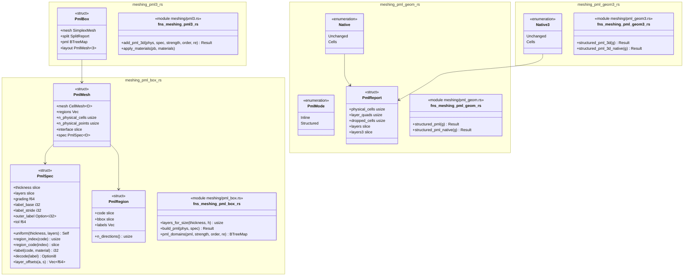

# Structured absorbing layers: code

C4 level 4 (code) of the component **Structured absorbing layers** (`femcore.structpml`) in the container **femcore** (crate `femcore`). [Component view of the container](../../3-components/femcore.md) · [All code pages](../README.md)

> Structured PML around a box-shaped or geom-model mesh: prisms, hexahedra, quads, labels.

**Decisions:** [ADR 7](../../../adr/0007-metric-adaptation-and-structured-pml.md), [ADR 52](../../../adr/0052-structured-absorbing-layers-in-3d.md), [ADR 5](../../../adr/0005-native-mixed-cell-mesh.md)  
**Size:** 4 files, 1468 lines.

## Files

| File | Lines | What it says about itself |
|---|---:|---|
| `crates/femcore/src/meshing/pml3.rs` | 69 | Structured absorbing layers around a tetrahedral mesh in a box: prisms on the faces, hexahedra on the edges and corners, the labels and `Pml` entries the solvers read, and the simplex mesh they run on today. |
| `crates/femcore/src/meshing/pml_box.rs` | 777 | Structured PML generator around a box-shaped physical mesh. |
| `crates/femcore/src/meshing/pml_geom.rs` | 298 | Structured absorbing layers for a meshed `geom` model (`PmlMode::Structured`). |
| `crates/femcore/src/meshing/pml_geom3.rs` | 324 | Structured absorbing layers for a meshed 3D `geom` model (`PmlMode::Structured` in 3D, ADR 52): the 3D counterpart of `pml_geom`. |

## What it uses

| Target | Modules | Items |
|---|---|---|
| [container `geom` (geom)](../../3-components/geom.md) | eval, model | Evaluated, RegionKind |
| [Finite-element basics](./fem.md) | props | Materials, Pml, PmlDir |
| [Mesh](./mesh.md) | mesh, mesh::cells, mesh::quality | CellMesh, CellType, SimplexMesh, SplitReport, cell_scaled_jacobian_min |
| [Meshing facade](./meshing.md) | meshing::geomdrive | MeshedGeom |
| [3D meshing](./meshing3d.md) | meshing::adapt3d | FaceTable, interface_facets_with_preserved |
| [Metric fields](./metric.md) | adapt::work | FacetKey, SimplexMesh, bbox_of, facet_key, simplex_to_adapt |

## Used by

| Component | Modules | Items |
|---|---|---|
| [Meshing validation harness](./meshcheck.md) | meshing::pml_box | PmlMesh |
| [Meshing facade](./meshing.md) | meshing::pml_geom | PmlMode, PmlReport, structured_pml |
| [3D meshing](./meshing3d.md) | meshing::pml_geom, meshing::pml_geom3 | PmlMode, structured_pml_3d |

## Class diagram

Public types with their public fields (or variants) and methods, free functions per file as a `module` box; arrows are field types and `impl Trait`. Capped at 36 types and a few members each; the table below is complete.

## Public items

| Kind | Item | File:line | Signature or summary |
|---|---|---|---|
| struct | `PmlBox` | `meshing/pml3.rs:24` | fields: `mesh`, `split`, `pml`, `layout` |
| fn | `add_pml_3d` | `meshing/pml3.rs:37` | `pub fn add_pml_3d(phys: &SimplexMesh, spec: &PmlSpec<3>, strength: f64, order: f64, re: f64) -> Result<PmlBox, String>` —  Adds structured layers to the tetrahedral mesh `phys`. `strength`, `order` and `re` are the stretch `s = re - j strength t^order` of |
| fn | `apply_materials` | `meshing/pml3.rs:54` | `pub fn apply_materials(pb: &PmlBox, materials: &mut Materials)` —  Gives every layer domain the material data of the physical domain it continues and its `Pml` entry. Domains of `materials` that are not |
| struct | `PmlSpec` | `meshing/pml_box.rs:35` | fields: `thickness`, `layers`, `grading`, `label_base`, `label_stride`, `outer_label`, `tol` —  Layer specification. Axis `a`, side `s` (0 = minimum, 1 = maximum face of the box); a side |
| fn | `layers_for_size` | `meshing/pml_box.rs:130` | `pub fn layers_for_size(thickness: f64, h: f64) -> usize` —  Layers needed to resolve `thickness` with cells of normal size about `h` (at least 1). |
| struct | `PmlRegion` | `meshing/pml_box.rs:136` | fields: `code`, `bbox`, `labels` —  One PML region. |
| struct | `PmlMesh` | `meshing/pml_box.rs:155` | fields: `mesh`, `regions`, `n_physical_cells`, `n_physical_points`, `interface`, `spec` —  Output of [`build_pml`]. |
| fn | `build_pml` | `meshing/pml_box.rs:245` | `pub fn build_pml<const D: usize>(phys: &SimplexMesh<D>, spec: &PmlSpec<D>) -> Result<PmlMesh<D>, String>` —  Build the structured PML around `phys` (see the module docs). |
| fn | `pml_domains` | `meshing/pml_box.rs:486` | `pub fn pml_domains<const D: usize>(pml: &PmlMesh<D>, strength: f64, order: f64, re: f64) -> std::collections::BTreeMap<i32, crate::props::Pml>` —  The `Pml` of every domain label of a PML mesh, keyed by label, to merge into `ProblemSpec::optical_pml`. |
| fn | `PmlSpec::uniform` | `meshing/pml_box.rs:55` | `pub fn uniform(thickness: f64, layers: usize) -> Self` —  The same `thickness` and number of `layers` on every side, uniform spacing. |
| fn | `PmlSpec::region_index` | `meshing/pml_box.rs:69` | `pub fn region_index(code: &[i8; D]) -> usize` —  Index of a region code `c` in `0..3^D`: `sum (c_a + 1) 3^a`. The all-zero code (the |
| fn | `PmlSpec::region_code` | `meshing/pml_box.rs:80` | `pub fn region_code(mut index: usize) -> [i8` —  Inverse of [`PmlSpec::region_index`]. |
| fn | `PmlSpec::label` | `meshing/pml_box.rs:90` | `pub fn label(&self, code: &[i8; D], material: i32) -> i32` —  PML label for region `code` and physical material label `material`. |
| fn | `PmlSpec::decode` | `meshing/pml_box.rs:96` | `pub fn decode(&self, label: i32) -> Option<([i8` —  Inverse of [`PmlSpec::label`]: `(region code, material)`, or `None` for a physical label. |
| fn | `PmlSpec::layer_offsets` | `meshing/pml_box.rs:108` | `pub fn layer_offsets(&self, a: usize, s: usize) -> Vec<f64>` —  Positions of the layer interfaces on side `(a, s)` as distances from the box face, |
| fn | `PmlRegion::n_directions` | `meshing/pml_box.rs:148` | `pub fn n_directions(&self) -> usize` —  Number of stretched directions (1 on faces, 2 on edges, 3 at corners). |
| enum | `PmlMode` | `meshing/pml_geom.rs:26` | variants: `Inline`, `Structured` —  How the absorbing layers of a model are meshed. |
| struct | `PmlReport` | `meshing/pml_geom.rs:36` | fields: `physical_cells`, `layer_quads`, `dropped_cells`, `layers`, `layers3` —  What `structured_pml` built. |
| fn | `structured_pml` | `meshing/pml_geom.rs:51` | `pub fn structured_pml(g: MeshedGeom) -> Result<(MeshedGeom, PmlReport), String>` —  Replaces the absorbing layers of a meshed 2D model by structured ones, cut into triangles for the simplex solvers. A model without a |
| enum | `Native` | `meshing/pml_geom.rs:69` | variants: `Unchanged`, `Cells` —  What `structured_pml_native` returns. |
| fn | `structured_pml_native` | `meshing/pml_geom.rs:79` | `pub fn structured_pml_native(g: MeshedGeom) -> Result<Native, String>` —  The structured layers without the final cut: a mixed triangle/quadrilateral `CellMesh`, for solvers that take quadrilaterals natively. |
| enum | `Native3` | `meshing/pml_geom3.rs:28` | variants: `Unchanged`, `Cells` —  What `structured_pml_3d_native` returns. |
| fn | `structured_pml_3d` | `meshing/pml_geom3.rs:40` | `pub fn structured_pml_3d(g: MeshedGeom) -> Result<(MeshedGeom, PmlReport), String>` —  Replaces the absorbing layers of a meshed 3D model by structured ones, cut into tetrahedra for the simplex solvers. A model without a |
| fn | `structured_pml_3d_native` | `meshing/pml_geom3.rs:80` | `pub fn structured_pml_3d_native(g: MeshedGeom) -> Result<Native3, String>` —  The structured layers without the final cut: a mixed tetrahedron / prism / hexahedron `CellMesh` with triangular and quadrilateral |
