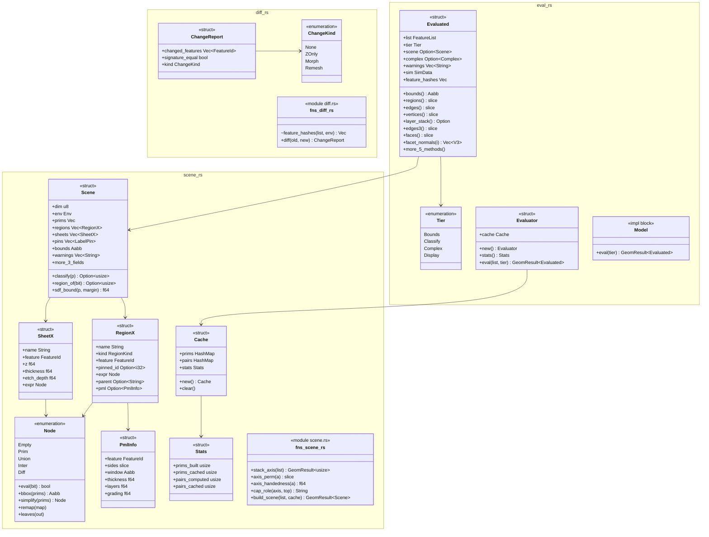

# Evaluation: code

C4 level 4 (code) of the component **Evaluation** (`geom.evaluation`) in the container **geom** (crate `geom`). [Component view of the container](../../3-components/geom.md) · [All code pages](../README.md)

> The Evaluator turns a feature list into an evaluated model at a chosen tier with a cache; scenes instantiate profiles with transforms and patterns; change detection between evaluations for sweeps.

**Decisions:** [ADR 2](../../../adr/0002-geometry-as-named-feature-list.md), [ADR 6](../../../adr/0006-one-meshing-interface.md)  
**Size:** 3 files, 1641 lines.

## Files

| File | Lines | What it says about itself |
|---|---:|---|
| `crates/geom/src/diff.rs` | 74 | Change detection between two evaluations of related feature lists, for parameter sweeps: per-feature content hashes (the operation with its expressions evaluated), propagated through the input references, plus the topology signature. |
| `crates/geom/src/eval.rs` | 168 | Evaluation: `Evaluator` owns the cache and turns a `FeatureList` into an `Evaluated` model at a chosen tier. Cheaper tiers never build costlier data: `Bounds` needs parameters only, `Classify` builds the scene (primitives and region expr... |
| `crates/geom/src/scene.rs` | 1399 | From a feature list to a *scene*: parameters evaluated, every profile instantiated (with transforms and pattern copies) into world-frame primitives, and one Boolean expression over primitives per overlay region (Cut and Pml already folde... |

## What it uses

| Target | Modules | Items |
|---|---|---|
| [Feature list](./featurelist.md) | error, expr, model | Env, Expr, GeomError, GeomResult |
| [2D kernel](./kernel2d.md) | arrange, complex, poly_batch, prim | Complex, Edge, Edge3, Face, PairRes, Region, Vertex, arrange, fit_rings_with_pins, simplify_rings_with_pins |
| [3D kernel](./kernel3d.md) | planar, stack | LayerStack, build, build_scene, needs_planar |
| [Math helpers](./math.md) | math | Hasher64 |
| [Queries and selectors](./queries.md) | sim | SimData |

## Used by

| Component | Modules | Items |
|---|---|---|
| [engine: Geometry operations](../engine/geometry.md) | eval | Evaluator, Tier |
| [engine: Meshing seam](../engine/meshing.md) | eval | Evaluated |
| [femcore: Meshing facade](../femcore/meshing.md) | diff, eval, scene | ChangeKind, Evaluated, Evaluator, Tier, axis_perm, diff |
| [femcore: 3D meshing](../femcore/meshing3d.md) | eval | Evaluated |
| [femcore: Structured absorbing layers](../femcore/structpml.md) | eval | Evaluated |
| [Feature list](./featurelist.md) | scene | Cache, build_scene |
| [2D kernel](./kernel2d.md) | scene | Cache, RegionX, Scene, axis_perm, cap_role |
| [3D kernel](./kernel3d.md) | eval, scene | Cache, Evaluated, Node, PmlInfo, RegionX, Scene, axis_perm, cap_role +1 |
| [Queries and selectors](./queries.md) | eval, scene | Evaluated, axis_perm |
| [Display tessellation](./tessellation.md) | eval | Evaluated |

## Class diagram

Public types with their public fields (or variants) and methods, free functions per file as a `module` box; arrows are field types and `impl Trait`. Capped at 36 types and a few members each; the table below is complete.

## Public items

| Kind | Item | File:line | Signature or summary |
|---|---|---|---|
| enum | `ChangeKind` | `diff.rs:9` | variants: `None`, `ZOnly`, `Morph`, `Remesh` |
| struct | `ChangeReport` | `diff.rs:21` | fields: `changed_features`, `signature_equal`, `kind` |
| fn | `feature_hashes` | `diff.rs:29` | `pub(crate) fn feature_hashes(list: &FeatureList, env: &crate::expr::Env) -> Vec<(FeatureId, u64)>` —  Content hash of every feature: the operation, its name, its suppression flag and the numeric value of each expression. |
| fn | `diff` | `diff.rs:44` | `pub fn diff(old: &Evaluated, new: &Evaluated) -> ChangeReport` |
| enum | `Tier` | `eval.rs:13` | variants: `Bounds`, `Classify`, `Complex`, `Display` |
| struct | `Evaluated` | `eval.rs:20` | fields: `list`, `tier`, `scene`, `complex`, `warnings`, `sim`, `feature_hashes` |
| struct | `Evaluator` | `eval.rs:32` | fields: `cache` |
| fn | `Evaluator::new` | `eval.rs:37` | `pub fn new() -> Evaluator` |
| fn | `Evaluator::stats` | `eval.rs:41` | `pub fn stats(&self) -> Stats` |
| fn | `Evaluator::eval` | `eval.rs:45` | `pub fn eval(&mut self, list: &FeatureList, tier: Tier) -> GeomResult<Evaluated>` |
| fn | `Model::eval` | `eval.rs:109` | `pub fn eval(&self, tier: Tier) -> GeomResult<Evaluated>` —  Evaluates with a throw-away cache; use an `Evaluator` for sweeps. |
| fn | `Evaluated::bounds` | `eval.rs:115` | `pub fn bounds(&self) -> Aabb` |
| fn | `Evaluated::regions` | `eval.rs:118` | `pub fn regions(&self) -> &[crate::complex::Region]` |
| fn | `Evaluated::edges` | `eval.rs:121` | `pub fn edges(&self) -> &[crate::complex::Edge]` |
| fn | `Evaluated::vertices` | `eval.rs:124` | `pub fn vertices(&self) -> &[crate::complex::Vertex]` |
| fn | `Evaluated::layer_stack` | `eval.rs:128` | `pub fn layer_stack(&self) -> Option<&crate::stack::LayerStack>` —  The layer stack of a 3D model (the overlay is the common refinement of all layers). |
| fn | `Evaluated::edges3` | `eval.rs:132` | `pub fn edges3(&self) -> &[crate::complex::Edge3]` —  3D crease edges (shared by two or more faces); empty in 2D, where `edges()` are the boundary curves. |
| fn | `Evaluated::faces` | `eval.rs:135` | `pub fn faces(&self) -> &[crate::complex::Face]` |
| fn | `Evaluated::facet_normals` | `eval.rs:139` | `pub fn facet_normals(&self, i: u32) -> Vec<V3>` —  Outward normals sampled over facet `i` (see `Complex::facet_normals`). |
| fn | `Evaluated::complex` | `eval.rs:142` | `pub fn complex(&self) -> &Complex` |
| fn | `Evaluated::scene` | `eval.rs:145` | `pub fn scene(&self) -> &Scene` |
| fn | `Evaluated::classify` | `eval.rs:149` | `pub fn classify(&self, p: V3) -> Option<u32>` —  Region id containing `p` (painter rule), without building the arrangement. |
| fn | `Evaluated::sdf_bound` | `eval.rs:159` | `pub fn sdf_bound(&self, p: V3, margin: f64) -> f64` —  Distance from `p` to the nearest primitive boundary, at most `margin`. |
| fn | `Evaluated::tol` | `eval.rs:164` | `pub fn tol(&self) -> f64` |
| enum | `Node` | `scene.rs:15` | variants: `Empty`, `Prim`, `Union`, `Inter`, `Diff` —  Boolean expression over primitive indices. |
| struct | `PmlInfo` | `scene.rs:155` | fields: `feature`, `sides`, `window`, `thickness`, `layers`, `grading` —  Data attached to a region generated by `Pml`. |
| struct | `RegionX` | `scene.rs:166` | fields: `name`, `kind`, `feature`, `pinned_id`, `expr`, `parent`, `pml` |
| struct | `SheetX` | `scene.rs:180` | fields: `name`, `feature`, `z`, `thickness`, `etch_depth`, `expr` —  An evaluated 2D sheet embedded at plane `z` in a 3D layer-stack model, with optional finite metal |
| struct | `Scene` | `scene.rs:190` | fields: `dim`, `env`, `prims`, `regions`, `sheets`, `pins`, `bounds`, `warnings`, `naming`, `axis`, `auto_tags` |
| struct | `Stats` | `scene.rs:208` | fields: `prims_built`, `prims_cached`, `pairs_computed`, `pairs_cached` |
| struct | `Cache` | `scene.rs:217` | fields: `prims`, `pairs`, `stats` —  Evaluation cache shared across evaluations of related feature lists (parameter sweeps, GUI edits). |
| fn | `stack_axis` | `scene.rs:255` | `pub fn stack_axis(list: &FeatureList) -> GeomResult<usize>` —  The sweep axis shared by all cylinders and extrusions of a model (z when there are none). A 2D model sweeps along y: the |
| fn | `axis_perm` | `scene.rs:283` | `pub fn axis_perm(a: usize) -> [usize` —  Sweep-frame axis `i` is world axis `perm[i]`. The sweep frame has the sweep axis last and the plane of the 2D profiles (the |
| fn | `axis_handedness` | `scene.rs:293` | `pub fn axis_handedness(a: usize) -> f64` —  -1 when the sweep frame of this sweep axis is left-handed in world coordinates (the wafer frame's |
| fn | `cap_role` | `scene.rs:303` | `pub fn cap_role(axis: usize, top: bool) -> String` —  Role of the cap of a sweep along world axis `axis` at its upper or lower end: `top` / `bottom` along z (the wafer normal), |
| fn | `build_scene` | `scene.rs:1033` | `pub fn build_scene(list: &FeatureList, cache: &mut Cache) -> GeomResult<Scene>` —  Builds the scene of a feature list (validates it first). |
| fn | `Node::eval` | `scene.rs:24` | `pub fn eval(&self, bit: &dyn Fn(usize) -> bool) -> bool` |
| fn | `Node::bbox` | `scene.rs:34` | `pub fn bbox(&self, prims: &[Arc<Prim>]) -> Aabb` —  Conservative bounding box. |
| fn | `Node::simplify` | `scene.rs:58` | `pub fn simplify(self, prims: &[Arc<Prim>]) -> Node` —  Normalisation: flatten nested Unions / Intersections, drop empty operands, remove duplicates (`A cap A = A`), turn |
| fn | `Node::remap` | `scene.rs:128` | `pub fn remap(&mut self, map: &[usize])` |
| fn | `Node::leaves` | `scene.rs:140` | `pub fn leaves(&self, out: &mut Vec<usize>)` |
| fn | `Cache::new` | `scene.rs:224` | `pub fn new() -> Cache` |
| fn | `Cache::clear` | `scene.rs:227` | `pub fn clear(&mut self)` |
| fn | `Scene::classify` | `scene.rs:235` | `pub fn classify(&self, p: V3) -> Option<usize>` —  Region index of the point `p` (painter rule: the last region that contains it wins; holes and voids give `None`). |
| fn | `Scene::region_of` | `scene.rs:239` | `pub fn region_of(&self, bit: &dyn Fn(usize) -> bool) -> Option<usize>` |
| fn | `Scene::sdf_bound` | `scene.rs:248` | `pub fn sdf_bound(&self, p: V3, margin: f64) -> f64` —  Smallest distance from `p` to any primitive boundary, capped at `margin`. |
