# Feature list: code

C4 level 4 (code) of the component **Feature list** (`geom.featurelist`) in the container **geom** (crate `geom`). [Component view of the container](../../3-components/geom.md) · [All code pages](../README.md)

> The serialisable feature list (single source of truth for code and GUI), its operations and validation, parameter expressions, printing as Rust builder calls, and the error type.

**Decisions:** [ADR 2](../../../adr/0002-geometry-as-named-feature-list.md), [ADR 3](../../../adr/0003-geom-is-a-lean-separate-kernel.md), [ADR 63](../../../adr/0063-the-format-key-and-no-json-for-bulk-data.md)  
**Size:** 6 files, 3578 lines.

## Files

| File | Lines | What it says about itself |
|---|---:|---|
| `crates/geom/src/error.rs` | 42 | The error type of the crate: plain-language messages that name the features involved. Converts into `String` because the femcore APIs use `Result<_, String>`. |
| `crates/geom/src/expr.rs` | 337 | Parameter expressions: a number or a small safe formula over named parameters. The grammar mirrors nyx `femcore::expr` (numbers, `+ - * / ^ **`, parentheses, the functions `sin cos tan exp log ln log10 sqrt abs sinh cosh tanh atan min ma... |
| `crates/geom/src/gds.rs` | 1959 |  |
| `crates/geom/src/lib.rs` | 27 | `geom`: a lean CSG-over-B-rep geometry kernel for the nyx FEM stack. |
| `crates/geom/src/model.rs` | 1046 | The serialisable feature list (the single source of truth for code and GUI), its operations, validation, and the `Model` builder that only pushes `Op`s and returns `FeatureId` handles. Nothing here evaluates geometry. |
| `crates/geom/src/print.rs` | 167 | `FeatureList::to_rust`: prints the builder calls that recreate a list (the "Copy as Rust" of the GUI). One statement per feature, `let fN = m.method(...)` where `N` is the feature id; operations without a builder shorthand fall back to `... |

## What it uses

| Target | Modules | Items |
|---|---|---|
| [Evaluation](./evaluation.md) | scene | Cache, build_scene |
| [2D kernel](./kernel2d.md) | arrange, complex, poly_batch, prim | Complex, GRAZE_K, arrange, clean_ring, polygon_area, shoelace_area, simplify_rings_with_pins |
| [Math helpers](./math.md) | math |  |
| [Queries and selectors](./queries.md) | select | Selector |

## Used by

| Component | Modules | Items |
|---|---|---|
| [engine: Commands](../engine/commands.md) | model | FeatureList, Op |
| [engine: Geometry operations](../engine/geometry.md) | error, expr, gds, model | Env, Expr, Feature, FeatureList, GdsImportOptions, GeomError, Op, Origin +3 |
| [engine: Job runner and queue](../engine/jobs.md) | expr, model | Expr, Op |
| [engine: Meshing seam](../engine/meshing.md) | model | FeatureList |
| [engine: Project](../engine/project.md) | model | FORMAT, FeatureList |
| [engine: Registry and facade](../engine/registry.md) | crate root |  |
| [engine: Store link](../engine/storeLink.md) | expr, model | Expr, Op |
| [femcore: Error estimators](../femcore/estimators.md) | model | FeatureList |
| [femcore: Fixtures and test kit](../femcore/fixtures.md) | model | FeatureId, Model |
| [femcore: Meshing facade](../femcore/meshing.md) | model | FeatureList, Model, RegionKind |
| [femcore: 3D meshing](../femcore/meshing3d.md) | model | Model, RegionKind |
| [femcore: Structured absorbing layers](../femcore/structpml.md) | model | RegionKind |
| [Evaluation](./evaluation.md) | error, expr, model | Env, Expr, GeomError, GeomResult |
| [2D kernel](./kernel2d.md) | error, model | FeatureId, GeomError, GeomResult, NameScheme, RegionKind |
| [3D kernel](./kernel3d.md) | error, expr, model | Axis, Env, Expr, GeomError, GeomResult, NameScheme, RegionKind |
| [Queries and selectors](./queries.md) | error, expr, model | Axis, Expr, GeomError, GeomResult, Op, RegionKind |

## Class diagram

Public types with their public fields (or variants) and methods, free functions per file as a `module` box; arrows are field types and `impl Trait`. Capped at 36 types and a few members each; the table below is complete.

```mermaid
classDiagram
  namespace error_rs {
    class GeomError {
        <<struct>>
        +_0 String
    }
    class String {
        <<impl block>>
    }
    class fns_error_rs {
        <<module error.rs>>
        +GeomResult type
    }
  }
  namespace expr_rs {
    class Expr {
        <<enumeration>>
        Num
        Text
        +source() String
    }
    class Env {
        <<struct>>
        +vars Vec
        +get(name) Option~f64~
        +eval(e, what) GeomResult~f64~
    }
    class fns_expr_rs {
        <<module expr.rs>>
        +eval_text(text, env) Result
    }
  }
  namespace gds_rs {
    class GdsBoundary {
        <<struct>>
        +layer i16
        +datatype i16
        +xy Vec
    }
    class GdsPath {
        <<struct>>
        +layer i16
        +datatype i16
        +pathtype i16
        +width i32
        +bgnextn i32
        +endextn i32
        +xy Vec
    }
    class GdsSref {
        <<struct>>
        +sname String
        +strans u16
        +mag f64
        +angle_deg f64
        +xy slice
    }
    class GdsAref {
        <<struct>>
        +sname String
        +strans u16
        +mag f64
        +angle_deg f64
        +cols i16
        +rows i16
        +xy slice
    }
    class GdsText {
        <<struct>>
        +layer i16
        +texttype i16
        +string String
        +xy slice
        +strans u16
        +mag f64
        +angle_deg f64
    }
    class GdsCell {
        <<struct>>
        +name String
        +boundaries Vec~GdsBoundary~
        +paths Vec~GdsPath~
        +srefs Vec~GdsSref~
        +arefs Vec~GdsAref~
        +texts Vec~GdsText~
    }
    class GdsLibrary {
        <<struct>>
        +version i16
        +name String
        +user_unit f64
        +dbu_m f64
        +cells Vec~GdsCell~
    }
    class GdsImportOptions {
        <<struct>>
        +layers Vec
        +cell Option~String~
        +split_islands bool
        +pin_layer Option
        +simplify_tol f64
        +arc_tol f64
    }
    class GdsSheet {
        <<struct>>
        +name String
        +layer_key String
        +outers Vec
        +holes Vec
        +islands Vec~IslandRings~
        +area f64
        +centroid V2
        +bbox slice
    }
    class GdsImportResult {
        <<struct>>
        +cell String
        +dbu_m f64
        +sheets Vec~GdsSheet~
        +layers Vec
        +layer_bbox slice
        +cell_bbox slice
        +pins Vec
    }
    class FlatWorld {
        <<impl block>>
    }
    class fns_gds_rs {
        <<module gds.rs>>
        +decode_ibm_f64(bytes) f64
        +encode_ibm_f64(val) slice
        +parse_gds(bytes) GeomResult~GdsLibrary~
        +expand_path_polygons(centerline, width, pathtype, bgnextn, endextn) Vec
        +sanitize_pin_name(raw) String
        +import_gds_bytes(bytes, opts) GeomResult~GdsImportResult~
        +import_gds_library(lib, opts) GeomResult~GdsImportResult~
        +STRANS_REFLECT_X const
        +IslandRings type
    }
  }
  namespace model_rs {
    class Axis {
        <<enumeration>>
        X
        Y
        Z
        +index() usize
        +name() str
    }
    class Origin {
        <<enumeration>>
        Gui
        Code
    }
    class NameScheme {
        <<enumeration>>
        Feature
        Region
        Numbered
    }
    class RegionKind {
        <<enumeration>>
        Material
        Hole
        Pml
        Void
    }
    class Param {
        <<struct>>
        +name String
        +value Expr
    }
    class RegionDef {
        <<struct>>
        +name String
        +input FeatureId
        +kind RegionKind
        +pinned_id Option~i32~
    }
    class LabelPin {
        <<struct>>
        +sel Selector
        +id i32
    }
    class Side {
        <<enumeration>>
        XMin
        XMax
        YMin
        YMax
        ZMin
        ZMax
        +axis() usize
        +sign() i8
        +name() str
    }
    class TStep {
        <<enumeration>>
        Translate
        Rotate
        Mirror
        Scale
    }
    class PatternKind {
        <<enumeration>>
        Linear
        Polar
    }
    class Keep {
        <<enumeration>>
        Above
        Below
    }
    class Op {
        <<enumeration>>
        Rect
        Circle
        Ellipse
        Polygon
        Polygons
        RoundedRect
        Box
        Cylinder
        Sphere
        Cone
        Revolve
        Torus
        more_13_variants
        +kind() str
        +exprs() Vec
        +inputs() Vec~FeatureId~
    }
    class Feature {
        <<struct>>
        +id FeatureId
        +name String
        +op Op
        +suppressed bool
        +origin Origin
        +tags Vec~String~
    }
    class FeatureList {
        <<struct>>
        +format u32
        +dim u8
        +params Vec~Param~
        +features Vec~Feature~
        +new(dim) FeatureList
        +feature(id) Option
        +feature_by_name(name) Option
        +with(set) FeatureList
        +validate() GeomResult
        +to_rust() String
    }
    class Model {
        <<struct>>
        +list FeatureList
        +new_2d() Model
        +new_3d() Model
        +from_list(list) Model
        +set_origin(o) Self
        +param(name, value) Self
        +push(name, op) FeatureId
        +set_naming(scheme) Self
        +tag_feature(id, tag) Self
        +more_39_methods()
    }
    class SteppedAirbridge {
        <<struct>>
        +pad0 FeatureId
        +pad1 FeatureId
        +pads FeatureId
        +deck_profile FeatureId
        +sheet FeatureId
        +hole_region(name) RegionDef
    }
    class fns_model_rs {
        <<module model.rs>>
        +check_name(kind, name) GeomResult
        +FeatureId type
        +FORMAT const
    }
  }
  namespace print_rs {
    class fns_print_rs {
        <<module print.rs>>
        +to_rust(l) String
    }
  }
  GeomError --> String
  Expr --> String
  Env --> String
  GdsSref --> String
  GdsAref --> String
  GdsText --> String
  GdsCell --> String
  GdsCell --> GdsBoundary
  GdsCell --> GdsPath
  GdsCell --> GdsSref
  GdsCell --> GdsAref
  GdsCell --> GdsText
  GdsLibrary --> String
  GdsLibrary --> GdsCell
  GdsImportOptions --> String
  GdsSheet --> String
  GdsImportResult --> String
  GdsImportResult --> GdsSheet
  Param --> String
  Param --> Expr
  RegionDef --> String
  RegionDef --> RegionKind
  TStep --> Expr
  TStep --> Axis
  PatternKind --> Expr
  PatternKind --> Axis
  Op --> Expr
  Op --> String
  Op --> Axis
  Op --> TStep
  Op --> PatternKind
  Op --> RegionDef
  Op --> LabelPin
  Op --> NameScheme
  Op --> Side
  Op --> Keep
  Feature --> String
  Feature --> Op
  Feature --> Origin
  FeatureList --> Param
  FeatureList --> Feature
  Model --> FeatureList
```

## Public items

| Kind | Item | File:line | Signature or summary |
|---|---|---|---|
| struct | `GeomError` | `error.rs:7` | fields: `_0` |
| type | `GeomResult` | `error.rs:9` | `<T>` |
| enum | `Expr` | `expr.rs:11` | variants: `Num`, `Text` —  A number or an expression string; serialises as a bare JSON number or string (`untagged`). |
| fn | `eval_text` | `expr.rs:288` | `pub fn eval_text(text: &str, env: &dyn Fn(&str) -> Option<f64>) -> Result<f64, String>` —  Evaluates `text` with names resolved by `env`; the result must be finite. |
| struct | `Env` | `expr.rs:300` | fields: `vars` —  Named parameters evaluated in order; later parameters may use earlier ones. |
| fn | `Expr::source` | `expr.rs:44` | `pub fn source(&self) -> String` —  Source text for printing (numbers use Rust's shortest round-trip form). |
| fn | `Env::get` | `expr.rs:305` | `pub fn get(&self, name: &str) -> Option<f64>` |
| fn | `Env::eval` | `expr.rs:309` | `pub fn eval(&self, e: &Expr, what: &str) -> GeomResult<f64>` |
| const | `STRANS_REFLECT_X` | `gds.rs:58` | `u16` —  STRANS bit 15: reflection across the local X-axis (`y -> -y`) before scaling and rotation. |
| fn | `decode_ibm_f64` | `gds.rs:61` | `pub fn decode_ibm_f64(bytes: [u8; 8]) -> f64` —  Decodes an 8-byte big-endian IBM System/360 hexadecimal floating-point value to IEEE-754 `f64`. |
| fn | `encode_ibm_f64` | `gds.rs:73` | `pub fn encode_ibm_f64(val: f64) -> [u8` —  Encodes an IEEE-754 `f64` into an 8-byte big-endian IBM hexadecimal floating-point value. |
| struct | `GdsBoundary` | `gds.rs:120` | fields: `layer`, `datatype`, `xy` —  Parsed GDSII `BOUNDARY` (or `BOX`) polygon in integer database units. |
| struct | `GdsPath` | `gds.rs:128` | fields: `layer`, `datatype`, `pathtype`, `width`, `bgnextn`, `endextn`, `xy` —  Parsed GDSII `PATH` element in integer database units. |
| struct | `GdsSref` | `gds.rs:140` | fields: `sname`, `strans`, `mag`, `angle_deg`, `xy` —  Parsed GDSII `SREF` structure instance. |
| struct | `GdsAref` | `gds.rs:150` | fields: `sname`, `strans`, `mag`, `angle_deg`, `cols`, `rows`, `xy` —  Parsed GDSII `AREF` array structure instance. |
| struct | `GdsText` | `gds.rs:162` | fields: `layer`, `texttype`, `string`, `xy`, `strans`, `mag`, `angle_deg` —  Parsed GDSII `TEXT` label element. |
| struct | `GdsCell` | `gds.rs:174` | fields: `name`, `boundaries`, `paths`, `srefs`, `arefs`, `texts` —  Parsed GDSII structure (`BGNSTR` .. `ENDSTR`). |
| struct | `GdsLibrary` | `gds.rs:185` | fields: `version`, `name`, `user_unit`, `dbu_m`, `cells` —  Parsed GDSII binary library (`HEADER` .. `ENDLIB`). |
| struct | `GdsImportOptions` | `gds.rs:197` | fields: `layers`, `cell`, `split_islands`, `pin_layer`, `simplify_tol`, `arc_tol` —  Options controlling GDSII hierarchy flattening, boolean union, island splitting, and pin matching. |
| type | `IslandRings` | `gds.rs:219` |  One connected planar island: `(outer_ccw, holes_cw)`. |
| struct | `GdsSheet` | `gds.rs:224` | fields: `name`, `layer_key`, `outers`, `holes`, `islands`, `area`, `centroid`, `bbox` —  One extracted conductive sheet (a single connected island when `split_islands` is `true`, or |
| struct | `GdsImportResult` | `gds.rs:245` | fields: `cell`, `dbu_m`, `sheets`, `layers`, `layer_bbox`, `cell_bbox`, `pins` —  Flattened, boolean-unioned GDSII import result in SI metres. |
| fn | `parse_gds` | `gds.rs:365` | `pub fn parse_gds(bytes: &[u8]) -> GeomResult<GdsLibrary>` —  Parses a binary GDSII stream into a structured `GdsLibrary`. |
| fn | `expand_path_polygons` | `gds.rs:782` | `pub fn expand_path_polygons(centerline: &[V2], width: f64, pathtype: i16, bgnextn: f64, endextn: f64) -> Vec<Vec<V2>>` —  Expands a GDSII `PATH` centerline into one or more closed counter-clockwise polygons in metres. |
| fn | `sanitize_pin_name` | `gds.rs:1698` | `pub fn sanitize_pin_name(raw: &str) -> String` —  Sanitizes a GDSII `TEXT` pin label into a valid `geom` feature name. |
| fn | `import_gds_bytes` | `gds.rs:1732` | `pub fn import_gds_bytes(bytes: &[u8], opts: &GdsImportOptions) -> GeomResult<GdsImportResult>` —  Parses and imports a binary GDSII stream according to `opts`. |
| fn | `import_gds_library` | `gds.rs:1739` | `pub fn import_gds_library(lib: &GdsLibrary, opts: &GdsImportOptions) -> GeomResult<GdsImportResult>` —  Flattens `lib`, boolean-unions requested layers, splits/orders islands, applies optional |
| type | `FeatureId` | `model.rs:9` |  |
| enum | `Axis` | `model.rs:29` | variants: `X`, `Y`, `Z` |
| enum | `Origin` | `model.rs:45` | variants: `Gui`, `Code` |
| enum | `NameScheme` | `model.rs:52` | variants: `Feature`, `Region`, `Numbered` —  How boundary faces (a region against the void) are named. Interfaces between two regions are always `A\|B`. |
| enum | `RegionKind` | `model.rs:63` | variants: `Material`, `Hole`, `Pml`, `Void` |
| struct | `Param` | `model.rs:74` | fields: `name`, `value` |
| struct | `RegionDef` | `model.rs:80` | fields: `name`, `input`, `kind`, `pinned_id` |
| struct | `LabelPin` | `model.rs:90` | fields: `sel`, `id` —  Pins the integer boundary label of everything a selector resolves to (all fragments share the int). |
| enum | `Side` | `model.rs:96` | variants: `XMin`, `XMax`, `YMin`, `YMax`, `ZMin`, `ZMax` |
| enum | `TStep` | `model.rs:122` | variants: `Translate`, `Rotate`, `Mirror`, `Scale` |
| enum | `PatternKind` | `model.rs:143` | variants: `Linear`, `Polar` |
| enum | `Keep` | `model.rs:156` | variants: `Above`, `Below` |
| enum | `Op` | `model.rs:163` | variants: `Rect`, `Circle`, `Ellipse`, `Polygon`, `Polygons`, `RoundedRect`, `Box`, `Cylinder`, `Sphere`, `Cone`, `Revolve`, `Torus`, ... |
| struct | `Feature` | `model.rs:422` | fields: `id`, `name`, `op`, `suppressed`, `origin`, `tags` |
| const | `FORMAT` | `model.rs:434` | `u32` —  The file format of a feature list (ADR 63). Written in every list; a list of another format is refused, there is no migration. |
| struct | `FeatureList` | `model.rs:441` | fields: `format`, `dim`, `params`, `features` |
| fn | `check_name` | `model.rs:454` | `pub fn check_name(kind: &str, name: &str) -> GeomResult<()>` |
| struct | `Model` | `model.rs:560` | fields: `list` —  Builder: pushes operations and returns handles. Holds no logic beyond name checks. |
| struct | `SteppedAirbridge` | `model.rs:1027` | fields: `pad0`, `pad1`, `pads`, `deck_profile`, `sheet` —  Feature handles created by [`Model::stepped_airbridge`]. |
| fn | `Axis::index` | `model.rs:36` | `pub fn index(self) -> usize` |
| fn | `Axis::name` | `model.rs:39` | `pub fn name(self) -> &'static str` |
| fn | `Side::axis` | `model.rs:106` | `pub fn axis(self) -> usize` |
| fn | `Side::sign` | `model.rs:109` | `pub fn sign(self) -> i8` |
| fn | `Side::name` | `model.rs:116` | `pub fn name(self) -> &'static str` |
| fn | `Op::kind` | `model.rs:327` | `pub fn kind(&self) -> &'static str` |
| fn | `Op::exprs` | `model.rs:358` | `pub fn exprs(&self) -> Vec<&Expr>` —  Every number-or-expression field of the operation, in a fixed order. |
| fn | `Op::inputs` | `model.rs:408` | `pub fn inputs(&self) -> Vec<FeatureId>` —  Features this operation refers to (all must come earlier in the list). |
| fn | `FeatureList::new` | `model.rs:467` | `pub fn new(dim: u8) -> FeatureList` |
| fn | `FeatureList::feature` | `model.rs:471` | `pub fn feature(&self, id: FeatureId) -> Option<&Feature>` |
| fn | `FeatureList::feature_by_name` | `model.rs:475` | `pub fn feature_by_name(&self, name: &str) -> Option<&Feature>` |
| fn | `FeatureList::with` | `model.rs:480` | `pub fn with(&self, set: &[(&str, f64)]) -> FeatureList` —  Parameter override without mutation: a copy with the listed parameters set to the given values. |
| fn | `FeatureList::validate` | `model.rs:492` | `pub fn validate(&self) -> GeomResult<()>` —  Structural checks: unique ids and names, references to earlier features only, one overlay, valid names. |
| fn | `FeatureList::to_rust` | `model.rs:553` | `pub fn to_rust(&self) -> String` —  Rust builder code that recreates this list (see `Model`). |
| fn | `Model::new_2d` | `model.rs:574` | `pub fn new_2d() -> Model` |
| fn | `Model::new_3d` | `model.rs:577` | `pub fn new_3d() -> Model` |
| fn | `Model::from_list` | `model.rs:580` | `pub fn from_list(list: FeatureList) -> Model` |
| fn | `Model::set_origin` | `model.rs:585` | `pub fn set_origin(&mut self, o: Origin) -> &mut Self` —  Features added after this call are marked as coming from the GUI. |
| fn | `Model::param` | `model.rs:590` | `pub fn param(&mut self, name: &str, value: impl Into<Expr>) -> &mut Self` |
| fn | `Model::push` | `model.rs:595` | `pub fn push(&mut self, name: &str, op: Op) -> FeatureId` |
| fn | `Model::set_naming` | `model.rs:610` | `pub fn set_naming(&mut self, scheme: NameScheme) -> &mut Self` —  Chooses how boundary faces are named (see `NameScheme`); applies to the model's overlay. |
| fn | `Model::tag_feature` | `model.rs:619` | `pub fn tag_feature(&mut self, id: FeatureId, tag: &str) -> &mut Self` |
| fn | `Model::suppress` | `model.rs:625` | `pub fn suppress(&mut self, id: FeatureId, on: bool) -> &mut Self` |
| fn | `Model::rect` | `model.rs:632` | `pub fn rect( &mut self, name: &str, min: (impl Into<Expr>, impl Into<Expr>), max: (impl Into<Expr>, impl Into<Expr>), ) -> FeatureId` |
| fn | `Model::rounded_rect` | `model.rs:640` | `pub fn rounded_rect( &mut self, name: &str, min: (impl Into<Expr>, impl Into<Expr>), max: (impl Into<Expr>, impl Into<Expr>), r: impl Into<Expr>, ) -> FeatureId` |
| fn | `Model::box_` | `model.rs:649` | `pub fn box_( &mut self, name: &str, min: (impl Into<Expr>, impl Into<Expr>, impl Into<Expr>), max: (impl Into<Expr>, impl Into<Expr>, impl Into<Expr>), ) -> FeatureId` |
| fn | `Model::cylinder` | `model.rs:657` | `pub fn cylinder( &mut self, name: &str, base: (impl Into<Expr>, impl Into<Expr>, impl Into<Expr>), r: impl Into<Expr>, h: impl Into<Expr>, ) -> FeatureId` |
| fn | `Model::extrude_tapered` | `model.rs:666` | `pub fn extrude_tapered( &mut self, name: &str, profile: FeatureId, y0: impl Into<Expr>, y1: impl Into<Expr>, taper_deg: impl Into<Expr>, ) -> FeatureId` |
| fn | `Model::cylinder_along` | `model.rs:680` | `pub fn cylinder_along( &mut self, name: &str, axis: Axis, base: (impl Into<Expr>, impl Into<Expr>, impl Into<Expr>), r: impl Into<Expr>, h: impl Into<Expr>, ) -> FeatureId` —  A cylinder along any axis (`axis` x, y or z); all prismatic solids of a model must share one axis. |
| fn | `Model::extrude_along` | `model.rs:691` | `pub fn extrude_along( &mut self, name: &str, axis: Axis, profile: FeatureId, a0: impl Into<Expr>, a1: impl Into<Expr>, ) -> FeatureId` —  A profile swept along any axis, from `a0` to `a1` on that axis (see `Op::Extrude`). |
| fn | `Model::cone` | `model.rs:701` | `pub fn cone( &mut self, name: &str, base: (impl Into<Expr>, impl Into<Expr>, impl Into<Expr>), r0: impl Into<Expr>, r1: impl Into<Expr>, h: impl Into<Expr>, ) -> FeatureId` |
| fn | `Model::cone_along` | `model.rs:711` | `pub fn cone_along( &mut self, name: &str, axis: Axis, base: (impl Into<Expr>, impl Into<Expr>, impl Into<Expr>), r0: impl Into<Expr>, r1: impl Into<Expr>, h: impl Into<Expr>, ) -> FeatureId` |
| fn | `Model::revolve` | `model.rs:723` | `pub fn revolve( &mut self, name: &str, profile: FeatureId, center: (impl Into<Expr>, impl Into<Expr>, impl Into<Expr>), ) -> FeatureId` —  Turns a `Rect` / `Polygon` profile once about the z axis through `center` (see `Op::Revolve`). |
| fn | `Model::revolve_along` | `model.rs:731` | `pub fn revolve_along( &mut self, name: &str, axis: Axis, profile: FeatureId, center: (impl Into<Expr>, impl Into<Expr>, impl Into<Expr>), ) -> FeatureId` |
| fn | `Model::sphere` | `model.rs:740` | `pub fn sphere( &mut self, name: &str, center: (impl Into<Expr>, impl Into<Expr>, impl Into<Expr>), r: impl Into<Expr>, ) -> FeatureId` |
| fn | `Model::torus` | `model.rs:748` | `pub fn torus( &mut self, name: &str, center: (impl Into<Expr>, impl Into<Expr>, impl Into<Expr>), major: impl Into<Expr>, minor: impl Into<Expr>, ) -> FeatureId` |
| fn | `Model::extrude` | `model.rs:758` | `pub fn extrude(&mut self, name: &str, profile: FeatureId, y0: impl Into<Expr>, y1: impl Into<Expr>) -> FeatureId` —  Sweeps an `(x, z)` profile along y from `y0` to `y1` (the wafer frame: cross-section in x-z, propagation along y). |
| fn | `Model::circle` | `model.rs:761` | `pub fn circle(&mut self, name: &str, center: (impl Into<Expr>, impl Into<Expr>), r: impl Into<Expr>) -> FeatureId` |
| fn | `Model::ellipse` | `model.rs:764` | `pub fn ellipse( &mut self, name: &str, center: (impl Into<Expr>, impl Into<Expr>), radii: (impl Into<Expr>, impl Into<Expr>), angle_deg: impl Into<Expr>, ) -> FeatureId` |
| fn | `Model::polygon` | `model.rs:773` | `pub fn polygon<A: Into<Expr> + Clone, B: Into<Expr> + Clone>(&mut self, name: &str, pts: &[(A, B)]) -> FeatureId` |
| fn | `Model::polygon_named` | `model.rs:777` | `pub fn polygon_named<A: Into<Expr> + Clone, B: Into<Expr> + Clone>( &mut self, name: &str, pts: &[(A, B)], edge_names: &[&str], ) -> FeatureId` |
| fn | `Model::polygons` | `model.rs:786` | `pub fn polygons(&mut self, name: &str, polygons: Vec<Vec<[Expr; 2]>>, holes: Vec<Vec<[Expr; 2]>>) -> FeatureId` |
| fn | `Model::polygons_with` | `model.rs:798` | `pub fn polygons_with( &mut self, name: &str, polygons: Vec<Vec<[Expr; 2]>>, holes: Vec<Vec<[Expr; 2]>>, simplify_tol: impl Into<Expr>, min_hole_area: impl Into<Expr>, ) -> FeatureId` |
| fn | `Model::polygons_with_arcs` | `model.rs:817` | `pub fn polygons_with_arcs( &mut self, name: &str, polygons: Vec<Vec<[Expr; 2]>>, holes: Vec<Vec<[Expr; 2]>>, simplify_tol: impl Into<Expr>, min_hole_area: impl Into<Expr>, arc_tol: impl Into<Expr>, ) -> FeatureId` |
| fn | `Model::sheet` | `model.rs:837` | `pub fn sheet(&mut self, name: &str, input: FeatureId, z: impl Into<Expr>) -> FeatureId` |
| fn | `Model::sheet_thick` | `model.rs:843` | `pub fn sheet_thick( &mut self, name: &str, input: FeatureId, z: impl Into<Expr>, thickness: impl Into<Expr>, etch_depth: impl Into<Expr>, ) -> FeatureId` |
| fn | `Model::transform` | `model.rs:853` | `pub fn transform(&mut self, name: &str, input: FeatureId, steps: Vec<TStep>) -> FeatureId` |
| fn | `Model::translate` | `model.rs:856` | `pub fn translate( &mut self, name: &str, input: FeatureId, d: (impl Into<Expr>, impl Into<Expr>, impl Into<Expr>), ) -> FeatureId` |
| fn | `Model::linear_pattern` | `model.rs:864` | `pub fn linear_pattern( &mut self, name: &str, input: FeatureId, step: (impl Into<Expr>, impl Into<Expr>, impl Into<Expr>), n: impl Into<Expr>, ) -> FeatureId` |
| fn | `Model::union` | `model.rs:873` | `pub fn union(&mut self, name: &str, ids: &[FeatureId]) -> FeatureId` |
| fn | `Model::difference` | `model.rs:876` | `pub fn difference(&mut self, name: &str, a: FeatureId, b: &[FeatureId]) -> FeatureId` |
| fn | `Model::intersect` | `model.rs:879` | `pub fn intersect(&mut self, name: &str, ids: &[FeatureId]) -> FeatureId` |
| fn | `Model::overlay` | `model.rs:883` | `pub fn overlay(&mut self, regions: &[(&str, FeatureId)]) -> FeatureId` —  Material regions in painter order (later wins). |
| fn | `Model::overlay_defs` | `model.rs:890` | `pub fn overlay_defs(&mut self, regions: Vec<RegionDef>, pins: Vec<LabelPin>) -> FeatureId` |
| fn | `Model::overlay_full` | `model.rs:894` | `pub fn overlay_full( &mut self, regions: &[(&str, FeatureId, RegionKind, Option<i32>)], pins: &[(&str, i32)], ) -> FeatureId` —  Regions with kinds and pinned ids, and boundary pins given as `(selector text, label)`. |
| fn | `Model::pml` | `model.rs:909` | `pub fn pml( &mut self, name: &str, window: FeatureId, sides: &[Side], thickness: impl Into<Expr>, layers: impl Into<Expr>, grading: impl Into<Expr>, ) -> FeatureId` |
| fn | `Model::cut` | `model.rs:930` | `pub fn cut(&mut self, name: &str, normal: (f64, f64, f64), offset: impl Into<Expr>, keep: Keep) -> FeatureId` |
| fn | `Model::periodic` | `model.rs:933` | `pub fn periodic( &mut self, name: &str, a: Selector, b: Selector, translation: (impl Into<Expr>, impl Into<Expr>, impl Into<Expr>), ) -> FeatureId` |
| fn | `Model::size` | `model.rs:942` | `pub fn size( &mut self, name: &str, sel: Selector, h: Option<Expr>, max_deviation: Option<Expr>, min_layers: Option<Expr>, ) -> FeatureId` |
| fn | `Model::tag` | `model.rs:952` | `pub fn tag(&mut self, name: &str, sel: Selector, tag: &str) -> FeatureId` |
| fn | `Model::stepped_airbridge` | `model.rs:961` | `pub fn stepped_airbridge( &mut self, name: &str, p0: (f64, f64), p1: (f64, f64), width: f64, pad_len: f64, z_base: f64, h_bridge: f64, ) -> SteppedAirbridge` —  Lowers a trapezoidal/arched airbridge spanning between inner landing edges `p0` and `p1` |
| fn | `SteppedAirbridge::hole_region` | `model.rs:1042` | `pub fn hole_region(&self, name: &str) -> RegionDef` —  Returns a `RegionDef` marking the landing pad pillars as `RegionKind::Hole` (PEC cutout). |
| fn | `to_rust` | `print.rs:36` | `pub fn to_rust(l: &FeatureList) -> String` |

Trait implementations in this component: `GeomError: Display`, `GeomError: Error`, `String: From`, `GeomError: From`, `GeomError: From`, `Expr: From`, `Expr: From`, `Expr: From`, `Expr: From`, `Expr: From`, `GdsImportOptions: Default`, `FlatWorld: Default`
