# 2D kernel: code

C4 level 4 (code) of the component **2D kernel** (`geom.kernel2d`) in the container **geom** (crate `geom`). [Component view of the container](../../3-components/geom.md) · [All code pages](../README.md)

> Primitives, planar curves, the planar arrangement of all boundary pieces, the evaluated region complex, and batch polygon ring cleanup with shared-corner-pinned RDP simplification.

**Decisions:** [ADR 3](../../../adr/0003-geom-is-a-lean-separate-kernel.md), [ADR 18](../../../adr/0018-curved-elements-deferred.md), [ADR 102](../../../adr/0102-conformal-interior-sheets-and-batch-polygons.md)  
**Size:** 5 files, 4357 lines.

## Files

| File | Lines | What it says about itself |
|---|---:|---|
| `crates/geom/src/arrange.rs` | 1175 | The planar arrangement: all primitive boundary pieces are interned onto shared curves, split at every crossing and touching point, identical pieces merge (keeping every origin), each piece is classified on both sides with the painter rul... |
| `crates/geom/src/complex.rs` | 828 | The evaluated region complex of a 2D model: regions (planar faces, possibly with holes), the edges that separate them (each used by exactly two region sides, one of which may be the void), vertices, and the closed boundary loops of every... |
| `crates/geom/src/curve.rs` | 439 | Planar curves of the 2D kernel: lines, circles and ellipses in one canonical parametrisation each (so that coincident curves compare equal), with evaluation, tangent, curvature, closest point, bounding boxes, length, the Green-theorem bo... |
| `crates/geom/src/poly_batch.rs` | 871 | Batch polygon preprocessing for `Op::Polygons`: closed-ring Ramer-Douglas-Peucker (RDP) simplification with cross-ring shared-vertex pinning and minimum-hole-area filtering. |
| `crates/geom/src/prim.rs` | 1044 | 2D primitives in the world frame: a local shape (rectangle, rounded rectangle, circle, ellipse, polygon), the similarity transform that placed it, its directed boundary pieces with role names (interior always on the left), an exact signe... |

## What it uses

| Target | Modules | Items |
|---|---|---|
| [Evaluation](./evaluation.md) | scene | Cache, RegionX, Scene, axis_perm, cap_role |
| [Feature list](./featurelist.md) | error, model | FeatureId, GeomError, GeomResult, NameScheme, RegionKind |
| [3D kernel](./kernel3d.md) | stack | LayerStack, interior_point |
| [Math helpers](./math.md) | math |  |
| [Queries and selectors](./queries.md) | bvh | AabbBvh2, Bbox2, ComplexBvh |

## Used by

| Component | Modules | Items |
|---|---|---|
| [femcore: Meshing facade](../femcore/meshing.md) | complex, curve | Complex, Curve, EdgeGeom, FaceGeom |
| [femcore: 3D meshing](../femcore/meshing3d.md) | complex, curve | Curve, EdgeGeom, FaceGeom |
| [Evaluation](./evaluation.md) | arrange, complex, poly_batch, prim | Complex, Edge, Edge3, Face, PairRes, Region, Vertex, arrange +2 |
| [Feature list](./featurelist.md) | arrange, complex, poly_batch, prim | Complex, GRAZE_K, arrange, clean_ring, polygon_area, shoelace_area, simplify_rings_with_pins |
| [3D kernel](./kernel3d.md) | arrange, complex, curve, prim | Body, Curve, GRAZE_K, Prim, Revolved, arrange, arrange_with |
| [Queries and selectors](./queries.md) | complex, curve, prim | Body, Complex, Curve, Edge, Face, FaceGeom, Region, curve_kind |
| [Display tessellation](./tessellation.md) | complex | Complex, FaceGeom, Loop |

## Class diagram

Public types with their public fields (or variants) and methods, free functions per file as a `module` box; arrows are field types and `impl Trait`. Capped at 36 types and a few members each; the table below is complete.

```mermaid
classDiagram
  namespace arrange_rs {
    class PairRes {
        <<struct>>
        +hits Vec~V2~
        +graze Vec~V2~
        +near bool
    }
    class fns_arrange_rs {
        <<module arrange.rs>>
        +arrange(scene, cache) GeomResult~Complex~
        +arrange_with(scene, cache, classify, regions) GeomResult~Complex~
        ~edge_crosses_ray_x(ed, curves, fwd, p) bool
        ~point_in_loop(l, edges, curves, p) bool
        +GRAZE_K const
        +Classify type
    }
  }
  namespace complex_rs {
    class Prov {
        <<struct>>
        +feature FeatureId
        +instance String
        +role String
        +name() String
    }
    class Region {
        <<struct>>
        +name String
        +kind RegionKind
        +feature FeatureId
        +pinned_id Option~i32~
        +scene_index usize
        +measure f64
        +bbox Aabb
        +loops Vec~u32~
        +more_1_fields
    }
    class Edge {
        <<struct>>
        +name String
        +curve u32
        +t0 f64
        +t1 f64
        +v0 u32
        +v1 u32
        +left Option~u32~
        +right Option~u32~
        +more_4_fields
    }
    class FaceGeom {
        <<enumeration>>
        Lateral
        Cap
        Quadric
        Planar
    }
    class Face {
        <<struct>>
        +name String
        +geom FaceGeom
        +first Option~u32~
        +second Option~u32~
        +prov Vec~Prov~
        +area f64
        +bbox Aabb
        +u_clamp(u) f64
        +is_sheet() bool
        +is_conductor_cavity() bool
    }
    class PlaneData {
        <<struct>>
        +n V3
        +d f64
        +o V3
        +u V3
        +v V3
        +cx Complex
    }
    class EdgeGeom {
        <<enumeration>>
        Vertical
        Horizontal
        Circle
        Segment
    }
    class Edge3 {
        <<struct>>
        +name String
        +geom EdgeGeom
        +v0 u32
        +v1 u32
        +faces Vec~u32~
        +length f64
        +bbox Aabb
    }
    class Vertex {
        <<struct>>
        +p V3
        +name String
        +edges Vec~u32~
    }
    class Loop {
        <<struct>>
        +region u32
        +edges Vec
        +area f64
        +outer Option~u32~
    }
    class Complex {
        <<struct>>
        +dim u8
        +tol f64
        +origin V2
        +curves Vec~Curve~
        +regions Vec~Region~
        +edges Vec~Edge~
        +vertices Vec~Vertex~
        +loops Vec~Loop~
        +more_7_fields
        +curve_of(e) tuple
        +edge_point(e, t) V3
        +edge_closest(e, p) tuple
        +project_edge(e, p) V2
        +edge_normal(e, t) V2
        +outward_normal(e, t) V2
        +wv(v) V3
        +iv(v) V3
        +more_29_methods()
    }
    class fns_complex_rs {
        <<module complex.rs>>
        +curve_kind(c) str
    }
  }
  namespace curve_rs {
    class Curve {
        <<enumeration>>
        Line
        Circle
        Ellipse
        +periodic() bool
        +eval(t) V2
        +deriv(t) V2
        +tangent(t) V2
        +curvature(t) f64
        +closest(p) tuple
        +sdf(p) Option~f64~
        +in_range(t, a, b, eps) bool
        +more_6_methods()
    }
    class Hit {
        <<struct>>
        +p V2
        +ta f64
        +tb f64
    }
    class Inter {
        <<struct>>
        +hits Vec~Hit~
        +graze Vec~V2~
        +near bool
    }
    class fns_curve_rs {
        <<module curve.rs>>
        +gauss_legendre(n) tuple
        +canonical_line(p, dir) tuple
        +canonical_ellipse(c, a, b, phi, tol) Curve
        +intersect(ca, cb, ra, rb, tol, k) Inter
    }
  }
  namespace poly_batch_rs {
    class fns_poly_batch_rs {
        <<module poly_batch.rs>>
        +shoelace_area(ring) f64
        +clean_ring(ring, eps) Vec~V2~
        +simplify_closed_ring(ring, pinned, tol) Vec~V2~
        +simplify_rings_with_pins(polygons, holes, external_pins, simplify_tol, min_hole_area) GeomResult~RingBatch~
        +simplify_rings(polygons, holes, simplify_tol, min_hole_area) GeomResult~RingBatch~
        +arc_endpoints(c, r, a0, sweep) tuple
        +fit_contour_arcs_with_line_tol(ring, pinned, arc_tol, line_tol) Vec~DSeg~
        +fit_contour_arcs(ring, pinned, arc_tol) Vec~DSeg~
        +fit_rings_with_pins(polygons, holes, external_pins, simplify_tol, min_hole_area, arc_tol) GeomResult~ContourBatch~
        +RingBatch type
        +ContourBatch type
    }
  }
  namespace prim_rs {
    class LShape {
        <<enumeration>>
        Rect
        Rounded
        Circle
        Ellipse
        Poly
        Contour
    }
    class DGeom {
        <<enumeration>>
        Line
        Arc
        Ell
        +curve_range() tuple
    }
    class DSeg {
        <<struct>>
        +geom DGeom
        +role String
    }
    class Poly3 {
        <<struct>>
        +faces Vec~PFace~
        +new(rings) Poly3
        +bbox() Aabb
        +sdf(p) f64
        +key(h)
    }
    class PFace {
        <<struct>>
        +ring Vec~V3~
        +role String
        +n V3
        +d f64
    }
    class Body {
        <<enumeration>>
        Sphere
        Torus
        Cone
        ConeSide
        Disk
        CylSide
        Annulus
        +kind() str
        +volume() f64
        +area() f64
        +perimeter() f64
        +bbox() Aabb
        ~seg(q, a, b) tuple
        +sdf(p) f64
        +project(p) V3
        +more_5_methods()
    }
    class Revolved {
        <<struct>>
        +c V3
        +pts Vec~V2~
        +roles Vec~String~
        +volume() f64
        +bbox() Aabb
        +sdf(p) f64
        +faces() Vec~RevFace~
        +surface_point() V3
        +key(h)
    }
    class RevFace {
        <<struct>>
        +role String
        +body Body
        +seg usize
    }
    class Style {
        <<enumeration>>
        Plain
        Box
        Cylinder
        Extrude
    }
    class Prim {
        <<struct>>
        +rev Option~Revolved~
        +poly Option~Poly3~
        +body Option~Body~
        +z tuple
        +caps slice
        +feature u32
        +name String
        +shape LShape
        +more_5_fields
        +new(feature, name, shape, xf, aux) GeomResult~Prim~
        +new_styled(feature, name, shape, xf, aux, style, z, axis) GeomResult~Prim~
        +new_body(feature, name, body) Prim
        +new_revolved(feature, name, rev) Prim
        +is_curved_solid() bool
        +new_poly(feature, name, poly, aux) Prim
        +bbox3() Aabb
        +sdf3(p, reach) f64
        +more_2_methods()
    }
    class fns_prim_rs {
        <<module prim.rs>>
        +ccw_polygon(pts, names) tuple
        +polygon_area(p) f64
    }
  }
  FaceGeom --> Body
  Face --> FaceGeom
  Face --> Prov
  PlaneData --> Complex
  Edge3 --> EdgeGeom
  Complex --> Curve
  Complex --> Region
  Complex --> Edge
  Complex --> Vertex
  Complex --> Loop
  Inter --> Hit
  LShape --> DSeg
  DSeg --> DGeom
  Poly3 --> PFace
  RevFace --> Body
  Prim --> Revolved
  Prim --> Poly3
  Prim --> Body
  Prim --> LShape
```

## Public items

| Kind | Item | File:line | Signature or summary |
|---|---|---|---|
| const | `GRAZE_K` | `arrange.rs:21` | `f64` —  Width of the "undecidable" band around the tolerance, in units of `tol`. |
| struct | `PairRes` | `arrange.rs:25` | fields: `hits`, `graze`, `near` —  Raw curve-curve intersection of two pieces (cached by the content hash of both). |
| fn | `arrange` | `arrange.rs:311` | `pub fn arrange(scene: &Scene, cache: &mut Cache) -> GeomResult<Complex>` —  Builds the region complex of a scene. |
| type | `Classify` | `arrange.rs:316` | `<'a>` —  Classifier of a side: the region index (any numbering) for a set of inside bits, `None` for the void. |
| fn | `arrange_with` | `arrange.rs:320` | `pub fn arrange_with( scene: &Scene, cache: &mut Cache, classify: Classify, regions: &dyn Fn() -> Vec<RegionX>, ) -> GeomResult<Complex>` —  The arrangement with a caller-supplied classifier (the layer stack uses composite classes for the common refinement); |
| fn | `edge_crosses_ray_x` | `arrange.rs:1147` | `pub(crate) fn edge_crosses_ray_x(ed: &Edge, curves: &[Curve], fwd: bool, p: V2) -> bool` —  Parity of crossings of one directed edge against the horizontal ray `[p[0], +inf) x {p[1]}`. |
| fn | `point_in_loop` | `arrange.rs:1166` | `pub(crate) fn point_in_loop(l: &Loop, edges: &[Edge], curves: &[Curve], p: V2) -> bool` —  Even-odd test of `p` against a loop flattened to chords (used only to decide which outer loop a hole belongs to). |
| struct | `Prov` | `complex.rs:15` | fields: `feature`, `instance`, `role` —  One origin of an edge: the feature (and pattern instance) whose boundary piece `role` produced it. |
| struct | `Region` | `complex.rs:28` | fields: `name`, `kind`, `feature`, `pinned_id`, `scene_index`, `measure`, `bbox`, `loops`, `parent` |
| struct | `Edge` | `complex.rs:44` | fields: `name`, `curve`, `t0`, `t1`, `v0`, `v1`, `left`, `right`, `prov`, `owner_prims`, `length`, `bbox` |
| enum | `FaceGeom` | `complex.rs:62` | variants: `Lateral`, `Cap`, `Quadric`, `Planar` —  A 3D face fragment of a prismatic model. |
| struct | `Face` | `complex.rs:74` | fields: `name`, `geom`, `first`, `second`, `prov`, `area`, `bbox` |
| struct | `PlaneData` | `complex.rs:87` | fields: `n`, `d`, `o`, `u`, `v`, `cx` —  A plane of a polyhedral model with the 2D complex of the cells on it (coordinates `(u, v)` from the origin `o`). |
| enum | `EdgeGeom` | `complex.rs:98` | variants: `Vertical`, `Horizontal`, `Circle`, `Segment` —  Where a 3D edge lies: a vertical run above an overlay vertex, or an overlay edge at a level. |
| struct | `Edge3` | `complex.rs:122` | fields: `name`, `geom`, `v0`, `v1`, `faces`, `length`, `bbox` —  A 3D edge: shared by two or more face fragments (three or more at a junction of regions). |
| struct | `Vertex` | `complex.rs:151` | fields: `p`, `name`, `edges` |
| struct | `Loop` | `complex.rs:158` | fields: `region`, `edges`, `area`, `outer` |
| struct | `Complex` | `complex.rs:169` | fields: `dim`, `tol`, `origin`, `curves`, `regions`, `edges`, `vertices`, `loops`, `scene_to_region`, `faces`, `edges3`, `planar`, ... |
| fn | `curve_kind` | `complex.rs:197` | `pub fn curve_kind(c: &Curve) -> &'static str` |
| fn | `Prov::name` | `complex.rs:22` | `pub fn name(&self) -> String` |
| fn | `Face::u_clamp` | `complex.rs:135` | `pub fn u_clamp(&self, u: f64) -> f64` —  Clamps a fraction to `[0, 1]`. |
| fn | `Face::is_sheet` | `complex.rs:140` | `pub fn is_sheet(&self) -> bool` —  True when this face fragment comes from a 2D `Op::Sheet` feature (zero-thickness sheet or thick-sheet cap/sidewall). |
| fn | `Face::is_conductor_cavity` | `complex.rs:145` | `pub fn is_conductor_cavity(&self) -> bool` —  True when this face fragment bounds the interior cavity of a finite-thickness `Op::Sheet` conductor (`[z_s, z_s + t_m]`). |
| fn | `Complex::curve_of` | `complex.rs:206` | `pub fn curve_of(&self, e: u32) -> (&Curve, f64, f64)` |
| fn | `Complex::edge_point` | `complex.rs:211` | `pub fn edge_point(&self, e: u32, t: f64) -> V3` |
| fn | `Complex::edge_closest` | `complex.rs:217` | `pub fn edge_closest(&self, e: u32, p: V2) -> (f64, V2)` —  Exact closest point of edge `e` (the arc between its end points, not the whole curve) to `p`, with its parameter |
| fn | `Complex::project_edge` | `complex.rs:232` | `pub fn project_edge(&self, e: u32, p: V2) -> V2` |
| fn | `Complex::edge_normal` | `complex.rs:237` | `pub fn edge_normal(&self, e: u32, t: f64) -> V2` —  Unit normal at parameter `t` pointing from the left region to the right region. |
| fn | `Complex::outward_normal` | `complex.rs:243` | `pub fn outward_normal(&self, e: u32, t: f64) -> V2` —  Outward normal for boundary edges (towards the void), the left-to-right normal for interfaces. |
| fn | `Complex::wv` | `complex.rs:252` | `pub fn wv(&self, v: V3) -> V3` —  Internal-frame vector to world coordinates. |
| fn | `Complex::iv` | `complex.rs:261` | `pub fn iv(&self, v: V3) -> V3` —  World vector to the internal frame. |
| fn | `Complex::has_sheets` | `complex.rs:266` | `pub fn has_sheets(&self) -> bool` —  True when the complex contains at least one 2D sheet cap face. |
| fn | `Complex::sheet_names` | `complex.rs:270` | `pub fn sheet_names(&self) -> Vec<String>` —  Sorted, deduplicated names of all 2D sheet features present in the complex. |
| fn | `Complex::sheet_perimeter_edges` | `complex.rs:278` | `pub fn sheet_perimeter_edges(&self, sheet: &str) -> Vec<u32>` —  3D edge indices (`edges3`) forming the exterior 1D perimeter of `<sheet>`'s union of cap cells |
| fn | `Complex::sheet_thickness` | `complex.rs:298` | `pub fn sheet_thickness(&self, sheet: &str) -> Option<f64>` —  Physical metal film thickness `t_m` (m) of a 3D `Op::Sheet` feature by name, if present. |
| fn | `Complex::sheet_etch_depth` | `complex.rs:302` | `pub fn sheet_etch_depth(&self, sheet: &str) -> Option<f64>` —  Substrate over-etch trench depth `t_e` (m) of a 3D `Op::Sheet` feature by name, if present. |
| fn | `Complex::sheet_thickness_m` | `complex.rs:306` | `pub fn sheet_thickness_m(&self) -> std::collections::BTreeMap<String, f64>` —  Map of sheet name -&gt; metal film thickness `t_m` (m) on a 3D stack complex. |
| fn | `Complex::sheet_etch_depth_m` | `complex.rs:310` | `pub fn sheet_etch_depth_m(&self) -> std::collections::BTreeMap<String, f64>` —  Map of sheet name -&gt; substrate over-etch trench depth `t_e` (m) on a 3D stack complex. |
| fn | `Complex::facet_is_conductor_cavity` | `complex.rs:314` | `pub fn facet_is_conductor_cavity(&self, i: u32) -> bool` —  True when 3D facet `i` bounds an interior finite-thickness `Op::Sheet` conductor cavity (`[z_s, z_s + t_m]`). |
| fn | `Complex::set_world_frame` | `complex.rs:318` | `pub(crate) fn set_world_frame(&mut self, axis: usize)` —  Converts the stored boxes and points of a freshly built stack complex to world coordinates and records the axis. |
| fn | `Complex::rebuild_bvh` | `complex.rs:341` | `pub fn rebuild_bvh(&mut self)` —  Builds or rebuilds the 2D curve-frame `(u, v)` AABB BVH over `edges`, `loops`, and `regions`. |
| fn | `Complex::facet_count` | `complex.rs:399` | `pub fn facet_count(&self) -> usize` |
| fn | `Complex::facet_name` | `complex.rs:406` | `pub fn facet_name(&self, i: u32) -> &str` |
| fn | `Complex::facet_prov` | `complex.rs:413` | `pub fn facet_prov(&self, i: u32) -> &[Prov]` |
| fn | `Complex::facet_sides` | `complex.rs:421` | `pub fn facet_sides(&self, i: u32) -> (Option<u32>, Option<u32>)` —  `(first, second)`: the facet normal points from the first region to the second. |
| fn | `Complex::facet_bbox` | `complex.rs:430` | `pub fn facet_bbox(&self, i: u32) -> Aabb` |
| fn | `Complex::facet_measure` | `complex.rs:438` | `pub fn facet_measure(&self, i: u32) -> f64` —  Length (2D) or area (3D). |
| fn | `Complex::facet_kind` | `complex.rs:462` | `pub fn facet_kind(&self, i: u32) -> &'static str` —  `plane`, `cylinder` (3D) or `line`, `circle`, `ellipse` (2D). |
| fn | `Complex::facet_radius` | `complex.rs:476` | `pub fn facet_radius(&self, i: u32) -> Option<f64>` |
| fn | `Complex::facet_normals` | `complex.rs:488` | `pub fn facet_normals(&self, i: u32) -> Vec<V3>` —  Outward normals (towards the void; for interfaces from first to second) sampled at the ends and the middle. |
| fn | `Complex::facet_vertices` | `complex.rs:515` | `pub fn facet_vertices(&self, i: u32) -> Vec<u32>` |
| fn | `Complex::facet_project` | `complex.rs:531` | `pub fn facet_project(&self, i: u32, p: V3) -> V3` —  The point of the facet closest to `p`. |
| fn | `Complex::facet_samples` | `complex.rs:569` | `pub fn facet_samples(&self, i: u32) -> Vec<V3>` —  Representative points of the facet (corners, edge middles, an interior point), used for congruence checks. |
| fn | `Complex::plane_lift` | `complex.rs:632` | `pub fn plane_lift(&self, plane: u32, q: V2) -> V3` |
| fn | `Complex::point_in_loop_idx` | `complex.rs:700` | `pub(crate) fn point_in_loop_idx(&self, l_idx: usize, p: V2) -> bool` |
| fn | `Complex::locate` | `complex.rs:733` | `pub fn locate(&self, p: V2) -> Option<u32>` —  Region containing `p` by testing the boundary loops (chord-flattened); agrees with `Evaluated::classify` away from the boundary. |
| fn | `Complex::region_area` | `complex.rs:749` | `pub fn region_area(&self, r: u32) -> f64` |
| fn | `Complex::interface_length` | `complex.rs:754` | `pub fn interface_length(&self, a: u32, b: u32) -> f64` —  Total length of the interface between two regions. |
| fn | `Complex::edge_green` | `complex.rs:765` | `pub fn edge_green(&self, e: u32) -> f64` —  Twice-signed-area integral of one edge in its canonical direction. |
| fn | `Complex::check` | `complex.rs:773` | `pub fn check(&self) -> Result<(), String>` —  Always-on self-checks (cheap): every edge separates two different sides, loops are closed and consistently oriented, |
| enum | `Curve` | `curve.rs:11` | variants: `Line`, `Circle`, `Ellipse` |
| struct | `Hit` | `curve.rs:19` | fields: `p`, `ta`, `tb` —  One intersection point with its parameter on each curve. |
| struct | `Inter` | `curve.rs:28` | fields: `hits`, `graze`, `near` —  Result of intersecting two curves. `graze` lists tangent contacts (grazing within the tolerance band), `near` is set when |
| fn | `gauss_legendre` | `curve.rs:263` | `pub fn gauss_legendre(n: usize) -> (Vec<f64>, Vec<f64>)` —  Gauss-Legendre nodes and weights on `[-1, 1]` by Newton iteration on the Legendre polynomial. |
| fn | `canonical_line` | `curve.rs:289` | `pub fn canonical_line(p: V2, dir: V2) -> (Curve, bool)` —  Canonical line through `p` with direction `dir` and whether `dir` is reversed with respect to the canonical direction. |
| fn | `canonical_ellipse` | `curve.rs:298` | `pub fn canonical_ellipse(c: V2, a: f64, b: f64, phi: f64, tol: f64) -> Curve` —  Canonical ellipse; collapses to a circle when the semi-axes agree to `tol`. |
| fn | `intersect` | `curve.rs:308` | `pub fn intersect(ca: &Curve, cb: &Curve, ra: (f64, f64), rb: (f64, f64), tol: f64, k: f64) -> Inter` —  Intersection of two curves. `k` is the grazing band in units of `tol`: contacts closer than `k * tol` are tangent. |
| fn | `Curve::periodic` | `curve.rs:40` | `pub fn periodic(&self) -> bool` |
| fn | `Curve::eval` | `curve.rs:44` | `pub fn eval(&self, t: f64) -> V2` |
| fn | `Curve::deriv` | `curve.rs:57` | `pub fn deriv(&self, t: f64) -> V2` —  Velocity `dp/dt`. |
| fn | `Curve::tangent` | `curve.rs:70` | `pub fn tangent(&self, t: f64) -> V2` —  Unit tangent in the direction of increasing `t`. |
| fn | `Curve::curvature` | `curve.rs:76` | `pub fn curvature(&self, t: f64) -> f64` —  Signed curvature (positive when the curve turns left in the direction of increasing `t`). |
| fn | `Curve::closest` | `curve.rs:88` | `pub fn closest(&self, p: V2) -> (f64, V2)` —  Closest point on the whole curve (parameter unrestricted; periodic parameters lie in `[0, 2 pi)`). |
| fn | `Curve::sdf` | `curve.rs:135` | `pub fn sdf(&self, p: V2) -> Option<f64>` —  Signed distance estimate for closed curves (negative inside); `None` for lines. |
| fn | `Curve::in_range` | `curve.rs:154` | `pub fn in_range(&self, t: f64, a: f64, b: f64, eps: f64) -> bool` —  True if `t` (any representative) lies in the segment `[a, b]`, with a parameter slack `eps`. |
| fn | `Curve::param_in` | `curve.rs:167` | `pub fn param_in(&self, t: f64, a: f64) -> f64` —  Parameter of a point of the curve relative to a segment start (`a`), wrapped for periodic curves. |
| fn | `Curve::bbox` | `curve.rs:176` | `pub fn bbox(&self, a: f64, b: f64) -> Aabb` —  Bounding box of the segment `[a, b]`. |
| fn | `Curve::length` | `curve.rs:201` | `pub fn length(&self, a: f64, b: f64) -> f64` —  Arc length of the segment `[a, b]`. |
| fn | `Curve::green` | `curve.rs:223` | `pub fn green(&self, a: f64, b: f64, o: V2) -> f64` —  `integral of (x dy - y dx)` along `[a, b]` about the point `o` (twice the signed area swept); Green's theorem gives exact |
| fn | `Curve::mid_point` | `curve.rs:242` | `pub fn mid_point(&self, a: f64, b: f64) -> V2` —  `integral of x dA`-type first moments are not needed; centroid of the boundary curve for naming and ordering. |
| fn | `Curve::hash_into` | `curve.rs:247` | `pub fn hash_into(&self, h: &mut Hasher64)` —  Stable content hash of the geometry (cache keys). |
| fn | `shoelace_area` | `poly_batch.rs:16` | `pub fn shoelace_area(ring: &[V2]) -> f64` —  Unsigned shoelace area of a closed 2D polygon ring. |
| fn | `clean_ring` | `poly_batch.rs:21` | `pub fn clean_ring(ring: &[V2], eps: f64) -> Vec<V2>` —  Removes consecutive duplicate vertices (and a closing duplicate of the first vertex). |
| fn | `simplify_closed_ring` | `poly_batch.rs:68` | `pub fn simplify_closed_ring(ring: &[V2], pinned: &[bool], tol: f64) -> Vec<V2>` —  Simplifies a single closed ring with mandatory `pinned` vertices using Ramer-Douglas-Peucker |
| type | `RingBatch` | `poly_batch.rs:125` |  Simplified outer polygon rings and surviving hole rings. |
| fn | `simplify_rings_with_pins` | `poly_batch.rs:130` | `pub fn simplify_rings_with_pins( polygons: &[Vec<V2>], holes: &[Vec<V2>], external_pins: &[V2], simplify_tol: f64, min_hole_area: f64, ) -> GeomResult<RingBatch>` —  Simplifies outer polygon rings and hole rings while pinning vertices shared across distinct |
| fn | `simplify_rings` | `poly_batch.rs:229` | `pub fn simplify_rings( polygons: &[Vec<V2>], holes: &[Vec<V2>], simplify_tol: f64, min_hole_area: f64, ) -> GeomResult<RingBatch>` —  Simplifies outer polygon rings and hole rings with cross-ring vertex pinning and hole area filtering. |
| type | `ContourBatch` | `poly_batch.rs:239` |  Fitted outer contour segment lists and surviving hole contour segment lists. |
| fn | `arc_endpoints` | `poly_batch.rs:245` | `pub fn arc_endpoints(c: V2, r: f64, a0: f64, sweep: f64) -> (V2, V2)` —  Evaluates the exact start and end coordinates of `DGeom::Arc { c, r, a0, sweep }` matching `geom::arrange`. |
| fn | `fit_contour_arcs_with_line_tol` | `poly_batch.rs:663` | `pub fn fit_contour_arcs_with_line_tol(ring: &[V2], pinned: &[bool], arc_tol: f64, line_tol: f64) -> Vec<DSeg>` —  Fits circular arcs (`DGeom::Arc` within `arc_tol`) and simplified straight lines (`DGeom::Line` within `line_tol`) |
| fn | `fit_contour_arcs` | `poly_batch.rs:732` | `pub fn fit_contour_arcs(ring: &[V2], pinned: &[bool], arc_tol: f64) -> Vec<DSeg>` —  Endpoint-anchored 1-DOF perpendicular-bisector circular arc fitter for a closed ring with mandatory `pinned` vertices. |
| fn | `fit_rings_with_pins` | `poly_batch.rs:738` | `pub fn fit_rings_with_pins( polygons: &[Vec<V2>], holes: &[Vec<V2>], external_pins: &[V2], simplify_tol: f64, min_hole_area: f64, arc_tol: f64, ) -> GeomResult<ContourBatch>` —  Cleans outer polygon rings and hole rings, filters holes with area `< min_hole_area`, pins shared |
| enum | `LShape` | `prim.rs:12` | variants: `Rect`, `Rounded`, `Circle`, `Ellipse`, `Poly`, `Contour` —  Local-frame shape. Polygons are counter-clockwise with `names[i]` the role of the edge `pts[i] -> pts[i+1]`. |
| enum | `DGeom` | `prim.rs:23` | variants: `Line`, `Arc`, `Ell` —  A directed boundary piece in world coordinates; the primitive's interior is on the left of the travel direction. |
| struct | `DSeg` | `prim.rs:45` | fields: `geom`, `role` |
| struct | `Poly3` | `prim.rs:52` | fields: `faces` —  A convex polyhedron: planar faces whose rings are counter-clockwise seen from outside. |
| struct | `PFace` | `prim.rs:57` | fields: `ring`, `role`, `n`, `d` |
| enum | `Body` | `prim.rs:118` | variants: `Sphere`, `Torus`, `Cone`, `ConeSide`, `Disk`, `CylSide`, `Annulus` —  A curved solid and the curved faces it is made of: sphere and torus (one closed face, no edges), a cone frustum along z, and the |
| struct | `Revolved` | `prim.rs:444` | fields: `c`, `pts`, `roles` —  A solid of revolution: a closed counter-clockwise profile in the `(rho, z)` half plane (`rho >= 0`) turned once about the axis through |
| struct | `RevFace` | `prim.rs:452` | fields: `role`, `body`, `seg` —  One face of a revolved solid: its role, geometry, and the profile corner (index) at its end. |
| enum | `Style` | `prim.rs:544` | variants: `Plain`, `Box`, `Cylinder`, `Extrude` —  How the boundary pieces are named in 3D: a rectangle read as a box, a circle read as a cylinder, any profile extruded, or plain 2D. |
| struct | `Prim` | `prim.rs:552` | fields: `rev`, `poly`, `body`, `z`, `caps`, `feature`, `name`, `shape`, `xf`, `segs`, `bbox`, `aux`, ... |
| fn | `ccw_polygon` | `prim.rs:1030` | `pub fn ccw_polygon(pts: &[V2], names: &[String]) -> (Vec<V2>, Vec<String>)` —  Counter-clockwise copy of a polygon with the edge names reordered to match. |
| fn | `polygon_area` | `prim.rs:1041` | `pub fn polygon_area(p: &[V2]) -> f64` |
| fn | `Poly3::new` | `prim.rs:67` | `pub fn new(rings: Vec<(Vec<V3>, String)>) -> Poly3` —  Builds a polyhedron from face rings in any orientation; each ring is turned to point away from the centroid. |
| fn | `Poly3::bbox` | `prim.rs:95` | `pub fn bbox(&self) -> Aabb` |
| fn | `Poly3::sdf` | `prim.rs:101` | `pub fn sdf(&self, p: V3) -> f64` —  Largest signed plane distance: exact inside, a lower bound of the distance outside. |
| fn | `Poly3::key` | `prim.rs:104` | `pub fn key(&self, h: &mut Hasher64)` |
| fn | `Body::kind` | `prim.rs:165` | `pub fn kind(&self) -> &'static str` |
| fn | `Body::volume` | `prim.rs:174` | `pub fn volume(&self) -> f64` |
| fn | `Body::area` | `prim.rs:183` | `pub fn area(&self) -> f64` |
| fn | `Body::perimeter` | `prim.rs:196` | `pub fn perimeter(&self) -> f64` —  Total length of the circle edges around a face. |
| fn | `Body::bbox` | `prim.rs:205` | `pub fn bbox(&self) -> Aabb` |
| fn | `Body::seg` | `prim.rs:224` | `pub(crate) fn seg(q: V2, a: V2, b: V2) -> (f64, V2)` —  Distance from `q = (rho, z)` to the segment `a -> b`, and the nearest point. |
| fn | `Body::sdf` | `prim.rs:232` | `pub fn sdf(&self, p: V3) -> f64` —  Signed distance of a solid (negative inside); infinite for face-only variants. |
| fn | `Body::project` | `prim.rs:257` | `pub fn project(&self, p: V3) -> V3` —  Closest point of the surface (of the face, for the face-only variants). |
| fn | `Body::normal` | `prim.rs:322` | `pub fn normal(&self, p: V3) -> V3` —  Outward unit normal (outward from the solid) at the surface point nearest `p`. |
| fn | `Body::point_at` | `prim.rs:354` | `pub fn point_at(&self, u: f64, v: f64) -> V3` —  Point at the fractions `(u, v)`. |
| fn | `Body::fractions` | `prim.rs:379` | `pub fn fractions(&self, p: V3) -> (f64, f64)` —  Fractions of the surface point nearest `p`. |
| fn | `Body::radius_of_curvature` | `prim.rs:407` | `pub fn radius_of_curvature(&self) -> f64` |
| fn | `Body::key` | `prim.rs:416` | `pub fn key(&self, h: &mut Hasher64)` |
| fn | `Revolved::volume` | `prim.rs:460` | `pub fn volume(&self) -> f64` |
| fn | `Revolved::bbox` | `prim.rs:470` | `pub fn bbox(&self) -> Aabb` |
| fn | `Revolved::sdf` | `prim.rs:479` | `pub fn sdf(&self, p: V3) -> f64` —  Signed distance (negative inside) to the surface, ignoring the segments on the axis. |
| fn | `Revolved::faces` | `prim.rs:500` | `pub fn faces(&self) -> Vec<RevFace>` —  The faces (profile segments off the axis). |
| fn | `Revolved::surface_point` | `prim.rs:525` | `pub fn surface_point(&self) -> V3` —  A point on the surface away from the edges (the middle of the longest segment off the axis). |
| fn | `Revolved::key` | `prim.rs:534` | `pub fn key(&self, h: &mut Hasher64)` |
| fn | `DGeom::curve_range` | `prim.rs:784` | `pub fn curve_range(&self) -> (Curve, f64, f64)` |
| fn | `Prim::new` | `prim.rs:823` | `pub fn new(feature: u32, name: String, shape: LShape, xf: Xf2, aux: bool) -> GeomResult<Prim>` |
| fn | `Prim::new_styled` | `prim.rs:828` | `pub fn new_styled( feature: u32, name: String, shape: LShape, xf: Xf2, aux: bool, style: Style, z: (f64, f64), axis: usize, ) -> GeomResult<Prim>` |
| fn | `Prim::new_body` | `prim.rs:910` | `pub fn new_body(feature: u32, name: String, body: Body) -> Prim` |
| fn | `Prim::new_revolved` | `prim.rs:932` | `pub fn new_revolved(feature: u32, name: String, rev: Revolved) -> Prim` |
| fn | `Prim::is_curved_solid` | `prim.rs:955` | `pub fn is_curved_solid(&self) -> bool` —  True for solids that take no part in the planar / prismatic arrangement (bodies and solids of revolution). |
| fn | `Prim::new_poly` | `prim.rs:959` | `pub fn new_poly(feature: u32, name: String, poly: Poly3, aux: bool) -> Prim` |
| fn | `Prim::bbox3` | `prim.rs:982` | `pub fn bbox3(&self) -> Aabb` —  Bounding box including the z interval. |
| fn | `Prim::sdf3` | `prim.rs:987` | `pub fn sdf3(&self, p: V3, reach: f64) -> f64` —  Signed distance estimate of the prism in 3D (negative inside). |
| fn | `Prim::sdf` | `prim.rs:1010` | `pub fn sdf(&self, p: V2) -> f64` —  Signed distance estimate in world units (negative inside); exact for polygons, rectangles and circles. |
| fn | `Prim::sdf_near` | `prim.rs:1015` | `pub fn sdf_near(&self, p: V2, reach: f64) -> f64` —  Signed distance, skipping the evaluation when `p` is farther than `reach` from the bounding box. |
