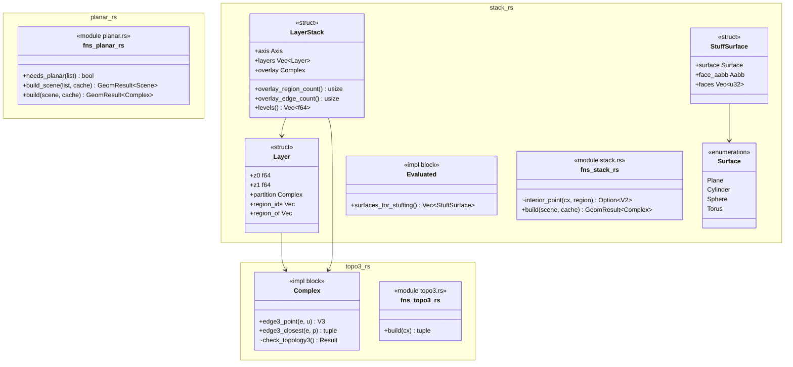

# 3D kernel: code

C4 level 4 (code) of the component **3D kernel** (`geom.kernel3d`) in the container **geom** (crate `geom`). [Component view of the container](../../3-components/geom.md) · [All code pages](../README.md)

> Prismatic models as a layer stack, general planar-faced solids, and the edges and vertices of a 3D model.

**Decisions:** [ADR 3](../../../adr/0003-geom-is-a-lean-separate-kernel.md), [ADR 1](../../../adr/0001-one-public-wafer-frame.md)  
**Size:** 3 files, 2202 lines.

## Files

| File | Lines | What it says about itself |
|---|---:|---|
| `crates/geom/src/planar.rs` | 1060 | General planar-faced solids: convex polyhedra (boxes in any orientation, tapered extrusions, half-space cuts at any angle) combined by Booleans. Used when a model is not a stack of z-prisms (a rotation about x or y, a tapered extrusion, ... |
| `crates/geom/src/stack.rs` | 856 | Prismatic 3D models as a *layer stack*: the model is cut at every z level where a solid starts or ends; each layer is a 2D arrangement of the solids active in it, and the *overlay* is the common refinement of all layers (every layer boun... |
| `crates/geom/src/topo3.rs` | 286 | Edges and vertices of a 3D (layer stack) model, derived from its face fragments so that the topology is closed and checkable. |

## What it uses

| Target | Modules | Items |
|---|---|---|
| [Evaluation](./evaluation.md) | eval, scene | Cache, Evaluated, Node, PmlInfo, RegionX, Scene, axis_perm, cap_role, stack_axis |
| [Feature list](./featurelist.md) | error, expr, model | Axis, Env, Expr, GeomError, GeomResult, NameScheme, RegionKind |
| [2D kernel](./kernel2d.md) | arrange, complex, curve, prim | Body, Curve, GRAZE_K, Prim, Revolved, arrange, arrange_with |
| [Math helpers](./math.md) | math |  |
| [Display tessellation](./tessellation.md) | tess | triangulate |

## Used by

| Component | Modules | Items |
|---|---|---|
| [Evaluation](./evaluation.md) | planar, stack | LayerStack, build, build_scene, needs_planar |
| [2D kernel](./kernel2d.md) | stack | LayerStack, interior_point |

## Class diagram

Public types with their public fields (or variants) and methods, free functions per file as a `module` box; arrows are field types and `impl Trait`. Capped at 36 types and a few members each; the table below is complete.

## Public items

| Kind | Item | File:line | Signature or summary |
|---|---|---|---|
| fn | `needs_planar` | `planar.rs:23` | `pub fn needs_planar(list: &FeatureList) -> bool` —  True when the model needs the polyhedral path. |
| fn | `build_scene` | `planar.rs:348` | `pub fn build_scene(list: &FeatureList, cache: &mut Cache) -> GeomResult<Scene>` —  Scene of a polyhedral model. |
| fn | `build` | `planar.rs:587` | `pub fn build(scene: &Scene, cache: &mut Cache) -> GeomResult<Complex>` —  The region complex of a polyhedral scene. |
| struct | `Layer` | `stack.rs:20` | fields: `z0`, `z1`, `partition`, `region_ids`, `region_of` |
| struct | `LayerStack` | `stack.rs:32` | fields: `axis`, `layers`, `overlay` |
| fn | `interior_point` | `stack.rs:78` | `pub(crate) fn interior_point(cx: &Complex, region: u32) -> Option<V2>` —  A point strictly inside an overlay cell (halfway along an inward ray from the middle of its first boundary edge). |
| fn | `build` | `stack.rs:118` | `pub fn build(scene: &Scene, cache: &mut Cache) -> GeomResult<Complex>` |
| enum | `Surface` | `stack.rs:559` | variants: `Plane`, `Cylinder`, `Sphere`, `Torus` —  An analytic surface that bounds faces (what an isosurface-stuffing mesher intersects its lattice with). |
| struct | `StuffSurface` | `stack.rs:584` | fields: `surface`, `face_aabb`, `faces` —  One surface with the faces on it and the extent of those faces, so a mesher keeps a *local* surface list per lattice cell. |
| fn | `LayerStack::overlay_region_count` | `stack.rs:41` | `pub fn overlay_region_count(&self) -> usize` —  Number of cells of the common refinement (a count: the overlay itself lives in the internal sweep frame). |
| fn | `LayerStack::overlay_edge_count` | `stack.rs:44` | `pub fn overlay_edge_count(&self) -> usize` |
| fn | `LayerStack::levels` | `stack.rs:49` | `pub fn levels(&self) -> Vec<f64>` —  Z levels where layers start or end, ascending. |
| fn | `Evaluated::surfaces_for_stuffing` | `stack.rs:592` | `pub fn surfaces_for_stuffing(&self) -> Vec<StuffSurface>` —  Surfaces (planes and cylinders; coincident faces share one) with the face extents, in a deterministic order. |
| fn | `build` | `topo3.rs:17` | `pub fn build(cx: &Complex) -> (Vec<Edge3>, Vec<Vertex>)` |
| fn | `Complex::edge3_point` | `topo3.rs:161` | `pub fn edge3_point(&self, e: u32, u: f64) -> V3` —  Point of a 3D edge at fraction `u` of its parameter range. |
| fn | `Complex::edge3_closest` | `topo3.rs:188` | `pub fn edge3_closest(&self, e: u32, p: V3) -> (V3, f64)` —  Closest point of a 3D edge to `p`, with its fraction. |
| fn | `Complex::check_topology3` | `topo3.rs:221` | `pub(crate) fn check_topology3(&self) -> Result<(), String>` —  Topology checks of a 3D complex: every edge is shared by at least two distinct faces, and the edges around every face add up to |
