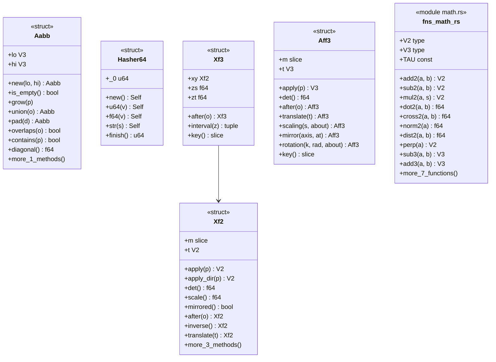

# Math helpers: code

C4 level 4 (code) of the component **Math helpers** (`geom.math`) in the container **geom** (crate `geom`). [Component view of the container](../../3-components/geom.md) · [All code pages](../README.md)

> Small vector, box and similarity-transform helpers.

**Decisions:** [ADR 3](../../../adr/0003-geom-is-a-lean-separate-kernel.md)  
**Size:** 1 file, 340 lines.

## Files

| File | Lines | What it says about itself |
|---|---:|---|
| `crates/geom/src/math.rs` | 340 | Small vector, box and similarity-transform helpers (2D and 3D, `f64`, plain arrays). |

## What it uses

Nothing outside the component (the standard library and external crates are not listed).

## Used by

| Component | Modules | Items |
|---|---|---|
| [femcore: Meshing facade](../femcore/meshing.md) | math | Aabb, V2, dist2 |
| [femcore: 3D meshing](../femcore/meshing3d.md) | math | Aabb, V2, V3, cross3, dist2, dot3, sub3 |
| [Evaluation](./evaluation.md) | math | Hasher64 |
| [Feature list](./featurelist.md) | math |  |
| [2D kernel](./kernel2d.md) | math |  |
| [3D kernel](./kernel3d.md) | math |  |
| [Queries and selectors](./queries.md) | math | Aabb, V2 |
| [Display tessellation](./tessellation.md) | math |  |

## Class diagram

Public types with their public fields (or variants) and methods, free functions per file as a `module` box; arrows are field types and `impl Trait`. Capped at 36 types and a few members each; the table below is complete.

## Public items

| Kind | Item | File:line | Signature or summary |
|---|---|---|---|
| type | `V2` | `math.rs:3` |  |
| type | `V3` | `math.rs:4` |  |
| const | `TAU` | `math.rs:6` | `f64` |
| fn | `add2` | `math.rs:9` | `pub fn add2(a: V2, b: V2) -> V2` |
| fn | `sub2` | `math.rs:13` | `pub fn sub2(a: V2, b: V2) -> V2` |
| fn | `mul2` | `math.rs:17` | `pub fn mul2(a: V2, s: f64) -> V2` |
| fn | `dot2` | `math.rs:21` | `pub fn dot2(a: V2, b: V2) -> f64` |
| fn | `cross2` | `math.rs:25` | `pub fn cross2(a: V2, b: V2) -> f64` |
| fn | `norm2` | `math.rs:29` | `pub fn norm2(a: V2) -> f64` |
| fn | `dist2` | `math.rs:33` | `pub fn dist2(a: V2, b: V2) -> f64` |
| fn | `perp` | `math.rs:38` | `pub fn perp(a: V2) -> V2` —  Rotation by +90 degrees (the left normal of a direction). |
| fn | `sub3` | `math.rs:43` | `pub fn sub3(a: V3, b: V3) -> V3` |
| fn | `add3` | `math.rs:47` | `pub fn add3(a: V3, b: V3) -> V3` |
| fn | `mul3` | `math.rs:51` | `pub fn mul3(a: V3, s: f64) -> V3` |
| fn | `dot3` | `math.rs:55` | `pub fn dot3(a: V3, b: V3) -> f64` |
| fn | `cross3` | `math.rs:59` | `pub fn cross3(a: V3, b: V3) -> V3` |
| fn | `norm3` | `math.rs:63` | `pub fn norm3(a: V3) -> f64` |
| fn | `unit3` | `math.rs:67` | `pub fn unit3(a: V3) -> V3` |
| fn | `to3` | `math.rs:76` | `pub fn to3(p: V2) -> V3` |
| fn | `wrap_from` | `math.rs:82` | `pub fn wrap_from(t: f64, base: f64) -> f64` —  Angle of `a` relative to `base`, wrapped into `[base, base + TAU)`. |
| struct | `Aabb` | `math.rs:88` | fields: `lo`, `hi` —  Axis-aligned box (2D or 3D; 2D boxes keep z = 0). |
| struct | `Xf2` | `math.rs:139` | fields: `m`, `t` —  Similarity transform of the plane: `p -> m p + t` with `m = s * R` or `s * R * mirror`. |
| struct | `Hasher64` | `math.rs:201` | fields: `_0` —  64-bit content hasher (splitmix-style mixing); deterministic across runs and platforms. |
| struct | `Xf3` | `math.rs:237` | fields: `xy`, `zs`, `zt` —  Placement of a solid: a plane similarity plus an affine map of z (`z -> zs * z + zt`, `zs = +-scale`). |
| struct | `Aff3` | `math.rs:271` | fields: `m`, `t` —  General affine map of space (rotations about any axis, mirrors, uniform scale, translation), used by polyhedral solids. |
| fn | `Aabb::new` | `math.rs:96` | `pub fn new(lo: V3, hi: V3) -> Aabb` |
| fn | `Aabb::is_empty` | `math.rs:99` | `pub fn is_empty(&self) -> bool` |
| fn | `Aabb::grow` | `math.rs:102` | `pub fn grow(&mut self, p: V3)` |
| fn | `Aabb::union` | `math.rs:108` | `pub fn union(&self, o: &Aabb) -> Aabb` |
| fn | `Aabb::pad` | `math.rs:116` | `pub fn pad(&self, d: f64) -> Aabb` |
| fn | `Aabb::overlaps` | `math.rs:119` | `pub fn overlaps(&self, o: &Aabb) -> bool` |
| fn | `Aabb::contains` | `math.rs:122` | `pub fn contains(&self, p: V3) -> bool` |
| fn | `Aabb::diagonal` | `math.rs:125` | `pub fn diagonal(&self) -> f64` |
| fn | `Aabb::center` | `math.rs:132` | `pub fn center(&self) -> V3` |
| fn | `Xf2::apply` | `math.rs:147` | `pub fn apply(&self, p: V2) -> V2` |
| fn | `Xf2::apply_dir` | `math.rs:151` | `pub fn apply_dir(&self, p: V2) -> V2` —  Linear part only (directions). |
| fn | `Xf2::det` | `math.rs:154` | `pub fn det(&self) -> f64` |
| fn | `Xf2::scale` | `math.rs:158` | `pub fn scale(&self) -> f64` —  Uniform scale factor. |
| fn | `Xf2::mirrored` | `math.rs:161` | `pub fn mirrored(&self) -> bool` |
| fn | `Xf2::after` | `math.rs:165` | `pub fn after(&self, o: &Xf2) -> Xf2` —  `self` applied after `o`. |
| fn | `Xf2::inverse` | `math.rs:173` | `pub fn inverse(&self) -> Xf2` |
| fn | `Xf2::translate` | `math.rs:179` | `pub fn translate(t: V2) -> Xf2` |
| fn | `Xf2::rotate` | `math.rs:182` | `pub fn rotate(rad: f64) -> Xf2` |
| fn | `Xf2::scaling` | `math.rs:186` | `pub fn scaling(s: f64) -> Xf2` |
| fn | `Xf2::mirror` | `math.rs:190` | `pub fn mirror(axis: usize, at: f64) -> Xf2` —  Reflection across the line `p[axis] = at`. |
| fn | `Hasher64::new` | `math.rs:204` | `pub fn new() -> Self` |
| fn | `Hasher64::u64` | `math.rs:207` | `pub fn u64(&mut self, v: u64) -> &mut Self` |
| fn | `Hasher64::f64` | `math.rs:214` | `pub fn f64(&mut self, v: f64) -> &mut Self` |
| fn | `Hasher64::str` | `math.rs:217` | `pub fn str(&mut self, s: &str) -> &mut Self` |
| fn | `Hasher64::finish` | `math.rs:224` | `pub fn finish(&self) -> u64` |
| fn | `Xf3::after` | `math.rs:246` | `pub fn after(&self, o: &Xf3) -> Xf3` —  `self` applied after `o`. |
| fn | `Xf3::interval` | `math.rs:249` | `pub fn interval(&self, z: (f64, f64)) -> (f64, f64)` |
| fn | `Xf3::key` | `math.rs:253` | `pub fn key(&self) -> [u64` |
| fn | `Aff3::apply` | `math.rs:278` | `pub fn apply(&self, p: V3) -> V3` |
| fn | `Aff3::det` | `math.rs:282` | `pub fn det(&self) -> f64` |
| fn | `Aff3::after` | `math.rs:288` | `pub fn after(&self, o: &Aff3) -> Aff3` —  `self` applied after `o`. |
| fn | `Aff3::translate` | `math.rs:297` | `pub fn translate(t: V3) -> Aff3` |
| fn | `Aff3::scaling` | `math.rs:300` | `pub fn scaling(s: f64, about: V3) -> Aff3` |
| fn | `Aff3::mirror` | `math.rs:304` | `pub fn mirror(axis: usize, at: f64) -> Aff3` —  Reflection across the plane `p[axis] = at`. |
| fn | `Aff3::rotation` | `math.rs:311` | `pub fn rotation(k: V3, rad: f64, about: V3) -> Aff3` —  Rotation by `rad` about the line through `about` along the unit vector `k` (Rodrigues). |
| fn | `Aff3::key` | `math.rs:321` | `pub fn key(&self) -> [u64` |

Trait implementations in this component: `Hasher64: Default`
