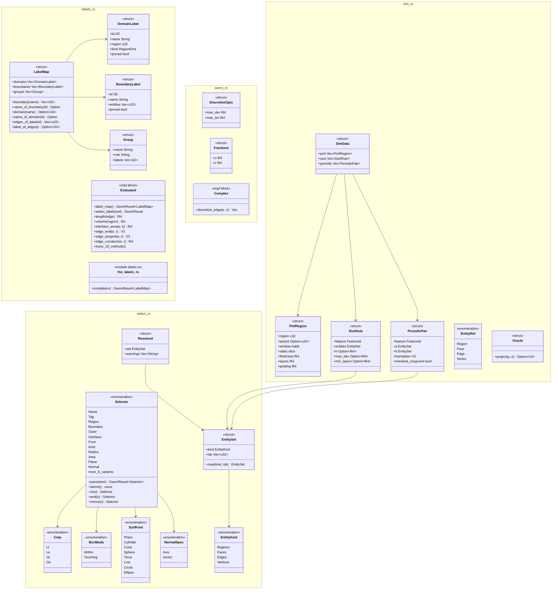

# Queries and selectors: code

C4 level 4 (code) of the component **Queries and selectors** (`geom.queries`) in the container **geom** (crate `geom`). [Component view of the container](../../3-components/geom.md) · [All code pages](../README.md)

> Exact queries on an evaluated model, serialisable selectors, the LabelMap between names and the integer labels solvers consume, and simulation operations as data.

**Decisions:** [ADR 2](../../../adr/0002-geometry-as-named-feature-list.md), [ADR 3](../../../adr/0003-geom-is-a-lean-separate-kernel.md), [ADR 7](../../../adr/0007-metric-adaptation-and-structured-pml.md), [ADR 18](../../../adr/0018-curved-elements-deferred.md)  
**Size:** 4 files, 1915 lines.

## Files

| File | Lines | What it says about itself |
|---|---:|---|
| `crates/geom/src/labels.rs` | 230 | `LabelMap`: the compiled, deterministic mapping between names and the integer labels the solvers consume. Domain label = region (1-based in overlay order, pins honoured and checked); boundary label = one per facet (ordered by provenance,... |
| `crates/geom/src/query.rs` | 405 | Exact queries on an evaluated 2D model: measures, curve evaluation with first and second derivatives, curvature radii, chord / facet deviation, edge discretisation by deviation and size, midpoint projection (where a quadratic element put... |
| `crates/geom/src/select.rs` | 1034 | Selectors: small serialisable rules that resolve against an evaluated complex to typed entity sets (regions, facets, vertices). The text form (`name(core.top) \| interface(Si, BOX)`) parses to the serde form and prints back deterministica... |
| `crates/geom/src/sim.rs` | 246 | Simulation operations as *data*: absorbing-layer regions, mesh size rules, periodic face pairs (verified congruent), and the projection oracle. geom describes which entities and how; femcore decides what a condition means and applies it. |

## What it uses

| Target | Modules | Items |
|---|---|---|
| [Evaluation](./evaluation.md) | eval, scene | Evaluated, axis_perm |
| [Feature list](./featurelist.md) | error, expr, model | Axis, Expr, GeomError, GeomResult, Op, RegionKind |
| [2D kernel](./kernel2d.md) | complex, curve | Complex, Curve, FaceGeom, curve_kind |
| [Math helpers](./math.md) | math |  |

## Used by

| Component | Modules | Items |
|---|---|---|
| [engine: Geometry operations](../engine/geometry.md) | select | Selector |
| [engine: Meshing seam](../engine/meshing.md) | labels, select | EntityKind, EntitySet, LabelMap, Selector |
| [femcore: Fixtures and test kit](../femcore/fixtures.md) | select | Selector |
| [femcore: Meshing facade](../femcore/meshing.md) | labels, query, select | DiscretizeOpts, EntityKind, LabelMap, Selector |
| [femcore: 3D meshing](../femcore/meshing3d.md) | labels, query, select | DiscretizeOpts, EntityKind, LabelMap |
| [Evaluation](./evaluation.md) | sim | SimData |
| [Feature list](./featurelist.md) | select | Selector |
| [Display tessellation](./tessellation.md) | query | DiscretizeOpts |

## Class diagram

Public types with their public fields (or variants) and methods, free functions per file as a `module` box; arrows are field types and `impl Trait`. Capped at 36 types and a few members each; the table below is complete.

## Public items

| Kind | Item | File:line | Signature or summary |
|---|---|---|---|
| struct | `DomainLabel` | `labels.rs:12` | fields: `id`, `name`, `region`, `kind`, `pinned` |
| struct | `BoundaryLabel` | `labels.rs:21` | fields: `id`, `name`, `entities`, `pinned` |
| struct | `Group` | `labels.rs:31` | fields: `name`, `rule`, `labels` —  A named group of boundary labels and the rule that produced it. |
| struct | `LabelMap` | `labels.rs:38` | fields: `domains`, `boundaries`, `groups` |
| fn | `compile` | `labels.rs:82` | `pub fn compile(ev: &Evaluated) -> GeomResult<LabelMap>` |
| fn | `LabelMap::boundary` | `labels.rs:46` | `pub fn boundary(&self, name: &str) -> Vec<i32>` —  All boundary labels whose name is `name` (a face split into fragments has several). |
| fn | `LabelMap::name_of_boundary` | `labels.rs:55` | `pub fn name_of_boundary(&self, id: i32) -> Option<&str>` |
| fn | `LabelMap::domain` | `labels.rs:58` | `pub fn domain(&self, name: &str) -> Option<i32>` |
| fn | `LabelMap::name_of_domain` | `labels.rs:61` | `pub fn name_of_domain(&self, id: i32) -> Option<&str>` |
| fn | `LabelMap::edges_of_label` | `labels.rs:64` | `pub fn edges_of_label(&self, id: i32) -> Vec<u32>` |
| fn | `LabelMap::label_of_edge` | `labels.rs:67` | `pub fn label_of_edge(&self, e: u32) -> Option<i32>` |
| fn | `Evaluated::label_map` | `labels.rs:210` | `pub fn label_map(&self) -> GeomResult<LabelMap>` |
| fn | `Evaluated::select_labels` | `labels.rs:215` | `pub fn select_labels(&self, sel: &Selector) -> GeomResult<Vec<i32>>` —  Integer labels (boundary labels for facets, domain labels for regions) a selector resolves to. |
| struct | `DiscretizeOpts` | `query.rs:22` | fields: `max_dev`, `max_len` |
| struct | `Fractions` | `query.rs:29` | fields: `u`, `v` —  Parametric position on an entity: one fraction along an edge (`v` is 0), two for a face. |
| fn | `Evaluated::length` | `query.rs:38` | `pub fn length(&self, edge: u32) -> f64` —  Length of an edge. |
| fn | `Evaluated::volume` | `query.rs:42` | `pub fn volume(&self, region: u32) -> f64` —  Area of a region (volume in 3D). |
| fn | `Evaluated::interface_area` | `query.rs:46` | `pub fn interface_area(&self, a: u32, b: u32) -> f64` —  Measure of the interface between two regions: length of the shared edges in 2D, area in 3D. |
| fn | `Evaluated::edge_eval` | `query.rs:54` | `pub fn edge_eval(&self, e: u32, t: f64) -> V3` |
| fn | `Evaluated::edge_tangent` | `query.rs:58` | `pub fn edge_tangent(&self, e: u32, t: f64) -> V3` |
| fn | `Evaluated::edge_curvature` | `query.rs:63` | `pub fn edge_curvature(&self, e: u32, t: f64) -> f64` —  Signed curvature along the canonical direction (positive: turns left). |
| fn | `Evaluated::edge_closest` | `query.rs:67` | `pub fn edge_closest(&self, e: u32, p: V3) -> (V3, f64)` —  Closest point of the edge (between its end points) and its parameter. |
| fn | `Evaluated::min_radius_of_curvature` | `query.rs:75` | `pub fn min_radius_of_curvature(&self, e: u32) -> f64` —  Smallest radius of curvature on the edge (infinite for a line); a mesher derives `n = pi / acos(1 - d / r)` chords from it. |
| fn | `Evaluated::chord_deviation` | `query.rs:94` | `pub fn chord_deviation(&self, e: u32, ta: f64, tb: f64) -> f64` —  Largest distance between the curve on `[ta, tb]` and its chord (exact for lines and circles, sampled for ellipses). |
| fn | `Evaluated::facet_deviation` | `query.rs:99` | `pub fn facet_deviation(&self, e: u32, pts: &[V3]) -> f64` —  Largest distance from the polyline through `pts` (straight facets) to the exact edge, sampled along each segment. |
| fn | `Evaluated::point_at_mid` | `query.rs:113` | `pub fn point_at_mid(&self, e: u32, ta: f64, tb: f64) -> (f64, V3)` —  The point of the exact edge nearest the midpoint of the chord between parameters `ta` and `tb` (the mid-edge node of a |
| fn | `Evaluated::project_midpoint` | `query.rs:128` | `pub fn project_midpoint(&self, e: u32, a: V3, b: V3) -> V3` —  The point of the exact edge nearest the chord midpoint of two positions on (or near) the edge; valid for chords up to a half turn. |
| fn | `Evaluated::discretize_edge` | `query.rs:134` | `pub fn discretize_edge(&self, e: u32, o: DiscretizeOpts) -> Vec<(f64, V3)>` —  Points `(t, p)` along the edge, end points included, such that the chord deviation is at most `max_dev` and each chord is at |
| fn | `Evaluated::fractions_of` | `query.rs:143` | `pub fn fractions_of(&self, ent: EntityRef, p: V3) -> Option<Fractions>` —  Fractions of the point of the entity closest to `p`. Edges: `u` in `[0, 1]` along `[t0, t1]`. Returns `None` for entities |
| fn | `Evaluated::position_at` | `query.rs:203` | `pub fn position_at(&self, ent: EntityRef, fr: Fractions) -> Option<V3>` —  The exact point of the entity at the given fractions. |
| fn | `Evaluated::topology_signature` | `query.rs:255` | `pub fn topology_signature(&self) -> u64` —  Hash of the combinatorial structure only: regions (kinds), edges (curve kinds, end vertices, sides, origins and names), |
| fn | `Evaluated::overlay_geometry_hash` | `query.rs:336` | `pub fn overlay_geometry_hash(&self) -> Option<u64>` —  Hash of the xy geometry of the overlay of a layer stack (curves and edge ranges): unchanged when only z extents move. |
| fn | `Complex::discretize_edge` | `query.rs:352` | `pub fn discretize_edge(&self, e: u32, o: DiscretizeOpts) -> Vec<(f64, V3)>` |
| enum | `Cmp` | `select.rs:19` | variants: `Lt`, `Le`, `Gt`, `Ge` |
| enum | `BoxMode` | `select.rs:27` | variants: `Within`, `Touching` |
| enum | `SurfKind` | `select.rs:33` | variants: `Plane`, `Cylinder`, `Cone`, `Sphere`, `Torus`, `Line`, `Circle`, `Ellipse` |
| enum | `NormalSpec` | `select.rs:45` | variants: `Axis`, `Vector` |
| enum | `Selector` | `select.rs:55` | variants: `Name`, `Tag`, `Region`, `Boundary`, `Outer`, `Interface`, `From`, `Kind`, `Radius`, `Area`, `Plane`, `Normal`, ... |
| enum | `EntityKind` | `select.rs:80` | variants: `Regions`, `Faces`, `Edges`, `Vertices` |
| struct | `EntitySet` | `select.rs:88` | fields: `kind`, `ids` |
| struct | `Resolved` | `select.rs:103` | fields: `set`, `warnings` |
| fn | `EntitySet::new` | `select.rs:95` | `pub fn new(kind: EntityKind, mut ids: Vec<u32>) -> EntitySet` |
| fn | `Selector::parse` | `select.rs:495` | `pub fn parse(text: &str) -> GeomResult<Selector>` |
| fn | `Selector::atoms` | `select.rs:498` | `pub fn atoms(&self) -> usize` |
| fn | `Selector::or` | `select.rs:505` | `pub fn or(self, o: Selector) -> Selector` |
| fn | `Selector::and` | `select.rs:508` | `pub fn and(self, o: Selector) -> Selector` |
| fn | `Selector::minus` | `select.rs:511` | `pub fn minus(self, o: Selector) -> Selector` |
| fn | `Evaluated::resolve` | `select.rs:882` | `pub fn resolve(&self, sel: &Selector) -> GeomResult<Resolved>` —  Resolves a selector to an entity set plus warnings (an empty result is a warning, not an error). |
| fn | `Evaluated::resolve_inner` | `select.rs:886` | `pub(crate) fn resolve_inner(&self, sel: &Selector, no_id: bool) -> GeomResult<Resolved>` |
| fn | `Evaluated::suggest` | `select.rs:897` | `pub fn suggest(&self, picked: &EntitySet) -> Vec<Selector>` —  Selectors, simplest first, that each resolve to exactly `picked`; empty if none does. |
| struct | `PmlRegion` | `sim.rs:11` | fields: `region`, `parent`, `window`, `sides`, `thickness`, `layers`, `grading` |
| struct | `SizeRule` | `sim.rs:24` | fields: `feature`, `entities`, `h`, `max_dev`, `min_layers` |
| struct | `PeriodicPair` | `sim.rs:33` | fields: `feature`, `a`, `b`, `translation`, `checked_congruent` |
| enum | `EntityRef` | `sim.rs:42` | variants: `Region`, `Face`, `Edge`, `Vertex` |
| struct | `SimData` | `sim.rs:50` | fields: `pml`, `size`, `periodic` |
| struct | `Oracle` | `sim.rs:195` |  |
| fn | `Evaluated::pml_regions` | `sim.rs:57` | `pub fn pml_regions(&self) -> &[PmlRegion]` |
| fn | `Evaluated::size_rules` | `sim.rs:60` | `pub fn size_rules(&self) -> &[SizeRule]` |
| fn | `Evaluated::periodic_pairs` | `sim.rs:63` | `pub fn periodic_pairs(&self) -> &[PeriodicPair]` |
| fn | `Evaluated::compute_sim` | `sim.rs:67` | `pub(crate) fn compute_sim(&mut self) -> GeomResult<()>` |
| fn | `Evaluated::oracle` | `sim.rs:190` | `pub fn oracle(&self) -> Oracle<'_>` —  Projection oracle: closest point on an exact entity (shaped to be wrapped by femcore's `Geometry2::project`). |
| fn | `Oracle::project` | `sim.rs:201` | `pub fn project(&self, p: V3, e: EntityRef) -> Option<V3>` —  Closest point of the entity to `p`; `None` for an unknown id or an entity kind the model does not have. |

Trait implementations in this component: `Selector: Display`
