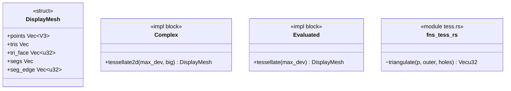

# Display tessellation: code

C4 level 4 (code) of the component **Display tessellation** (`geom.tessellation`) in the container **geom** (crate `geom`). [Component view of the container](../../3-components/geom.md) · [All code pages](../README.md)

> Tessellation for the viewport and picking only, never for meshing.

**Decisions:** [ADR 3](../../../adr/0003-geom-is-a-lean-separate-kernel.md)  
**Size:** 1 file, 280 lines.

## Files

| File | Lines | What it says about itself |
|---|---:|---|
| `crates/geom/src/tess.rs` | 280 | Display tessellation (viewport and picking only, never used for meshing): every edge is discretised once by deviation, region loops become polygons that are triangulated by hole bridging and ear clipping, and each triangle / segment carr... |

## What it uses

| Target | Modules | Items |
|---|---|---|
| [Evaluation](./evaluation.md) | eval | Evaluated |
| [2D kernel](./kernel2d.md) | complex | Complex, FaceGeom, Loop |
| [Math helpers](./math.md) | math |  |
| [Queries and selectors](./queries.md) | query | DiscretizeOpts |

## Used by

| Component | Modules | Items |
|---|---|---|
| [3D kernel](./kernel3d.md) | tess | triangulate |

## Class diagram

Public types with their public fields (or variants) and methods, free functions per file as a `module` box; arrows are field types and `impl Trait`. Capped at 36 types and a few members each; the table below is complete.

## Public items

| Kind | Item | File:line | Signature or summary |
|---|---|---|---|
| struct | `DisplayMesh` | `tess.rs:11` | fields: `points`, `tris`, `tri_face`, `segs`, `seg_edge` |
| fn | `triangulate` | `tess.rs:36` | `pub(crate) fn triangulate(p: &[V3], outer: Vec<u32>, mut holes: Vec<Vec<u32>>) -> Vec<[u32` —  Triangulates a counter-clockwise outer loop with clockwise holes (indices into `p`). |
| fn | `Complex::tessellate2d` | `tess.rs:124` | `pub fn tessellate2d(&self, max_dev: f64, big: f64) -> DisplayMesh` —  2D: triangles carrying region ids and polyline segments carrying edge ids. |
| fn | `Evaluated::tessellate` | `tess.rs:196` | `pub fn tessellate(&self, max_dev: f64) -> DisplayMesh` —  Triangles carrying region ids (2D) or face ids (3D) and polyline segments carrying edge ids (2D) or face ids (3D); chords |
