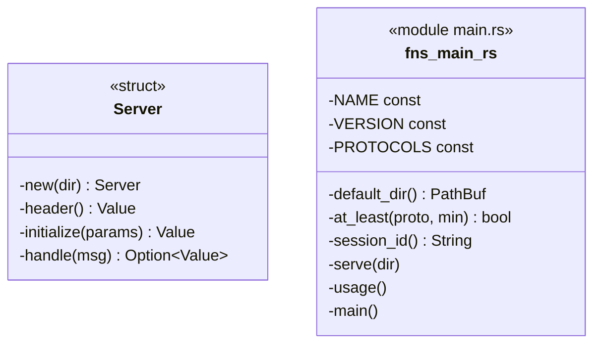

# Protocol loop: code

C4 level 4 (code) of the component **Protocol loop** (`mcp.protocol`) in the container **nyx-mcp** (crate `nyx_mcp`). [Component view of the container](../../3-components/mcp.md) · [All code pages](../README.md)

> Newline-delimited JSON-RPC 2.0 over stdin/stdout: initialize with protocol negotiation, method dispatch, notifications, logs on stderr. No async runtime and no SDK.

**Decisions:** [ADR 15](../../../adr/0015-ai-interface-separate-workspace-and-mcp-server.md), [ADR 57](../../../adr/0057-front-ends-are-thin-the-mcp-tools-are-engine-commands.md)  
**Size:** 1 file, 254 lines.

## Files

| File | Lines | What it says about itself |
|---|---:|---|
| `crates/nyx-mcp/src/main.rs` | 254 | nyx-mcp: a Model Context Protocol server over stdio for nyx. Newline-delimited JSON-RPC 2.0 on stdin/stdout, logs on stderr. No async runtime and no SDK: the protocol surface nyx needs is five methods. The server holds one `nyx_engine::E... |

## What it uses

| Target | Modules | Items |
|---|---|---|
| [container `engine` (nyx-engine)](../../3-components/engine.md) |  (declared: Server instructions text) |  |

## Used by

Nothing else in the workspace names this component (entry points are reached by the program or by tests).

## Class diagram

Public types with their public fields (or variants) and methods, free functions per file as a `module` box; arrows are field types and `impl Trait`. Capped at 36 types and a few members each; the table below is complete.

## Public items

| Kind | Item | File:line | Signature or summary |
|---|---|---|---|
| const | `NAME` | `main.rs:14` | `&str` |
| const | `VERSION` | `main.rs:15` | `&str` |
| const | `PROTOCOLS` | `main.rs:17` | `&[&str]` —  Protocol revisions this server speaks, newest first. It answers `initialize` with the client's if listed, else the newest. |
| fn | `default_dir` | `main.rs:19` | `fn default_dir() -> PathBuf` |
| fn | `at_least` | `main.rs:53` | `fn at_least(proto: &str, min: &str) -> bool` —  Protocol revisions compare as dates, so string order is chronological. |
| fn | `session_id` | `main.rs:58` | `fn session_id() -> String` —  A short id for this process: the session a result belongs to. |
| struct | `Server` | `main.rs:63` |  |
| fn | `serve` | `main.rs:168` | `fn serve(dir: PathBuf)` |
| fn | `usage` | `main.rs:197` | `fn usage()` |
| fn | `main` | `main.rs:201` | `fn main()` |
| fn | `Server::new` | `main.rs:72` | `fn new(dir: PathBuf) -> Server` |
| fn | `Server::header` | `main.rs:78` | `fn header(&self) -> Value` |
| fn | `Server::initialize` | `main.rs:83` | `fn initialize(&mut self, params: &Value) -> Value` |
| fn | `Server::handle` | `main.rs:135` | `fn handle(&mut self, msg: &Value) -> Option<Value>` —  One incoming message; `None` means no reply (notifications). |
