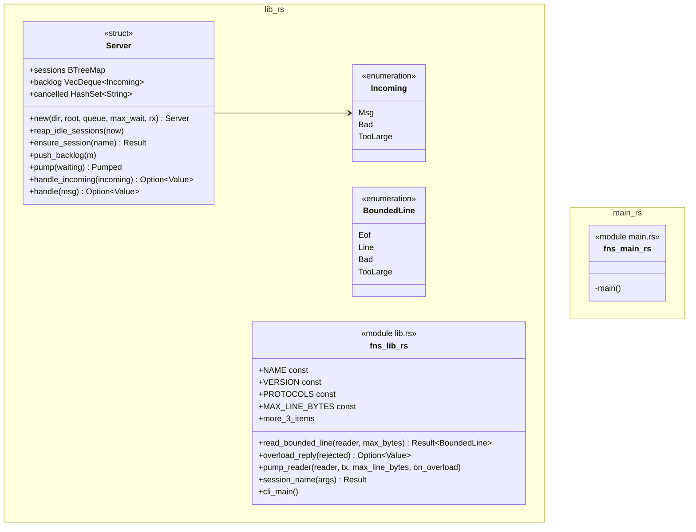

# Protocol loop: code

C4 level 4 (code) of the component **Protocol loop** (`mcp.protocol`) in the container **nyx-mcp** (crate `nyx_mcp`). [Component view of the container](../../3-components/mcp.md) · [All code pages](../README.md)

> Newline-delimited JSON-RPC 2.0 over stdio, no async runtime and no SDK; initialize, ping, tools/list and tools/call with bounded 16 MiB reader, sync_channel backlog, and session cap. `--dir` (workflows and saved scripts), `--root` (the folder a script's file arguments may name); `--job` is the engine's solve worker.

**Decisions:** [ADR 15](../../../adr/0015-ai-interface-separate-workspace-and-mcp-server.md), [ADR 57](../../../adr/0057-front-ends-are-thin-the-mcp-tools-are-engine-commands.md), [ADR 94](../../../adr/0094-the-mcp-server-is-four-script-tools-over-one-kernel.md), [ADR 131](../../../adr/0131-vvuq-p0-soundness-security-and-layer1-gates.md)  
**Size:** 2 files, 1085 lines.

## Files

| File | Lines | What it says about itself |
|---|---:|---|
| `crates/nyx-mcp/src/lib.rs` | 1077 |  |
| `crates/nyx-mcp/src/main.rs` | 8 |  |

## What it uses

| Target | Modules | Items |
|---|---|---|
| [container `engine` (nyx-engine)](../../3-components/engine.md) |  (declared: Server instructions text) |  |

## Used by

Nothing else in the workspace names this component (entry points are reached by the program or by tests).

## Class diagram

Public types with their public fields (or variants) and methods, free functions per file as a `module` box; arrows are field types and `impl Trait`. Capped at 36 types and a few members each; the table below is complete.

## Public items

| Kind | Item | File:line | Signature or summary |
|---|---|---|---|
| const | `NAME` | `lib.rs:29` | `&str` |
| const | `VERSION` | `lib.rs:30` | `&str` |
| const | `PROTOCOLS` | `lib.rs:32` | `&[&str]` —  Protocol revisions this server speaks, newest first. It answers `initialize` with the client's if listed, else the newest. |
| const | `MAX_LINE_BYTES` | `lib.rs:47` | `usize` —  Maximum accepted JSON-RPC line length on stdin (16 MiB). |
| const | `CHANNEL_CAP` | `lib.rs:49` | `usize` —  Bounded reader-to-server channel and backlog capacity. |
| const | `MAX_SESSIONS` | `lib.rs:51` | `usize` —  Maximum number of concurrent isolated MCP sessions (`"default"` plus named sessions). |
| const | `SESSION_IDLE_TTL` | `lib.rs:53` | `Duration` —  Idle timeout before inactive non-`"default"` sessions are reaped. |
| enum | `Incoming` | `lib.rs:146` | variants: `Msg`, `Bad`, `TooLarge` —  What the reader thread took from stdin. |
| enum | `BoundedLine` | `lib.rs:155` | variants: `Eof`, `Line`, `Bad`, `TooLarge` |
| fn | `read_bounded_line` | `lib.rs:162` | `pub fn read_bounded_line<R: BufRead>(reader: &mut R, max_bytes: usize) -> std::io::Result<BoundedLine>` |
| fn | `overload_reply` | `lib.rs:219` | `pub fn overload_reply(rejected: &Incoming) -> Option<Value>` |
| fn | `pump_reader` | `lib.rs:235` | `pub fn pump_reader<R: BufRead, F: FnMut(&Value) -> bool>( reader: &mut R, tx: &mpsc::SyncSender<Incoming>, max_line_bytes: usize, mut on_overload: F, )` |
| fn | `session_name` | `lib.rs:309` | `pub fn session_name(args: &Value) -> Result<String, String>` —  Validates the optional `session` name argument (default `"default"`). |
| struct | `Server` | `lib.rs:388` | fields: `sessions`, `backlog`, `cancelled` |
| fn | `cli_main` | `lib.rs:963` | `pub fn cli_main()` —  CLI entrypoint for the `nyx-mcp` server and `--job` worker dispatch. |
| fn | `Server::new` | `lib.rs:411` | `pub fn new(dir: PathBuf, root: PathBuf, queue: PathBuf, max_wait: f64, rx: mpsc::Receiver<Incoming>) -> Server` |
| fn | `Server::reap_idle_sessions` | `lib.rs:446` | `pub fn reap_idle_sessions(&mut self, now: Instant)` |
| fn | `Server::ensure_session` | `lib.rs:453` | `pub fn ensure_session(&mut self, name: &str) -> Result<&mut McpSession, (i64, String)>` |
| fn | `Server::push_backlog` | `lib.rs:481` | `pub fn push_backlog(&mut self, m: Incoming)` |
| fn | `Server::pump` | `lib.rs:493` | `pub fn pump(&mut self, waiting: Option<&str>) -> Pumped` —  Takes in what the reader thread has for the server and answers what needs no kernel at once (`ping`, `tools/list`); the rest waits its turn |
| fn | `Server::handle_incoming` | `lib.rs:881` | `pub fn handle_incoming(&mut self, incoming: Incoming) -> Option<Value>` —  One incoming message; `None` means no reply (notifications). |
| fn | `Server::handle` | `lib.rs:893` | `pub fn handle(&mut self, msg: &Value) -> Option<Value>` |
| fn | `main` | `main.rs:5` | `fn main()` |
