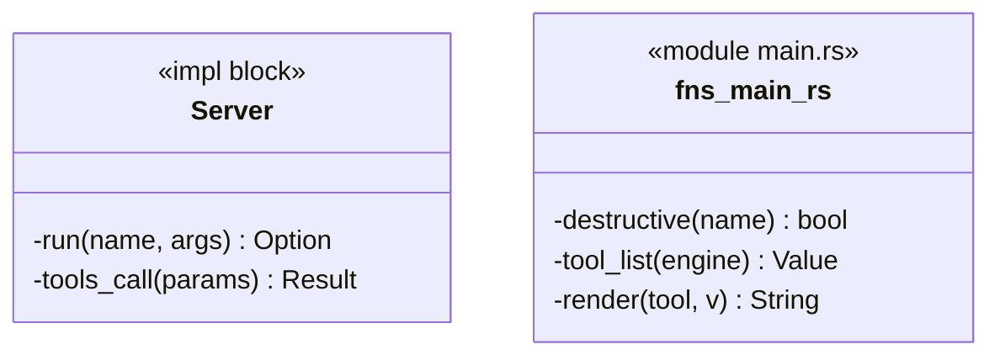

# Tool bridge: code

C4 level 4 (code) of the component **Tool bridge** (`mcp.tools`) in the container **nyx-mcp** (crate `nyx_mcp`). [Component view of the container](../../3-components/mcp.md) · [All code pages](../README.md)

> The tool list is the engine's command catalog (with annotations: read-only, destructive); a tool call is Engine::call, its reply rendered as text.

**Decisions:** [ADR 15](../../../adr/0015-ai-interface-separate-workspace-and-mcp-server.md), [ADR 57](../../../adr/0057-front-ends-are-thin-the-mcp-tools-are-engine-commands.md)  
**Size:** 1 file, 254 lines.

## Files

| File | Lines | What it says about itself |
|---|---:|---|
| `crates/nyx-mcp/src/main.rs` | 254 | nyx-mcp: a Model Context Protocol server over stdio for nyx. Newline-delimited JSON-RPC 2.0 on stdin/stdout, logs on stderr. No async runtime and no SDK: the protocol surface nyx needs is five methods. The server holds one `nyx_engine::E... |

## What it uses

| Target | Modules | Items |
|---|---|---|
| [container `engine` (nyx-engine)](../../3-components/engine.md) |  (declared: One tool per command: catalog and call) |  |

## Used by

Nothing else in the workspace names this component (entry points are reached by the program or by tests).

## Class diagram

Public types with their public fields (or variants) and methods, free functions per file as a `module` box; arrows are field types and `impl Trait`. Capped at 36 types and a few members each; the table below is complete.

## Public items

| Kind | Item | File:line | Signature or summary |
|---|---|---|---|
| fn | `destructive` | `main.rs:28` | `fn destructive(name: &str) -> bool` —  Commands that discard the project or a part of it: a host may ask the person first. |
| fn | `tool_list` | `main.rs:32` | `fn tool_list(engine: &Engine) -> Value` |
| fn | `render` | `main.rs:159` | `fn render(tool: &str, v: &Value) -> String` —  Text for the host: a guide is plain text, everything else compact JSON. |
| fn | `Server::run` | `main.rs:95` | `fn run(&mut self, name: &str, args: &Value) -> Option<(Value, bool)>` —  Runs one command: its JSON with the session header, or the error as JSON. `None` when there is no such tool. |
| fn | `Server::tools_call` | `main.rs:118` | `fn tools_call(&mut self, params: &Value) -> Result<Value, (i64, String)>` |
