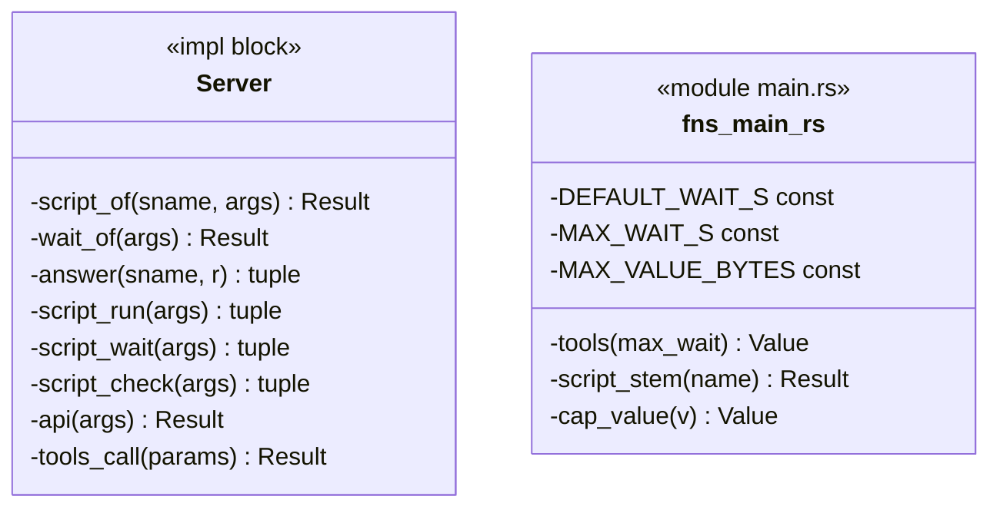

# Script tools: code

C4 level 4 (code) of the component **Script tools** (`mcp.tools`) in the container **nyx-mcp** (crate `nyx_mcp`). [Component view of the container](../../3-components/mcp.md) · [All code pages](../README.md)

> Four tools instead of one per command: `script_run` (a script on the kernel; `params`, `path`, `save_as`, `wait_s`, `allow_destructive`), `script_wait` (continue or cancel a script that is waiting for a job), `script_check` (the static check) and `api` (the guide, the command list, one command). One answer, as text, with the project header.

**Decisions:** [ADR 94](../../../adr/0094-the-mcp-server-is-four-script-tools-over-one-kernel.md), [ADR 57](../../../adr/0057-front-ends-are-thin-the-mcp-tools-are-engine-commands.md)  
**Size:** 1 file, 1070 lines.

## Files

| File | Lines | What it says about itself |
|---|---:|---|
| `crates/nyx-mcp/src/main.rs` | 1070 |  |

## What it uses

| Target | Modules | Items |
|---|---|---|
| [container `engine` (nyx-engine)](../../3-components/engine.md) |  (declared: The one engine the scripts drive, and its project header) |  |
| [container `script` (nyx-script)](../../3-components/script.md) |  (declared: api: the command list and one command's documentation) |  |

## Used by

Nothing else in the workspace names this component (entry points are reached by the program or by tests).

## Class diagram

Public types with their public fields (or variants) and methods, free functions per file as a `module` box; arrows are field types and `impl Trait`. Capped at 36 types and a few members each; the table below is complete.

## Public items

| Kind | Item | File:line | Signature or summary |
|---|---|---|---|
| const | `DEFAULT_WAIT_S` | `main.rs:34` | `f64` —  How long `script_run` and `script_wait` give a script before answering `running`, and the most they may be asked to. |
| const | `MAX_WAIT_S` | `main.rs:37` | `f64` —  The longest wait unless `--max-wait` says otherwise. Hosts end a tool call after 60 to 180 s (Antigravity: 180 s); an answer `running` is cheap, |
| const | `MAX_VALUE_BYTES` | `main.rs:45` | `usize` —  A script's value is cut past this many bytes of JSON: the point of a script is that fields stay in the engine. |
| fn | `tools` | `main.rs:72` | `fn tools(max_wait: f64) -> Value` |
| fn | `script_stem` | `main.rs:123` | `fn script_stem(name: &str) -> Result<String, String>` —  A saved script's file stem: letters, digits, `-` and `_`, with `.nys` allowed and dropped; nothing that names a folder. |
| fn | `cap_value` | `main.rs:132` | `fn cap_value(v: Value) -> Value` —  A value too long for a model's context is replaced by its start and its size. |
| fn | `Server::script_of` | `main.rs:574` | `fn script_of(&mut self, sname: &str, args: &Value) -> Result<(String, String), String>` —  The script a call names: its text and the name its errors and its run records carry. |
| fn | `Server::wait_of` | `main.rs:598` | `fn wait_of(&self, args: &Value) -> Result<(Duration, Option<f64>), String>` —  The wait a call asked for, cut to the longest wait of the server; the second is the value that was asked when it was cut. |
| fn | `Server::answer` | `main.rs:684` | `fn answer(&mut self, sname: &str, r: Result<Step, String>) -> (Value, bool)` —  The JSON the host gets for one answer of the kernel. |
| fn | `Server::script_run` | `main.rs:722` | `fn script_run(&mut self, args: &Value) -> (Value, bool)` |
| fn | `Server::script_wait` | `main.rs:769` | `fn script_wait(&mut self, args: &Value) -> (Value, bool)` |
| fn | `Server::script_check` | `main.rs:798` | `fn script_check(&mut self, args: &Value) -> (Value, bool)` |
| fn | `Server::api` | `main.rs:826` | `fn api(&self, args: &Value) -> Result<String, String>` —  Plain text: a guide card, the list of commands, or one command. |
| fn | `Server::tools_call` | `main.rs:839` | `fn tools_call(&mut self, params: &Value) -> Result<Value, (i64, String)>` |
