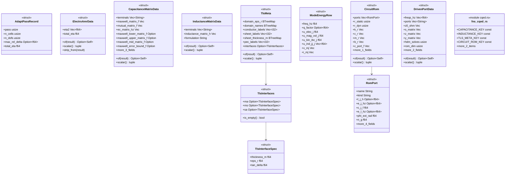

# cQED result payloads: code

C4 level 4 (code) of the component **cQED result payloads** (`physics.cqed`) in the container **nyx-physics** (crate `nyx_physics`). [Component view of the container](../../3-components/physics.md) · [All code pages](../README.md)

> Typed superconducting quantum-circuit payloads (capacitance and inductance matrices, TLS geometry metadata, passive CircuitRom, driven port parameters).

**Decisions:** [ADR 103](../../../adr/0103-multi-rhs-capacitance-and-gauge-stabilized-magnetostatics.md), [ADR 104](../../../adr/0104-bcs-surface-impedance-and-lumped-josephson-ports.md), [ADR 105](../../../adr/0105-kicq-epr-craig-bampton-quantization-and-tls-participation.md), [ADR 106](../../../adr/0106-driven-frequency-domain-waveports-and-hermite-prom.md)  
**Size:** 1 file, 356 lines.

## Files

| File | Lines | What it says about itself |
|---|---:|---|
| `crates/nyx-physics/src/cqed.rs` | 356 |  |

## What it uses

| Target | Modules | Items |
|---|---|---|
| [Result and frame](./result.md) | result | Scalar, SolveResult |

## Used by

| Component | Modules | Items |
|---|---|---|
| [analysis: Capacitance and inductance matrices](../analysis/capacitance.md) | cqed | CapacitanceMatrixData, InductanceMatrixData, TlsMeta |
| [analysis: cQED quantization and TLS participation](../analysis/cqed.md) | cqed | CapacitanceMatrixData, CircuitRom, DrivenPortData, ModeEnergyRow, RomPort, TlsMeta |
| [analysis: Piezo resonator analysis](../analysis/piezo.md) | cqed | DrivenPortData |
| [dfs: Electrostatics kernel](../dfs/electro.md) | cqed | CapacitanceMatrixData, ElectroAmrData, TlsMeta |
| [dfs: Magnetostatics kernel](../dfs/magneto.md) | cqed | InductanceMatrixData |
| [dfs: Typed problem](../dfs/problem.md) | cqed | TlsInterfaces |
| [ems: Driven frequency-domain and PROM](../ems/driven.md) | cqed | DrivenPortData |
| [ems: Thin-film IBC and Josephson ROM](../ems/ibc.md) | cqed | CircuitRom, ModeEnergyRow, RomPort, TlsMeta |
| [ems: Typed problem](../ems/problem.md) | cqed | TlsInterfaces |
| [engine: Analyses](../engine/analyse.md) | cqed | CapacitanceMatrixData, CircuitRom |
| [engine: Commands](../engine/commands.md) | cqed | CapacitanceMatrixData |
| [engine: Job runner and queue](../engine/jobs.md) | cqed | CAPACITANCE_KEY, CapacitanceMatrixData, ElectroAmrData, TlsMeta |
| [engine: Meshing seam](../engine/meshing.md) | cqed | AdaptPassRecord, CAPACITANCE_KEY, CapacitanceMatrixData, ElectroAmrData, TlsMeta |
| [Problem envelope](./envelope.md) | cqed | TlsInterfaceSpec, TlsInterfaces |
| [Physics trait and registry](./trait.md) | cqed | AdaptPassRecord, CAPACITANCE_KEY, CIRCUIT_ROM_KEY, CapacitanceMatrixData, CircuitRom, DRIVEN_PORT_KEY, DrivenPortData, ELECTRO_AMR_KEY +9 |
| [sms: Piezoelectric kernel](../sms/piezo.md) | cqed | DrivenPortData |

## Class diagram

Public types with their public fields (or variants) and methods, free functions per file as a `module` box; arrows are field types and `impl Trait`. Capped at 36 types and a few members each; the table below is complete.

## Public items

| Kind | Item | File:line | Signature or summary |
|---|---|---|---|
| const | `CAPACITANCE_KEY` | `cqed.rs:15` | `&str` —  Scalar key carrying `CapacitanceMatrixData` on a multi-terminal `dfs` electrostatic result. |
| const | `INDUCTANCE_KEY` | `cqed.rs:17` | `&str` —  Scalar key carrying `InductanceMatrixData` on a `dfs` magnetostatic result. |
| const | `TLS_META_KEY` | `cqed.rs:19` | `&str` —  Scalar key carrying `TlsMeta` on `dfs` or `ems` results for dielectric TLS surface participation. |
| const | `CIRCUIT_ROM_KEY` | `cqed.rs:21` | `&str` —  Scalar key carrying `CircuitRom` on `ems` `cavity` results with `lumped_jj` or `surface_impedance` sheets. |
| const | `DRIVEN_PORT_KEY` | `cqed.rs:23` | `&str` —  Scalar key carrying `DrivenPortData` on `ems` `driven` results. |
| const | `ELECTRO_AMR_KEY` | `cqed.rs:25` | `&str` —  Transient scalar key carrying per-cell `ElectroAmrData` during multi-pass electrostatic AMR (`AF-1`). |
| struct | `AdaptPassRecord` | `cqed.rs:41` | fields: `pass`, `n_cells`, `n_dofs`, `max_rel_delta`, `total_eta` —  Convergence record of one pass in a multi-pass goal-oriented electrostatic AMR loop (`AF-1`). |
| struct | `ElectroAmrData` | `cqed.rs:52` | fields: `eta2`, `total_eta` —  Per-cell electrostatic error indicators transferred from `nyx-dfs` to `nyx-engine` during multi-pass AMR (`AF-1`). |
| struct | `CapacitanceMatrixData` | `cqed.rs:74` | fields: `terminals`, `maxwell_matrix_f`, `mutual_matrix_f`, `ec_matrix_hz`, `maxwell_lower_matrix_f`, `maxwell_upper_matrix_f`, `maxwell_mid_matrix_f`, `maxwell_error_bound_f`, `conductance_matrix_s`, `q_dielectric_matrix`, `adapt_history` —  Multi-terminal Maxwell, SPICE/mutual capacitance matrices (F), charging energy matrix `E_C / h` (Hz), and optional |
| struct | `InductanceMatrixData` | `cqed.rs:107` | fields: `terminals`, `inductance_matrix_h`, `formulation` —  Multi-terminal inductance matrix `L` (H, or H/m for 2D cross-sections) from `dfs` magnetostatics. |
| struct | `TlsInterfaceSpec` | `cqed.rs:125` | fields: `thickness_m`, `eps_r`, `tan_delta` —  Native surface-oxide TLS loss layer parameters (`thickness_m`, `eps_r`, `tan_delta`). |
| struct | `TlsInterfaces` | `cqed.rs:133` | fields: `ma`, `ms`, `sa` —  Material-resolved `[interfaces.{ma,ms,sa}]` TLS surface-loss parameters. |
| struct | `TlsMeta` | `cqed.rs:150` | fields: `domain_eps_r`, `domain_names`, `conductor_labels`, `sheet_labels`, `sheet_thickness_m`, `pec_labels`, `interfaces` —  Domain permittivities and metallized boundary/sheet annotations used by `tls_participation`. |
| struct | `RomPort` | `cqed.rs:185` | fields: `name`, `kind`, `l_j_h`, `e_j_hz`, `c_j_f`, `e_l_hz`, `phi_ext_rad`, `n_g`, `squid_asymmetry`, `z0_ohm`, `direction`, `formulation` —  Metadata describing one lumped Josephson / nonlinear port inside `CircuitRom`. |
| struct | `ModeEnergyRow` | `cqed.rs:203` | fields: `freq_hz`, `q_factor`, `u_elec_j`, `u_mag_vol_j`, `u_kin_ibc_j`, `u_ind_jj_j`, `v_mj`, `i_mj` —  Exact energy partition and terminal phasors of one converged `ems` eigenmode. |
| struct | `CircuitRom` | `cqed.rs:218` | fields: `ports`, `r_static`, `r_dyn`, `k_r`, `c_r`, `m_r`, `b_r`, `c_port_f`, `modes` —  Multi-port Craig–Bampton passive reduced-order model `(K_r, C_r, M_r, B_r)` + exact modal energies. |
| struct | `DrivenPortData` | `cqed.rs:248` | fields: `freqs_hz`, `ports`, `z0_ohm`, `s_matrix`, `z_matrix`, `y_matrix`, `hdm_solves`, `rom_dim`, `anchor_freqs_hz`, `max_residual` —  Multi-frequency scattering, impedance, and admittance matrices from `ems` `driven` study. |
| fn | `ElectroAmrData::of` | `cqed.rs:58` | `pub fn of(result: &SolveResult) -> Option<Self>` |
| fn | `ElectroAmrData::scalar` | `cqed.rs:62` | `pub fn scalar(&self) -> (String, Scalar)` |
| fn | `ElectroAmrData::strip_from` | `cqed.rs:66` | `pub fn strip_from(result: &mut SolveResult)` |
| fn | `CapacitanceMatrixData::of` | `cqed.rs:96` | `pub fn of(result: &SolveResult) -> Option<Self>` |
| fn | `CapacitanceMatrixData::scalar` | `cqed.rs:100` | `pub fn scalar(&self) -> (String, Scalar)` |
| fn | `InductanceMatrixData::of` | `cqed.rs:114` | `pub fn of(result: &SolveResult) -> Option<Self>` |
| fn | `InductanceMatrixData::scalar` | `cqed.rs:118` | `pub fn scalar(&self) -> (String, Scalar)` |
| fn | `TlsInterfaces::is_empty` | `cqed.rs:143` | `pub fn is_empty(&self) -> bool` |
| fn | `TlsMeta::of` | `cqed.rs:174` | `pub fn of(result: &SolveResult) -> Option<Self>` |
| fn | `TlsMeta::scalar` | `cqed.rs:178` | `pub fn scalar(&self) -> (String, Scalar)` |
| fn | `CircuitRom::of` | `cqed.rs:237` | `pub fn of(result: &SolveResult) -> Option<Self>` |
| fn | `CircuitRom::scalar` | `cqed.rs:241` | `pub fn scalar(&self) -> (String, Scalar)` |
| fn | `DrivenPortData::of` | `cqed.rs:266` | `pub fn of(result: &SolveResult) -> Option<Self>` |
| fn | `DrivenPortData::scalar` | `cqed.rs:270` | `pub fn scalar(&self) -> (String, Scalar)` |
