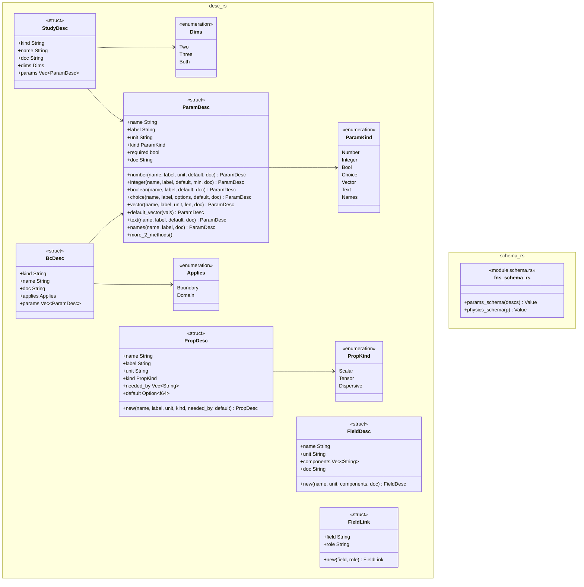

# Descriptors and schemas: code

C4 level 4 (code) of the component **Descriptors and schemas** (`physics.descriptors`) in the container **nyx-physics** (crate `nyx_physics`). [Component view of the container](../../3-components/physics.md) · [All code pages](../README.md)

> What a physics tells nyx about itself (studies, conditions, parameters) and the JSON Schemas generated from it for the window, the MCP server and the documentation.

**Decisions:** [ADR 25](../../../adr/0025-physics-trait-registry-and-problem-envelope.md)  
**Size:** 2 files, 344 lines.

## Files

| File | Lines | What it says about itself |
|---|---:|---|
| `crates/nyx-physics/src/desc.rs` | 240 |  |
| `crates/nyx-physics/src/schema.rs` | 104 |  |

## What it uses

| Target | Modules | Items |
|---|---|---|
| [container `femcore` (femcore)](../../3-components/femcore.md) | meshing::sizing | Sizing |
| [Physics trait and registry](./trait.md) | physics | Physics |

## Used by

| Component | Modules | Items |
|---|---|---|
| [engine: Materials](../engine/materials.md) | desc | ParamKind |
| [Problem envelope](./envelope.md) | desc | Applies, BcDesc, ParamDesc, ParamKind, PropDesc |
| [Test support](./testsupport.md) | schema | physics_schema |
| [Physics trait and registry](./trait.md) | crate root, desc | BcDesc, FieldDesc, FieldLink, ParamDesc, PropDesc, Sizing, StudyDesc |

## Class diagram

Public types with their public fields (or variants) and methods, free functions per file as a `module` box; arrows are field types and `impl Trait`. Capped at 36 types and a few members each; the table below is complete.

## Public items

| Kind | Item | File:line | Signature or summary |
|---|---|---|---|
| enum | `Dims` | `desc.rs:11` | variants: `Two`, `Three`, `Both` —  Which meshes a study runs on. |
| enum | `ParamKind` | `desc.rs:22` | variants: `Number`, `Integer`, `Bool`, `Choice`, `Vector`, `Text`, `Names` —  The type and range of one parameter. |
| struct | `ParamDesc` | `desc.rs:57` | fields: `name`, `label`, `unit`, `kind`, `required`, `doc` —  One named parameter of a study, a boundary condition or the physics. |
| struct | `StudyDesc` | `desc.rs:131` | fields: `kind`, `name`, `doc`, `dims`, `params` —  A kind of study (stationary, eigenfrequency, modes, ...). |
| enum | `Applies` | `desc.rs:143` | variants: `Boundary`, `Domain` —  Whether a boundary condition sits on a boundary (facet) selection or fills a domain. |
| struct | `BcDesc` | `desc.rs:149` | fields: `kind`, `name`, `doc`, `applies`, `params` |
| enum | `PropKind` | `desc.rs:160` | variants: `Scalar`, `Tensor`, `Dispersive` —  How a material property is given. |
| struct | `PropDesc` | `desc.rs:169` | fields: `name`, `label`, `unit`, `kind`, `needed_by`, `default` |
| struct | `FieldDesc` | `desc.rs:203` | fields: `name`, `unit`, `components`, `doc` —  A field a study produces. Components are named in wafer axes (`x` lateral, `y` propagation, `z` normal); empty is a scalar. |
| struct | `FieldLink` | `desc.rs:224` | fields: `field`, `role` —  One end of a one-way coupling between two physics (restructure plan section 2). A physics *exports* fields under a `role` and |
| fn | `ParamDesc::number` | `desc.rs:72` | `pub fn number(name: &str, label: &str, unit: &str, default: f64, doc: &str) -> ParamDesc` |
| fn | `ParamDesc::integer` | `desc.rs:75` | `pub fn integer(name: &str, label: &str, default: i64, min: i64, doc: &str) -> ParamDesc` |
| fn | `ParamDesc::boolean` | `desc.rs:78` | `pub fn boolean(name: &str, label: &str, default: bool, doc: &str) -> ParamDesc` |
| fn | `ParamDesc::choice` | `desc.rs:81` | `pub fn choice(name: &str, label: &str, options: &[&str], default: &str, doc: &str) -> ParamDesc` |
| fn | `ParamDesc::vector` | `desc.rs:90` | `pub fn vector(name: &str, label: &str, unit: &str, len: usize, doc: &str) -> ParamDesc` |
| fn | `ParamDesc::default_vector` | `desc.rs:94` | `pub fn default_vector(mut self, vals: Vec<f64>) -> ParamDesc` —  Sets the default vector for a `ParamKind::Vector` descriptor. |
| fn | `ParamDesc::text` | `desc.rs:101` | `pub fn text(name: &str, label: &str, default: &str, doc: &str) -> ParamDesc` |
| fn | `ParamDesc::names` | `desc.rs:104` | `pub fn names(name: &str, label: &str, doc: &str) -> ParamDesc` |
| fn | `ParamDesc::required` | `desc.rs:108` | `pub fn required(mut self) -> ParamDesc` —  Marks the parameter as one that must be given. |
| fn | `ParamDesc::range` | `desc.rs:113` | `pub fn range(mut self, lo: Option<f64>, hi: Option<f64>) -> ParamDesc` —  Sets the allowed range of a number or an integer. |
| fn | `PropDesc::new` | `desc.rs:182` | `pub fn new( name: &str, label: &str, unit: &str, kind: PropKind, needed_by: &[&str], default: Option<f64>, ) -> PropDesc` |
| fn | `FieldDesc::new` | `desc.rs:211` | `pub fn new(name: &str, unit: &str, components: &[&str], doc: &str) -> FieldDesc` |
| fn | `FieldLink::new` | `desc.rs:232` | `pub fn new(field: &str, role: &str) -> FieldLink` |
| fn | `params_schema` | `schema.rs:71` | `pub fn params_schema(descs: &[ParamDesc]) -> Value` —  The schema of an object made of `descs`: unknown keys are refused, required ones listed. |
| fn | `physics_schema` | `schema.rs:81` | `pub fn physics_schema(p: &dyn Physics) -> Value` —  The schema of a `ProblemSpec` for `p`: its study kinds, condition kinds, property names and physics options. |
