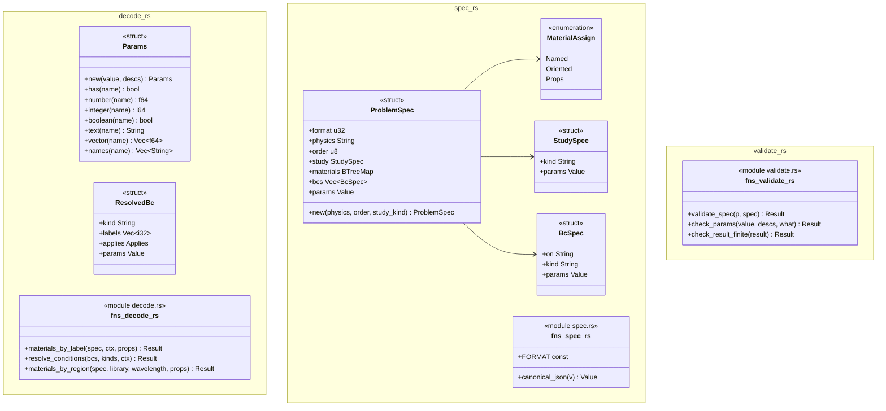

# Problem envelope: code

C4 level 4 (code) of the component **Problem envelope** (`physics.envelope`) in the container **nyx-physics** (crate `nyx_physics`). [Component view of the container](../../3-components/physics.md) · [All code pages](../README.md)

> The one shape every physics is given (ProblemSpec), its decoding into typed parameters with descriptor defaults and name resolution, and its structural validation.

**Decisions:** [ADR 25](../../../adr/0025-physics-trait-registry-and-problem-envelope.md), [ADR 41](../../../adr/0041-physics-crate-pattern-and-the-legacy-bridge.md), [ADR 63](../../../adr/0063-the-format-key-and-no-json-for-bulk-data.md)  
**Size:** 3 files, 534 lines.

## Files

| File | Lines | What it says about itself |
|---|---:|---|
| `crates/nyx-physics/src/decode.rs` | 259 | Decoding the problem envelope into what a kernel reads: typed parameters with the descriptor defaults, region names resolved to domain numbers (`materials_by_label`), condition selectors resolved to boundary or domain numbers (`resolve_c... |
| `crates/nyx-physics/src/spec.rs` | 99 | The problem envelope: the one shape every physics is given. Each physics owns the typed form of `study.params`, `bcs[].params` and `params` and validates them against its descriptors (`validate`); nothing physics-specific lives here. |
| `crates/nyx-physics/src/validate.rs` | 176 | Structural validation of a problem against the descriptors of its physics: the study and condition kinds exist, parameters have the declared type and range, unknown keys are reported, material property names are ones the physics reads (R... |

## What it uses

| Target | Modules | Items |
|---|---|---|
| [container `femcore` (femcore)](../../3-components/femcore.md) | material, material::elastic, material::spec, props | Class, Library, Materials, Tensor |
| [Descriptors and schemas](./descriptors.md) | desc | Applies, BcDesc, ParamDesc, ParamKind, PropDesc |
| [Result and frame](./result.md) | result | SolveResult |
| [Physics trait and registry](./trait.md) | error, physics | Ctx, Error, LabelResolver, Physics |

## Used by

| Component | Modules | Items |
|---|---|---|
| [dfs: Typed problem](../dfs/problem.md) | decode, spec | Params, ProblemSpec, materials_by_label, resolve_conditions |
| [ems: Physics adapter](../ems/adapter.md) | decode | Params, materials_by_region |
| [ems: Typed problem](../ems/problem.md) | decode, spec | Params, ProblemSpec, materials_by_label, resolve_conditions |
| [engine: Commands](../engine/commands.md) | spec, validate | BcSpec, MaterialAssign, ProblemSpec, StudySpec, canonical_json, validate_spec |
| [engine: Job runner](../engine/jobs.md) | validate | validate_spec |
| [engine: Materials](../engine/materials.md) | spec | ProblemSpec |
| [engine: Meshing seam](../engine/meshing.md) | spec | BcSpec |
| [engine: Project](../engine/project.md) | spec, validate | FORMAT, ProblemSpec, canonical_json, validate_spec |
| [engine: Store link](../engine/storeLink.md) | spec | MaterialAssign |
| [Test support](./testsupport.md) | spec | canonical_json |
| [Physics trait and registry](./trait.md) | spec, validate | BcSpec, FORMAT, MaterialAssign, ProblemSpec, StudySpec, canonical_json, check_params, check_result_finite +1 |
| [sms: Physics adapter](../sms/adapter.md) | decode | Params, materials_by_region |
| [sms: Typed problem](../sms/problem.md) | decode, spec | Params, ProblemSpec, materials_by_label, resolve_conditions |

## Class diagram

Public types with their public fields (or variants) and methods, free functions per file as a `module` box; arrows are field types and `impl Trait`. Capped at 36 types and a few members each; the table below is complete.

## Public items

| Kind | Item | File:line | Signature or summary |
|---|---|---|---|
| struct | `Params` | `decode.rs:15` |  Typed access to the parameters of a study, a condition or the physics: a value that was given, else the default of the descriptor. |
| fn | `materials_by_label` | `decode.rs:96` | `pub fn materials_by_label(spec: &ProblemSpec, ctx: &Ctx, props: &[PropDesc]) -> Result<Materials, Error>` —  The material properties of every region as numbers per domain label: a region name or pattern (`sapphire*`) can match several |
| struct | `ResolvedBc` | `decode.rs:207` | fields: `kind`, `labels`, `applies`, `params` —  A condition of the problem with its selector resolved to numbers: boundary numbers when the descriptor says `Boundary`, domain |
| fn | `resolve_conditions` | `decode.rs:215` | `pub fn resolve_conditions(bcs: &[BcSpec], kinds: &[BcDesc], ctx: &Ctx) -> Result<Vec<ResolvedBc>, Error>` —  Resolves the `on` selector of every condition. A selector that matches nothing is an error, naming the selector. |
| fn | `materials_by_region` | `decode.rs:236` | `pub fn materials_by_region( spec: &ProblemSpec, library: Option<&std::sync::Arc<femcore::material::Library>>, wavelength: Option<f64>, props: &[PropDesc], ) -> Result<(Vec<String>, Materials), Error>` —  Names the regions a problem gives materials to, for the physics' `sizing`: region `i` of the result is label `i + 1` of the returned |
| fn | `Params::new` | `decode.rs:21` | `pub fn new(value: &'a Value, descs: &'a [ParamDesc]) -> Params<'a>` |
| fn | `Params::has` | `decode.rs:37` | `pub fn has(&self, name: &str) -> bool` —  Whether the parameter was given in the problem (not defaulted). |
| fn | `Params::number` | `decode.rs:41` | `pub fn number(&self, name: &str) -> f64` |
| fn | `Params::integer` | `decode.rs:49` | `pub fn integer(&self, name: &str) -> i64` |
| fn | `Params::boolean` | `decode.rs:57` | `pub fn boolean(&self, name: &str) -> bool` |
| fn | `Params::text` | `decode.rs:66` | `pub fn text(&self, name: &str) -> String` —  Text or a choice. |
| fn | `Params::vector` | `decode.rs:74` | `pub fn vector(&self, name: &str) -> Vec<f64>` |
| fn | `Params::names` | `decode.rs:82` | `pub fn names(&self, name: &str) -> Vec<String>` |
| enum | `MaterialAssign` | `spec.rs:14` | variants: `Named`, `Oriented`, `Props` —  What the material of a region is. |
| struct | `StudySpec` | `spec.rs:25` | fields: `kind`, `params` —  The study: a `kind` the physics lists in `studies()` and its parameters. |
| struct | `BcSpec` | `spec.rs:33` | fields: `on`, `kind`, `params` —  A boundary or domain condition: `on` is a selector over the geometry (`outer & plane(x = 0)`) or a region name. |
| const | `FORMAT` | `spec.rs:41` | `u32` —  The file format of a problem (ADR 63). Written in every problem; a problem of another format is refused, there is no migration. |
| struct | `ProblemSpec` | `spec.rs:49` | fields: `format`, `physics`, `order`, `study`, `materials`, `bcs`, `params` —  A problem for one physics. |
| fn | `canonical_json` | `spec.rs:84` | `pub fn canonical_json(v: &Value) -> Value` —  The same JSON with every object's keys in sorted order. Contract exemplars are written and compared in this form because `serde_json` |
| fn | `ProblemSpec::new` | `spec.rs:69` | `pub fn new(physics: &str, order: u8, study_kind: &str) -> ProblemSpec` |
| fn | `validate_spec` | `validate.rs:11` | `pub fn validate_spec(p: &dyn Physics, spec: &ProblemSpec) -> Result<(), Error>` |
| fn | `check_params` | `validate.rs:77` | `pub fn check_params(value: &Value, descs: &[ParamDesc], what: &str) -> Result<(), Error>` —  Checks `value` (null or an object) against `descs`. |
| fn | `check_result_finite` | `validate.rs:159` | `pub fn check_result_finite(result: &crate::result::SolveResult) -> Result<(), Error>` —  Every field of the result must be finite: NaN or infinity does not stop a factorisation or a Krylov iteration, it flows into every |
