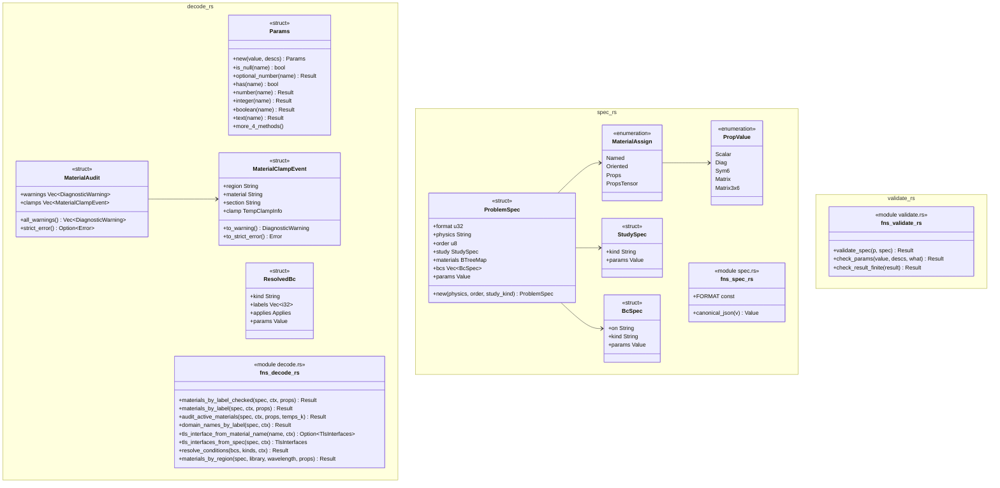

# Problem envelope: code

C4 level 4 (code) of the component **Problem envelope** (`physics.envelope`) in the container **nyx-physics** (crate `nyx_physics`). [Component view of the container](../../3-components/physics.md) · [All code pages](../README.md)

> The one shape every physics is given (ProblemSpec), its decoding into typed parameters with descriptor defaults and name resolution, and its structural validation.

**Decisions:** [ADR 25](../../../adr/0025-physics-trait-registry-and-problem-envelope.md), [ADR 41](../../../adr/0041-physics-crate-pattern-and-the-legacy-bridge.md), [ADR 63](../../../adr/0063-the-format-key-and-no-json-for-bulk-data.md)  
**Size:** 3 files, 2012 lines.

## Files

| File | Lines | What it says about itself |
|---|---:|---|
| `crates/nyx-physics/src/decode.rs` | 1461 |  |
| `crates/nyx-physics/src/spec.rs` | 114 |  |
| `crates/nyx-physics/src/validate.rs` | 437 |  |

## What it uses

| Target | Modules | Items |
|---|---|---|
| [container `femcore` (femcore)](../../3-components/femcore.md) | material, material::coupled, material::elastic, material::optics, material::source, material::spec, material::state_t, material::tensor +1 | Axes, Class, InterfaceLayer, Library, M3, MaterialSpec, Materials, Requirement, Source, TempClampInfo +4 |
| [cQED result payloads](./cqed.md) | cqed | TlsInterfaceSpec, TlsInterfaces |
| [Descriptors and schemas](./descriptors.md) | desc | Applies, BcDesc, ParamDesc, ParamKind, PropDesc, PropKind |
| [Result and frame](./result.md) | result | DiagnosticSeverity, DiagnosticWarning, Scalar, SolveResult |
| [Physics trait and registry](./trait.md) | error, physics | Ctx, Error, LabelResolver, Physics |

## Used by

| Component | Modules | Items |
|---|---|---|
| [dfs: Typed problem](../dfs/problem.md) | decode, spec | Params, ProblemSpec, domain_names_by_label, materials_by_label, resolve_conditions, tls_interfaces_from_spec |
| [ems: Physics adapter](../ems/adapter.md) | decode | Params, materials_by_region |
| [ems: Typed problem](../ems/problem.md) | decode, spec | MaterialAssign, Params, ProblemSpec, domain_names_by_label, materials_by_label, resolve_conditions, tls_interfaces_from_spec |
| [engine: API reference](../engine/apiref.md) | spec | canonical_json |
| [engine: Commands](../engine/commands.md) | decode, spec, validate | BcSpec, MaterialAssign, ProblemSpec, StudySpec, audit_active_materials, canonical_json, materials_by_label, validate_spec |
| [engine: Job runner and queue](../engine/jobs.md) | spec, validate | ProblemSpec, validate_spec |
| [engine: Materials](../engine/materials.md) | decode, spec | MaterialAudit, ProblemSpec, audit_active_materials |
| [engine: Meshing seam](../engine/meshing.md) | spec, validate | BcSpec, MaterialAssign, ProblemSpec, check_result_finite, validate_spec |
| [engine: Project](../engine/project.md) | spec, validate | FORMAT, ProblemSpec, canonical_json, validate_spec |
| [engine: Results files](../engine/resultsIO.md) | spec | MaterialAssign, canonical_json |
| [engine: Store link](../engine/storeLink.md) | spec | MaterialAssign |
| [Test support](./testsupport.md) | spec | canonical_json |
| [Physics trait and registry](./trait.md) | decode, spec, validate | BcSpec, FORMAT, MaterialAssign, MaterialAudit, MaterialClampEvent, ProblemSpec, PropValue, StudySpec +8 |
| [sms: Physics adapter](../sms/adapter.md) | decode | Params, materials_by_region |
| [sms: Typed problem](../sms/problem.md) | decode, spec | Params, ProblemSpec, materials_by_label, resolve_conditions |

## Class diagram

Public types with their public fields (or variants) and methods, free functions per file as a `module` box; arrows are field types and `impl Trait`. Capped at 36 types and a few members each; the table below is complete.

## Public items

| Kind | Item | File:line | Signature or summary |
|---|---|---|---|
| struct | `Params` | `decode.rs:20` |  Typed access to the parameters of a study, a condition or the physics: returns the given value or the descriptor default, |
| struct | `MaterialClampEvent` | `decode.rs:160` | fields: `region`, `material`, `section`, `clamp` —  Out-of-range temperature clamping recorded while evaluating an active material table. |
| struct | `MaterialAudit` | `decode.rs:206` | fields: `warnings`, `clamps` —  Active-study material provenance uncertainty and temperature-clamping findings. |
| fn | `materials_by_label_checked` | `decode.rs:233` | `pub fn materials_by_label_checked( spec: &ProblemSpec, ctx: &Ctx, props: &[PropDesc], ) -> Result<(Materials, MaterialAudit), Error>` —  Resolves `spec.materials` per domain label and returns both [`Materials`] and the active-study [`MaterialAudit`]. |
| fn | `materials_by_label` | `decode.rs:533` | `pub fn materials_by_label(spec: &ProblemSpec, ctx: &Ctx, props: &[PropDesc]) -> Result<Materials, Error>` —  The material properties of every region as numbers per domain label: a region name or pattern (`sapphire*`) can match several |
| fn | `audit_active_materials` | `decode.rs:636` | `pub fn audit_active_materials( spec: &ProblemSpec, ctx: &Ctx, props: &[PropDesc], temps_k: &[f64], ) -> Result<MaterialAudit, Error>` —  Audits active-study material provenance (`Source::flags_uncertainty()`) and out-of-range temperature clamping across `spec.materials` and boundary conditions. |
| fn | `domain_names_by_label` | `decode.rs:879` | `pub fn domain_names_by_label(spec: &ProblemSpec, ctx: &Ctx) -> Result<std::collections::BTreeMap<i32, String>, Error>` —  Resolves each material assignment region key in `spec.materials` to its domain labels. |
| fn | `tls_interface_from_material_name` | `decode.rs:894` | `pub fn tls_interface_from_material_name(name: &str, ctx: &Ctx) -> Option<TlsInterfaces>` —  Resolves `[interfaces.{ma,ms,sa}]` TLS surface-loss parameters for a named material from `ctx.library`. |
| fn | `tls_interfaces_from_spec` | `decode.rs:916` | `pub fn tls_interfaces_from_spec(spec: &ProblemSpec, ctx: &Ctx) -> TlsInterfaces` —  Resolves `[interfaces.{ma,ms,sa}]` TLS surface-loss parameters from named/oriented domain materials in |
| struct | `ResolvedBc` | `decode.rs:1248` | fields: `kind`, `labels`, `applies`, `params` —  A condition of the problem with its selector resolved to numbers: boundary numbers when the descriptor says `Boundary`, domain |
| fn | `resolve_conditions` | `decode.rs:1256` | `pub fn resolve_conditions(bcs: &[BcSpec], kinds: &[BcDesc], ctx: &Ctx) -> Result<Vec<ResolvedBc>, Error>` —  Resolves the `on` selector of every condition. A selector that matches nothing is an error, naming the selector. |
| fn | `materials_by_region` | `decode.rs:1277` | `pub fn materials_by_region( spec: &ProblemSpec, library: Option<&std::sync::Arc<femcore::material::Library>>, wavelength: Option<f64>, props: &[PropDesc], ) -> Result<(Vec<String>, Materials), Error>` —  Names the regions a problem gives materials to, for the physics' `sizing`: region `i` of the result is label `i + 1` of the returned |
| fn | `Params::new` | `decode.rs:26` | `pub fn new(value: &'a Value, descs: &'a [ParamDesc]) -> Params<'a>` |
| fn | `Params::is_null` | `decode.rs:39` | `pub fn is_null(&self, name: &str) -> bool` —  True if the parameter key was explicitly passed with JSON `null`. |
| fn | `Params::optional_number` | `decode.rs:45` | `pub fn optional_number(&self, name: &str) -> Result<Option<f64>, Error>` —  Optional numeric parameter: returns `None` when explicitly passed as `null`, |
| fn | `Params::has` | `decode.rs:54` | `pub fn has(&self, name: &str) -> bool` —  Whether the parameter was given with a non-null value in the problem (not defaulted). |
| fn | `Params::number` | `decode.rs:58` | `pub fn number(&self, name: &str) -> Result<f64, Error>` |
| fn | `Params::integer` | `decode.rs:67` | `pub fn integer(&self, name: &str) -> Result<i64, Error>` |
| fn | `Params::boolean` | `decode.rs:76` | `pub fn boolean(&self, name: &str) -> Result<bool, Error>` |
| fn | `Params::text` | `decode.rs:86` | `pub fn text(&self, name: &str) -> Result<String, Error>` —  Text or a choice. |
| fn | `Params::vector` | `decode.rs:97` | `pub fn vector(&self, name: &str) -> Result<Vec<f64>, Error>` |
| fn | `Params::names` | `decode.rs:113` | `pub fn names(&self, name: &str) -> Result<Vec<String>, Error>` |
| fn | `Params::numbers` | `decode.rs:131` | `pub fn numbers(&self, name: &str) -> Result<Vec<f64>, Error>` |
| fn | `Params::optional_numbers` | `decode.rs:148` | `pub fn optional_numbers(&self, name: &str) -> Result<Option<Vec<f64>>, Error>` —  Optional number-list parameter: returns `None` when explicitly passed as `null` or when the resolved list is empty. |
| fn | `MaterialClampEvent::to_warning` | `decode.rs:169` | `pub fn to_warning(&self) -> DiagnosticWarning` —  Converts this clamping event into a [`DiagnosticWarning`] with code `"temperature_clamped"`. |
| fn | `MaterialClampEvent::to_strict_error` | `decode.rs:199` | `pub fn to_strict_error(&self) -> Error` —  Formats a refusal error for `strict_material_range = true`. |
| fn | `MaterialAudit::all_warnings` | `decode.rs:213` | `pub fn all_warnings(&self) -> Vec<DiagnosticWarning>` —  Returns all warnings (both provenance uncertainty and `temperature_clamped`). |
| fn | `MaterialAudit::strict_error` | `decode.rs:220` | `pub fn strict_error(&self) -> Option<Error>` —  Returns the first strict refusal error if any active temperature evaluation was clamped. |
| enum | `PropValue` | `spec.rs:16` | variants: `Scalar`, `Diag`, `Sym6`, `Matrix`, `Matrix3x6` —  A material property value given inline: a scalar, three diagonal components `[xx, yy, zz]`, six symmetric components `[xx, yy, zz, xy, xz, yz]`, a symmetric 3x3 tensor, or a 3x6 coupling matrix. |
| enum | `MaterialAssign` | `spec.rs:27` | variants: `Named`, `Oriented`, `Props`, `PropsTensor` —  What the material of a region is. |
| struct | `StudySpec` | `spec.rs:40` | fields: `kind`, `params` —  The study: a `kind` the physics lists in `studies()` and its parameters. |
| struct | `BcSpec` | `spec.rs:48` | fields: `on`, `kind`, `params` —  A boundary or domain condition: `on` is a selector over the geometry (`outer & plane(x = 0)`) or a region name. |
| const | `FORMAT` | `spec.rs:56` | `u32` —  The file format of a problem (ADR 63). Written in every problem; a problem of another format is refused, there is no migration. |
| struct | `ProblemSpec` | `spec.rs:64` | fields: `format`, `physics`, `order`, `study`, `materials`, `bcs`, `params` —  A problem for one physics. |
| fn | `canonical_json` | `spec.rs:99` | `pub fn canonical_json(v: &Value) -> Value` —  The same JSON with every object's keys in sorted order. Contract exemplars are written and compared in this form because `serde_json` |
| fn | `ProblemSpec::new` | `spec.rs:84` | `pub fn new(physics: &str, order: u8, study_kind: &str) -> ProblemSpec` |
| fn | `validate_spec` | `validate.rs:13` | `pub fn validate_spec(p: &dyn Physics, spec: &ProblemSpec) -> Result<(), Error>` |
| fn | `check_params` | `validate.rs:216` | `pub fn check_params(value: &Value, descs: &[ParamDesc], what: &str) -> Result<(), Error>` —  Checks `value` (null or an object) against `descs`. |
| fn | `check_result_finite` | `validate.rs:305` | `pub fn check_result_finite(result: &crate::result::SolveResult) -> Result<(), Error>` —  Every field and scalar solution metric of the result must be finite, with one physical |
