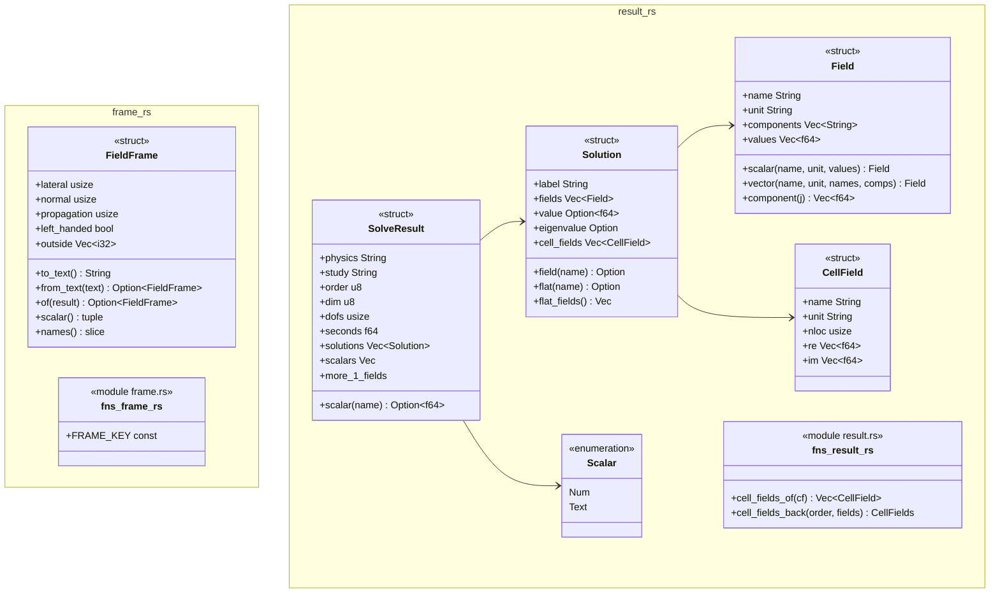

# Result and frame: code

C4 level 4 (code) of the component **Result and frame** (`physics.result`) in the container **nyx-physics** (crate `nyx_physics`). [Component view of the container](../../3-components/physics.md) · [All code pages](../README.md)

> SolveResult as plain serialisable data, and the frame a result states for the analysis of its vector fields.

**Decisions:** [ADR 25](../../../adr/0025-physics-trait-registry-and-problem-envelope.md), [ADR 56](../../../adr/0056-polarization-analysis-is-a-function-of-a-result.md)  
**Size:** 2 files, 290 lines.

## Files

| File | Lines | What it says about itself |
|---|---:|---|
| `crates/nyx-physics/src/frame.rs` | 113 |  |
| `crates/nyx-physics/src/result.rs` | 177 |  |

## What it uses

| Target | Modules | Items |
|---|---|---|
| [container `femcore` (femcore)](../../3-components/femcore.md) | adapt, fields | CellField, CellFields, PlotFields |

## Used by

| Component | Modules | Items |
|---|---|---|
| [analysis: Analysis API](../analysis/api.md) | result | SolveResult |
| [analysis: Capacitance and inductance matrices](../analysis/capacitance.md) | result | SolveResult |
| [analysis: cQED quantization and TLS participation](../analysis/cqed.md) | result | CellField, Solution, SolveResult |
| [analysis: Mode figures](../analysis/figures.md) | frame, result | FieldFrame, Scalar, Solution, SolveResult |
| [analysis: Field samples](../analysis/samples.md) | frame, result | CellField, FieldFrame, Solution, SolveResult |
| [dfs: Electrostatics kernel](../dfs/electro.md) | result | Field, Scalar, Solution, SolveResult, cell_fields_of |
| [dfs: Heat kernel](../dfs/heat.md) | result | Field, Scalar, Solution, SolveResult, cell_fields_of |
| [dfs: Magnetostatics kernel](../dfs/magneto.md) | result | Field, Scalar, Solution, SolveResult, cell_fields_of |
| [ems: Axisymmetric kernel](../ems/axisym.md) | result | Field, Scalar, Solution, SolveResult, cell_fields_of |
| [ems: 3D cavity kernel](../ems/cavity.md) | frame, result | Field, FieldFrame, Scalar, Solution, SolveResult, cell_fields_of |
| [ems: Driven frequency-domain and PROM](../ems/driven.md) | frame, result | Field, FieldFrame, Scalar, Solution, SolveResult, cell_fields_of |
| [ems: Mode kernel](../ems/modes.md) | result | Field, Scalar, Solution, SolveResult, cell_fields_of |
| [ems: Complex-mode kernel](../ems/modescx.md) | result | Field, Scalar, Solution, SolveResult, cell_fields_of |
| [ems: Optical mode sets](../ems/optical.md) | frame | FieldFrame |
| [engine: Analyses](../engine/analyse.md) | result | Scalar, SolveResult |
| [engine: Commands](../engine/commands.md) | result | Solution, SolveResult |
| [engine: Job runner and queue](../engine/jobs.md) | result | Scalar, SolveResult |
| [engine: Meshing seam](../engine/meshing.md) | result | Scalar, SolveResult |
| [engine: Results files](../engine/resultsIO.md) | result | CellField, Field, Scalar, Solution, SolveResult |
| [engine: Store link](../engine/storeLink.md) | result | Scalar, SolveResult |
| [cQED result payloads](./cqed.md) | result | Scalar, SolveResult |
| [Problem envelope](./envelope.md) | result | SolveResult |
| [Test support](./testsupport.md) | result | Scalar, SolveResult |
| [Physics trait and registry](./trait.md) | frame, result | CellField, FRAME_KEY, Field, FieldFrame, Scalar, Solution, SolveResult, cell_fields_back +1 |
| [sms: Cross-section study kernel](../sms/crosssection.md) | result | Field, Scalar, Solution, SolveResult, cell_fields_of |
| [sms: Floquet kernel](../sms/floquet.md) | result | Scalar, Solution, SolveResult, cell_fields_of |
| [sms: Low-reflecting boundary](../sms/lrb.md) | result | Scalar, Solution, SolveResult, cell_fields_of |
| [sms: Absorbing-layer kernel](../sms/pml.md) | result | Scalar, Solution, SolveResult, cell_fields_of |
| [sms: Solid kernel](../sms/solid.md) | result | Field, Scalar, Solution, SolveResult, cell_fields_of |

## Class diagram

Public types with their public fields (or variants) and methods, free functions per file as a `module` box; arrows are field types and `impl Trait`. Capped at 36 types and a few members each; the table below is complete.

## Public items

| Kind | Item | File:line | Signature or summary |
|---|---|---|---|
| const | `FRAME_KEY` | `frame.rs:15` | `&str` —  Name of the scalar that carries the frame. |
| struct | `FieldFrame` | `frame.rs:22` | fields: `lateral`, `normal`, `propagation`, `left_handed`, `outside` —  Wafer axes (0 = x, 1 = y, 2 = z) of the lateral, normal and propagation direction of the modes of a result, and the domains the |
| fn | `FieldFrame::to_text` | `frame.rs:34` | `pub fn to_text(&self) -> String` —  The text written to the result. |
| fn | `FieldFrame::from_text` | `frame.rs:50` | `pub fn from_text(text: &str) -> Option<FieldFrame>` —  Reads `to_text` back; `None` for anything else. |
| fn | `FieldFrame::of` | `frame.rs:80` | `pub fn of(result: &SolveResult) -> Option<FieldFrame>` —  The frame a result states, if it states one. |
| fn | `FieldFrame::scalar` | `frame.rs:88` | `pub fn scalar(&self) -> (String, Scalar)` —  The scalar to push on a result. |
| fn | `FieldFrame::names` | `frame.rs:93` | `pub fn names(&self) -> [&'static str` —  Wafer axis name (`x`, `y` or `z`) of the lateral, normal and propagation direction. |
| struct | `Field` | `result.rs:10` | fields: `name`, `unit`, `components`, `values` —  A field with one or more components, one value per dof (P1: vertices; P2: vertices then edge midpoints). |
| struct | `CellField` | `result.rs:21` | fields: `name`, `unit`, `nloc`, `re`, `im` —  A field before it is averaged over the cells at a node, one value per cell node (`nloc` per cell). |
| enum | `Scalar` | `result.rs:32` | variants: `Num`, `Text` |
| struct | `Solution` | `result.rs:39` | fields: `label`, `fields`, `value`, `eigenvalue`, `cell_fields` —  One solution of a study: a time step, an eigenmode, a frequency. |
| struct | `SolveResult` | `result.rs:62` | fields: `physics`, `study`, `order`, `dim`, `dofs`, `seconds`, `solutions`, `scalars`, `log` |
| fn | `cell_fields_of` | `result.rs:141` | `pub fn cell_fields_of(cf: &femcore::fields::CellFields) -> Vec<CellField>` —  The per-cell fields of a kernel (`femcore::fields::CellFields`) as plain serialisable data. |
| fn | `cell_fields_back` | `result.rs:155` | `pub fn cell_fields_back(order: usize, fields: &[CellField]) -> femcore::fields::CellFields` —  The inverse of `cell_fields_of`, for code that still reads `CellFields` (the window until phase 7, the analysis until phase 5). |
| fn | `Solution::field` | `result.rs:51` | `pub fn field(&self, name: &str) -> Option<&Field>` |
| fn | `Solution::flat` | `result.rs:56` | `pub fn flat(&self, name: &str) -> Option<Vec<f64>>` —  The values of a field by its flat name (`V`, `\|E\|`, `Ex`; see `flat_fields`). |
| fn | `SolveResult::scalar` | `result.rs:79` | `pub fn scalar(&self, name: &str) -> Option<f64>` —  The first numeric scalar whose name starts with `name`. |
| fn | `Field::scalar` | `result.rs:89` | `pub fn scalar(name: impl Into<String>, unit: impl Into<String>, values: Vec<f64>) -> Field` —  A scalar field, one value per dof. |
| fn | `Field::vector` | `result.rs:94` | `pub fn vector(name: impl Into<String>, unit: impl Into<String>, names: &[&str], comps: &[Vec<f64>]) -> Field` —  A vector field from one array per component (`comps[j][dof]`), stored interleaved by dof. |
| fn | `Field::component` | `result.rs:112` | `pub fn component(&self, j: usize) -> Vec<f64>` —  The array of component `j` of a vector field (the whole array for a scalar). |
| fn | `Solution::flat_fields` | `result.rs:121` | `pub fn flat_fields(&self) -> Vec<(String, String, Vec<f64>)>` —  The fields in the flat form the window and the golden files use: a scalar keeps its name; a vector `E` with components `x`, `z` |

Trait implementations in this component: `SolveResult: PlotFields`
