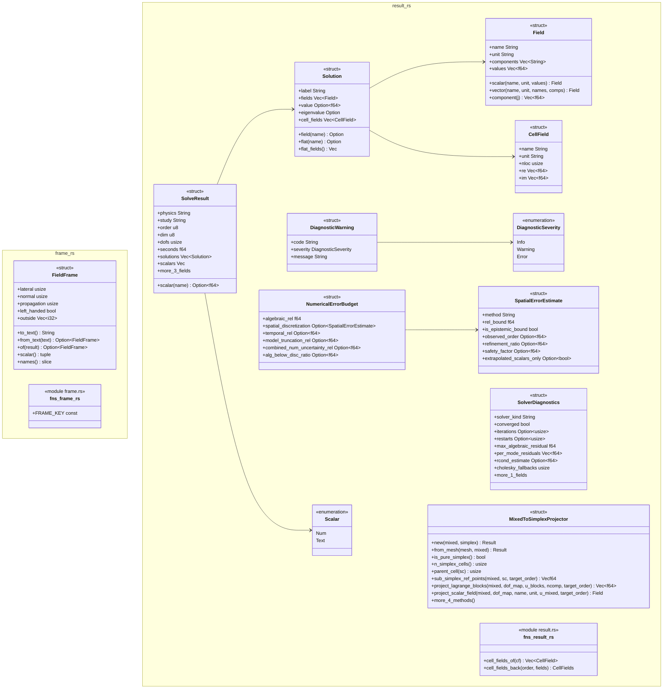

# Result and frame: code

C4 level 4 (code) of the component **Result and frame** (`physics.result`) in the container **nyx-physics** (crate `nyx_physics`). [Component view of the container](../../3-components/physics.md) · [All code pages](../README.md)

> SolveResult as plain serialisable data, and the frame a result states for the analysis of its vector fields.

**Decisions:** [ADR 25](../../../adr/0025-physics-trait-registry-and-problem-envelope.md), [ADR 56](../../../adr/0056-polarization-analysis-is-a-function-of-a-result.md)  
**Size:** 2 files, 871 lines.

## Files

| File | Lines | What it says about itself |
|---|---:|---|
| `crates/nyx-physics/src/frame.rs` | 113 |  |
| `crates/nyx-physics/src/result.rs` | 758 |  |

## What it uses

| Target | Modules | Items |
|---|---|---|
| [container `femcore` (femcore)](../../3-components/femcore.md) | adapt, fem_mixed, fields, mesh, mesh::cells, mesh::mixed | CellField, CellFields, CellType, LagrangeSpace, MixedDiscretisation, MixedLagrangeDofMap, PlotFields, SimplexMesh, cell_corner_ref_coords, cell_local_quad_faces +1 |
| [Physics trait and registry](./trait.md) | crate root, error | Error, Mesh, discretise |

## Used by

| Component | Modules | Items |
|---|---|---|
| [analysis: Analysis API](../analysis/api.md) | result | SolveResult |
| [analysis: Capacitance and inductance matrices](../analysis/capacitance.md) | result | SolveResult |
| [analysis: cQED quantization and TLS participation](../analysis/cqed.md) | result | CellField, Solution, SolveResult |
| [analysis: Mode figures](../analysis/figures.md) | frame, result | FieldFrame, Scalar, Solution, SolveResult |
| [analysis: Piezo resonator analysis](../analysis/piezo.md) | result | SolveResult |
| [analysis: Field samples](../analysis/samples.md) | frame, result | CellField, FieldFrame, Solution, SolveResult |
| [dfs: Shared helpers](../dfs/common.md) | result | DiagnosticSeverity, DiagnosticWarning, MixedToSimplexProjector, NumericalErrorBudget, SolverDiagnostics, SpatialErrorEstimate |
| [dfs: Electrostatics kernel](../dfs/electro.md) | result | DiagnosticSeverity, Field, MixedToSimplexProjector, Scalar, Solution, SolveResult, SpatialErrorEstimate, cell_fields_of |
| [dfs: Heat kernel](../dfs/heat.md) | result | Field, MixedToSimplexProjector, Scalar, Solution, SolveResult, cell_fields_of |
| [dfs: Magnetostatics kernel](../dfs/magneto.md) | result | Field, MixedToSimplexProjector, Scalar, Solution, SolveResult, cell_fields_of |
| [ems: Physics adapter](../ems/adapter.md) | result | DiagnosticSeverity, DiagnosticWarning, NumericalErrorBudget, SolverDiagnostics, SpatialErrorEstimate |
| [ems: Axisymmetric kernel](../ems/axisym.md) | result | Field, MixedToSimplexProjector, Scalar, Solution, SolveResult, cell_fields_of |
| [ems: 3D cavity kernel](../ems/cavity.md) | frame, result | Field, FieldFrame, MixedToSimplexProjector, Scalar, Solution, SolveResult, cell_fields_of |
| [ems: Driven frequency-domain and PROM](../ems/driven.md) | frame, result | DiagnosticSeverity, DiagnosticWarning, Field, FieldFrame, MixedToSimplexProjector, Scalar, Solution, SolveResult +1 |
| [ems: Thin-film IBC and Josephson ROM](../ems/ibc.md) | result | DiagnosticSeverity, DiagnosticWarning |
| [ems: Native mixed-cell EM](../ems/mixed.md) | result | DiagnosticSeverity, DiagnosticWarning |
| [ems: Mode kernel](../ems/modes.md) | result | Field, MixedToSimplexProjector, Scalar, Solution, SolveResult, cell_fields_of |
| [ems: Complex-mode kernel](../ems/modescx.md) | result | Field, MixedToSimplexProjector, Scalar, Solution, SolveResult, cell_fields_of |
| [ems: Optical mode sets](../ems/optical.md) | frame | FieldFrame |
| [engine: Analyses](../engine/analyse.md) | result | Scalar, SolveResult |
| [engine: Commands](../engine/commands.md) | result | DiagnosticSeverity, DiagnosticWarning, NumericalErrorBudget, Solution, SolveResult |
| [engine: Job runner and queue](../engine/jobs.md) | result | DiagnosticSeverity, DiagnosticWarning, Scalar, SolveResult, SpatialErrorEstimate |
| [engine: Meshing seam](../engine/meshing.md) | result | Scalar, SolveResult |
| [engine: Results files](../engine/resultsIO.md) | result | CellField, Field, NumericalErrorBudget, Scalar, Solution, SolveResult, SolverDiagnostics |
| [engine: Store link](../engine/storeLink.md) | result | Scalar, SolveResult |
| [cQED result payloads](./cqed.md) | result | Scalar, SolveResult |
| [Problem envelope](./envelope.md) | result | Scalar, SolveResult |
| [Test support](./testsupport.md) | result | Scalar, SolveResult |
| [Physics trait and registry](./trait.md) | frame, result | CellField, DiagnosticSeverity, DiagnosticWarning, FRAME_KEY, Field, FieldFrame, MixedToSimplexProjector, NumericalErrorBudget +7 |
| [sms: Physics adapter](../sms/adapter.md) | result | DiagnosticSeverity, DiagnosticWarning, NumericalErrorBudget, SolverDiagnostics, SpatialErrorEstimate |
| [sms: Cross-section study kernel](../sms/crosssection.md) | result | Field, MixedToSimplexProjector, Scalar, Solution, SolveResult, cell_fields_of |
| [sms: Floquet kernel](../sms/floquet.md) | result | MixedToSimplexProjector, Scalar, Solution, SolveResult, cell_fields_of |
| [sms: Low-reflecting boundary](../sms/lrb.md) | result | MixedToSimplexProjector, Scalar, Solution, SolveResult, cell_fields_of |
| [sms: Piezoelectric kernel](../sms/piezo.md) | frame, result | CellField, DiagnosticSeverity, DiagnosticWarning, Field, FieldFrame, MixedToSimplexProjector, Scalar, Solution +2 |
| [sms: Absorbing-layer kernel](../sms/pml.md) | result | MixedToSimplexProjector, Scalar, Solution, SolveResult, cell_fields_of |
| [sms: Solid kernel](../sms/solid.md) | result | CellField, DiagnosticSeverity, Field, MixedToSimplexProjector, Scalar, Solution, SolveResult, cell_fields_of |

## Class diagram

Public types with their public fields (or variants) and methods, free functions per file as a `module` box; arrows are field types and `impl Trait`. Capped at 36 types and a few members each; the table below is complete.

## Public items

| Kind | Item | File:line | Signature or summary |
|---|---|---|---|
| const | `FRAME_KEY` | `frame.rs:15` | `&str` —  Name of the scalar that carries the frame. |
| struct | `FieldFrame` | `frame.rs:22` | fields: `lateral`, `normal`, `propagation`, `left_handed`, `outside` —  Wafer axes (0 = x, 1 = y, 2 = z) of the lateral, normal and propagation direction of the modes of a result, and the domains the |
| fn | `FieldFrame::to_text` | `frame.rs:34` | `pub fn to_text(&self) -> String` —  The text written to the result. |
| fn | `FieldFrame::from_text` | `frame.rs:50` | `pub fn from_text(text: &str) -> Option<FieldFrame>` —  Reads `to_text` back; `None` for anything else. |
| fn | `FieldFrame::of` | `frame.rs:80` | `pub fn of(result: &SolveResult) -> Option<FieldFrame>` —  The frame a result states, if it states one. |
| fn | `FieldFrame::scalar` | `frame.rs:88` | `pub fn scalar(&self) -> (String, Scalar)` —  The scalar to push on a result. |
| fn | `FieldFrame::names` | `frame.rs:93` | `pub fn names(&self) -> [&'static str` —  Wafer axis name (`x`, `y` or `z`) of the lateral, normal and propagation direction. |
| struct | `Field` | `result.rs:10` | fields: `name`, `unit`, `components`, `values` —  A field with one or more components, one value per dof (P1: vertices; P2: vertices then edge midpoints). |
| struct | `CellField` | `result.rs:21` | fields: `name`, `unit`, `nloc`, `re`, `im` —  A field before it is averaged over the cells at a node, one value per cell node (`nloc` per cell). |
| enum | `Scalar` | `result.rs:32` | variants: `Num`, `Text` |
| struct | `Solution` | `result.rs:39` | fields: `label`, `fields`, `value`, `eigenvalue`, `cell_fields` —  One solution of a study: a time step, an eigenmode, a frequency. |
| enum | `DiagnosticSeverity` | `result.rs:64` | variants: `Info`, `Warning`, `Error` —  Severity level for structured VVUQ solver, material, or discretization warnings. |
| struct | `DiagnosticWarning` | `result.rs:73` | fields: `code`, `severity`, `message` —  Structured machine-readable diagnostic warning attached to [`SolveResult`]. |
| struct | `SolverDiagnostics` | `result.rs:81` | fields: `solver_kind`, `converged`, `iterations`, `restarts`, `max_algebraic_residual`, `per_mode_residuals`, `rcond_estimate`, `cholesky_fallbacks`, `warnings` —  Algebraic solve, condition, and convergence telemetry emitted by every solver (`solve_result` `2.1`). |
| struct | `SpatialErrorEstimate` | `result.rs:101` | fields: `method`, `rel_bound`, `is_epistemic_bound`, `observed_order`, `refinement_ratio`, `safety_factor`, `extrapolated_scalars_only` —  Spatial discretization uncertainty estimate (Prager–Synge bound, 3-grid Roache GCI, 2-grid delta, or indicator). |
| struct | `NumericalErrorBudget` | `result.rs:117` | fields: `algebraic_rel`, `spatial_discretization`, `temporal_rel`, `model_truncation_rel`, `combined_num_uncertainty_rel`, `alg_below_disc_ratio` —  Numerical error budget pairing algebraic floor, discretization uncertainty, temporal error, and model truncation. |
| struct | `SolveResult` | `result.rs:132` | fields: `physics`, `study`, `order`, `dim`, `dofs`, `seconds`, `solutions`, `scalars`, `log`, `diagnostics`, `error_budget` |
| fn | `cell_fields_of` | `result.rs:217` | `pub fn cell_fields_of(cf: &femcore::fields::CellFields) -> Vec<CellField>` —  The per-cell fields of a kernel (`femcore::fields::CellFields`) as plain serialisable data. |
| fn | `cell_fields_back` | `result.rs:231` | `pub fn cell_fields_back(order: usize, fields: &[CellField]) -> femcore::fields::CellFields` —  The inverse of `cell_fields_of`, for code that still reads `CellFields` (the window until phase 7, the analysis until phase 5). |
| struct | `MixedToSimplexProjector` | `result.rs:314` |  Stage-3 projector mapping native [`MixedDiscretisation`] vertex, edge, and per-cell fields onto |
| fn | `Solution::field` | `result.rs:51` | `pub fn field(&self, name: &str) -> Option<&Field>` |
| fn | `Solution::flat` | `result.rs:56` | `pub fn flat(&self, name: &str) -> Option<Vec<f64>>` —  The values of a field by its flat name (`V`, `\|E\|`, `Ex`; see `flat_fields`). |
| fn | `SolveResult::scalar` | `result.rs:155` | `pub fn scalar(&self, name: &str) -> Option<f64>` —  The first numeric scalar whose name starts with `name`. |
| fn | `Field::scalar` | `result.rs:165` | `pub fn scalar(name: impl Into<String>, unit: impl Into<String>, values: Vec<f64>) -> Field` —  A scalar field, one value per dof. |
| fn | `Field::vector` | `result.rs:170` | `pub fn vector(name: impl Into<String>, unit: impl Into<String>, names: &[&str], comps: &[Vec<f64>]) -> Field` —  A vector field from one array per component (`comps[j][dof]`), stored interleaved by dof. |
| fn | `Field::component` | `result.rs:188` | `pub fn component(&self, j: usize) -> Vec<f64>` —  The array of component `j` of a vector field (the whole array for a scalar). |
| fn | `Solution::flat_fields` | `result.rs:197` | `pub fn flat_fields(&self) -> Vec<(String, String, Vec<f64>)>` —  The fields in the flat form the window and the golden files use: a scalar keeps its name; a vector `E` with components `x`, `z` |
| fn | `MixedToSimplexProjector::new` | `result.rs:334` | `pub fn new(mixed: &MixedDiscretisation, simplex: &SimplexMesh) -> Result<Self, Error>` —  Builds a Stage-3 projector from `mixed` (`discretise_mixed(mesh)`) onto `simplex` (`discretise(mesh)`). |
| fn | `MixedToSimplexProjector::from_mesh` | `result.rs:467` | `pub fn from_mesh(mesh: &crate::Mesh, mixed: &MixedDiscretisation) -> Result<(SimplexMesh, Self), Error>` —  Convenience constructor building both `SimplexMesh` and `MixedToSimplexProjector` from `mesh`. |
| fn | `MixedToSimplexProjector::is_pure_simplex` | `result.rs:475` | `pub fn is_pure_simplex(&self) -> bool` —  Whether the underlying mesh is pure-simplex with 1-to-1 identity cell correspondence. |
| fn | `MixedToSimplexProjector::n_simplex_cells` | `result.rs:481` | `pub fn n_simplex_cells(&self) -> usize` —  Number of cells in the target `SimplexMesh`. |
| fn | `MixedToSimplexProjector::parent_cell` | `result.rs:487` | `pub fn parent_cell(&self, sc: usize) -> usize` —  Parent cell index in `MixedDiscretisation` of `SimplexMesh` cell `sc`. |
| fn | `MixedToSimplexProjector::sub_simplex_ref_points` | `result.rs:493` | `pub fn sub_simplex_ref_points(&self, mixed: &MixedDiscretisation, sc: usize, target_order: usize) -> Vec<[f64` —  Reference coordinates inside parent cell `parent_cell(sc)` for all `nloc(target_order)` nodes of `sc` |
| fn | `MixedToSimplexProjector::project_lagrange_blocks` | `result.rs:515` | `pub fn project_lagrange_blocks( &self, mixed: &MixedDiscretisation, dof_map: &MixedLagrangeDofMap, u_blocks: &[f64], ncomp: usize, target_order: usize, ) -> Vec<f64>` —  Projects `ncomp` stacked scalar DOF blocks (`u_blocks[comp * dof_map.n_dofs + dof]`) computed on |
| fn | `MixedToSimplexProjector::project_scalar_field` | `result.rs:581` | `pub fn project_scalar_field( &self, mixed: &MixedDiscretisation, dof_map: &MixedLagrangeDofMap, name: impl Into<String>, unit: impl Into<String>, u_mixed: &[f64], target_order: usize, ) -> Field` —  Projects a scalar `MixedLagrangeDofMap` vector onto a [`Field`] over `SimplexMesh` (`target_order`). |
| fn | `MixedToSimplexProjector::project_vector_field` | `result.rs:595` | `pub fn project_vector_field( &self, mixed: &MixedDiscretisation, dof_map: &MixedLagrangeDofMap, name: impl Into<String>, unit: impl Into<String>, comp_names: &[&str], u_blocks: &[f64], target_order: usize, ) -> Field` —  Projects `ncomp` stacked scalar component blocks onto an interleaved vector [`Field`] over `SimplexMesh`. |
| fn | `MixedToSimplexProjector::project_cell_nodal_values` | `result.rs:614` | `pub fn project_cell_nodal_values( &self, mixed: &MixedDiscretisation, space: LagrangeSpace, mixed_vals: &[f64], mixed_cell_offsets: &[usize], target_order: usize, ) -> Vec<f64>` —  Projects discontinuous per-cell nodal values (`mixed_vals[mixed_cell_offsets[mc] + a]`, evaluated at |
| fn | `MixedToSimplexProjector::project_cell_field` | `result.rs:645` | `pub fn project_cell_field( &self, mixed: &MixedDiscretisation, space: LagrangeSpace, name: impl Into<String>, unit: impl Into<String>, re_mixed: &[f64], im_mixed: &[f64], mixed_cell_offsets: &[usize], target_order: usize, ) -> CellField` —  Projects real or complex per-cell nodal arrays from `MixedDiscretisation` into a `SimplexMesh`-indexed [`CellField`]. |
| fn | `MixedToSimplexProjector::sample_simplex_cell_nodes` | `result.rs:670` | `pub fn sample_simplex_cell_nodes<T, F>( &self, mixed: &MixedDiscretisation, target_order: usize, mut eval_fn: F, ) -> Vec<T>` —  Evaluates `eval_fn(parent_mc, &xi_ref)` directly at every local node of every sub-simplex `sc` |

Trait implementations in this component: `SolveResult: PlotFields`
