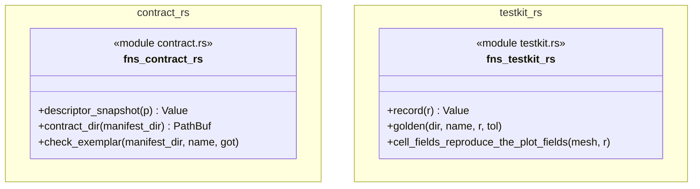

# Test support: code

C4 level 4 (code) of the component **Test support** (`physics.testsupport`) in the container **nyx-physics** (crate `nyx_physics`). [Component view of the container](../../3-components/physics.md) · [All code pages](../README.md)

> The golden-file harness and the contract-test helpers shared by every physics crate.

**Decisions:** [ADR 10](../../../adr/0010-golden-files-are-the-numerical-oracle.md), [ADR 19](../../../adr/0019-versioned-interface-contracts.md)  
**Size:** 2 files, 233 lines.

## Files

| File | Lines | What it says about itself |
|---|---:|---|
| `crates/nyx-physics/src/contract.rs` | 52 |  |
| `crates/nyx-physics/src/testkit.rs` | 181 |  |

## What it uses

| Target | Modules | Items |
|---|---|---|
| [container `femcore` (femcore)](../../3-components/femcore.md) | fields | node_average |
| [Descriptors and schemas](./descriptors.md) | schema | physics_schema |
| [Problem envelope](./envelope.md) | spec | canonical_json |
| [Result and frame](./result.md) | result | Scalar, SolveResult |
| [Physics trait and registry](./trait.md) | crate root, physics | Discretisation, Physics |

## Used by

| Component | Modules | Items |
|---|---|---|
| [engine: Commands](../engine/commands.md) | contract |  |

## Class diagram

Public types with their public fields (or variants) and methods, free functions per file as a `module` box; arrows are field types and `impl Trait`. Capped at 36 types and a few members each; the table below is complete.

## Public items

| Kind | Item | File:line | Signature or summary |
|---|---|---|---|
| fn | `descriptor_snapshot` | `contract.rs:16` | `pub fn descriptor_snapshot(p: &dyn Physics) -> Value` —  Everything a physics tells the rest of nyx, as one JSON value: the exemplar `physics_<id>.v1.json` is this value. |
| fn | `contract_dir` | `contract.rs:34` | `pub fn contract_dir(manifest_dir: &str) -> PathBuf` |
| fn | `check_exemplar` | `contract.rs:39` | `pub fn check_exemplar(manifest_dir: &str, name: &str, got: &Value)` —  Compares `got` with the exemplar file `name` (call with `env!("CARGO_MANIFEST_DIR")`). Panics with the instruction to version the change. |
| fn | `record` | `testkit.rs:13` | `pub fn record(r: &SolveResult) -> Value` —  The record of a result that goes into a golden file. |
| fn | `golden` | `testkit.rs:83` | `pub fn golden(dir: &std::path::Path, name: &str, r: &SolveResult, tol: f64)` —  Checks (or, with NYX_WRITE_GOLDEN, writes) the record of `r` against the golden file `name`. |
| fn | `cell_fields_reproduce_the_plot_fields` | `testkit.rs:156` | `pub fn cell_fields_reproduce_the_plot_fields(mesh: &crate::Discretisation, r: &SolveResult)` —  The fields stage hands out the same quantities as the plot fields before the average over the cells at a node: every cell field has the |
