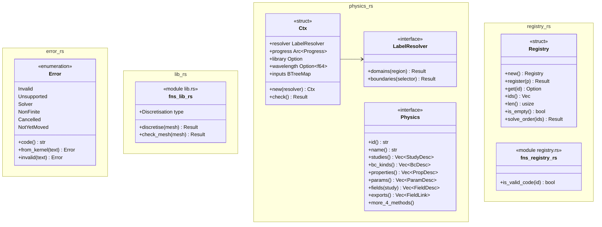

# Physics trait and registry: code

C4 level 4 (code) of the component **Physics trait and registry** (`physics.trait`) in the container **nyx-physics** (crate `nyx_physics`). [Component view of the container](../../3-components/physics.md) · [All code pages](../README.md)

> The Physics trait (everything the rest of nyx may ask of a physics), the Registry of the physics a build contains, and the plain-data error every method returns.

**Decisions:** [ADR 25](../../../adr/0025-physics-trait-registry-and-problem-envelope.md)  
**Size:** 4 files, 294 lines.

## Files

| File | Lines | What it says about itself |
|---|---:|---|
| `crates/nyx-physics/src/error.rs` | 64 | The error type every `Physics` method returns. Plain data, so it can cross a process boundary later. |
| `crates/nyx-physics/src/lib.rs` | 58 | nyx-physics: the interface between nyx and a physics (ADR 25). A physics crate (`nyx-dfs`, `nyx-sms`, `nyx-ems`, ...) implements `Physics`; the engine finds it in a `Registry`; the window, the MCP server and the mesher read only its desc... |
| `crates/nyx-physics/src/physics.rs` | 81 | The `Physics` trait: everything the rest of nyx may ask of a physics (restructure plan, section 2; ADR 25). |
| `crates/nyx-physics/src/registry.rs` | 91 | The registry: the physics a build contains, by code. The engine fills it from cargo features (physics are compiled in); a project loads a few of them. Nothing outside the physics crates names a physics: everything goes through `Registry:... |

## What it uses

| Target | Modules | Items |
|---|---|---|
| [container `femcore` (femcore)](../../3-components/femcore.md) | material::spec, mesh, mesh::exchange, progress | Library, Mesh, Progress, SimplexMesh |
| [Descriptors and schemas](./descriptors.md) | crate root, desc | BcDesc, FieldDesc, FieldLink, ParamDesc, PropDesc, Sizing, StudyDesc |
| [Problem envelope](./envelope.md) | spec, validate | BcSpec, FORMAT, MaterialAssign, ProblemSpec, StudySpec, canonical_json, check_params, check_result_finite, validate_spec |
| [Result and frame](./result.md) | frame, result | CellField, FRAME_KEY, Field, FieldFrame, Scalar, Solution, SolveResult, cell_fields_back, cell_fields_of |

## Used by

| Component | Modules | Items |
|---|---|---|
| [analysis: Analysis API](../analysis/api.md) | crate root, error | Error, Mesh |
| [analysis: Mode figures](../analysis/figures.md) | crate root, error | Discretisation, Error, Mesh, discretise |
| [analysis: Field samples](../analysis/samples.md) | crate root, error | Error, Mesh, discretise |
| [dfs: Physics adapter](../dfs/adapter.md) | crate root |  |
| [dfs: Shared helpers](../dfs/common.md) | crate root | Discretisation |
| [dfs: Electrostatics kernel](../dfs/electro.md) | crate root | Discretisation |
| [dfs: Heat kernel](../dfs/heat.md) | crate root | Discretisation |
| [dfs: Typed problem](../dfs/problem.md) | error, physics | Ctx, Error, Physics |
| [ems: Physics adapter](../ems/adapter.md) | crate root | Mesh |
| [ems: Axisymmetric kernel](../ems/axisym.md) | crate root | Discretisation |
| [ems: 3D cavity kernel](../ems/cavity.md) | crate root | Discretisation |
| [ems: Mode kernel](../ems/modes.md) | crate root | Discretisation |
| [ems: Complex-mode kernel](../ems/modescx.md) | crate root | Discretisation |
| [ems: Optical mode sets](../ems/optical.md) | crate root | Discretisation |
| [ems: Typed problem](../ems/problem.md) | error, physics | Ctx, Error, Physics |
| [engine: Analyses](../engine/analyse.md) | error | Error |
| [engine: Command lists](../engine/commandlist.md) | error | Error |
| [engine: Commands](../engine/commands.md) | crate root, error, physics, registry | Ctx, Error, LabelResolver, Registry, Sizing |
| [engine: Geometry operations](../engine/geometry.md) | error | Error |
| [engine: Job runner and queue](../engine/jobs.md) | error, physics, registry | Ctx, Error, Registry |
| [engine: Materials](../engine/materials.md) | error, physics | Error, Physics |
| [engine: Meshing seam](../engine/meshing.md) | crate root, error, physics | Error, LabelResolver, Mesh, Sizing |
| [engine: Project](../engine/project.md) | error, registry | Error, Registry |
| [engine: Registry and facade](../engine/registry.md) | crate root, error, physics, registry | Error, Physics, Registry |
| [engine: Results files](../engine/resultsIO.md) | error, registry | Error, Registry |
| [engine: Store link](../engine/storeLink.md) | error | Error |
| [Descriptors and schemas](./descriptors.md) | physics | Physics |
| [Problem envelope](./envelope.md) | error, physics | Ctx, Error, LabelResolver, Physics |
| [Test support](./testsupport.md) | crate root, physics | Discretisation, Physics |
| [sms: Physics adapter](../sms/adapter.md) | crate root | Mesh |
| [sms: Axisymmetric kernel](../sms/axisym.md) | crate root | Discretisation |
| [sms: Axisymmetric study kernel](../sms/crosssection.md) | crate root | Discretisation |
| [sms: Floquet kernel](../sms/floquet.md) | crate root | Discretisation |
| [sms: Low-reflecting boundary](../sms/lrb.md) | crate root | Discretisation |
| [sms: Absorbing-layer kernel](../sms/pml.md) | crate root | Discretisation |
| [sms: Typed problem](../sms/problem.md) | error, physics | Ctx, Error, Physics |
| [sms: Solid kernel](../sms/solid.md) | crate root | Discretisation |

## Class diagram

Public types with their public fields (or variants) and methods, free functions per file as a `module` box; arrows are field types and `impl Trait`. Capped at 36 types and a few members each; the table below is complete.

## Public items

| Kind | Item | File:line | Signature or summary |
|---|---|---|---|
| enum | `Error` | `error.rs:6` | variants: `Invalid`, `Unsupported`, `Solver`, `NonFinite`, `Cancelled`, `NotYetMoved` |
| fn | `Error::code` | `error.rs:23` | `pub fn code(&self) -> &'static str` —  A stable short name for the kind, for logs, JSON and MCP error codes. |
| fn | `Error::from_kernel` | `error.rs:35` | `pub fn from_kernel(text: String) -> Error` —  Maps the `String` errors of the kernels in `femcore` (the text `"cancelled"` is the cancel signal there). |
| fn | `Error::invalid` | `error.rs:45` | `pub fn invalid(text: impl Into<String>) -> Error` |
| type | `Discretisation` | `lib.rs:37` |  The numbering of unknowns (edges, P2 dofs) a kernel assembles on. Each solve builds its own from the `Mesh` with `discretise`. The type |
| fn | `discretise` | `lib.rs:40` | `pub fn discretise(mesh: &Mesh) -> Result<Discretisation, Error>` —  The `Discretisation` a physics assembles on, made from the `Mesh` it was given (non-simplex cells are cut into simplices). |
| fn | `check_mesh` | `lib.rs:45` | `pub fn check_mesh(mesh: &Mesh) -> Result<(), Error>` —  Refuses a mesh with a NaN or infinite coordinate, naming the vertex and the axis. |
| trait | `LabelResolver` | `physics.rs:19` | methods: `domains`, `boundaries` —  Turns the names of a problem (`geom` region names and boundary selectors) into the integer labels of the mesh being solved. |
| struct | `Ctx` | `physics.rs:28` | fields: `resolver`, `progress`, `library`, `wavelength`, `inputs` —  What a solve may use besides the mesh and the problem: the label resolver, progress and cancellation, and the fields that other |
| trait | `Physics` | `physics.rs:54` | methods: `id`, `name`, `studies`, `bc_kinds`, `properties`, `params`, `fields`, `exports`, `imports`, `validate`, `sizing`, `solve` |
| fn | `Ctx::new` | `physics.rs:40` | `pub fn new(resolver: &'a dyn LabelResolver) -> Ctx<'a>` |
| fn | `Ctx::check` | `physics.rs:45` | `pub fn check(&self) -> Result<(), Error>` —  `Err(Cancelled)` when the run was cancelled; kernels call it between stages. |
| struct | `Registry` | `registry.rs:10` |  |
| fn | `is_valid_code` | `registry.rs:15` | `pub fn is_valid_code(id: &str) -> bool` —  A code is exactly three lowercase ASCII letters (ADR 12). |
| fn | `Registry::new` | `registry.rs:20` | `pub fn new() -> Registry` |
| fn | `Registry::register` | `registry.rs:25` | `pub fn register(&mut self, p: Arc<dyn Physics>) -> Result<(), Error>` —  Adds a physics. Refuses a code that is not three lowercase letters and a code that is already taken. |
| fn | `Registry::get` | `registry.rs:37` | `pub fn get(&self, id: &str) -> Option<&dyn Physics>` |
| fn | `Registry::ids` | `registry.rs:42` | `pub fn ids(&self) -> Vec<&'static str>` —  The codes in alphabetical order. |
| fn | `Registry::len` | `registry.rs:46` | `pub fn len(&self) -> usize` |
| fn | `Registry::is_empty` | `registry.rs:50` | `pub fn is_empty(&self) -> bool` |
| fn | `Registry::solve_order` | `registry.rs:56` | `pub fn solve_order(&self, ids: &[&str]) -> Result<Vec<String>, Error>` —  The order in which `ids` must be solved so that every import finds its export first. An import with no matching export among `ids` is |

Trait implementations in this component: `Error: Display`, `Error: Error`
