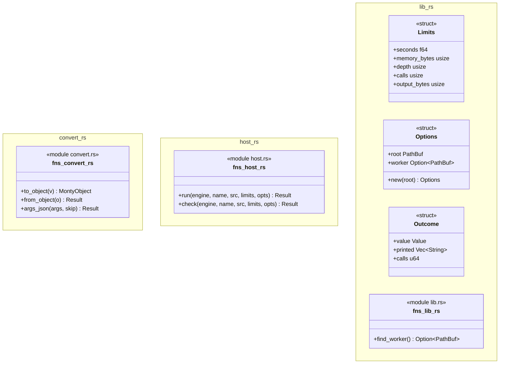

# Script host: code

C4 level 4 (code) of the component **Script host** (`script.host`) in the container **nyx-script** (crate `nyx_script`). [Component view of the container](../../3-components/script.md) · [All code pages](../README.md)

> Runs a script (Python syntax, `*.nys`) through a worker process and answers each `nyx.<command>(...)` it makes with Engine::call; the limits, the clock and random policy, the path guard turned on for the run, the script kept with the runs it makes; `check` parses and type-checks without running. JSON to and from script values.

**Decisions:** [ADR 93](../../../adr/0093-scripts-are-python-text-run-by-monty-in-a-worker-process.md), [ADR 57](../../../adr/0057-front-ends-are-thin-the-mcp-tools-are-engine-commands.md)  
**Size:** 3 files, 345 lines.

## Files

| File | Lines | What it says about itself |
|---|---:|---|
| `crates/nyx-script/src/convert.rs` | 63 | JSON to and from the values of a script (S4). Written by hand: a script value is a `MontyObject`, an engine value is a `serde_json::Value`, and a number keeps its kind (an integer stays an integer, everything else is a float). |
| `crates/nyx-script/src/host.rs` | 199 | Running and checking a script (S4). `run` starts one worker process through monty-pool, feeds it the script and answers each pause (an engine command, an unknown name, a file or clock request) until the script completes or a limit ends i... |
| `crates/nyx-script/src/lib.rs` | 83 | Scripts as a front-end of the nyx engine (productivity plan S4, ADR [89]). |

## What it uses

| Target | Modules | Items |
|---|---|---|
| [container `engine` (nyx-engine)](../../3-components/engine.md) | engine | Engine |
| [Type stub](./stubs.md) | stubs |  |
| [Tracing of script functions](./tracing.md) | trace |  |
| [Worker program](./worker.md) |  (declared: Frames over a pipe: the script pauses at each command and the host answers) |  |

## Used by

| Component | Modules | Items |
|---|---|---|
| [app: Scripts and batch](../app/headless.md) | crate root, host | Limits, Options, check, run |

## Class diagram

Public types with their public fields (or variants) and methods, free functions per file as a `module` box; arrows are field types and `impl Trait`. Capped at 36 types and a few members each; the table below is complete.

## Public items

| Kind | Item | File:line | Signature or summary |
|---|---|---|---|
| fn | `to_object` | `convert.rs:8` | `pub fn to_object(v: &Value) -> MontyObject` —  JSON to a script value. |
| fn | `from_object` | `convert.rs:23` | `pub fn from_object(o: ObjectRef) -> Result<Value, String>` —  A script value to JSON; a value JSON cannot hold (a function, a set, a dict key that is not text, an integer past 64 bits) is an error. |
| fn | `args_json` | `convert.rs:48` | `pub fn args_json(args: &CallArgs, skip: usize) -> Result<Value, String>` —  The arguments of one command call as the engine's JSON object: the keyword arguments, or one positional dict. `skip` leading positional |
| fn | `run` | `host.rs:181` | `pub fn run(engine: &mut Engine, name: &str, src: &str, limits: &Limits, opts: &Options) -> Result<Outcome, String>` —  Runs a script. Its value is its last expression. The engine's path guard is on for the run and restored after it. |
| fn | `check` | `host.rs:195` | `pub fn check(engine: &mut Engine, name: &str, src: &str, limits: &Limits, opts: &Options) -> Result<(), String>` —  Parses and type-checks a script against the commands of `engine` and runs nothing: a misspelled command or argument, a missing argument, a |
| struct | `Limits` | `lib.rs:27` | fields: `seconds`, `memory_bytes`, `depth`, `calls`, `output_bytes` —  What the host allows a script to use. The defaults are strict; a run may raise them (S4 decision). |
| struct | `Options` | `lib.rs:48` | fields: `root`, `worker` —  How a script is run. |
| struct | `Outcome` | `lib.rs:63` | fields: `value`, `printed`, `calls` —  What a finished script gave back. |
| fn | `find_worker` | `lib.rs:74` | `pub fn find_worker() -> Option<PathBuf>` —  The script worker program: named by `NYX_SCRIPT_WORKER`, else `nyx-script-worker` in the folder of the running program or the one above it |
| fn | `Options::new` | `lib.rs:56` | `pub fn new(root: impl Into<PathBuf>) -> Options` |

Trait implementations in this component: `Limits: Default`
