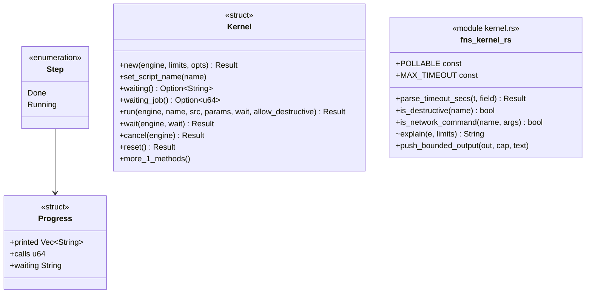

# Script kernel: code

C4 level 4 (code) of the component **Script kernel** (`script.kernel`) in the container **nyx-script** (crate `nyx_script`). [Component view of the container](../../3-components/script.md) · [All code pages](../README.md)

> One Monty session in a worker process that outlives a script: `run`, `wait`, `cancel` and `check`; variables stay from one script to the next; a command that waits for a job (`solve_run`, `convergence_check`, `job_wait`, `queue_wait`) is started and polled by the host so no call blocks for ever and a script can be left `running`; `nyx.aio` futures; the destructive commands refused unless allowed; a dead worker replaced from a dump.

**Decisions:** [ADR 94](../../../adr/0094-the-mcp-server-is-four-script-tools-over-one-kernel.md), [ADR 93](../../../adr/0093-scripts-are-python-text-run-by-monty-in-a-worker-process.md)  
**Size:** 1 file, 774 lines.

## Files

| File | Lines | What it says about itself |
|---|---:|---|
| `crates/nyx-script/src/kernel.rs` | 774 |  |

## What it uses

| Target | Modules | Items |
|---|---|---|
| [container `engine` (nyx-engine)](../../3-components/engine.md) | engine | Engine |
| [Script host](./host.md) | convert, crate root | Limits, Options, Outcome, args_json, find_worker, from_object, to_object |
| [Type stub](./stubs.md) | stubs |  |
| [Tracing of script functions](./tracing.md) | trace |  |

## Used by

| Component | Modules | Items |
|---|---|---|
| [Script host](./host.md) | kernel | Kernel, Step |
| [Type stub](./stubs.md) | kernel | POLLABLE |
| [Tracing of script functions](./tracing.md) | kernel | POLLABLE |

## Class diagram

Public types with their public fields (or variants) and methods, free functions per file as a `module` box; arrows are field types and `impl Trait`. Capped at 36 types and a few members each; the table below is complete.

## Public items

| Kind | Item | File:line | Signature or summary |
|---|---|---|---|
| const | `POLLABLE` | `kernel.rs:34` | `&[&str]` —  The commands that wait for a job. Each is served by starting the job and polling it, and each has an `nyx.aio` twin. |
| const | `MAX_TIMEOUT` | `kernel.rs:40` | `Duration` —  Maximum duration accepted for script execution or job waits (24 hours), preventing host `Duration`/`Instant` panics. |
| fn | `parse_timeout_secs` | `kernel.rs:43` | `pub fn parse_timeout_secs(t: f64, field: &str) -> Result<Duration, String>` —  Parses a timeout in seconds into a [`Duration`] clamped to [`MAX_TIMEOUT`], rejecting non-finite or negative values. |
| fn | `is_destructive` | `kernel.rs:53` | `pub fn is_destructive(name: &str) -> bool` —  Commands that discard the project or a part of it. |
| fn | `is_network_command` | `kernel.rs:58` | `pub fn is_network_command(name: &str, args: &Value) -> bool` —  Commands that trigger outbound network requests (denied during sandboxed script execution). |
| struct | `Progress` | `kernel.rs:65` | fields: `printed`, `calls`, `waiting` —  What a script that is not finished is waiting for. |
| enum | `Step` | `kernel.rs:75` | variants: `Done`, `Running` —  The answer to `run` and `wait`. |
| fn | `explain` | `kernel.rs:181` | `pub(crate) fn explain(e: PoolError, limits: &Limits) -> String` —  What the pool's error means to the person who wrote the script. |
| struct | `Kernel` | `kernel.rs:271` |  A Monty session that outlives a script. |
| fn | `push_bounded_output` | `kernel.rs:291` | `pub fn push_bounded_output(out: &mut String, cap: usize, text: &str)` —  Appends as much of `text` as fits within `cap` bytes of `out`, snapping down to a UTF-8 character boundary. |
| fn | `Kernel::new` | `kernel.rs:317` | `pub fn new(engine: &Engine, limits: Limits, opts: Options) -> Result<Kernel, String>` —  A kernel for `engine`'s catalog. No process is started until the first script. |
| fn | `Kernel::set_script_name` | `kernel.rs:352` | `pub fn set_script_name(&mut self, name: &str)` —  The name the static check gives the script in its messages (`file.nys:2:1`). It is the name of the session, so it is set before the first |
| fn | `Kernel::waiting` | `kernel.rs:357` | `pub fn waiting(&self) -> Option<String>` —  What the script that has not finished is waiting for. |
| fn | `Kernel::waiting_job` | `kernel.rs:365` | `pub fn waiting_job(&self) -> Option<u64>` —  The engine job the script that has not finished is waiting for (none when it waits for futures): a host asks the engine about it. |
| fn | `Kernel::run` | `kernel.rs:380` | `pub fn run(&mut self, engine: &mut Engine, name: &str, src: &str, params: Option<&Value>, wait: Option<Duration>, allow_destructive: bool) -> Result<Step, String>` —  Feeds `src` to the session. It returns when the script is finished, or when `wait` is spent and it is waiting for a job. |
| fn | `Kernel::wait` | `kernel.rs:404` | `pub fn wait(&mut self, engine: &mut Engine, wait: Option<Duration>) -> Result<Step, String>` —  Continues the script that is waiting; at the end of `wait` it may still be. |
| fn | `Kernel::cancel` | `kernel.rs:420` | `pub fn cancel(&mut self, engine: &mut Engine) -> Result<(), String>` —  Abandons the script that is waiting: its job is cancelled and the session starts again from the last script that finished. |
| fn | `Kernel::reset` | `kernel.rs:437` | `pub fn reset(&mut self) -> Result<(), String>` —  Clears the script session (variables, functions, and saved snapshot) without touching the engine. |
| fn | `Kernel::check` | `kernel.rs:455` | `pub fn check(&mut self, engine: &mut Engine, name: &str, src: &str) -> Result<(), String>` —  Parses and type-checks `src` against the commands and the variables of the session and runs nothing that matters: the session it is |

Trait implementations in this component: `Kernel: Drop`
