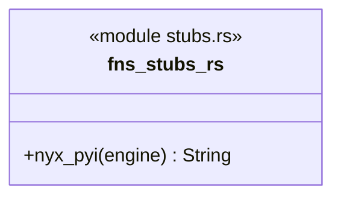

# Type stub: code

C4 level 4 (code) of the component **Type stub** (`script.stubs`) in the container **nyx-script** (crate `nyx_script`). [Component view of the container](../../3-components/script.md) · [All code pages](../README.md)

> The `nyx` object written as Python declarations from Engine::catalog(): the static check, and the file an editor reads.

**Decisions:** [ADR 93](../../../adr/0093-scripts-are-python-text-run-by-monty-in-a-worker-process.md)  
**Size:** 1 file, 73 lines.

## Files

| File | Lines | What it says about itself |
|---|---:|---|
| `crates/nyx-script/src/stubs.rs` | 73 | The type stub of the `nyx` module (S4): `Engine::catalog()` written as Python declarations. Monty type-checks a script against it before the script runs, so a misspelled command, a misspelled or missing argument fails in milliseconds wit... |

## What it uses

| Target | Modules | Items |
|---|---|---|
| [container `engine` (nyx-engine)](../../3-components/engine.md) | commands, engine | CommandDesc, Engine |
| [Tracing of script functions](./tracing.md) | trace | stub |

## Used by

| Component | Modules | Items |
|---|---|---|
| [app: Scripts and batch](../app/headless.md) | stubs | nyx_pyi |
| [Script host](./host.md) | stubs |  |

## Class diagram

Public types with their public fields (or variants) and methods, free functions per file as a `module` box; arrows are field types and `impl Trait`. Capped at 36 types and a few members each; the table below is complete.

## Public items

| Kind | Item | File:line | Signature or summary |
|---|---|---|---|
| fn | `nyx_pyi` | `stubs.rs:61` | `pub fn nyx_pyi(engine: &Engine) -> String` —  The stub of `nyx` for the commands of `engine`: a class with one method per command and the global `nyx` of that class. |
