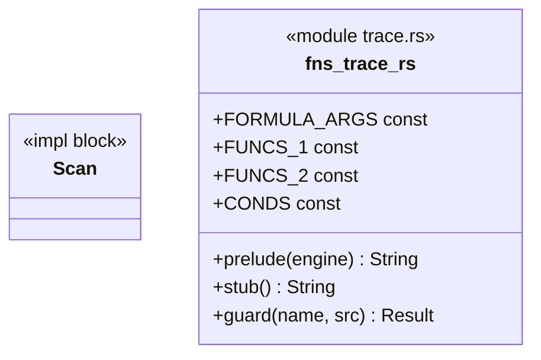

# Tracing of script functions: code

C4 level 4 (code) of the component **Tracing of script functions** (`script.tracing`) in the container **nyx-script** (crate `nyx_script`). [Component view of the container](../../3-components/script.md) · [All code pages](../README.md)

> A Python function given as a formula is called once with a symbolic point and becomes formula text (N3): the prelude the worker is fed (the symbolic value, the formula functions, the `nyx` wrapper), the names the stub declares for it, and the static guard that refuses a branch or comparison on a value of the point with its line (Monty does not call `__bool__` or `__lt__`).

**Decisions:** [ADR 90](../../../adr/0090-whole-array-operations-are-engine-commands-over-a-typed-tree.md), [ADR 93](../../../adr/0093-scripts-are-python-text-run-by-monty-in-a-worker-process.md)  
**Size:** 1 file, 419 lines.

## Files

| File | Lines | What it says about itself |
|---|---:|---|
| `crates/nyx-script/src/trace.rs` | 419 |  |

## What it uses

| Target | Modules | Items |
|---|---|---|
| [container `engine` (nyx-engine)](../../3-components/engine.md) | engine | Engine |
| [Script kernel](./kernel.md) | kernel | POLLABLE |

## Used by

| Component | Modules | Items |
|---|---|---|
| [Script kernel](./kernel.md) | trace |  |
| [Type stub](./stubs.md) | trace | stub |

## Class diagram

Public types with their public fields (or variants) and methods, free functions per file as a `module` box; arrows are field types and `impl Trait`. Capped at 36 types and a few members each; the table below is complete.

## Public items

| Kind | Item | File:line | Signature or summary |
|---|---|---|---|
| const | `FORMULA_ARGS` | `trace.rs:24` | `&[&str]` —  The arguments of the engine commands that take a formula: a function (or a symbolic value) given for one of them is traced. |
| const | `FUNCS_1` | `trace.rs:26` | `&[&str]` —  One value in, the formula function of the same name out (`abs` is Python's own, through `__abs__`). |
| const | `FUNCS_2` | `trace.rs:28` | `&[(&str, &str)]` —  Two values in: the name in a script, the name in the formula. |
| const | `CONDS` | `trace.rs:30` | `&[(&str, &str)]` —  Conditions for `where`: the name in a script, the operator in the formula. |
| fn | `prelude` | `trace.rs:44` | `pub fn prelude(engine: &Engine) -> String` —  The Python text fed to the worker before the script, with `nyx` (the engine's module) as its input: it leaves `nyx` bound to a wrapper. |
| fn | `stub` | `trace.rs:83` | `pub fn stub() -> String` —  The names of the prelude as Python declarations, appended to the stub of `nyx`. They are declared as `Any` variables, not as functions: a |
| fn | `guard` | `trace.rs:358` | `pub fn guard(name: &str, src: &str) -> Result<(), String>` —  Refuses a script in which a function given as a formula branches or compares on a value of the point. `Ok` for a script the parser does not |

Trait implementations in this component: `Scan: Visitor`
