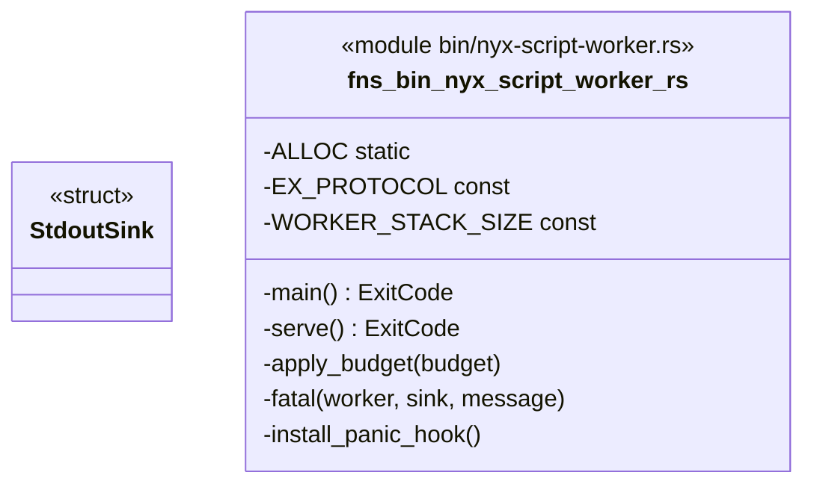

# Worker program: code

C4 level 4 (code) of the component **Worker program** (`script.worker`) in the container **nyx-script** (crate `nyx_script`). [Component view of the container](../../3-components/script.md) · [All code pages](../README.md)

> The only place the Monty interpreter runs: Monty's worker mode over stdin and stdout, with the allocator that bounds its memory. A script that exhausts memory or the stack ends this process, not the engine's.

**Decisions:** [ADR 93](../../../adr/0093-scripts-are-python-text-run-by-monty-in-a-worker-process.md), [ADR 86](../../../adr/0086-solves-run-in-a-worker-process.md)  
**Size:** 1 file, 120 lines.

## Files

| File | Lines | What it says about itself |
|---|---:|---|
| `crates/nyx-script/src/bin/nyx-script-worker.rs` | 120 |  |

## What it uses

Nothing outside the component (the standard library and external crates are not listed).

## Used by

Nothing else in the workspace names this component (entry points are reached by the program or by tests).

## Class diagram

Public types with their public fields (or variants) and methods, free functions per file as a `module` box; arrows are field types and `impl Trait`. Capped at 36 types and a few members each; the table below is complete.

## Public items

| Kind | Item | File:line | Signature or summary |
|---|---|---|---|
| static | `ALLOC` | `bin/nyx-script-worker.rs:24` | `monty_alloc::LimitedAllocator` —  Bounds the worker's memory and turns an allocation failure into an exit code the pool reports as `MemoryError`. Only a program may |
| const | `EX_PROTOCOL` | `bin/nyx-script-worker.rs:27` | `u8` —  exit code for a protocol violation (the stream with the engine is out of step) |
| const | `WORKER_STACK_SIZE` | `bin/nyx-script-worker.rs:30` | `usize` —  The interpreter recurses on deep source; a 16 MiB stack leaves room for the nesting limit of the sandbox. |
| fn | `main` | `bin/nyx-script-worker.rs:32` | `fn main() -> ExitCode` |
| fn | `serve` | `bin/nyx-script-worker.rs:46` | `fn serve() -> ExitCode` |
| fn | `apply_budget` | `bin/nyx-script-worker.rs:90` | `fn apply_budget(budget: SessionBudget)` |
| struct | `StdoutSink` | `bin/nyx-script-worker.rs:95` |  |
| fn | `fatal` | `bin/nyx-script-worker.rs:107` | `fn fatal(worker: &Worker, sink: &mut impl EventSink, message: &str)` |
| fn | `install_panic_hook` | `bin/nyx-script-worker.rs:113` | `fn install_panic_hook()` —  A panic is reported to the engine as a fatal event first (the engine then knows it was a crash and says so), then handled as usual. |

Trait implementations in this component: `StdoutSink: EventSink`
