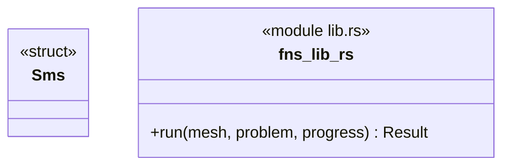

# Physics adapter: code

C4 level 4 (code) of the component **Physics adapter** (`sms.adapter`) in the container **nyx-sms** (crate `nyx_sms`). [Component view of the container](../../3-components/sms.md) · [All code pages](../README.md)

> The Physics implementation of sms: descriptors, validation, solve entry.

**Decisions:** [ADR 42](../../../adr/0042-solid-mechanics-moves-into-nyx-sms.md), [ADR 25](../../../adr/0025-physics-trait-registry-and-problem-envelope.md)  
**Size:** 1 file, 264 lines.

## Files

| File | Lines | What it says about itself |
|---|---:|---|
| `crates/nyx-sms/src/lib.rs` | 264 | nyx-sms: solid mechanics (`sms`, ADR 12): static and eigenfrequency studies of isotropic and anisotropic solids, in 2D (plane strain or stress) and 3D, with absorbing layers (perfectly matched layers and low-reflecting boundaries) and Fl... |

## What it uses

| Target | Modules | Items |
|---|---|---|
| [container `femcore` (femcore)](../../3-components/femcore.md) | material, material::spec, meshing::physics_size, progress | Library, Progress, elastic_wavelength, isotropic_stiffness, stiffness_global |
| [container `physics` (nyx-physics)](../../3-components/physics.md) | crate root, decode | Mesh, Params, materials_by_region |
| [Cross-section kernel](./crosssection.md) | cross_section | CrossModes, solve_solid_axisym |
| [Typed problem](./problem.md) | problem | Bc, BcKind, Plane, Problem, Study, ThermalExpansion, ThermalSource, decode |
| [Solid kernel](./solid.md) | solid | Setup, solve_solid |

## Used by

| Component | Modules | Items |
|---|---|---|
| [engine: Registry and facade](../engine/registry.md) | crate root | Sms |
| [Typed problem](./problem.md) | crate root | Sms |

## Class diagram

Public types with their public fields (or variants) and methods, free functions per file as a `module` box; arrows are field types and `impl Trait`. Capped at 36 types and a few members each; the table below is complete.

## Public items

| Kind | Item | File:line | Signature or summary |
|---|---|---|---|
| struct | `Sms` | `lib.rs:30` |  |
| fn | `run` | `lib.rs:242` | `pub fn run(mesh: &Mesh, problem: &Problem, progress: &Arc<Progress>) -> Result<SolveResult, Error>` —  Solves a typed problem: checks the numbers, runs the kernel of the study under `progress` (stage log, cancellation) and appends the |

Trait implementations in this component: `Sms: Physics`
