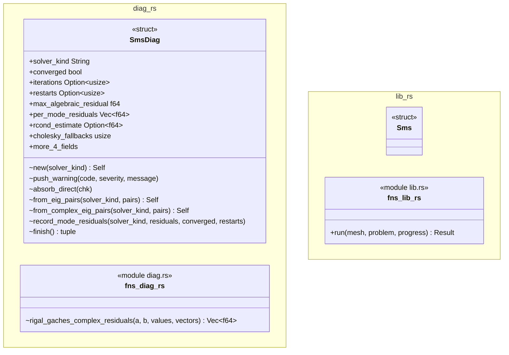

# Physics adapter: code

C4 level 4 (code) of the component **Physics adapter** (`sms.adapter`) in the container **nyx-sms** (crate `nyx_sms`). [Component view of the container](../../3-components/sms.md) · [All code pages](../README.md)

> The Physics implementation of sms with five studies (static, eigenfrequency, axisymmetric eigenfrequency, waveguide modes, driven frequency sweep): descriptors, validation, R32 curved guard, shared solver diagnostics builder, solve entry.

**Decisions:** [ADR 42](../../../adr/0042-solid-mechanics-moves-into-nyx-sms.md), [ADR 25](../../../adr/0025-physics-trait-registry-and-problem-envelope.md), [ADR 68](../../../adr/0068-the-axisymmetric-solid-gets-a-study.md), [ADR 101](../../../adr/0101-sms-waveguide-modes-and-floquet-pml.md), [ADR 129](../../../adr/0129-coupled-piezoelectric-fem-in-nyx-sms.md), [ADR 132](../../../adr/0132-vvuq-asme-six-pillar-code-verification.md), [ADR 133](../../../adr/0133-vvuq-error-budgets-gci-provenance-and-uq.md)  
**Size:** 2 files, 955 lines.

## Files

| File | Lines | What it says about itself |
|---|---:|---|
| `crates/nyx-sms/src/diag.rs` | 257 |  |
| `crates/nyx-sms/src/lib.rs` | 698 |  |

## What it uses

| Target | Modules | Items |
|---|---|---|
| [container `femcore` (femcore)](../../3-components/femcore.md) | linalg::arnoldi_real, linalg::csr::assembly, linalg::driver, material, material::coupled, material::spec, meshing::physics_size, progress | C, CCsr, CEigPairs, DirectSolveCheck, EPSILON_0, EigPairs, Library, Progress, elastic_wavelength, isotropic_stiffness +4 |
| [container `physics` (nyx-physics)](../../3-components/physics.md) | crate root, decode, result | DiagnosticSeverity, DiagnosticWarning, Mesh, NumericalErrorBudget, Params, SolverDiagnostics, SpatialErrorEstimate, materials_by_region |
| [Cross-section study kernel](./crosssection.md) | cross_section | CrossModes, solve_axisymmetric, solve_axisymmetric_mixed, solve_solid_axisym, solve_solid_waveguide, solve_waveguide_modes, solve_waveguide_modes_mixed |
| [Typed problem](./problem.md) | problem | Bc, BcKind, ConductorRole, IeProfile, InfiniteElement, PiezoMode, Plane, Problem, Study, ThermalExpansion +2 |
| [Solid kernel](./solid.md) | solid | Setup, solve_solid, solve_solid_mixed |

## Used by

| Component | Modules | Items |
|---|---|---|
| [engine: Registry and facade](../engine/registry.md) | crate root | Sms |
| [Cross-section study kernel](./crosssection.md) | diag | SmsDiag, rigal_gaches_complex_residuals |
| [Floquet kernel](./floquet.md) | diag | SmsDiag, rigal_gaches_complex_residuals |
| [Low-reflecting boundary](./lrb.md) | diag | SmsDiag |
| [Piezoelectric kernel](./piezo.md) | diag | SmsDiag |
| [Absorbing-layer kernel](./pml.md) | diag | SmsDiag, rigal_gaches_complex_residuals |
| [Typed problem](./problem.md) | crate root | Sms |
| [Solid kernel](./solid.md) | diag | SmsDiag |

## Class diagram

Public types with their public fields (or variants) and methods, free functions per file as a `module` box; arrows are field types and `impl Trait`. Capped at 36 types and a few members each; the table below is complete.

## Public items

| Kind | Item | File:line | Signature or summary |
|---|---|---|---|
| struct | `SmsDiag` | `diag.rs:12` | fields: `solver_kind`, `converged`, `iterations`, `restarts`, `max_algebraic_residual`, `per_mode_residuals`, `rcond_estimate`, `cholesky_fallbacks`, `warnings`, `spatial_discretization`, `temporal_rel`, `model_truncation_rel` —  Accumulator for solver telemetry and error-budget construction across `nyx-sms` studies. |
| fn | `rigal_gaches_complex_residuals` | `diag.rs:227` | `pub(crate) fn rigal_gaches_complex_residuals( a: &femcore::linalg::csr::CCsr, b: &femcore::linalg::csr::CCsr, values: &[femcore::linalg::csr::C], vectors: &[Vec<femcore::linalg::csr::C>], ) -> Vec<f64>` —  Rigal-Gaches normwise generalized eigenproblem backward error |
| fn | `SmsDiag::new` | `diag.rs:28` | `pub(crate) fn new(solver_kind: impl Into<String>) -> Self` |
| fn | `SmsDiag::push_warning` | `diag.rs:45` | `pub(crate) fn push_warning(&mut self, code: &str, severity: DiagnosticSeverity, message: impl Into<String>)` |
| fn | `SmsDiag::absorb_direct` | `diag.rs:49` | `pub(crate) fn absorb_direct(&mut self, chk: &DirectSolveCheck)` |
| fn | `SmsDiag::from_eig_pairs` | `diag.rs:70` | `pub(crate) fn from_eig_pairs(solver_kind: impl Into<String>, pairs: &EigPairs) -> Self` |
| fn | `SmsDiag::from_complex_eig_pairs` | `diag.rs:95` | `pub(crate) fn from_complex_eig_pairs(solver_kind: impl Into<String>, pairs: &CEigPairs) -> Self` |
| fn | `SmsDiag::record_mode_residuals` | `diag.rs:119` | `pub(crate) fn record_mode_residuals( &mut self, solver_kind: impl Into<String>, residuals: Vec<f64>, converged: bool, restarts: Option<usize>, )` |
| fn | `SmsDiag::finish` | `diag.rs:142` | `pub(crate) fn finish(mut self) -> (SolverDiagnostics, NumericalErrorBudget)` |
| struct | `Sms` | `lib.rs:54` |  |
| fn | `run` | `lib.rs:617` | `pub fn run(mesh: &Mesh, problem: &Problem, progress: &Arc<Progress>) -> Result<SolveResult, Error>` —  Solves a typed problem: checks the numbers, assembles natively on `MixedDiscretisation` whenever |

Trait implementations in this component: `Sms: Physics`
