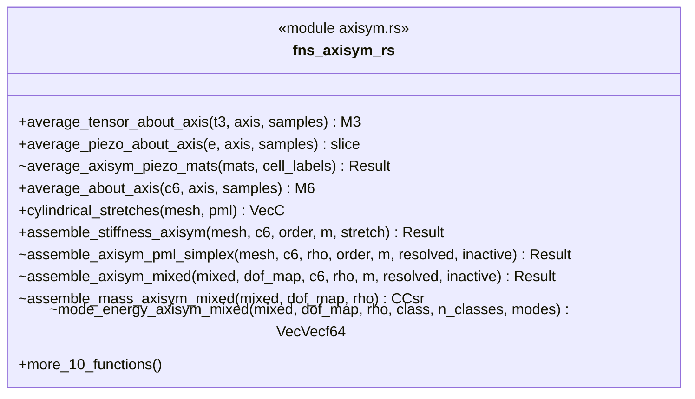

# Axisymmetric kernel: code

C4 level 4 (code) of the component **Axisymmetric kernel** (`sms.axisym`) in the container **nyx-sms** (crate `nyx_sms`). [Component view of the container](../../3-components/sms.md) · [All code pages](../README.md)

> Elastic and `6mm`/`inf m` piezoelectric modes of a body of revolution on its half-plane cross-section, with axis regularity (`phi = 0` at `|m| >= 1`), rotational invariance check, cylindrical PML stretch, and energy weights.

**Decisions:** [ADR 43](../../../adr/0043-axisymmetric-solid-kernel-stays-a-library-entry.md), [ADR 69](../../../adr/0069-axis-conditions-and-cylindrical-stretch-of-the-axisymmetric-solid.md), [ADR 80](../../../adr/0080-modes-carry-what-identifies-them-and-a-convergence-check-follows-a-mode.md), [ADR 129](../../../adr/0129-coupled-piezoelectric-fem-in-nyx-sms.md)  
**Size:** 1 file, 1423 lines.

## Files

| File | Lines | What it says about itself |
|---|---:|---|
| `crates/nyx-sms/src/axisym.rs` | 1423 |  |

## What it uses

| Target | Modules | Items |
|---|---|---|
| [container `femcore` (femcore)](../../3-components/femcore.md) | fem, fem_mixed, linalg::csr, linalg::csr::assembly, material, mesh::mixed, pml, props | C, CCoo, CCsr, IsoparametricCell, LagrangeSpace, M3, M6, MixedDiscretisation, MixedLagrangeDofMap, Pml +7 |
| [container `physics` (nyx-physics)](../../3-components/physics.md) | crate root | Discretisation |
| [Piezoelectric kernel](./piezo.md) | piezo_mat | PiezoCellMat |
| [Absorbing-layer kernel](./pml.md) | pml | ResolvedPmlDomains |

## Used by

| Component | Modules | Items |
|---|---|---|
| [Cross-section study kernel](./crosssection.md) | axisym | assemble_axisym_mixed, assemble_axisym_piezo_mixed, assemble_axisym_piezo_simplex, assemble_axisym_pml_simplex, assemble_mass_axisym, assemble_mass_axisym_mixed, assemble_stiffness_axisym, average_about_axis +9 |
| [Absorbing-layer kernel](./pml.md) | axisym | average_about_axis |

## Class diagram

Public types with their public fields (or variants) and methods, free functions per file as a `module` box; arrows are field types and `impl Trait`. Capped at 36 types and a few members each; the table below is complete.

## Public items

| Kind | Item | File:line | Signature or summary |
|---|---|---|---|
| fn | `average_tensor_about_axis` | `axisym.rs:46` | `pub fn average_tensor_about_axis(t3: &M3, axis: usize, samples: usize) -> M3` —  Rank-2 tensor `3x3` averaged over rotations about `axis` (`0, 1, or 2`). |
| fn | `average_piezo_about_axis` | `axisym.rs:68` | `pub fn average_piezo_about_axis(e: &[[f64; 6]; 3], axis: usize, samples: usize) -> [[f64` —  Piezoelectric stress-charge matrix `e_{iJ}` (`3x6` in cross-section `(r, z, theta)` axes and |
| fn | `average_axisym_piezo_mats` | `axisym.rs:107` | `pub(crate) fn average_axisym_piezo_mats(mats: &mut [PiezoCellMat], cell_labels: &[i32]) -> Result<Vec<String>, String>` —  Azimuthally averages `(c6, e, eps_re, eps_im, eta)` around symmetry axis `1` (`z`) and |
| fn | `average_about_axis` | `axisym.rs:162` | `pub fn average_about_axis(c6: &M6, axis: usize, samples: usize) -> M6` —  The stiffness (solver Voigt order xx, yy, zz, xy, yz, xz in the frame of the cross-section) |
| fn | `cylindrical_stretches` | `axisym.rs:207` | `pub fn cylindrical_stretches(mesh: &Discretisation, pml: &std::collections::BTreeMap<i32, Pml>) -> Vec<[C` —  Per-cell stretch `[s_r, s_z, s_theta]` of the absorbing layers of an axisymmetric model (mesh x = r, mesh y = z). |
| fn | `assemble_stiffness_axisym` | `axisym.rs:294` | `pub fn assemble_stiffness_axisym( mesh: &Discretisation, c6: &[M6], order: usize, m: f64, stretch: Option<&[[C; 3]]>, ) -> Result<CCsr, String>` —  Stiffness matrix over `3 * n_dofs(order)` unknowns (component blocks u_r, u_z, u_theta). `stretch` holds `[s_r, s_z, s_theta]` per cell |
| fn | `assemble_axisym_pml_simplex` | `axisym.rs:370` | `pub(crate) fn assemble_axisym_pml_simplex( mesh: &Discretisation, c6: &[M6], rho: &[f64], order: usize, m: f64, resolved: &ResolvedPmlDomains, inactive: &[i32], ) -> Result<(CCsr, CCsr), String>` —  Quadrature-point curvilinear `(K, M)` assembly for 2D axisymmetric models on [`SimplexMesh`] |
| fn | `assemble_axisym_mixed` | `axisym.rs:472` | `pub(crate) fn assemble_axisym_mixed( mixed: &MixedDiscretisation, dof_map: &MixedLagrangeDofMap, c6: &[M6], rho: &[f64], m: f64, resolved: Option<&ResolvedPmlDomains>, inactive: &[i32], ) -> Result<(CCsr, CCsr), String>` —  Native mixed-cell (`Tri` + `Quad`, straight and curved) `(K, M)` assembly for 2D axisymmetric models. |
| fn | `assemble_mass_axisym_mixed` | `axisym.rs:582` | `pub(crate) fn assemble_mass_axisym_mixed( mixed: &MixedDiscretisation, dof_map: &MixedLagrangeDofMap, rho: &[f64], ) -> CCsr` |
| fn | `mode_energy_axisym_mixed` | `axisym.rs:628` | `pub(crate) fn mode_energy_axisym_mixed( mixed: &MixedDiscretisation, dof_map: &MixedLagrangeDofMap, rho: &[f64], class: &[usize], n_classes: usize, modes: &[Vec<C>], ) -> Vec<Vec<[f64` |
| fn | `assemble_mass_axisym` | `axisym.rs:695` | `pub fn assemble_mass_axisym(mesh: &Discretisation, rho: &[f64], order: usize, stretch: Option<&[[C; 3]]>) -> CCsr` —  Mass matrix `rho r` over `3 * n_dofs` unknowns, with the PML stretch determinant `s_r s_z s_theta` as a complex weight. |
| fn | `mode_energy_axisym` | `axisym.rs:741` | `pub fn mode_energy_axisym( mesh: &Discretisation, rho: &[f64], order: usize, class: &[usize], n_classes: usize, modes: &[Vec<C>], ) -> Vec<Vec<[f64` —  The kinetic-energy weight `int rho \|u_k\|^2 r dr dz` of every mode, split over the three displacement components (radial, axial, |
| fn | `axis_tolerance` | `axisym.rs:792` | `pub fn axis_tolerance(mesh: &Discretisation) -> f64` —  Distance from the axis below which a point counts as on it: 1e-9 of the extent of the mesh. |
| fn | `axis_tolerance_mixed` | `axisym.rs:802` | `pub(crate) fn axis_tolerance_mixed(mixed: &MixedDiscretisation) -> f64` |
| fn | `assemble_axisym_piezo_simplex` | `axisym.rs:1042` | `pub(crate) fn assemble_axisym_piezo_simplex( mesh: &Discretisation, mats: &[PiezoCellMat], order: usize, m: f64, resolved: Option<&ResolvedPmlDomains>, ) -> Result<(CCsr, CCsr, Option<CCsr>), String>` —  Assembles 4-block `(u_r, u_z, u_theta, phi)` coupled piezoelectric axisymmetric matrices |
| fn | `assemble_axisym_piezo_mixed` | `axisym.rs:1182` | `pub(crate) fn assemble_axisym_piezo_mixed( mixed: &MixedDiscretisation, dof_map: &MixedLagrangeDofMap, mats: &[PiezoCellMat], m: f64, resolved: Option<&ResolvedPmlDomains>, ) -> Result<(CCsr, CCsr, Option<CCsr>), String>` —  Native mixed-cell (`Tri` + `Quad`, straight and curved) 4-block `(u_r, u_z, u_theta, phi)` |
| fn | `axis_constraints` | `axisym.rs:1338` | `pub fn axis_constraints(mesh: &Discretisation, order: usize, m: f64) -> Result<(Vec<(usize, usize)>, usize), String>` —  The essential conditions on the axis `r = 0` (`0 u_r`, `1 u_z`, `2 u_theta`), and the number of dofs found on the axis. |
| fn | `axis_constraints_mixed` | `axisym.rs:1343` | `pub(crate) fn axis_constraints_mixed( mixed: &MixedDiscretisation, dof_map: &MixedLagrangeDofMap, m: f64, ) -> Result<(Vec<(usize, usize)>, usize), String>` |
| fn | `axis_constraints_piezo` | `axisym.rs:1355` | `pub(crate) fn axis_constraints_piezo( mesh: &Discretisation, order: usize, m: f64, ) -> Result<(Vec<(usize, usize)>, Vec<usize>, usize), String>` —  Coupled axisymmetric axis `r = 0` regularity constraints: `(mech_pairs, phi_fixed, on_axis_count)`. |
| fn | `axis_constraints_piezo_mixed` | `axisym.rs:1372` | `pub(crate) fn axis_constraints_piezo_mixed( mixed: &MixedDiscretisation, dof_map: &MixedLagrangeDofMap, m: f64, ) -> Result<(Vec<(usize, usize)>, Vec<usize>, usize), String>` |
