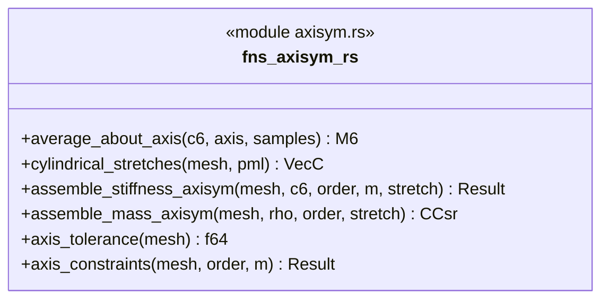

# Axisymmetric kernel: code

C4 level 4 (code) of the component **Axisymmetric kernel** (`sms.axisym`) in the container **nyx-sms** (crate `nyx_sms`). [Component view of the container](../../3-components/sms.md) · [All code pages](../README.md)

> Elastic modes of a body of revolution on its half-plane cross-section, with the axis regularity conditions and the cylindrical PML stretch.

**Decisions:** [ADR 43](../../../adr/0043-axisymmetric-solid-kernel-stays-a-library-entry.md), [ADR 69](../../../adr/0069-axis-conditions-and-cylindrical-stretch-of-the-axisymmetric-solid.md)  
**Size:** 1 file, 334 lines.

## Files

| File | Lines | What it says about itself |
|---|---:|---|
| `crates/nyx-sms/src/axisym.rs` | 334 | Elastic modes of a body of revolution (a ring, a disk, a wheel) on its half-plane cross-section: the displacement is `u(r, z) exp(-i m theta)` with azimuthal order `m`, and the mesh has `x = r`, `y = z`. The three components are stored a... |

## What it uses

| Target | Modules | Items |
|---|---|---|
| [container `femcore` (femcore)](../../3-components/femcore.md) | fem, linalg::csr, linalg::csr::assembly, material, pml, props | C, CCoo, CCsr, M6, Pml, PmlDir, c, cell_stretches, radial_coordinate |
| [container `physics` (nyx-physics)](../../3-components/physics.md) | crate root | Discretisation |

## Used by

| Component | Modules | Items |
|---|---|---|
| [Axisymmetric study kernel](./crosssection.md) | axisym | assemble_mass_axisym, assemble_stiffness_axisym, average_about_axis, axis_constraints, cylindrical_stretches |

## Class diagram

Public types with their public fields (or variants) and methods, free functions per file as a `module` box; arrows are field types and `impl Trait`. Capped at 36 types and a few members each; the table below is complete.

## Public items

| Kind | Item | File:line | Signature or summary |
|---|---|---|---|
| fn | `average_about_axis` | `axisym.rs:53` | `pub fn average_about_axis(c6: &M6, axis: usize, samples: usize) -> M6` —  The stiffness (solver Voigt order xx, yy, zz, xy, yz, xz in the frame of the cross-section) |
| fn | `cylindrical_stretches` | `axisym.rs:110` | `pub fn cylindrical_stretches(mesh: &Discretisation, pml: &std::collections::BTreeMap<i32, Pml>) -> Vec<[C` —  Per-cell stretch `[s_r, s_z, s_theta]` of the absorbing layers of an axisymmetric model (mesh x = r, mesh y = z). `s_r` and `s_z` are |
| fn | `assemble_stiffness_axisym` | `axisym.rs:139` | `pub fn assemble_stiffness_axisym( mesh: &Discretisation, c6: &[M6], order: usize, m: f64, stretch: Option<&[[C; 3]]>, ) -> Result<CCsr, String>` |
| fn | `assemble_mass_axisym` | `axisym.rs:257` | `pub fn assemble_mass_axisym(mesh: &Discretisation, rho: &[f64], order: usize, stretch: Option<&[[C; 3]]>) -> CCsr` —  Mass matrix `rho r` over `3 * n_dofs` unknowns, with the PML stretch determinant `s_r s_z s_theta` as a complex weight. |
| fn | `axis_tolerance` | `axisym.rs:303` | `pub fn axis_tolerance(mesh: &Discretisation) -> f64` —  Distance from the axis below which a point counts as on it: 1e-9 of the extent of the mesh. |
| fn | `axis_constraints` | `axisym.rs:316` | `pub fn axis_constraints(mesh: &Discretisation, order: usize, m: f64) -> Result<(Vec<(usize, usize)>, usize), String>` —  The essential conditions on the axis `r = 0` (module header): `(block, dof)` pairs to hold at zero, blocks as the |
