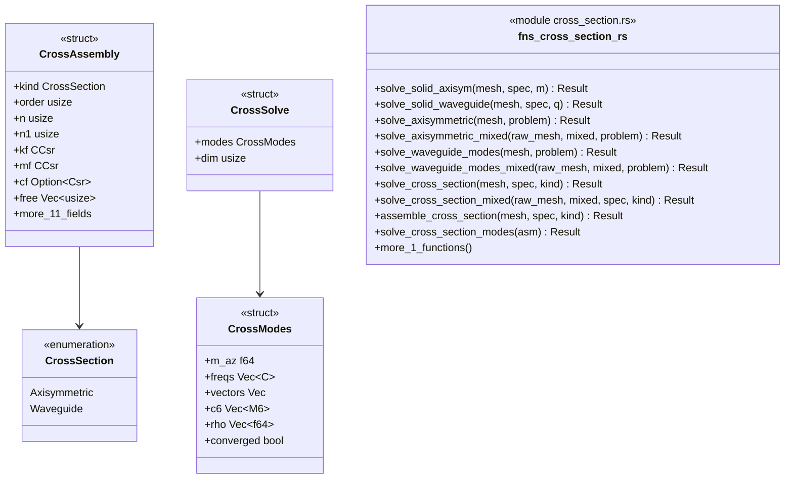

# Cross-section study kernel: code

C4 level 4 (code) of the component **Cross-section study kernel** (`sms.crosssection`) in the container **nyx-sms** (crate `nyx_sms`). [Component view of the container](../../3-components/sms.md) · [All code pages](../README.md)

> Cross-section study kernel (`axisymmetric_eigenfrequency` on the (r, z) half plane and 2.5D `modes` on the (x, z) cross-section): elastic and coupled piezoelectric constraints, axis and periodic conditions, absorbing layers, complex eigensolve and fields.

**Decisions:** [ADR 43](../../../adr/0043-axisymmetric-solid-kernel-stays-a-library-entry.md), [ADR 68](../../../adr/0068-the-axisymmetric-solid-gets-a-study.md), [ADR 69](../../../adr/0069-axis-conditions-and-cylindrical-stretch-of-the-axisymmetric-solid.md), [ADR 80](../../../adr/0080-modes-carry-what-identifies-them-and-a-convergence-check-follows-a-mode.md), [ADR 101](../../../adr/0101-sms-waveguide-modes-and-floquet-pml.md), [ADR 129](../../../adr/0129-coupled-piezoelectric-fem-in-nyx-sms.md)  
**Size:** 1 file, 1753 lines.

## Files

| File | Lines | What it says about itself |
|---|---:|---|
| `crates/nyx-sms/src/cross_section.rs` | 1753 |  |

## What it uses

| Target | Modules | Items |
|---|---|---|
| [container `femcore` (femcore)](../../3-components/femcore.md) | fem, fem_mixed, fields, linalg::csr, linalg::csr::assembly, linalg::driver, material, mesh::mixed +2 | C, CCsr, CellFields, Csr, LagrangeSpace, M6, MixedDiscretisation, MixedLagrangeDofMap, RCsr, Reduction +8 |
| [container `physics` (nyx-physics)](../../3-components/physics.md) | crate root, result | Discretisation, Field, Mesh, MixedToSimplexProjector, Scalar, Solution, SolveResult, cell_fields_of |
| [Axisymmetric kernel](./axisym.md) | axisym | assemble_axisym_mixed, assemble_axisym_piezo_mixed, assemble_axisym_piezo_simplex, assemble_axisym_pml_simplex, assemble_mass_axisym, assemble_mass_axisym_mixed, assemble_stiffness_axisym, average_about_axis, average_axisym_piezo_mats, axis_constraints +7 |
| [Floquet kernel](./floquet.md) | floquet | mixed_nodal_relations |
| [Low-reflecting boundary](./lrb.md) | lrb | AMPLIFYING_IM_TOL, damping_matrix, damping_matrix_mixed, quadratic_modes |
| [Piezoelectric kernel](./piezo.md) | piezo, piezo_asm, piezo_mat | PiezoCellMat, PiezoComplexEigenInput, resolve_piezo_mats_mixed, resolve_piezo_mats_simplex, solve_piezo_complex_schur, sub_csr |
| [Absorbing-layer kernel](./pml.md) | pml | ResolvedPmlDomains, outer_clamped_dofs_mixed, outer_clamped_dofs_simplex |
| [Typed problem](./problem.md) | problem |  |
| [Solid kernel](./solid.md) | solid | cell_rho, mixed_cell_rho, mixed_cell_stiffness_skipping, mixed_check_boundary_labels, mixed_untouched_dofs |
| [Waveguide kernel](./waveguide.md) | waveguide | assemble_stiffness_waveguide, assemble_waveguide_mixed, assemble_waveguide_piezo_mixed, assemble_waveguide_piezo_simplex, assemble_waveguide_pml_simplex, mode_energy_waveguide, mode_energy_waveguide_mixed |

## Used by

| Component | Modules | Items |
|---|---|---|
| [Physics adapter](./adapter.md) | cross_section | CrossModes, solve_axisymmetric, solve_axisymmetric_mixed, solve_solid_axisym, solve_solid_waveguide, solve_waveguide_modes, solve_waveguide_modes_mixed |
| [Solid kernel](./solid.md) | cross_section | solve_axisymmetric, solve_axisymmetric_mixed, solve_waveguide_modes, solve_waveguide_modes_mixed |

## Class diagram

Public types with their public fields (or variants) and methods, free functions per file as a `module` box; arrows are field types and `impl Trait`. Capped at 36 types and a few members each; the table below is complete.

## Public items

| Kind | Item | File:line | Signature or summary |
|---|---|---|---|
| struct | `CrossModes` | `cross_section.rs:39` | fields: `m_az`, `freqs`, `vectors`, `c6`, `rho`, `converged` —  The complex eigenvectors behind a cross-section solid result: displacement over all `3 * n_dofs` dofs (component blocks), the complex |
| enum | `CrossSection` | `cross_section.rs:49` | variants: `Axisymmetric`, `Waveguide` |
| fn | `solve_solid_axisym` | `cross_section.rs:54` | `pub fn solve_solid_axisym(mesh: &Discretisation, spec: &Problem, m: f64) -> Result<(SolveResult, CrossModes), String>` |
| fn | `solve_solid_waveguide` | `cross_section.rs:58` | `pub fn solve_solid_waveguide( mesh: &Discretisation, spec: &Problem, q: f64, ) -> Result<(SolveResult, CrossModes), String>` |
| fn | `solve_axisymmetric` | `cross_section.rs:66` | `pub fn solve_axisymmetric(mesh: &Discretisation, problem: &Problem) -> Result<SolveResult, String>` |
| fn | `solve_axisymmetric_mixed` | `cross_section.rs:85` | `pub fn solve_axisymmetric_mixed( raw_mesh: &Mesh, mixed: &MixedDiscretisation, problem: &Problem, ) -> Result<SolveResult, String>` |
| fn | `solve_waveguide_modes` | `cross_section.rs:108` | `pub fn solve_waveguide_modes(mesh: &Discretisation, problem: &Problem) -> Result<SolveResult, String>` |
| fn | `solve_waveguide_modes_mixed` | `cross_section.rs:126` | `pub fn solve_waveguide_modes_mixed( raw_mesh: &Mesh, mixed: &MixedDiscretisation, problem: &Problem, ) -> Result<SolveResult, String>` |
| fn | `solve_cross_section` | `cross_section.rs:166` | `pub fn solve_cross_section( mesh: &Discretisation, spec: &Problem, kind: CrossSection, ) -> Result<(SolveResult, CrossModes), String>` |
| fn | `solve_cross_section_mixed` | `cross_section.rs:179` | `pub fn solve_cross_section_mixed( raw_mesh: &Mesh, mixed: &MixedDiscretisation, spec: &Problem, kind: CrossSection, ) -> Result<(SolveResult, CrossModes), String>` |
| struct | `CrossAssembly` | `cross_section.rs:347` | fields: `kind`, `order`, `n`, `n1`, `kf`, `mf`, `cf`, `free`, `fixed`, `c6`, `rho`, `n_modes`, ... —  Stage 1 of the cross-section solid kernels: stiffness, mass and (low-reflecting) damping on the free dofs, the |
| fn | `assemble_cross_section` | `cross_section.rs:369` | `pub fn assemble_cross_section( mesh: &Discretisation, spec: &Problem, kind: CrossSection, ) -> Result<CrossAssembly, String>` |
| struct | `CrossSolve` | `cross_section.rs:523` | fields: `modes`, `dim` |
| fn | `solve_cross_section_modes` | `cross_section.rs:528` | `pub fn solve_cross_section_modes(asm: &CrossAssembly) -> Result<CrossSolve, String>` |
| fn | `cross_section_fields` | `cross_section.rs:597` | `pub fn cross_section_fields( mesh: &Discretisation, asm: &CrossAssembly, solved: &CrossSolve, ) -> Result<SolveResult, String>` |
