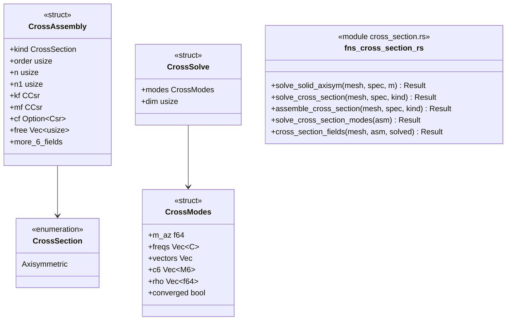

# Cross-section kernel: code

C4 level 4 (code) of the component **Cross-section kernel** (`sms.crosssection`) in the container **nyx-sms** (crate `nyx_sms`). [Component view of the container](../../3-components/sms.md) · [All code pages](../README.md)

> Stiffness and mass on a 2D mesh with three displacement components (the shared kernel of the elastic cross-section models).

**Decisions:** [ADR 43](../../../adr/0043-axisymmetric-solid-kernel-stays-a-library-entry.md)  
**Size:** 1 file, 354 lines.

## Files

| File | Lines | What it says about itself |
|---|---:|---|
| `crates/nyx-sms/src/cross_section.rs` | 354 | The shared kernel of the elastic cross-section models: stiffness and mass on a 2D mesh with three displacement components, the constraints, absorbing layers and low-reflecting boundaries, the complex eigensolve and the fields. It serves ... |

## What it uses

| Target | Modules | Items |
|---|---|---|
| [container `femcore` (femcore)](../../3-components/femcore.md) | fem, fields, linalg::csr, linalg::csr::assembly, linalg::driver, material, pml, section | C, CCsr, CellFields, M6, RCsr, c, cell_stretches, check_boundary_labels, eigs_complex, plane_stiffness |
| [container `physics` (nyx-physics)](../../3-components/physics.md) | crate root, result | Discretisation, Field, Scalar, Solution, SolveResult, cell_fields_of |
| [Axisymmetric kernel](./axisym.md) | axisym | assemble_mass_axisym, assemble_stiffness_axisym, average_about_axis |
| [Low-reflecting boundary](./lrb.md) | lrb | damping_matrix, quadratic_modes |
| [Typed problem](./problem.md) | problem |  |

## Used by

| Component | Modules | Items |
|---|---|---|
| [Physics adapter](./adapter.md) | cross_section | CrossModes, solve_solid_axisym |

## Class diagram

Public types with their public fields (or variants) and methods, free functions per file as a `module` box; arrows are field types and `impl Trait`. Capped at 36 types and a few members each; the table below is complete.

## Public items

| Kind | Item | File:line | Signature or summary |
|---|---|---|---|
| struct | `CrossModes` | `cross_section.rs:46` | fields: `m_az`, `freqs`, `vectors`, `c6`, `rho`, `converged` —  The complex eigenvectors behind a cross-section solid result: displacement over all `3 * n_dofs(order)` dofs (component blocks), the complex |
| enum | `CrossSection` | `cross_section.rs:58` | variants: `Axisymmetric` —  What the third displacement component and the third dimension are: the azimuth of an axisymmetric body with azimuthal order `m` |
| fn | `solve_solid_axisym` | `cross_section.rs:64` | `pub fn solve_solid_axisym(mesh: &Discretisation, spec: &Problem, m: f64) -> Result<(SolveResult, CrossModes), String>` —  Elastic modes of a body of revolution with azimuthal dependence `exp(-i m theta)` on the (r, z) half |
| fn | `solve_cross_section` | `cross_section.rs:68` | `pub fn solve_cross_section( mesh: &Discretisation, spec: &Problem, kind: CrossSection, ) -> Result<(SolveResult, CrossModes), String>` |
| struct | `CrossAssembly` | `cross_section.rs:83` | fields: `kind`, `order`, `n`, `n1`, `kf`, `mf`, `cf`, `free`, `fixed`, `c6`, `rho`, `n_modes`, ... —  Stage 1 of the cross-section solid kernels: stiffness, mass and (low-reflecting) damping on the free dofs, the |
| fn | `assemble_cross_section` | `cross_section.rs:103` | `pub fn assemble_cross_section( mesh: &Discretisation, spec: &Problem, kind: CrossSection, ) -> Result<CrossAssembly, String>` |
| struct | `CrossSolve` | `cross_section.rs:206` | fields: `modes`, `dim` —  Stage 2 output: the mode shapes over all dofs and what the eigensolver says about them. |
| fn | `solve_cross_section_modes` | `cross_section.rs:214` | `pub fn solve_cross_section_modes(asm: &CrossAssembly) -> Result<CrossSolve, String>` —  Stage 2: the complex eigenpairs (`K - w^2 M` or the quadratic problem with the low-reflecting damping) nearest the |
| fn | `cross_section_fields` | `cross_section.rs:270` | `pub fn cross_section_fields( mesh: &Discretisation, asm: &CrossAssembly, solved: &CrossSolve, ) -> Result<SolveResult, String>` —  Stage 3: the plot fields `\|u\|`, `ux`, `uz`, `uy`, `\|uy\|` of every mode (largest component real, unit maximum), the |
