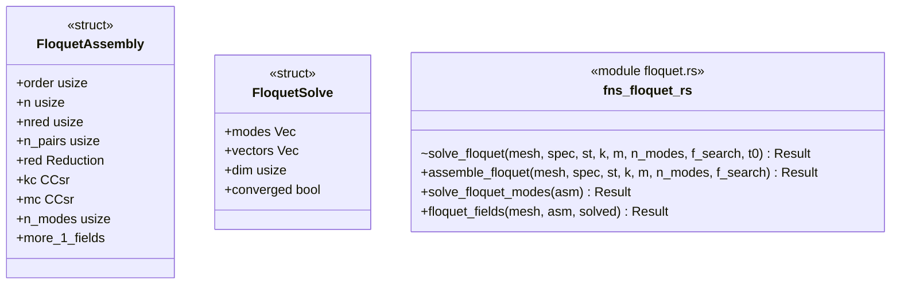

# Floquet kernel: code

C4 level 4 (code) of the component **Floquet kernel** (`sms.floquet`) in the container **nyx-sms** (crate `nyx_sms`). [Component view of the container](../../3-components/sms.md) · [All code pages](../README.md)

> Eigenfrequencies of a solid with Floquet-periodic boundaries (phononic crystals).

**Decisions:** [ADR 42](../../../adr/0042-solid-mechanics-moves-into-nyx-sms.md)  
**Size:** 1 file, 128 lines.

## Files

| File | Lines | What it says about itself |
|---|---:|---|
| `crates/nyx-sms/src/floquet.rs` | 128 | Eigenfrequencies of a solid with Floquet-periodic boundaries (phononic crystals, periodic waveguide cells): the stiffness and mass matrices are reduced by the periodic constraints and the complex Hermitian eigenproblem is solved with the... |

## What it uses

| Target | Modules | Items |
|---|---|---|
| [container `femcore` (femcore)](../../3-components/femcore.md) | linalg::csr, linalg::csr::assembly, linalg::driver, periodic | C, CCsr, RCsr, Reduction, c, congruence, eigs_complex, match_vertices, nodal_relations |
| [container `physics` (nyx-physics)](../../3-components/physics.md) | crate root, result | Discretisation, Scalar, Solution, SolveResult, cell_fields_of |
| [Typed problem](./problem.md) | problem |  |
| [Solid kernel](./solid.md) | solid | Setup, complex_mode_fields |

## Used by

| Component | Modules | Items |
|---|---|---|
| [Solid kernel](./solid.md) | floquet | solve_floquet |

## Class diagram

Public types with their public fields (or variants) and methods, free functions per file as a `module` box; arrows are field types and `impl Trait`. Capped at 36 types and a few members each; the table below is complete.

## Public items

| Kind | Item | File:line | Signature or summary |
|---|---|---|---|
| fn | `solve_floquet` | `floquet.rs:19` | `pub(crate) fn solve_floquet( mesh: &Discretisation, spec: &Problem, st: &Setup, k: &Csr, m: &Csr, n_modes: usize, f_search: f64, t0: Instant, ) -> Result<SolveResult, String>` |
| struct | `FloquetAssembly` | `floquet.rs:37` | fields: `order`, `n`, `nred`, `n_pairs`, `red`, `kc`, `mc`, `n_modes`, `f_search` —  Stage 1 of the Floquet-periodic solid kernel: the stiffness and mass reduced to the independent dofs of the |
| struct | `FloquetSolve` | `floquet.rs:50` | fields: `modes`, `vectors`, `dim`, `converged` —  Stage 2 output: frequency and index of each converged mode (by frequency), the reduced vectors. |
| fn | `assemble_floquet` | `floquet.rs:57` | `pub fn assemble_floquet( mesh: &Discretisation, spec: &Problem, st: &Setup, k: &Csr, m: &Csr, n_modes: usize, f_search: f64, ) -> Result<FloquetAssembly, String>` |
| fn | `solve_floquet_modes` | `floquet.rs:86` | `pub fn solve_floquet_modes(asm: &FloquetAssembly) -> Result<FloquetSolve, String>` —  Stage 2: the complex Hermitian eigenpairs of the reduced problem nearest the search frequency. |
| fn | `floquet_fields` | `floquet.rs:104` | `pub fn floquet_fields( mesh: &Discretisation, asm: &FloquetAssembly, solved: &FloquetSolve, ) -> Result<SolveResult, String>` —  Stage 3: plot fields and per-cell complex displacement of every mode. |
