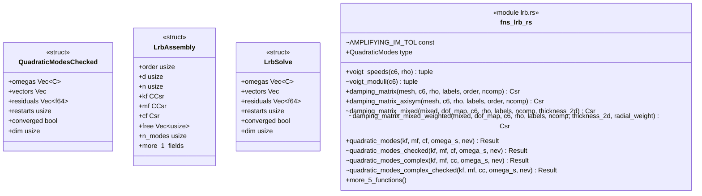

# Low-reflecting boundary: code

C4 level 4 (code) of the component **Low-reflecting boundary** (`sms.lrb`) in the container **nyx-sms** (crate `nyx_sms`). [Component view of the container](../../3-components/sms.md) · [All code pages](../README.md)

> Low-reflecting boundaries for solid mechanics (with `r`-weighted axisymmetric `damping_matrix`, R6b).

**Decisions:** [ADR 42](../../../adr/0042-solid-mechanics-moves-into-nyx-sms.md), [ADR 132](../../../adr/0132-vvuq-asme-six-pillar-code-verification.md)  
**Size:** 1 file, 693 lines.

## Files

| File | Lines | What it says about itself |
|---|---:|---|
| `crates/nyx-sms/src/lrb.rs` | 693 |  |

## What it uses

| Target | Modules | Items |
|---|---|---|
| [container `femcore` (femcore)](../../3-components/femcore.md) | fem, fem_mixed, linalg::csr, linalg::csr::assembly, linalg::driver, material, mesh::cells, mesh::mixed +1 | C, CCoo, CCsr, Coo, FacetType, M6, MixedDiscretisation, MixedLagrangeDofMap, RCsr, c +10 |
| [container `physics` (nyx-physics)](../../3-components/physics.md) | crate root, result | Discretisation, Mesh, MixedToSimplexProjector, Scalar, Solution, SolveResult, cell_fields_of |
| [Physics adapter](./adapter.md) | diag | SmsDiag |
| [Typed problem](./problem.md) | problem | Problem, check_simplex_straight |
| [Solid kernel](./solid.md) | solid | Setup, assemble_solid, assemble_solid_mixed, complex_mode_fields, complex_mode_fields_mixed, mixed_cell_viscosity_skipping |

## Used by

| Component | Modules | Items |
|---|---|---|
| [Cross-section study kernel](./crosssection.md) | lrb | AMPLIFYING_IM_TOL, damping_matrix, damping_matrix_axisym, damping_matrix_mixed, damping_matrix_mixed_weighted, quadratic_modes_checked, quadratic_modes_complex_checked |
| [Piezoelectric kernel](./piezo.md) | lrb | AMPLIFYING_IM_TOL, damping_matrix, damping_matrix_mixed |
| [Absorbing-layer kernel](./pml.md) | lrb | AMPLIFYING_IM_TOL |
| [Solid kernel](./solid.md) | lrb | solve_lrb, solve_lrb_mixed, voigt_moduli |

## Class diagram

Public types with their public fields (or variants) and methods, free functions per file as a `module` box; arrows are field types and `impl Trait`. Capped at 36 types and a few members each; the table below is complete.

## Public items

| Kind | Item | File:line | Signature or summary |
|---|---|---|---|
| const | `AMPLIFYING_IM_TOL` | `lrb.rs:32` | `f64` —  Relative imaginary-frequency threshold below which `f.im < 0` flags an unphysical amplifying mode. |
| fn | `voigt_speeds` | `lrb.rs:35` | `pub fn voigt_speeds(c6: &M6, rho: f64) -> (f64, f64)` —  Pressure and shear speeds of an anisotropic stiffness (Voigt averages) and density. |
| fn | `voigt_moduli` | `lrb.rs:44` | `pub(crate) fn voigt_moduli(c6: &M6) -> (f64, f64)` —  Voigt-averaged `(bulk_K, shear_G)` moduli of a `6x6` stiffness matrix `c6` without dividing by `rho`. |
| fn | `damping_matrix` | `lrb.rs:54` | `pub fn damping_matrix( mesh: &Discretisation, c6: &[M6], rho: &[f64], labels: &[i32], order: usize, ncomp: usize, ) -> Csr` —  The real symmetric damping matrix `C` over `ncomp` component blocks of the boundaries `labels`. |
| fn | `damping_matrix_axisym` | `lrb.rs:67` | `pub fn damping_matrix_axisym( mesh: &Discretisation, c6: &[M6], rho: &[f64], labels: &[i32], order: usize, ncomp: usize, ) -> Csr` —  Axisymmetric real symmetric damping matrix `C` with the radial Jacobian weight `r` |
| fn | `damping_matrix_mixed` | `lrb.rs:182` | `pub(crate) fn damping_matrix_mixed( mixed: &MixedDiscretisation, dof_map: &MixedLagrangeDofMap, c6: &[M6], rho: &[f64], labels: &[i32], ncomp: usize, thickness_2d: f64, ) -> Csr` —  Real symmetric low-reflecting damping matrix `C` assembled natively on a [`MixedDiscretisation`] |
| fn | `damping_matrix_mixed_weighted` | `lrb.rs:195` | `pub(crate) fn damping_matrix_mixed_weighted( mixed: &MixedDiscretisation, dof_map: &MixedLagrangeDofMap, c6: &[M6], rho: &[f64], labels: &[i32], ncomp: usize, thickness_2d: f64, radial_weight: bool, ) -> Csr` —  Low-reflecting damping matrix on a [`MixedDiscretisation`] with optional radial Jacobian weight `r` (`R6b`). |
| type | `QuadraticModes` | `lrb.rs:304` |  Eigenvalues, eigenvectors, whether all converged, and the Krylov dimension used. |
| struct | `QuadraticModesChecked` | `lrb.rs:307` | fields: `omegas`, `vectors`, `residuals`, `restarts`, `converged`, `dim` —  Detailed quadratic eigenproblem solution retaining per-mode residuals and restart count. |
| fn | `quadratic_modes` | `lrb.rs:318` | `pub fn quadratic_modes(kf: &CCsr, mf: &CCsr, cf: &Csr, omega_s: f64, nev: usize) -> Result<QuadraticModes, String>` —  Eigenpairs `omega` (complex, rad/s) near `omega_s` of `(K + i omega C - omega^2 M) u = 0` over the free |
| fn | `quadratic_modes_checked` | `lrb.rs:323` | `pub(crate) fn quadratic_modes_checked( kf: &CCsr, mf: &CCsr, cf: &Csr, omega_s: f64, nev: usize, ) -> Result<QuadraticModesChecked, String>` |
| fn | `quadratic_modes_complex` | `lrb.rs:335` | `pub(crate) fn quadratic_modes_complex( kf: &CCsr, mf: &CCsr, cc: &CCsr, omega_s: f64, nev: usize, ) -> Result<QuadraticModes, String>` —  Complex damping variant of [`quadratic_modes`] (supports congruence-reduced complex LRB matrices). |
| fn | `quadratic_modes_complex_checked` | `lrb.rs:347` | `pub(crate) fn quadratic_modes_complex_checked( kf: &CCsr, mf: &CCsr, cc: &CCsr, omega_s: f64, nev: usize, ) -> Result<QuadraticModesChecked, String>` —  Complex damping quadratic eigenproblem solver retaining per-mode residuals and restarts. |
| fn | `solve_lrb` | `lrb.rs:421` | `pub fn solve_lrb( mesh: &Discretisation, spec: &Problem, st: &crate::solid::Setup, k: &Csr, m: &Csr, rho_cells: &[f64], labels: &[i32], n_modes: usize, f_search: f64, t0: std::time::Instant, ) -> Result<SolveResult, String>` —  Eigenfrequencies with low-reflecting boundaries for the real stiffness and mass matrices of |
| fn | `solve_lrb_mixed` | `lrb.rs:440` | `pub(crate) fn solve_lrb_mixed( raw_mesh: &Mesh, mixed: &MixedDiscretisation, dof_map: &MixedLagrangeDofMap, spec: &Problem, c6: &[M6], fixed: &[usize], k: &Csr, m: &Csr, rho_cells: &[f64], labels: &[i32], n_modes: usize, f_search: f64, t0: std::time::Instant, ) -> Result<SolveResult, String>` |
| struct | `LrbAssembly` | `lrb.rs:544` | fields: `order`, `d`, `n`, `kf`, `mf`, `cf`, `free`, `n_modes`, `f_search` —  Stage 1 of the solid kernel with low-reflecting boundaries: stiffness, mass and the boundary damping on the free dofs |
| struct | `LrbSolve` | `lrb.rs:557` | fields: `omegas`, `vectors`, `residuals`, `restarts`, `converged`, `dim` —  Stage 2 output: complex angular frequencies and the free-dof vectors of the converged modes. |
| fn | `assemble_lrb` | `lrb.rs:567` | `pub fn assemble_lrb( mesh: &Discretisation, spec: &Problem, st: &crate::solid::Setup, k: &Csr, m: &Csr, rho_cells: &[f64], labels: &[i32], n_modes: usize, f_search: f64, ) -> Result<LrbAssembly, String>` |
| fn | `solve_lrb_modes` | `lrb.rs:615` | `pub fn solve_lrb_modes(asm: &LrbAssembly) -> Result<LrbSolve, String>` —  Stage 2: the quadratic eigenpairs nearest the search frequency. |
| fn | `lrb_fields` | `lrb.rs:631` | `pub fn lrb_fields(mesh: &Discretisation, asm: &LrbAssembly, solved: &LrbSolve) -> Result<SolveResult, String>` —  Stage 3: plot fields and per-cell complex displacement of every mode, the frequencies and signed Q. |
