# Piezoelectric kernel: code

C4 level 4 (code) of the component **Piezoelectric kernel** (`sms.piezo`) in the container **nyx-sms** (crate `nyx_sms`). [Component view of the container](../../3-components/sms.md) · [All code pages](../README.md)

> Coupled piezoelectric `(u, phi)` 2D/3D static, eigenfrequency (Schur Krylov-Schur & damped QEP), Schur-AMG Right-FGMRES 3D static, and driven frequency-domain multi-port `Y`/`Z`/`S` PROM kernels on `SimplexMesh` and `MixedDiscretisation`.

**Decisions:** [ADR 129](../../../adr/0129-coupled-piezoelectric-fem-in-nyx-sms.md), [ADR 106](../../../adr/0106-driven-frequency-domain-waveports-and-hermite-prom.md), [ADR 128](../../../adr/0128-structured-curvilinear-pml-and-open-boundaries.md)  
**Size:** 4 files, 6043 lines.

## Files

| File | Lines | What it says about itself |
|---|---:|---|
| `crates/nyx-sms/src/piezo.rs` | 2028 |  |
| `crates/nyx-sms/src/piezo_asm.rs` | 2775 |  |
| `crates/nyx-sms/src/piezo_driven.rs` | 678 |  |
| `crates/nyx-sms/src/piezo_mat.rs` | 562 |  |

## What it uses

| Target | Modules | Items |
|---|---|---|
| [container `femcore` (femcore)](../../3-components/femcore.md) | adapt::metric, crate root, fem, fem_mixed, fields, linalg::amg_elastic, linalg::csr, linalg::csr::assembly +20 | AmgOptions, AmgSystem, C, C64, CANCELLED, CCoo, CCsr, CellFields, Coo, Csr +82 |
| [container `physics` (nyx-physics)](../../3-components/physics.md) | cqed, crate root, frame, result | CellField, Discretisation, DrivenPortData, Field, FieldFrame, Mesh, MixedToSimplexProjector, Scalar, Solution, SolveResult +1 |
| [Floquet kernel](./floquet.md) | floquet | mixed_nodal_relations |
| [Low-reflecting boundary](./lrb.md) | lrb | AMPLIFYING_IM_TOL, damping_matrix, damping_matrix_mixed |
| [Absorbing-layer kernel](./pml.md) | pml | ResolvedPmlDomains, b_matrix_c, outer_clamped_dofs_mixed, outer_clamped_dofs_simplex, push_pml_mode_scalars_and_label, real_quad_norm, simplex_barycentric |
| [Typed problem](./problem.md) | problem | BcKind, ConductorRole, Plane, Problem, Study, ThermalSource |
| [Solid kernel](./solid.md) | crate root, solid | ResolvedIeDomains, Thermal, add_boundary_load_mixed, assemble_exponential_ie_robin, assemble_solid, assemble_solid_mixed, b_matrix, collect_exponential_ie_faces, eval_raw_face_jacobian, lap +6 |

## Used by

| Component | Modules | Items |
|---|---|---|
| [Axisymmetric kernel](./axisym.md) | piezo_mat | PiezoCellMat |
| [Cross-section study kernel](./crosssection.md) | piezo, piezo_asm, piezo_mat | PiezoCellMat, PiezoComplexEigenInput, resolve_piezo_mats_mixed, resolve_piezo_mats_simplex, solve_piezo_complex_schur, sub_csr |
| [Waveguide kernel](./waveguide.md) | piezo_mat | PiezoCellMat |

## Class diagram

Public types with their public fields (or variants) and methods, free functions per file as a `module` box; arrows are field types and `impl Trait`. Capped at 36 types and a few members each; the table below is complete.

```mermaid
classDiagram
  namespace piezo_rs {
    class SchurShiftInvertOp {
        <<struct>>
        +n_u usize
        +n_tot usize
        +m_uu_scaled Csr~T~
        +fac ShiftedFactorization~T~
        +d_scale slice
    }
    class SchurQepShiftInvertOp {
        <<struct>>
        +n_u usize
        +n_tot usize
        +a2_uu CCsr
        +p_prime_uu CCsr
        +fac ShiftedFactorization~C64~
        +d_scale slice
    }
    class PiezoComplexEigenInput {
        <<struct>>
        +n_u usize
        +n_tot usize
        +n_modes usize
        +f_search f64
        +is_hermitian bool
        +has_pml bool
        +has_dielectric_loss bool
        +n_pairs usize
        +more_5_fields
    }
    class PiezoComplexEigenSolved {
        <<struct>>
        +freqs Vec~C~
        +reduced_vecs Vec
        +dim usize
        +converged bool
        +backend FactorBackend
    }
    class PiezoModeSolved {
        <<struct>>
        +freqs Vec~C~
        +full_vecs Vec
        +dim usize
        +converged bool
        +backend FactorBackend
    }
    class PiezoSchurPc {
        <<impl block>>
    }
    class fns_piezo_rs {
        <<module piezo.rs>>
        ~recover_phi_complex(k_pp, k_pu, u_vecs) Result
        ~solve_piezo_complex_schur(input) Result
        ~push_eigen_mode_fields_simplex(mesh, order, d, n1, u_full, phi_full, complex_mode) tuple
        ~push_eigen_mode_fields_mixed(mixed, dof_map, proj, order, d, n1, u_full, phi_full, complex_mode) tuple
        +solve_piezo(mesh, spec) Result
        +solve_piezo_mixed(raw_mesh, mixed, spec) Result
    }
  }
  namespace piezo_asm_rs {
    class ElectrodeInfo {
        <<struct>>
        +label String
        +bc_index usize
        +dofs Vec~usize~
        +fixed_voltage Option~f64~
        +prescribed_charge Option~f64~
        +is_floating bool
        +root_dof Option~usize~
    }
    class PiezoTerminal {
        <<struct>>
        +name String
        +z0_ohm f64
        +dofs Vec~usize~
    }
    class PiezoConstraints {
        <<struct>>
        +d usize
        +n1 usize
        +n_mech usize
        +n_tot usize
        +red_all Reduction
        +red_u Reduction
        +g_all Vec~C~
        +n_u_red usize
        +more_7_fields
    }
    class PiezoStaticAssembly {
        <<struct>>
        +constraints PiezoConstraints
        +mats Vec~PiezoCellMat~
        +by_dom BTreeMap
        +k_full RCsr
        +k_red RCsr
        +f_full Vec~f64~
        +f_mech_elec_load_only Vec~f64~
        +f_th_only Vec~f64~
        +more_4_fields
    }
    class PiezoEigenAssembly {
        <<struct>>
        +constraints PiezoConstraints
        +mats Vec~PiezoCellMat~
        +by_dom BTreeMap
        +k_full_real Option~RCsr~
        +k_red_real Option~RCsr~
        +m_uu_red_real Option~RCsr~
        +k_full_c Option~CCsr~
        +k_red_c Option~CCsr~
        +more_18_fields
    }
    class PiezoDrivenFull {
        <<struct>>
        +constraints PiezoConstraints
        +k_full CCsr
        +m_uu_full CCsr
        +c_uu_full Option~CCsr~
        +resolved_pml ResolvedPmlDomains
        +m1_phys_all Option~RCsr~
        +m1_phys_pml Option~RCsr~
        +is_complex bool
        +more_4_fields
    }
    class fns_piezo_asm_rs {
        <<module piezo_asm.rs>>
        +assemble_piezo_real_simplex(mesh, mats, order, plane, thickness) RCsr
        ~assemble_piezo_real_mixed(mixed, dof_map, mats, plane, thickness, ie_domains, inactive, conductor_domains) RCsr
        +assemble_piezo_static_simplex(mesh, spec) Result
        +assemble_piezo_static_mixed(mixed, dof_map, spec) Result
        ~sub_csr(a, r_start, r_end, c_start, c_end) Csr~T~
        +assemble_piezo_eigen_simplex(mesh, spec) Result
        +assemble_piezo_eigen_mixed(mixed, dof_map, spec) Result
        ~assemble_piezo_driven_simplex(mesh, spec) Result
        ~assemble_piezo_driven_mixed(mixed, dof_map, spec) Result
    }
  }
  namespace piezo_driven_rs {
    class PiezoDrivenAssembly {
        <<struct>>
        +constraints PiezoConstraints
        +nred usize
        +f_min f64
        +f_max f64
        +n_points usize
        +freqs_hz Option
        +prom_tol Option~f64~
        +max_hdm_solves usize
        +more_24_fields
    }
    class fns_piezo_driven_rs {
        <<module piezo_driven.rs>>
        +solve_piezo_driven(mesh, spec) Result
        +solve_piezo_driven_mixed(raw_mesh, mixed, spec) Result
    }
  }
  namespace piezo_mat_rs {
    class PiezoCellMat {
        <<struct>>
        +c6 M6
        +e slice
        +eps_re M3
        +eps_im M3
        +eta M6
        +rho f64
        +mech_active bool
        +elec_active bool
    }
    class PlaneStressPiezoCond {
        <<struct>>
        +d_uu slice
        +e_pu slice
        +eps_ps_re slice
        +eps_ps_im slice
    }
    class PiezoPointEval {
        <<struct>>
        +stress slice
        +e_field slice
        +d_field slice
        +elastic_energy_density f64
        +dielectric_energy_density f64
    }
    class fns_piezo_mat_rs {
        <<module piezo_mat.rs>>
        +condense_plane_stress(c, e, eps_re, eps_im) PlaneStressPiezoCond
        ~cell_constitutive_blocks(mat, dim, plane) PlaneStressPiezoCond
        +eval_piezo_point(mat, dim, plane, grad_u, grad_phi, thermal) PiezoPointEval
        +resolve_domain_mats(domain_labels, materials, inactive, conductor_domains, need_rho, dim) Result
        +resolve_piezo_mats_simplex(mesh, spec, need_rho) Result
        +resolve_piezo_mats_mixed(mixed, spec, need_rho) Result
        +power_of_two_block_scale(a, n_u) Vec~f64~
        +equilibrate_real(a, f, n_u) tuple
        +compute_piezo_complex_scaling(n, n_u, ref_mat, terms) Vec~f64~
        +compute_piezo_real_scaling(n, n_u, ref_mat, terms) Vec~f64~
        +more_3_functions()
        +EPSILON_0 const
        +INPLANE_2D const
    }
  }
  PiezoStaticAssembly --> PiezoConstraints
  PiezoStaticAssembly --> PiezoCellMat
  PiezoEigenAssembly --> PiezoConstraints
  PiezoEigenAssembly --> PiezoCellMat
  PiezoDrivenFull --> PiezoConstraints
  PiezoDrivenAssembly --> PiezoConstraints
```

## Public items

| Kind | Item | File:line | Signature or summary |
|---|---|---|---|
| struct | `SchurShiftInvertOp` | `piezo.rs:51` | fields: `n_u`, `n_tot`, `m_uu_scaled`, `fac`, `d_scale` —  Shift-and-invert Schur operator acting strictly on reduced mechanical displacement DOFs `u` (`dim = n_u`), |
| struct | `SchurQepShiftInvertOp` | `piezo.rs:116` | fields: `n_u`, `n_tot`, `a2_uu`, `p_prime_uu`, `fac`, `d_scale` —  Companion shift-and-invert operator in **dimensionless** `s = omega / omega_0` on `C^{2 n_u}` for |
| fn | `recover_phi_complex` | `piezo.rs:209` | `pub(crate) fn recover_phi_complex(k_pp: &CCsr, k_pu: &CCsr, u_vecs: &[Vec<C64>]) -> Result<Vec<Vec<C64>>, String>` |
| struct | `PiezoComplexEigenInput` | `piezo.rs:228` | fields: `n_u`, `n_tot`, `n_modes`, `f_search`, `is_hermitian`, `has_pml`, `has_dielectric_loss`, `n_pairs`, `k_red`, `m_uu_red`, `c_uu_red`, `k_pp_red`, ... |
| struct | `PiezoComplexEigenSolved` | `piezo.rs:244` | fields: `freqs`, `reduced_vecs`, `dim`, `converged`, `backend` |
| fn | `solve_piezo_complex_schur` | `piezo.rs:252` | `pub(crate) fn solve_piezo_complex_schur(input: &PiezoComplexEigenInput<'_>) -> Result<PiezoComplexEigenSolved, String>` |
| struct | `PiezoModeSolved` | `piezo.rs:491` | fields: `freqs`, `full_vecs`, `dim`, `converged`, `backend` |
| fn | `push_eigen_mode_fields_simplex` | `piezo.rs:1125` | `pub(crate) fn push_eigen_mode_fields_simplex( mesh: &SimplexMesh, order: usize, d: usize, n1: usize, u_full: &[C], phi_full: &[C], complex_mode: bool, ) -> (Vec<Field>, CellFields)` |
| fn | `push_eigen_mode_fields_mixed` | `piezo.rs:1193` | `pub(crate) fn push_eigen_mode_fields_mixed( mixed: &MixedDiscretisation, dof_map: &MixedLagrangeDofMap, proj: &MixedToSimplexProjector, order: usize, d: usize, n1: usize, u_full: &[C], phi_full: &[C], complex_mode: bool, ) -> (Vec<Field>, Vec<CellField>)` |
| fn | `solve_piezo` | `piezo.rs:1764` | `pub fn solve_piezo(mesh: &Discretisation, spec: &Problem) -> Result<SolveResult, String>` —  Solves a coupled piezoelectric static or eigenfrequency problem on [`SimplexMesh`] (`Discretisation`). |
| fn | `solve_piezo_mixed` | `piezo.rs:1848` | `pub fn solve_piezo_mixed(raw_mesh: &Mesh, mixed: &MixedDiscretisation, spec: &Problem) -> Result<SolveResult, String>` —  Solves a coupled piezoelectric static or eigenfrequency problem natively on [`MixedDiscretisation`]. |
| struct | `ElectrodeInfo` | `piezo_asm.rs:42` | fields: `label`, `bc_index`, `dofs`, `fixed_voltage`, `prescribed_charge`, `is_floating`, `root_dof` —  One electrical electrode group (fixed potential, ground, floating boundary, or conductor domain) |
| struct | `PiezoTerminal` | `piezo_asm.rs:54` | fields: `name`, `z0_ohm`, `dofs` —  Driven multi-port terminal electrode (`BcKind::Terminal` or `ConductorRole::Terminal`). |
| struct | `PiezoConstraints` | `piezo_asm.rs:62` | fields: `d`, `n1`, `n_mech`, `n_tot`, `red_all`, `red_u`, `g_all`, `n_u_red`, `n_phi_red`, `fixed_phi_vals`, `gauge_pins`, `electrodes`, ... —  Complete reduced constraints, block sizes, and electrode metadata for a coupled solve. |
| struct | `PiezoStaticAssembly` | `piezo_asm.rs:81` | fields: `constraints`, `mats`, `by_dom`, `k_full`, `k_red`, `f_full`, `f_mech_elec_load_only`, `f_th_only`, `rhs_red`, `thermal`, `ie_domains`, `diagnostics` —  Assembled static coupled piezoelectric problem (real arithmetic). |
| struct | `PiezoEigenAssembly` | `piezo_asm.rs:97` | fields: `constraints`, `mats`, `by_dom`, `k_full_real`, `k_red_real`, `m_uu_red_real`, `k_full_c`, `k_red_c`, `m_uu_red_c`, `c_uu_red_c`, `k_pp_red_real`, `k_pp_red_c`, ... —  Assembled eigenfrequency coupled piezoelectric problem (real lossless or complex/damped). |
| fn | `assemble_piezo_real_simplex` | `piezo_asm.rs:1011` | `pub fn assemble_piezo_real_simplex( mesh: &SimplexMesh, mats: &[PiezoCellMat], order: usize, plane: Plane, thickness: f64, ) -> RCsr` —  Deterministic chunked parallel real coupled matrix assembly on [`SimplexMesh`]. |
| fn | `assemble_piezo_real_mixed` | `piezo_asm.rs:1096` | `pub(crate) fn assemble_piezo_real_mixed( mixed: &MixedDiscretisation, dof_map: &MixedLagrangeDofMap, mats: &[PiezoCellMat], plane: Plane, thickness: f64, ie_domains: &ResolvedIeDomains, inactive: &[i32], conductor_domains: &[i32], ) -> RCsr` —  Deterministic chunked parallel real coupled matrix assembly on [`MixedDiscretisation`] |
| fn | `assemble_piezo_static_simplex` | `piezo_asm.rs:1500` | `pub fn assemble_piezo_static_simplex(mesh: &SimplexMesh, spec: &Problem) -> Result<PiezoStaticAssembly, String>` —  Assembles Stage 1 static coupled piezoelectric problem on [`SimplexMesh`]. |
| fn | `assemble_piezo_static_mixed` | `piezo_asm.rs:1604` | `pub fn assemble_piezo_static_mixed( mixed: &MixedDiscretisation, dof_map: &MixedLagrangeDofMap, spec: &Problem, ) -> Result<PiezoStaticAssembly, String>` —  Assembles Stage 1 static coupled piezoelectric problem natively on [`MixedDiscretisation`]. |
| fn | `sub_csr` | `piezo_asm.rs:2134` | `pub(crate) fn sub_csr<T: femcore::linalg::scalar::Scalar>( a: &femcore::linalg::csr::Csr<T>, r_start: usize, r_end: usize, c_start: usize, c_end: usize, ) -> femcore::linalg::csr::Csr<T>` —  Extracts a sub-block CSR `a[rows, cols]` where `rows`, `cols` are ascending local indices. |
| fn | `assemble_piezo_eigen_simplex` | `piezo_asm.rs:2162` | `pub fn assemble_piezo_eigen_simplex(mesh: &SimplexMesh, spec: &Problem) -> Result<PiezoEigenAssembly, String>` —  Assembles Stage 1 eigenfrequency coupled piezoelectric problem on [`SimplexMesh`]. |
| fn | `assemble_piezo_eigen_mixed` | `piezo_asm.rs:2327` | `pub fn assemble_piezo_eigen_mixed( mixed: &MixedDiscretisation, dof_map: &MixedLagrangeDofMap, spec: &Problem, ) -> Result<PiezoEigenAssembly, String>` —  Assembles Stage 1 eigenfrequency coupled piezoelectric problem natively on [`MixedDiscretisation`]. |
| struct | `PiezoDrivenFull` | `piezo_asm.rs:2511` | fields: `constraints`, `k_full`, `m_uu_full`, `c_uu_full`, `resolved_pml`, `m1_phys_all`, `m1_phys_pml`, `is_complex`, `has_pml`, `has_damping`, `has_interior`, `diagnostics` —  Unreduced full complex operators for Stage 1 of the coupled piezoelectric driven frequency solver. |
| fn | `assemble_piezo_driven_simplex` | `piezo_asm.rs:2527` | `pub(crate) fn assemble_piezo_driven_simplex(mesh: &SimplexMesh, spec: &Problem) -> Result<PiezoDrivenFull, String>` —  Assembles full coupled operators (`K`, `M_uu`, `C_uu`) and terminal constraints for `Study::Driven` on [`SimplexMesh`]. |
| fn | `assemble_piezo_driven_mixed` | `piezo_asm.rs:2646` | `pub(crate) fn assemble_piezo_driven_mixed( mixed: &MixedDiscretisation, dof_map: &MixedLagrangeDofMap, spec: &Problem, ) -> Result<PiezoDrivenFull, String>` —  Assembles full coupled operators (`K`, `M_uu`, `C_uu`) and terminal constraints for `Study::Driven` natively on [`MixedDiscretisation`]. |
| struct | `PiezoDrivenAssembly` | `piezo_driven.rs:78` | fields: `constraints`, `nred`, `f_min`, `f_max`, `n_points`, `freqs_hz`, `prom_tol`, `max_hdm_solves`, `strict_prom_tol`, `seed_freqs_hz`, `solver`, `blr_tol`, ... —  Reduced equilibrated affine piezoelectric frequency-domain problem ready for PROM or HDM sweeps. |
| fn | `solve_piezo_driven` | `piezo_driven.rs:619` | `pub fn solve_piezo_driven(mesh: &SimplexMesh, spec: &Problem) -> Result<SolveResult, String>` —  Solves a coupled piezoelectric `Study::Driven` frequency sweep on [`SimplexMesh`]. |
| fn | `solve_piezo_driven_mixed` | `piezo_driven.rs:649` | `pub fn solve_piezo_driven_mixed( raw_mesh: &Mesh, mixed: &MixedDiscretisation, spec: &Problem, ) -> Result<SolveResult, String>` —  Solves a coupled piezoelectric `Study::Driven` frequency sweep natively on [`MixedDiscretisation`]. |
| const | `EPSILON_0` | `piezo_mat.rs:22` | `f64` —  Vacuum permittivity `epsilon_0` (F/m), shared from `femcore::material::coupled`. |
| const | `INPLANE_2D` | `piezo_mat.rs:25` | `[usize` —  In-plane Voigt indices `[xx, zz, xz]` inside 2D cross-section order `(xx, zz, yy, xz, zy, xy)`. |
| struct | `PiezoCellMat` | `piezo_mat.rs:29` | fields: `c6`, `e`, `eps_re`, `eps_im`, `eta`, `rho`, `mech_active`, `elec_active` —  Resolved global/cross-section constitutive properties on a single cell/domain. |
| struct | `PlaneStressPiezoCond` | `piezo_mat.rs:50` | fields: `d_uu`, `e_pu`, `eps_ps_re`, `eps_ps_im` —  Exact 2D `Plane::Stress` (`T_yy = 0`) electromechanical static condensation of `(C^E, e, eps^S)`. |
| fn | `condense_plane_stress` | `piezo_mat.rs:65` | `pub fn condense_plane_stress(c: &M6, e: &[[f64; 6]; 3], eps_re: &M3, eps_im: &M3) -> PlaneStressPiezoCond` —  Performs exact 2D `Plane::Stress` (`T_yy = 0`) electromechanical static condensation. |
| fn | `cell_constitutive_blocks` | `piezo_mat.rs:98` | `pub(crate) fn cell_constitutive_blocks(mat: &PiezoCellMat, dim: usize, plane: Plane) -> PlaneStressPiezoCond` —  Evaluates in-plane / 3D constitutive blocks `(d_uu, e_pu, eps_re, eps_im)` used for cell assembly. |
| struct | `PiezoPointEval` | `piezo_mat.rs:128` | fields: `stress`, `e_field`, `d_field`, `elastic_energy_density`, `dielectric_energy_density` —  Pointwise stress (`[xx, yy, zz, xy, yz, xz]` in 3D or `[xx, zz, yy, xz, 0, 0]` in 2D), |
| fn | `eval_piezo_point` | `piezo_mat.rs:138` | `pub fn eval_piezo_point( mat: &PiezoCellMat, dim: usize, plane: Plane, grad_u: &[[f64; 3]; 3], grad_phi: &[f64; 3], thermal: Option<(&M3, f64)>, ) -> PiezoPointEval` —  Evaluates pointwise coupled piezoelectric stress, electric field `E`, electric displacement `D`, |
| fn | `resolve_domain_mats` | `piezo_mat.rs:288` | `pub fn resolve_domain_mats( domain_labels: &[i32], materials: &Materials, inactive: &[i32], conductor_domains: &[i32], need_rho: bool, dim: usize, ) -> Result<BTreeMap<i32, PiezoCellMat>, String>` —  Resolves per-domain piezoelectric material tables over unique domain labels. |
| fn | `resolve_piezo_mats_simplex` | `piezo_mat.rs:410` | `pub fn resolve_piezo_mats_simplex( mesh: &SimplexMesh, spec: &Problem, need_rho: bool, ) -> Result<(BTreeMap<i32, PiezoCellMat>, Vec<PiezoCellMat>), String>` —  Resolves per-cell [`PiezoCellMat`] entries for a [`SimplexMesh`] and validates domain data. |
| fn | `resolve_piezo_mats_mixed` | `piezo_mat.rs:423` | `pub fn resolve_piezo_mats_mixed( mixed: &MixedDiscretisation, spec: &Problem, need_rho: bool, ) -> Result<(BTreeMap<i32, PiezoCellMat>, Vec<PiezoCellMat>), String>` —  Resolves per-cell [`PiezoCellMat`] entries for a [`MixedDiscretisation`] and validates domain data. |
| fn | `power_of_two_block_scale` | `piezo_mat.rs:439` | `pub fn power_of_two_block_scale<T: Scalar>(a: &Csr<T>, n_u: usize) -> Vec<f64>` —  Computes the exact power-of-2 block pre-scaling `d_blk` placing mechanical `[0..n_u)` |
| fn | `equilibrate_real` | `piezo_mat.rs:475` | `pub fn equilibrate_real(a: &RCsr, f: &[f64], n_u: usize) -> (RCsr, Vec<f64>, Vec<f64>)` —  Applies power-of-2 block scaling followed by 8-pass symmetric Ruiz equilibration to a real system. |
| fn | `compute_piezo_complex_scaling` | `piezo_mat.rs:487` | `pub fn compute_piezo_complex_scaling(n: usize, n_u: usize, ref_mat: &CCsr, terms: &[(&CCsr, f64)]) -> Vec<f64>` —  Computes power-of-2 block scaling + 8-pass symmetric Ruiz diagonal `d_tot` over weighted complex/real terms. |
| fn | `compute_piezo_real_scaling` | `piezo_mat.rs:496` | `pub fn compute_piezo_real_scaling(n: usize, n_u: usize, ref_mat: &RCsr, terms: &[(&RCsr, f64)]) -> Vec<f64>` —  Computes power-of-2 block scaling + 8-pass symmetric Ruiz diagonal `d_tot` for real affine terms `(A, w)`. |
| fn | `unscale_solution` | `piezo_mat.rs:506` | `pub fn unscale_solution<T: Scalar>(x_hat: &[T], d_tot: &[f64]) -> Vec<T>` —  Restores physical solution `x = D x_hat` after equilibrated solve. |
| fn | `scale_rhs` | `piezo_mat.rs:512` | `pub fn scale_rhs<T: Scalar>(f: &[T], d_tot: &[f64]) -> Vec<T>` —  Converts a reduced solution `x_phys = D x_hat` via symmetric factor `u = d_tot * x_hat` or `f_hat = d_tot * f`. |
| fn | `div_scale` | `piezo_mat.rs:518` | `pub fn div_scale<T: Scalar>(v: &[T], d_tot: &[f64]) -> Vec<T>` —  Unscales inverse transform `v / d_tot` (re-export for symmetry checks). |

Trait implementations in this component: `SchurShiftInvertOp: LinearOperator`, `SchurQepShiftInvertOp: LinearOperator`, `PiezoSchurPc: Preconditioner`, `PiezoDrivenAssembly: PromOperator`
