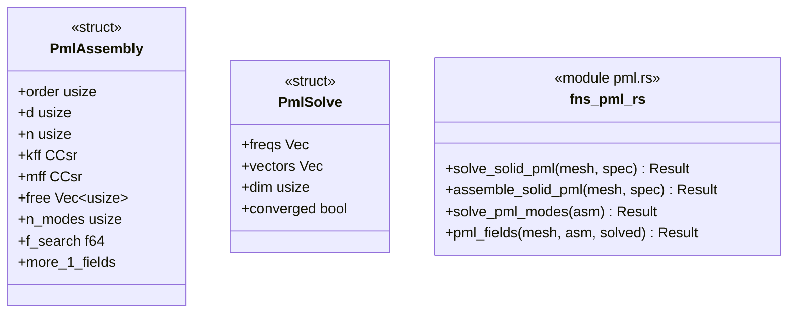

# Absorbing-layer kernel: code

C4 level 4 (code) of the component **Absorbing-layer kernel** (`sms.pml`) in the container **nyx-sms** (crate `nyx_sms`). [Component view of the container](../../3-components/sms.md) · [All code pages](../README.md)

> Eigenfrequencies of elastic bodies with perfectly matched layers.

**Decisions:** [ADR 42](../../../adr/0042-solid-mechanics-moves-into-nyx-sms.md)  
**Size:** 1 file, 216 lines.

## Files

| File | Lines | What it says about itself |
|---|---:|---|
| `crates/nyx-sms/src/pml.rs` | 216 |  |

## What it uses

| Target | Modules | Items |
|---|---|---|
| [container `femcore` (femcore)](../../3-components/femcore.md) | fem, linalg::csr, linalg::csr::assembly, linalg::driver, pml | C, CCoo, CCsr, c, cell_stretches, eigs_complex |
| [container `physics` (nyx-physics)](../../3-components/physics.md) | crate root, result | Discretisation, Scalar, Solution, SolveResult, cell_fields_of |
| [Typed problem](./problem.md) | problem |  |
| [Solid kernel](./solid.md) | solid | complex_mode_fields, d_matrix, dof_layout, setup |

## Used by

| Component | Modules | Items |
|---|---|---|
| [Solid kernel](./solid.md) | pml | solve_solid_pml |

## Class diagram

Public types with their public fields (or variants) and methods, free functions per file as a `module` box; arrows are field types and `impl Trait`. Capped at 36 types and a few members each; the table below is complete.

## Public items

| Kind | Item | File:line | Signature or summary |
|---|---|---|---|
| fn | `solve_solid_pml` | `pml.rs:43` | `pub fn solve_solid_pml(mesh: &Discretisation, spec: &Problem) -> Result<SolveResult, String>` |
| struct | `PmlAssembly` | `pml.rs:53` | fields: `order`, `d`, `n`, `kff`, `mff`, `free`, `n_modes`, `f_search`, `has_fixed` —  Stage 1 of the solid kernel with perfectly matched layers: the complex stiffness and the mass (weighted by the |
| struct | `PmlSolve` | `pml.rs:66` | fields: `freqs`, `vectors`, `dim`, `converged` —  Stage 2 output: eigenvalue index and complex frequency (Hz) of every mode sorted by real part, the free-dof vectors. |
| fn | `assemble_solid_pml` | `pml.rs:73` | `pub fn assemble_solid_pml(mesh: &Discretisation, spec: &Problem) -> Result<PmlAssembly, String>` |
| fn | `solve_pml_modes` | `pml.rs:162` | `pub fn solve_pml_modes(asm: &PmlAssembly) -> Result<PmlSolve, String>` —  Stage 2: the complex eigenpairs nearest the search frequency. |
| fn | `pml_fields` | `pml.rs:183` | `pub fn pml_fields(mesh: &Discretisation, asm: &PmlAssembly, solved: &PmlSolve) -> Result<SolveResult, String>` —  Stage 3: plot fields and per-cell complex displacement of every mode, the frequencies and Q. |
