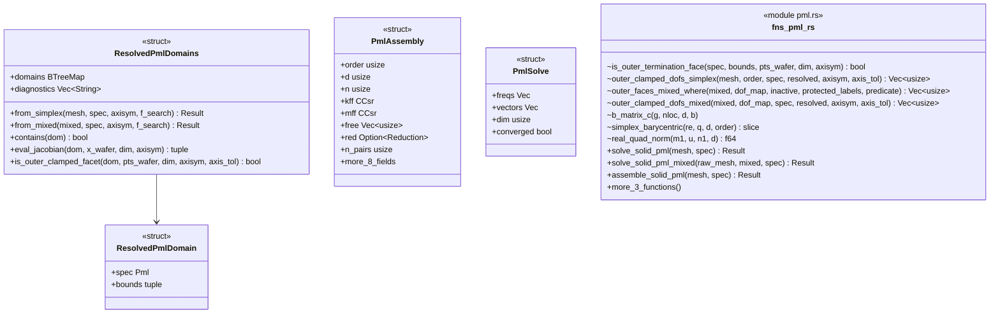

# Absorbing-layer kernel: code

C4 level 4 (code) of the component **Absorbing-layer kernel** (`sms.pml`) in the container **nyx-sms** (crate `nyx_sms`). [Component view of the container](../../3-components/sms.md) · [All code pages](../README.md)

> Eigenfrequencies of elastic bodies with perfectly matched layers and optional Floquet-periodic boundaries.

**Decisions:** [ADR 42](../../../adr/0042-solid-mechanics-moves-into-nyx-sms.md), [ADR 101](../../../adr/0101-sms-waveguide-modes-and-floquet-pml.md), [ADR 132](../../../adr/0132-vvuq-asme-six-pillar-code-verification.md)  
**Size:** 1 file, 1576 lines.

## Files

| File | Lines | What it says about itself |
|---|---:|---|
| `crates/nyx-sms/src/pml.rs` | 1576 |  |

## What it uses

| Target | Modules | Items |
|---|---|---|
| [container `femcore` (femcore)](../../3-components/femcore.md) | fem, fem_mixed, linalg::csr, linalg::csr::assembly, linalg::driver, material, material::coupled, mesh::cells +7 | BackwardWaveCheck, C, CCoo, CCsr, EPSILON_0, FacetType, IsoparametricCell, LagrangeSpace, M3, M6 +41 |
| [container `physics` (nyx-physics)](../../3-components/physics.md) | crate root, result | Discretisation, Mesh, MixedToSimplexProjector, Scalar, Solution, SolveResult, cell_fields_of |
| [Axisymmetric kernel](./axisym.md) | axisym | average_about_axis |
| [Floquet kernel](./floquet.md) | floquet | mixed_nodal_relations |
| [Low-reflecting boundary](./lrb.md) | lrb | AMPLIFYING_IM_TOL |
| [Typed problem](./problem.md) | problem |  |
| [Solid kernel](./solid.md) | solid | cell_rho, complex_mode_fields, complex_mode_fields_mixed, d_matrix, dof_layout, mixed_cell_rho, mixed_cell_stiffness_skipping, mixed_check_boundary_labels, mixed_untouched_dofs, setup |

## Used by

| Component | Modules | Items |
|---|---|---|
| [Axisymmetric kernel](./axisym.md) | pml | ResolvedPmlDomains |
| [Cross-section study kernel](./crosssection.md) | pml | ResolvedPmlDomains, outer_clamped_dofs_mixed, outer_clamped_dofs_simplex |
| [Piezoelectric kernel](./piezo.md) | pml | ResolvedPmlDomains, b_matrix_c, outer_clamped_dofs_mixed, outer_clamped_dofs_simplex, push_pml_mode_scalars_and_label, real_quad_norm, simplex_barycentric |
| [Solid kernel](./solid.md) | pml | is_outer_termination_face, outer_faces_mixed_where, solve_solid_pml, solve_solid_pml_mixed |
| [Waveguide kernel](./waveguide.md) | pml | ResolvedPmlDomains |

## Class diagram

Public types with their public fields (or variants) and methods, free functions per file as a `module` box; arrows are field types and `impl Trait`. Capped at 36 types and a few members each; the table below is complete.

## Public items

| Kind | Item | File:line | Signature or summary |
|---|---|---|---|
| struct | `ResolvedPmlDomain` | `pml.rs:43` | fields: `spec`, `bounds` —  One resolved active PML domain with wafer-frame bounds, optional auto-scaling, and Christoffel stabilization. |
| struct | `ResolvedPmlDomains` | `pml.rs:50` | fields: `domains`, `diagnostics` —  Pre-solve resolved PML configuration across all active PML domains of a mesh. |
| fn | `is_outer_termination_face` | `pml.rs:466` | `pub(crate) fn is_outer_termination_face( spec: &Pml, bounds: ([f64; 3], [f64; 3]), pts_wafer: &[[f64; 3]], dim: usize, axisym: bool, ) -> bool` —  Checks whether all corner points `pts_wafer` of an exterior face sit at the outer end (`t >= 1 - tol`) |
| fn | `outer_clamped_dofs_simplex` | `pml.rs:568` | `pub(crate) fn outer_clamped_dofs_simplex( mesh: &Discretisation, order: usize, spec: &Problem, resolved: &ResolvedPmlDomains, axisym: bool, axis_tol: f64, ) -> Vec<usize>` —  Returns sorted unique scalar DOFs (`0 .. mesh.n_dofs(order)`) lying on outer clamped PML termination |
| fn | `outer_faces_mixed_where` | `pml.rs:673` | `pub(crate) fn outer_faces_mixed_where<F>( mixed: &MixedDiscretisation, dof_map: &MixedLagrangeDofMap, inactive: &[i32], protected_labels: &BTreeSet<i32>, mut predicate: F, ) -> Vec<usize>` —  Returns sorted unique scalar DOFs (`0 .. dof_map.n_dofs`) lying on outer clamped termination faces |
| fn | `outer_clamped_dofs_mixed` | `pml.rs:817` | `pub(crate) fn outer_clamped_dofs_mixed( mixed: &MixedDiscretisation, dof_map: &MixedLagrangeDofMap, spec: &Problem, resolved: &ResolvedPmlDomains, axisym: bool, axis_tol: f64, ) -> Vec<usize>` |
| fn | `b_matrix_c` | `pml.rs:836` | `pub(crate) fn b_matrix_c(g: &[C], nloc: usize, d: usize, b: &mut [C])` —  Complex strain-displacement matrix from complex shape gradients `g[a*d + k]`. |
| fn | `simplex_barycentric` | `pml.rs:855` | `pub(crate) fn simplex_barycentric(re: &RefElement, q: usize, d: usize, order: usize) -> [f64` |
| fn | `real_quad_norm` | `pml.rs:875` | `pub(crate) fn real_quad_norm(m1: &Csr, u: &[C], n1: usize, d: usize) -> f64` |
| fn | `solve_solid_pml` | `pml.rs:890` | `pub fn solve_solid_pml(mesh: &Discretisation, spec: &Problem) -> Result<SolveResult, String>` |
| fn | `solve_solid_pml_mixed` | `pml.rs:899` | `pub fn solve_solid_pml_mixed( raw_mesh: &Mesh, mixed: &MixedDiscretisation, spec: &Problem, ) -> Result<SolveResult, String>` —  Native mixed-cell (`Tri`/`Quad` and `Tet`/`Prism`/`Hex`) PML eigenfrequency solve. |
| struct | `PmlAssembly` | `pml.rs:1114` | fields: `order`, `d`, `n`, `kff`, `mff`, `free`, `red`, `n_pairs`, `n_modes`, `f_search`, `has_fixed`, `diagnostics`, ... —  Stage 1 of the solid kernel with perfectly matched layers: the complex stiffness and the mass (weighted by the |
| struct | `PmlSolve` | `pml.rs:1134` | fields: `freqs`, `vectors`, `dim`, `converged` —  Stage 2 output: eigenvalue index and complex frequency (Hz) of every mode sorted by real part, the free-dof vectors. |
| fn | `assemble_solid_pml` | `pml.rs:1141` | `pub fn assemble_solid_pml(mesh: &Discretisation, spec: &Problem) -> Result<PmlAssembly, String>` |
| fn | `solve_pml_modes` | `pml.rs:1374` | `pub fn solve_pml_modes(asm: &PmlAssembly) -> Result<PmlSolve, String>` —  Stage 2: the complex eigenpairs nearest the search frequency. |
| fn | `push_pml_mode_scalars_and_label` | `pml.rs:1397` | `pub(crate) fn push_pml_mode_scalars_and_label( j: usize, f: C, layer_fraction: f64, phys_mass_norm: f64, any_pml: bool, has_interior: bool, scalars: &mut Vec<(String, Scalar)>, unstable_count: &mut usize, ) -> (String, f64)` |
| fn | `pml_fields` | `pml.rs:1471` | `pub fn pml_fields(mesh: &Discretisation, asm: &PmlAssembly, solved: &PmlSolve) -> Result<SolveResult, String>` —  Stage 3: plot fields and per-cell complex displacement of every mode, frequencies, signed Q, |
| fn | `ResolvedPmlDomains::from_simplex` | `pml.rs:383` | `pub fn from_simplex(mesh: &Discretisation, spec: &Problem, axisym: bool, f_search: f64) -> Result<Self, String>` |
| fn | `ResolvedPmlDomains::from_mixed` | `pml.rs:401` | `pub fn from_mixed( mixed: &MixedDiscretisation, spec: &Problem, axisym: bool, f_search: f64, ) -> Result<Self, String>` |
| fn | `ResolvedPmlDomains::contains` | `pml.rs:425` | `pub fn contains(&self, dom: i32) -> bool` |
| fn | `ResolvedPmlDomains::eval_jacobian` | `pml.rs:430` | `pub fn eval_jacobian(&self, dom: i32, x_wafer: [f64; 3], dim: usize, axisym: bool) -> (PmlJacobian, C)` |
| fn | `ResolvedPmlDomains::is_outer_clamped_facet` | `pml.rs:443` | `pub fn is_outer_clamped_facet( &self, dom: i32, pts_wafer: &[[f64; 3]], dim: usize, axisym: bool, axis_tol: f64, ) -> bool` —  True if an exterior face with corner coordinates `pts_wafer` belonging to PML domain `dom` |
