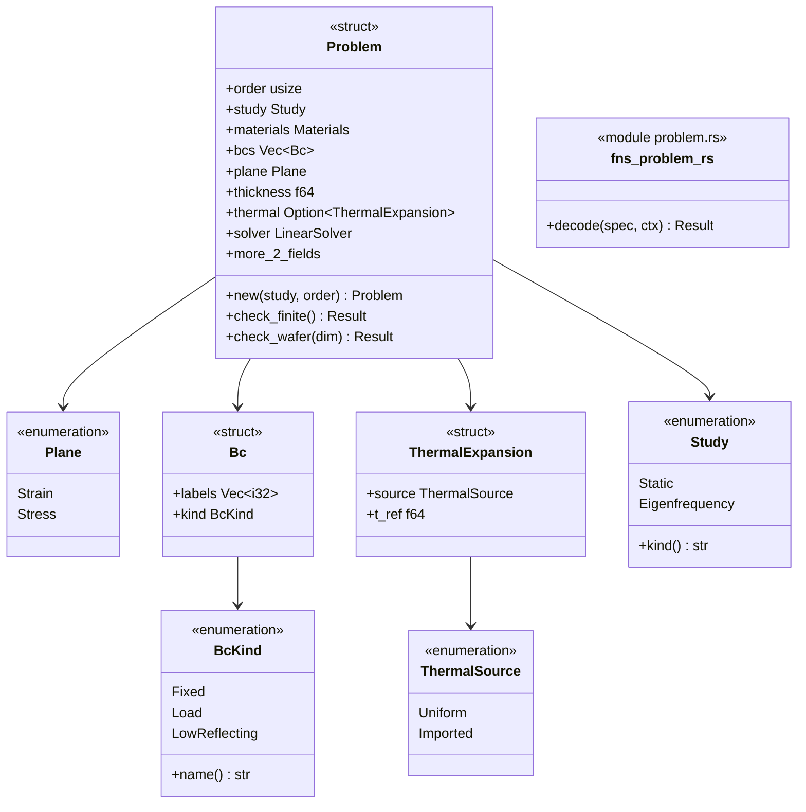

# Typed problem: code

C4 level 4 (code) of the component **Typed problem** (`sms.problem`) in the container **nyx-sms** (crate `nyx_sms`). [Component view of the container](../../3-components/sms.md) · [All code pages](../README.md)

> The typed sms problem the kernels read, decoded from the envelope.

**Decisions:** [ADR 42](../../../adr/0042-solid-mechanics-moves-into-nyx-sms.md)  
**Size:** 1 file, 314 lines.

## Files

| File | Lines | What it says about itself |
|---|---:|---|
| `crates/nyx-sms/src/problem.rs` | 314 | The typed problem of `sms`: what the kernels read. It is decoded from the `ProblemSpec` envelope by `decode` (names and selectors resolved to mesh numbers, parameters with their defaults, the imported temperature taken from `ctx.inputs`)... |

## What it uses

| Target | Modules | Items |
|---|---|---|
| [container `femcore` (femcore)](../../3-components/femcore.md) | props, validate | LinearSolver, Materials, Periodic, Pml, PmlDir, non_finite_token |
| [container `physics` (nyx-physics)](../../3-components/physics.md) | decode, error, physics, spec | Ctx, Error, Params, Physics, ProblemSpec, materials_by_label, resolve_conditions |
| [Physics adapter](./adapter.md) | crate root | Sms |

## Used by

| Component | Modules | Items |
|---|---|---|
| [Physics adapter](./adapter.md) | problem | Bc, BcKind, Plane, Problem, Study, ThermalExpansion, ThermalSource, decode |
| [Cross-section kernel](./crosssection.md) | problem |  |
| [Floquet kernel](./floquet.md) | problem |  |
| [Low-reflecting boundary](./lrb.md) | problem | Problem |
| [Absorbing-layer kernel](./pml.md) | problem |  |
| [Solid kernel](./solid.md) | problem |  |

## Class diagram

Public types with their public fields (or variants) and methods, free functions per file as a `module` box; arrows are field types and `impl Trait`. Capped at 36 types and a few members each; the table below is complete.

## Public items

| Kind | Item | File:line | Signature or summary |
|---|---|---|---|
| enum | `Plane` | `problem.rs:12` | variants: `Strain`, `Stress` |
| enum | `BcKind` | `problem.rs:18` | variants: `Fixed`, `Load`, `LowReflecting` |
| struct | `Bc` | `problem.rs:39` | fields: `labels`, `kind` —  A condition on boundary numbers of the mesh. |
| enum | `ThermalSource` | `problem.rs:45` | variants: `Uniform`, `Imported` |
| struct | `ThermalExpansion` | `problem.rs:52` | fields: `source`, `t_ref` |
| enum | `Study` | `problem.rs:58` | variants: `Static`, `Eigenfrequency` |
| struct | `Problem` | `problem.rs:78` | fields: `order`, `study`, `materials`, `bcs`, `plane`, `thickness`, `thermal`, `solver`, `inactive`, `periodic` |
| fn | `decode` | `problem.rs:191` | `pub fn decode(spec: &ProblemSpec, ctx: &Ctx) -> Result<Problem, Error>` —  Reads the envelope. The structural checks against the descriptors (`validate_spec`) are the engine's job; this resolves names and |
| fn | `BcKind::name` | `problem.rs:28` | `pub fn name(&self) -> &'static str` |
| fn | `Study::kind` | `problem.rs:69` | `pub fn kind(&self) -> &'static str` —  The `study.kind` of the envelope. |
| fn | `Problem::new` | `problem.rs:97` | `pub fn new(study: Study, order: usize) -> Problem` |
| fn | `Problem::check_finite` | `problem.rs:114` | `pub fn check_finite(&self) -> Result<(), String>` —  Every number the user can type must be finite: NaN or infinity does not stop a factorisation or a Krylov iteration, it flows into |
| fn | `Problem::check_wafer` | `problem.rs:168` | `pub fn check_wafer(&self, dim: usize) -> Result<(), String>` —  Refuses what a wafer-frame 2D problem cannot say: there is no y axis in the plane of a cross-section. |
