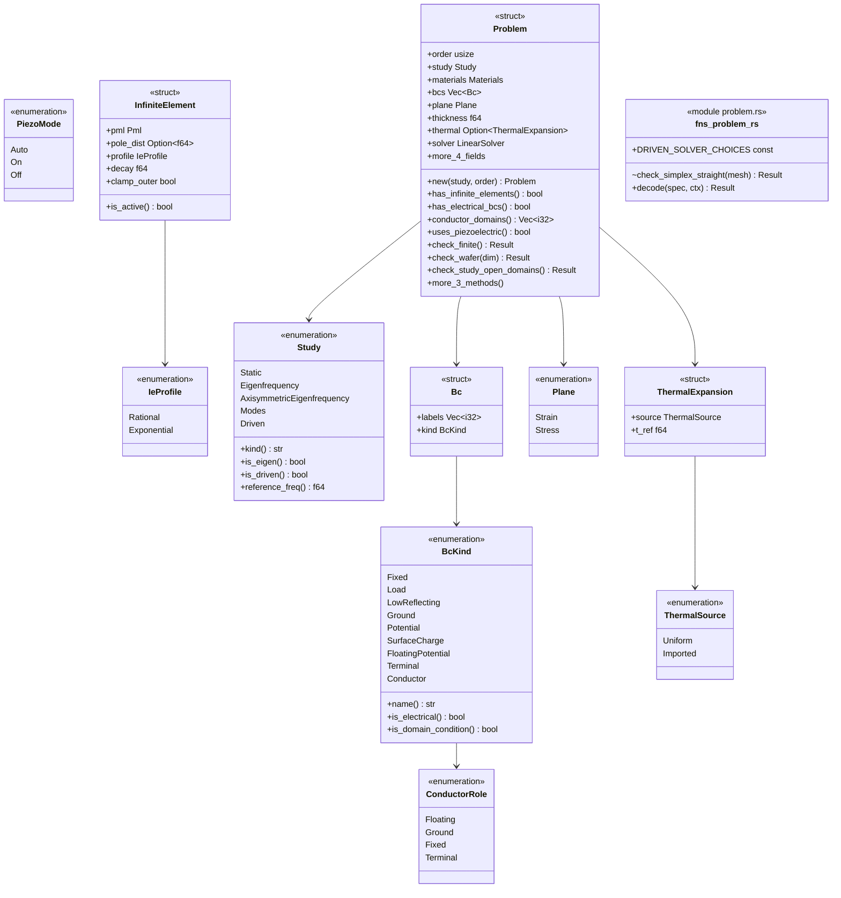

# Typed problem: code

C4 level 4 (code) of the component **Typed problem** (`sms.problem`) in the container **nyx-sms** (crate `nyx_sms`). [Component view of the container](../../3-components/sms.md) · [All code pages](../README.md)

> The typed sms problem the kernels read, decoded from the envelope, with straight-simplex checks.

**Decisions:** [ADR 42](../../../adr/0042-solid-mechanics-moves-into-nyx-sms.md), [ADR 68](../../../adr/0068-the-axisymmetric-solid-gets-a-study.md), [ADR 101](../../../adr/0101-sms-waveguide-modes-and-floquet-pml.md), [ADR 129](../../../adr/0129-coupled-piezoelectric-fem-in-nyx-sms.md), [ADR 132](../../../adr/0132-vvuq-asme-six-pillar-code-verification.md)  
**Size:** 1 file, 1056 lines.

## Files

| File | Lines | What it says about itself |
|---|---:|---|
| `crates/nyx-sms/src/problem.rs` | 1056 |  |

## What it uses

| Target | Modules | Items |
|---|---|---|
| [container `femcore` (femcore)](../../3-components/femcore.md) | mesh, props, validate | LinearSolver, Materials, Periodic, Pml, PmlCoord, PmlDir, PmlProfile, PmlStabilization, SimplexMesh, non_finite_token |
| [container `physics` (nyx-physics)](../../3-components/physics.md) | decode, error, physics, spec | Ctx, Error, Params, Physics, ProblemSpec, materials_by_label, resolve_conditions |
| [Physics adapter](./adapter.md) | crate root | Sms |

## Used by

| Component | Modules | Items |
|---|---|---|
| [Physics adapter](./adapter.md) | problem | Bc, BcKind, ConductorRole, IeProfile, InfiniteElement, PiezoMode, Plane, Problem +4 |
| [Axisymmetric kernel](./axisym.md) | problem | check_simplex_straight |
| [Cross-section study kernel](./crosssection.md) | problem | check_simplex_straight |
| [Floquet kernel](./floquet.md) | problem |  |
| [Low-reflecting boundary](./lrb.md) | problem | Problem, check_simplex_straight |
| [Piezoelectric kernel](./piezo.md) | problem | BcKind, ConductorRole, Plane, Problem, Study, ThermalSource, check_simplex_straight |
| [Absorbing-layer kernel](./pml.md) | problem |  |
| [Solid kernel](./solid.md) | problem | check_simplex_straight |
| [Waveguide kernel](./waveguide.md) | problem | check_simplex_straight |

## Class diagram

Public types with their public fields (or variants) and methods, free functions per file as a `module` box; arrows are field types and `impl Trait`. Capped at 36 types and a few members each; the table below is complete.

## Public items

| Kind | Item | File:line | Signature or summary |
|---|---|---|---|
| fn | `check_simplex_straight` | `problem.rs:14` | `pub(crate) fn check_simplex_straight(mesh: &femcore::mesh::SimplexMesh) -> Result<(), String>` —  Refuses curved or quarter-point `SimplexMesh` inputs on affine simplex fast paths (`R32`). |
| enum | `Plane` | `problem.rs:25` | variants: `Strain`, `Stress` |
| enum | `PiezoMode` | `problem.rs:32` | variants: `Auto`, `On`, `Off` —  Piezoelectric coupling activation policy in solid mechanics (`sms`). |
| enum | `ConductorRole` | `problem.rs:45` | variants: `Floating`, `Ground`, `Fixed`, `Terminal` —  Electrical role of a domain-level metallic `conductor` condition. |
| enum | `BcKind` | `problem.rs:58` | variants: `Fixed`, `Load`, `LowReflecting`, `Ground`, `Potential`, `SurfaceCharge`, `FloatingPotential`, `Terminal`, `Conductor` |
| struct | `Bc` | `problem.rs:115` | fields: `labels`, `kind` —  A condition on boundary numbers of the mesh. |
| enum | `IeProfile` | `problem.rs:122` | variants: `Rational`, `Exponential` —  Real coordinate-stretching profile for static Infinite Elements (`sms::static`). |
| struct | `InfiniteElement` | `problem.rs:134` | fields: `pml`, `pole_dist`, `profile`, `decay`, `clamp_outer` —  Domain configuration for a static Infinite Element (`"infinite_element"` on `sms::static`). |
| enum | `ThermalSource` | `problem.rs:168` | variants: `Uniform`, `Imported` |
| struct | `ThermalExpansion` | `problem.rs:175` | fields: `source`, `t_ref` |
| const | `DRIVEN_SOLVER_CHOICES` | `problem.rs:181` | `[&str` —  Allowed values for `Study::Driven` `solver`. |
| enum | `Study` | `problem.rs:184` | variants: `Static`, `Eigenfrequency`, `AxisymmetricEigenfrequency`, `Modes`, `Driven` |
| struct | `Problem` | `problem.rs:259` | fields: `order`, `study`, `materials`, `bcs`, `plane`, `thickness`, `thermal`, `solver`, `inactive`, `periodic`, `infinite_elements`, `piezoelectric` |
| fn | `decode` | `problem.rs:751` | `pub fn decode(spec: &ProblemSpec, ctx: &Ctx) -> Result<Problem, Error>` —  Reads the envelope. The structural checks against the descriptors (`validate_spec`) are the engine's job; this resolves names and |
| fn | `BcKind::name` | `problem.rs:80` | `pub fn name(&self) -> &'static str` |
| fn | `BcKind::is_electrical` | `problem.rs:95` | `pub fn is_electrical(&self) -> bool` —  True if this boundary condition applies to electrical potential `phi`. |
| fn | `BcKind::is_domain_condition` | `problem.rs:108` | `pub fn is_domain_condition(&self) -> bool` —  True if this condition selects volumetric domain labels rather than boundary facets. |
| fn | `InfiniteElement::is_active` | `problem.rs:157` | `pub fn is_active(&self) -> bool` —  True if this Infinite Element domain is active. |
| fn | `Study::kind` | `problem.rs:220` | `pub fn kind(&self) -> &'static str` —  The `study.kind` of the envelope. |
| fn | `Study::is_eigen` | `problem.rs:231` | `pub fn is_eigen(&self) -> bool` —  Whether the study finds eigenfrequencies (`Eigenfrequency`, `AxisymmetricEigenfrequency` or `Modes`). |
| fn | `Study::is_driven` | `problem.rs:236` | `pub fn is_driven(&self) -> bool` —  Whether this study is a frequency-domain harmonic driven sweep. |
| fn | `Study::reference_freq` | `problem.rs:241` | `pub fn reference_freq(&self) -> f64` —  Reference frequency (Hz) used when evaluating frequency-dependent dielectric loss. |
| fn | `Problem::new` | `problem.rs:282` | `pub fn new(study: Study, order: usize) -> Problem` |
| fn | `Problem::has_infinite_elements` | `problem.rs:300` | `pub fn has_infinite_elements(&self) -> bool` —  True if any domain carries an active static Infinite Element. |
| fn | `Problem::has_electrical_bcs` | `problem.rs:306` | `pub fn has_electrical_bcs(&self) -> bool` —  True if any electrical boundary/domain condition (`ground`, `potential`, `surface_charge`, |
| fn | `Problem::conductor_domains` | `problem.rs:311` | `pub fn conductor_domains(&self) -> Vec<i32>` —  Domain labels marked as equipotential `conductor` bodies (sorted, unique). |
| fn | `Problem::uses_piezoelectric` | `problem.rs:327` | `pub fn uses_piezoelectric(&self) -> bool` —  True when the coupled `(u, phi)` piezoelectric/electro-elastic solver should handle this problem. |
| fn | `Problem::check_finite` | `problem.rs:337` | `pub fn check_finite(&self) -> Result<(), String>` —  Every number the user can type must be finite: NaN or infinity does not stop a factorisation or a Krylov iteration, it flows into |
| fn | `Problem::check_wafer` | `problem.rs:414` | `pub fn check_wafer(&self, dim: usize) -> Result<(), String>` —  Refuses what a wafer-frame 2D problem cannot say: there is no y axis in the plane of a cross-section. |
| fn | `Problem::check_study_open_domains` | `problem.rs:439` | `pub fn check_study_open_domains(&self) -> Result<(), Error>` —  Rejects `infinite_element` domains on dynamic eigenfrequency or driven studies. |
| fn | `Problem::check_electrical` | `problem.rs:449` | `pub fn check_electrical(&self) -> Result<(), Error>` —  Validates electrical/piezoelectric settings and boundary/domain conflicts. |
| fn | `Problem::check_axisymmetric` | `problem.rs:579` | `pub fn check_axisymmetric(&self) -> Result<(), Error>` —  The rules of the axisymmetric study that do not need the mesh (ADR 68): no boundary load, no Floquet pair, no low-reflecting boundary |
| fn | `Problem::check_modes` | `problem.rs:660` | `pub fn check_modes(&self) -> Result<(), Error>` —  The rules of the waveguide modes study: no boundary load, and only zero constraints. Periodic lateral pairs and |

Trait implementations in this component: `InfiniteElement: Default`
