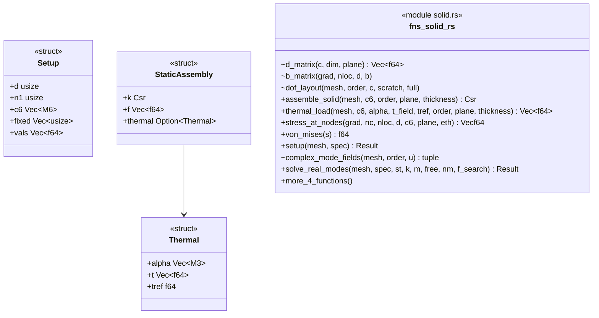

# Solid kernel: code

C4 level 4 (code) of the component **Solid kernel** (`sms.solid`) in the container **nyx-sms** (crate `nyx_sms`). [Component view of the container](../../3-components/sms.md) · [All code pages](../README.md)

> Linear elastic solid mechanics on P1/P2 triangles and tetrahedra: static solve and eigenfrequencies.

**Decisions:** [ADR 42](../../../adr/0042-solid-mechanics-moves-into-nyx-sms.md), [ADR 9](../../../adr/0009-kernels-are-three-stages.md)  
**Size:** 1 file, 746 lines.

## Files

| File | Lines | What it says about itself |
|---|---:|---|
| `crates/nyx-sms/src/solid.rs` | 746 | Linear elastic solid mechanics on P1/P2 triangles (plane stress or plane strain) and tetrahedra: static solve with boundary loads, prescribed displacements and thermal expansion, eigenfrequencies, stress and von Mises. Moved here from `f... |

## What it uses

| Target | Modules | Items |
|---|---|---|
| [container `femcore` (femcore)](../../3-components/femcore.md) | fem, fields, linalg::arnoldi_real, linalg::csr, linalg::csr::assembly, linalg::driver, material, par +3 | AMG_THRESHOLD, AmgSystem, C, CellFields, EigOpts, EigPairs, FACTORISE_MAX_FREE, LOBPCG_MAX_FACTOR, LOBPCG_MIN_FREE, LinearSolver +19 |
| [container `physics` (nyx-physics)](../../3-components/physics.md) | crate root, result | Discretisation, Field, Scalar, Solution, SolveResult, cell_fields_of |
| [Axisymmetric study kernel](./crosssection.md) | cross_section | solve_axisymmetric |
| [Floquet kernel](./floquet.md) | floquet | solve_floquet |
| [Low-reflecting boundary](./lrb.md) | lrb | solve_lrb |
| [Absorbing-layer kernel](./pml.md) | pml | solve_solid_pml |
| [Typed problem](./problem.md) | problem |  |

## Used by

| Component | Modules | Items |
|---|---|---|
| [Physics adapter](./adapter.md) | solid | Setup, solve_solid |
| [Floquet kernel](./floquet.md) | solid | Setup, complex_mode_fields |
| [Low-reflecting boundary](./lrb.md) | solid | Setup, complex_mode_fields |
| [Absorbing-layer kernel](./pml.md) | solid | complex_mode_fields, d_matrix, dof_layout, setup |

## Class diagram

Public types with their public fields (or variants) and methods, free functions per file as a `module` box; arrows are field types and `impl Trait`. Capped at 36 types and a few members each; the table below is complete.

## Public items

| Kind | Item | File:line | Signature or summary |
|---|---|---|---|
| fn | `d_matrix` | `solid.rs:39` | `pub(crate) fn d_matrix(c: &M6, dim: usize, plane: Plane) -> Vec<f64>` —  Constitutive matrix, row-major `ns x ns` (ns = 3 in 2D, 6 in 3D). |
| fn | `b_matrix` | `solid.rs:77` | `pub(crate) fn b_matrix(grad: &[f64], nloc: usize, d: usize, b: &mut [f64])` —  Strain-displacement matrix `B[s * (d*nloc) + comp*nloc + a]` from shape gradients `grad[a*d + k]`. |
| fn | `dof_layout` | `solid.rs:96` | `pub(crate) fn dof_layout( mesh: &Discretisation, order: usize, c: usize, scratch: &mut Vec<usize>, full: &mut Vec<usize>, )` |
| fn | `assemble_solid` | `solid.rs:112` | `pub fn assemble_solid(mesh: &Discretisation, c6: &[M6], order: usize, plane: Plane, thickness: f64) -> Csr` —  Stiffness matrix with a (possibly anisotropic) stiffness per cell. |
| fn | `thermal_load` | `solid.rs:162` | `pub fn thermal_load( mesh: &Discretisation, c6: &[M6], alpha: &[M3], t_field: &[f64], tref: f64, order: usize, plane: Plane, thickness: f64, ) -> Vec<f64>` —  Load vector of the thermal strain `alpha (T - Tref)`; `t` is the temperature at the scalar |
| fn | `stress_at_nodes` | `solid.rs:227` | `pub fn stress_at_nodes( grad: &[f64], nc: usize, nloc: usize, d: usize, c6: &[M6], plane: Plane, eth: &[[f64; 6]], ) -> Vec<[f64` —  Cauchy stress (solver Voigt order, six components, also in 2D) at every local node of every |
| fn | `von_mises` | `solid.rs:275` | `pub fn von_mises(s: &[f64; 6]) -> f64` —  von Mises stress of a six-component stress. |
| struct | `Setup` | `solid.rs:281` | fields: `d`, `n1`, `c6`, `fixed`, `vals` |
| fn | `setup` | `solid.rs:289` | `pub fn setup(mesh: &Discretisation, spec: &Problem) -> Result<Setup, String>` |
| struct | `Thermal` | `solid.rs:321` | fields: `alpha`, `t`, `tref` |
| fn | `complex_mode_fields` | `solid.rs:393` | `pub(crate) fn complex_mode_fields(mesh: &Discretisation, order: usize, u: &[C]) -> (Vec<Field>, CellFields)` —  Stage 3 of the complex-frequency solid kernels (PML, Floquet, low-reflecting): the mode shape `u` over all dofs |
| fn | `solve_real_modes` | `solid.rs:425` | `pub fn solve_real_modes( mesh: &Discretisation, spec: &Problem, st: &Setup, k: &Csr, m: &Csr, free: &[usize], nm: usize, f_search: f64, ) -> Result<(femcore::linalg::driver::EigPairs, Option<String>), String>` —  Stage 2 of the real solid eigenfrequency kernel: the `nm` eigenpairs of `K u = w^2 M u` on the free dofs nearest the |
| struct | `StaticAssembly` | `solid.rs:506` | fields: `k`, `f`, `thermal` —  Stage 1 of the static solid kernel: the load vector (boundary tractions in wafer axes, thermal expansion) next to the |
| fn | `assemble_static` | `solid.rs:512` | `pub fn assemble_static(mesh: &Discretisation, spec: &Problem, st: &Setup, k: Csr) -> Result<StaticAssembly, String>` |
| fn | `solve_static` | `solid.rs:552` | `pub fn solve_static( mesh: &Discretisation, spec: &Problem, st: &Setup, asm: &StaticAssembly, ) -> Result<(Vec<f64>, Option<String>), String>` —  Stage 2: the displacement (component blocks) by the linear solver `spec.solver` names, and its note. |
| fn | `solve_solid` | `solid.rs:565` | `pub fn solve_solid(mesh: &Discretisation, spec: &Problem) -> Result<SolveResult, String>` —  Solves the problem: the three stages in order, with the variants for perfectly matched layers, Floquet pairs and low-reflecting |
| fn | `centroid_stress` | `solid.rs:710` | `pub fn centroid_stress(mesh: &Discretisation, u: &[f64], c6: &[M6], plane: Plane, order: usize) -> Vec<Vec<f64>>` —  Element-wise stress at the centroid of every cell, one row per cell: |
