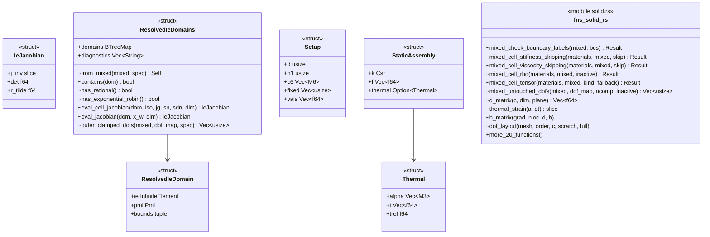

# Solid kernel: code

C4 level 4 (code) of the component **Solid kernel** (`sms.solid`) in the container **nyx-sms** (crate `nyx_sms`). [Component view of the container](../../3-components/sms.md) · [All code pages](../README.md)

> Linear elastic solid mechanics on P1/P2 triangles and tetrahedra and MixedDiscretisation: static solve and eigenfrequencies.

**Decisions:** [ADR 42](../../../adr/0042-solid-mechanics-moves-into-nyx-sms.md), [ADR 9](../../../adr/0009-kernels-are-three-stages.md)  
**Size:** 1 file, 2771 lines.

## Files

| File | Lines | What it says about itself |
|---|---:|---|
| `crates/nyx-sms/src/solid.rs` | 2771 |  |

## What it uses

| Target | Modules | Items |
|---|---|---|
| [container `femcore` (femcore)](../../3-components/femcore.md) | fem, fem_mixed, fields, linalg::amg_elastic, linalg::arnoldi_real, linalg::csr, linalg::csr::assembly, linalg::driver +8 | AMG_THRESHOLD, Amg, AmgOptions, AmgSystem, C, CellFields, Coo, EigOpts, EigPairs, FACTORISE_MAX_FREE +51 |
| [container `physics` (nyx-physics)](../../3-components/physics.md) | crate root, result | CellField, Discretisation, Field, Mesh, MixedToSimplexProjector, Scalar, Solution, SolveResult, cell_fields_of, discretise_mixed |
| [Cross-section study kernel](./crosssection.md) | cross_section | solve_axisymmetric, solve_axisymmetric_mixed, solve_waveguide_modes, solve_waveguide_modes_mixed |
| [Floquet kernel](./floquet.md) | floquet | solve_floquet, solve_floquet_mixed |
| [Low-reflecting boundary](./lrb.md) | lrb | solve_lrb, solve_lrb_mixed, voigt_moduli |
| [Absorbing-layer kernel](./pml.md) | pml | is_outer_termination_face, outer_faces_mixed_where, solve_solid_pml, solve_solid_pml_mixed |
| [Typed problem](./problem.md) | problem |  |

## Used by

| Component | Modules | Items |
|---|---|---|
| [Physics adapter](./adapter.md) | solid | Setup, solve_solid, solve_solid_mixed |
| [Cross-section study kernel](./crosssection.md) | solid | cell_rho, mixed_cell_rho, mixed_cell_stiffness_skipping, mixed_check_boundary_labels, mixed_untouched_dofs |
| [Floquet kernel](./floquet.md) | solid | Setup, complex_mode_fields, complex_mode_fields_mixed |
| [Low-reflecting boundary](./lrb.md) | solid | Setup, assemble_solid, assemble_solid_mixed, complex_mode_fields, complex_mode_fields_mixed, mixed_cell_viscosity_skipping |
| [Piezoelectric kernel](./piezo.md) | crate root, solid | ResolvedIeDomains, Thermal, add_boundary_load_mixed, assemble_exponential_ie_robin, assemble_solid, assemble_solid_mixed, b_matrix, collect_exponential_ie_faces +8 |
| [Absorbing-layer kernel](./pml.md) | solid | cell_rho, complex_mode_fields, complex_mode_fields_mixed, d_matrix, dof_layout, mixed_cell_rho, mixed_cell_stiffness_skipping, mixed_check_boundary_labels +2 |

## Class diagram

Public types with their public fields (or variants) and methods, free functions per file as a `module` box; arrows are field types and `impl Trait`. Capped at 36 types and a few members each; the table below is complete.

## Public items

| Kind | Item | File:line | Signature or summary |
|---|---|---|---|
| fn | `mixed_check_boundary_labels` | `solid.rs:63` | `pub(crate) fn mixed_check_boundary_labels(mixed: &MixedDiscretisation, bcs: &[Bc]) -> Result<(), String>` |
| fn | `mixed_cell_stiffness_skipping` | `solid.rs:100` | `pub(crate) fn mixed_cell_stiffness_skipping( materials: &Materials, mixed: &MixedDiscretisation, skip: &[i32], ) -> Result<Vec<M6>, String>` |
| fn | `mixed_cell_viscosity_skipping` | `solid.rs:132` | `pub(crate) fn mixed_cell_viscosity_skipping( materials: &Materials, mixed: &MixedDiscretisation, skip: &[i32], ) -> Result<Vec<M6>, String>` |
| fn | `mixed_cell_rho` | `solid.rs:162` | `pub(crate) fn mixed_cell_rho( materials: &Materials, mixed: &MixedDiscretisation, inactive: &[i32], ) -> Result<Vec<f64>, String>` |
| fn | `mixed_cell_tensor` | `solid.rs:179` | `pub(crate) fn mixed_cell_tensor( materials: &Materials, mixed: &MixedDiscretisation, kind: TensorKind, fallback: Option<f64>, ) -> Result<Vec<M3>, String>` |
| fn | `mixed_untouched_dofs` | `solid.rs:208` | `pub(crate) fn mixed_untouched_dofs( mixed: &MixedDiscretisation, dof_map: &MixedLagrangeDofMap, ncomp: usize, inactive: &[i32], ) -> Vec<usize>` |
| fn | `d_matrix` | `solid.rs:237` | `pub(crate) fn d_matrix(c: &M6, dim: usize, plane: Plane) -> Vec<f64>` —  Constitutive matrix, row-major `ns x ns` (ns = 3 in 2D, 6 in 3D). |
| fn | `thermal_strain` | `solid.rs:261` | `pub(crate) fn thermal_strain(a: &M3, dt: f64) -> [f64` —  Thermal strain vector (solver Voigt order, engineering shear) for expansion tensor `a` and |
| fn | `b_matrix` | `solid.rs:281` | `pub(crate) fn b_matrix(grad: &[f64], nloc: usize, d: usize, b: &mut [f64])` —  Strain-displacement matrix `B[s * (d*nloc) + comp*nloc + a]` from shape gradients `grad[a*d + k]`. |
| fn | `dof_layout` | `solid.rs:300` | `pub(crate) fn dof_layout( mesh: &Discretisation, order: usize, c: usize, scratch: &mut Vec<usize>, full: &mut Vec<usize>, )` |
| fn | `assemble_solid` | `solid.rs:316` | `pub fn assemble_solid(mesh: &Discretisation, c6: &[M6], order: usize, plane: Plane, thickness: f64) -> Csr` —  Stiffness matrix with a (possibly anisotropic) stiffness per cell. |
| struct | `IeJacobian` | `solid.rs:366` | fields: `j_inv`, `det`, `r_tilde` |
| struct | `ResolvedIeDomain` | `solid.rs:380` | fields: `ie`, `pml`, `bounds` |
| struct | `ResolvedIeDomains` | `solid.rs:387` | fields: `domains`, `diagnostics` |
| fn | `eval_raw_face_jacobian` | `solid.rs:822` | `pub(crate) fn eval_raw_face_jacobian( mixed: &MixedDiscretisation, ft: FacetType, fv: &[u32], xi: &[f64; 2], ) -> ([f64` —  Evaluates `(x, ds, n_hat)` on an arbitrary face defined by corner vertex indices `fv` (`Edge2`, `Tri3`, `Quad4`) |
| fn | `raw_face_dofs` | `solid.rs:930` | `pub(crate) fn raw_face_dofs( mixed: &MixedDiscretisation, dof_map: &MixedLagrangeDofMap, ft: FacetType, fv: &[u32], out: &mut Vec<usize>, )` |
| fn | `collect_exponential_ie_faces` | `solid.rs:965` | `pub(crate) fn collect_exponential_ie_faces( mixed: &MixedDiscretisation, ie_domains: &ResolvedIeDomains, inactive: &[i32], skip_domains: &[i32], ) -> Vec<(usize, FacetType, Vec<u32>)>` —  Collects exterior termination faces of active exponential Infinite Element domains (when `clamp_outer == false`). |
| fn | `assemble_exponential_ie_robin` | `solid.rs:1058` | `pub(crate) fn assemble_exponential_ie_robin( mixed: &MixedDiscretisation, dof_map: &MixedLagrangeDofMap, c6: &[M6], ie_domains: &ResolvedIeDomains, inactive: &[i32], thickness_2d: f64, ) -> Csr` —  Assembles the outer 1st-order asymptotic elastic spring Robin matrix on exterior termination |
| fn | `assemble_solid_mixed` | `solid.rs:1146` | `pub(crate) fn assemble_solid_mixed( mixed: &MixedDiscretisation, dof_map: &MixedLagrangeDofMap, c6: &[M6], plane: Plane, thickness: f64, ) -> Csr` —  Native mixed-cell elastic stiffness matrix (`Tri`/`Quad` and `Tet`/`Prism`/`Hex`). |
| fn | `thermal_load` | `solid.rs:1277` | `pub fn thermal_load( mesh: &Discretisation, c6: &[M6], alpha: &[M3], t_field: &[f64], tref: f64, order: usize, plane: Plane, thickness: f64, ) -> Vec<f64>` —  Load vector of the thermal strain `alpha (T - Tref)`; `t` is the temperature at the scalar |
| fn | `stress_at_nodes` | `solid.rs:1453` | `pub fn stress_at_nodes( grad: &[f64], nc: usize, nloc: usize, d: usize, c6: &[M6], plane: Plane, eth: &[[f64; 6]], ) -> Vec<[f64` —  Cauchy stress (solver Voigt order, six components, also in 2D) at every local node of every |
| fn | `von_mises` | `solid.rs:1501` | `pub fn von_mises(s: &[f64; 6]) -> f64` —  von Mises stress of a six-component stress. |
| struct | `Setup` | `solid.rs:1507` | fields: `d`, `n1`, `c6`, `fixed`, `vals` |
| fn | `setup` | `solid.rs:1515` | `pub fn setup(mesh: &Discretisation, spec: &Problem) -> Result<Setup, String>` |
| struct | `Thermal` | `solid.rs:1586` | fields: `alpha`, `t`, `tref` |
| fn | `complex_mode_fields` | `solid.rs:1806` | `pub(crate) fn complex_mode_fields(mesh: &Discretisation, order: usize, u: &[C]) -> (Vec<Field>, CellFields)` —  Stage 3 of the complex-frequency solid kernels (PML, Floquet, low-reflecting): the mode shape `u` over all dofs |
| fn | `complex_mode_fields_mixed` | `solid.rs:1835` | `pub(crate) fn complex_mode_fields_mixed( mixed: &MixedDiscretisation, dof_map: &MixedLagrangeDofMap, proj: &MixedToSimplexProjector, order: usize, u: &[C], ) -> (Vec<Field>, Vec<CellField>)` —  Stage-3 complex-frequency mode fields projected from [`MixedDiscretisation`] onto [`Discretisation`] (`SimplexMesh`). |
| fn | `solve_real_modes` | `solid.rs:1910` | `pub fn solve_real_modes( mesh: &Discretisation, spec: &Problem, st: &Setup, k: &Csr, m: &Csr, free: &[usize], nm: usize, f_search: f64, ) -> Result<(femcore::linalg::driver::EigPairs, Option<String>), String>` —  Stage 2 of the real solid eigenfrequency kernel: the `nm` eigenpairs of `K u = w^2 M u` on the free dofs nearest the |
| struct | `StaticAssembly` | `solid.rs:1991` | fields: `k`, `f`, `thermal` —  Stage 1 of the static solid kernel: the load vector (boundary tractions in wafer axes, thermal expansion) next to the |
| fn | `assemble_static` | `solid.rs:1997` | `pub fn assemble_static(mesh: &Discretisation, spec: &Problem, st: &Setup, k: Csr) -> Result<StaticAssembly, String>` |
| fn | `add_boundary_load_mixed` | `solid.rs:2036` | `pub(crate) fn add_boundary_load_mixed( mixed: &MixedDiscretisation, dof_map: &MixedLagrangeDofMap, labels: &[i32], tc: f64, out: &mut [f64], comp: usize, )` |
| fn | `solve_static` | `solid.rs:2137` | `pub fn solve_static( mesh: &Discretisation, spec: &Problem, st: &Setup, asm: &StaticAssembly, ) -> Result<(Vec<f64>, Option<String>), String>` —  Stage 2: the displacement (component blocks) by the linear solver `spec.solver` names, and its note. |
| fn | `cell_rho` | `solid.rs:2351` | `pub(crate) fn cell_rho( materials: &femcore::props::Materials, mesh: &Discretisation, inactive: &[i32], ) -> Result<Vec<f64>, String>` —  Density per cell; domains in `inactive` get `0.0` without requiring `"rho"`, while active domains without `"rho"` return an error. |
| fn | `solve_solid` | `solid.rs:2370` | `pub fn solve_solid(mesh: &Discretisation, spec: &Problem) -> Result<SolveResult, String>` —  Solves the problem: the three stages in order, with the variants for perfectly matched layers, Floquet pairs and low-reflecting |
| fn | `solve_solid_mixed` | `solid.rs:2392` | `pub fn solve_solid_mixed(raw_mesh: &Mesh, mixed: &MixedDiscretisation, spec: &Problem) -> Result<SolveResult, String>` —  Native mixed-cell (`Tri`/`Quad` and `Tet`/`Prism`/`Hex`) and Static Infinite Element solid solver. |
| fn | `centroid_stress` | `solid.rs:2735` | `pub fn centroid_stress(mesh: &Discretisation, u: &[f64], c6: &[M6], plane: Plane, order: usize) -> Vec<Vec<f64>>` —  Element-wise stress at the centroid of every cell, one row per cell: |
| fn | `ResolvedIeDomains::from_mixed` | `solid.rs:486` | `pub(crate) fn from_mixed(mixed: &MixedDiscretisation, spec: &Problem) -> Self` |
| fn | `ResolvedIeDomains::contains` | `solid.rs:536` | `pub(crate) fn contains(&self, dom: i32) -> bool` |
| fn | `ResolvedIeDomains::has_rational` | `solid.rs:540` | `pub(crate) fn has_rational(&self) -> bool` |
| fn | `ResolvedIeDomains::has_exponential_robin` | `solid.rs:544` | `pub(crate) fn has_exponential_robin(&self) -> bool` |
| fn | `ResolvedIeDomains::eval_cell_jacobian` | `solid.rs:551` | `pub(crate) fn eval_cell_jacobian( &self, dom: i32, iso: &IsoparametricCell, jg: &femcore::fem_mixed::JacobianEval, sn: &[f64], sdn: &[[f64; 3]], dim: usize, ) -> IeJacobian` —  Evaluates the Infinite Element Jacobian inside cell `iso`, using nodal-radius isoparametric |
| fn | `ResolvedIeDomains::eval_jacobian` | `solid.rs:631` | `pub(crate) fn eval_jacobian(&self, dom: i32, x_w: [f64; 3], dim: usize) -> IeJacobian` |
| fn | `ResolvedIeDomains::outer_clamped_dofs` | `solid.rs:796` | `pub(crate) fn outer_clamped_dofs( &self, mixed: &MixedDiscretisation, dof_map: &MixedLagrangeDofMap, spec: &Problem, ) -> Vec<usize>` |
