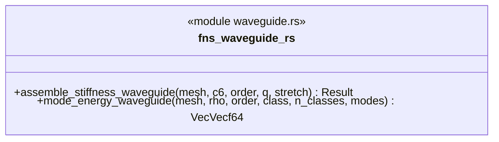

# Waveguide kernel: code

C4 level 4 (code) of the component **Waveguide kernel** (`sms.waveguide`) in the container **nyx-sms** (crate `nyx_sms`). [Component view of the container](../../3-components/sms.md) · [All code pages](../README.md)

> Elastic modes of a 2.5D waveguide on its 2D (x, z) cross-section (`exp(-i q y)`), with full 3D anisotropic crystal orientation, planar PML coordinate stretching and the planar kinetic-energy weight of a mode per component and class of cells.

**Decisions:** [ADR 101](../../../adr/0101-sms-waveguide-modes-and-floquet-pml.md)  
**Size:** 1 file, 158 lines.

## Files

| File | Lines | What it says about itself |
|---|---:|---|
| `crates/nyx-sms/src/waveguide.rs` | 158 |  |

## What it uses

| Target | Modules | Items |
|---|---|---|
| [container `femcore` (femcore)](../../3-components/femcore.md) | fem, linalg::csr, linalg::csr::assembly, material | C, CCoo, CCsr, M6, c |
| [container `physics` (nyx-physics)](../../3-components/physics.md) | crate root | Discretisation |

## Used by

| Component | Modules | Items |
|---|---|---|
| [Cross-section study kernel](./crosssection.md) | waveguide | assemble_stiffness_waveguide, mode_energy_waveguide |

## Class diagram

Public types with their public fields (or variants) and methods, free functions per file as a `module` box; arrows are field types and `impl Trait`. Capped at 36 types and a few members each; the table below is complete.

## Public items

| Kind | Item | File:line | Signature or summary |
|---|---|---|---|
| fn | `assemble_stiffness_waveguide` | `waveguide.rs:31` | `pub fn assemble_stiffness_waveguide( mesh: &Discretisation, c6: &[M6], order: usize, q: f64, stretch: Option<&[[C; 3]]>, ) -> Result<CCsr, String>` —  Stiffness matrix over `3 * n_dofs(order)` unknowns (component blocks `u_x, u_z, u_y`) for a 2D |
| fn | `mode_energy_waveguide` | `waveguide.rs:114` | `pub fn mode_energy_waveguide( mesh: &Discretisation, rho: &[f64], order: usize, class: &[usize], n_classes: usize, modes: &[Vec<C>], ) -> Vec<Vec<[f64` —  The planar kinetic-energy weight `int rho \|u_k\|^2 dx dz` of every mode, split over the three |
