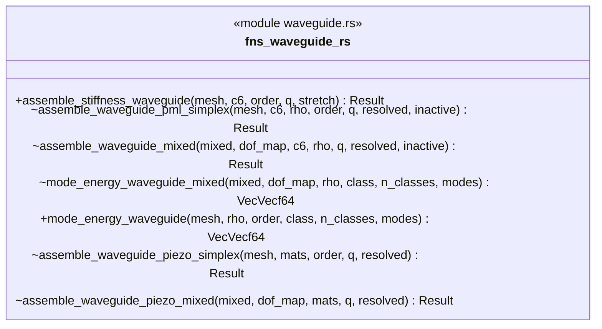

# Waveguide kernel: code

C4 level 4 (code) of the component **Waveguide kernel** (`sms.waveguide`) in the container **nyx-sms** (crate `nyx_sms`). [Component view of the container](../../3-components/sms.md) · [All code pages](../README.md)

> Elastic and coupled piezoelectric `(u_x, u_z, u_y, phi)` modes of a 2.5D waveguide on its 2D (x, z) cross-section (`exp(-i q y)`), with full 3D anisotropic orientation and planar PML stretching.

**Decisions:** [ADR 101](../../../adr/0101-sms-waveguide-modes-and-floquet-pml.md), [ADR 129](../../../adr/0129-coupled-piezoelectric-fem-in-nyx-sms.md)  
**Size:** 1 file, 842 lines.

## Files

| File | Lines | What it says about itself |
|---|---:|---|
| `crates/nyx-sms/src/waveguide.rs` | 842 |  |

## What it uses

| Target | Modules | Items |
|---|---|---|
| [container `femcore` (femcore)](../../3-components/femcore.md) | fem, fem_mixed, linalg::csr, linalg::csr::assembly, material, mesh::mixed, pml | C, CCoo, CCsr, IsoparametricCell, M6, MixedDiscretisation, MixedLagrangeDofMap, PmlJacobian, c, lagrange_shape_into +1 |
| [container `physics` (nyx-physics)](../../3-components/physics.md) | crate root | Discretisation |
| [Piezoelectric kernel](./piezo.md) | piezo_mat | PiezoCellMat |
| [Absorbing-layer kernel](./pml.md) | pml | ResolvedPmlDomains |

## Used by

| Component | Modules | Items |
|---|---|---|
| [Cross-section study kernel](./crosssection.md) | waveguide | assemble_stiffness_waveguide, assemble_waveguide_mixed, assemble_waveguide_piezo_mixed, assemble_waveguide_piezo_simplex, assemble_waveguide_pml_simplex, mode_energy_waveguide, mode_energy_waveguide_mixed |

## Class diagram

Public types with their public fields (or variants) and methods, free functions per file as a `module` box; arrows are field types and `impl Trait`. Capped at 36 types and a few members each; the table below is complete.

## Public items

| Kind | Item | File:line | Signature or summary |
|---|---|---|---|
| fn | `assemble_stiffness_waveguide` | `waveguide.rs:73` | `pub fn assemble_stiffness_waveguide( mesh: &Discretisation, c6: &[M6], order: usize, q: f64, stretch: Option<&[[C; 3]]>, ) -> Result<CCsr, String>` —  Stiffness matrix over `3 * n_dofs(order)` unknowns (component blocks `u_x, u_z, u_y`) for a 2D |
| fn | `assemble_waveguide_pml_simplex` | `waveguide.rs:144` | `pub(crate) fn assemble_waveguide_pml_simplex( mesh: &Discretisation, c6: &[M6], rho: &[f64], order: usize, q: f64, resolved: &ResolvedPmlDomains, inactive: &[i32], ) -> Result<(CCsr, CCsr), String>` —  Quadrature-point curvilinear `(K, M)` assembly for 2.5D waveguide models on [`SimplexMesh`]. |
| fn | `assemble_waveguide_mixed` | `waveguide.rs:229` | `pub(crate) fn assemble_waveguide_mixed( mixed: &MixedDiscretisation, dof_map: &MixedLagrangeDofMap, c6: &[M6], rho: &[f64], q: f64, resolved: Option<&ResolvedPmlDomains>, inactive: &[i32], ) -> Result<(CCsr, CCsr), String>` —  Native mixed-cell (`Tri` + `Quad`, straight and curved) `(K, M)` assembly for 2.5D waveguide models. |
| fn | `mode_energy_waveguide_mixed` | `waveguide.rs:324` | `pub(crate) fn mode_energy_waveguide_mixed( mixed: &MixedDiscretisation, dof_map: &MixedLagrangeDofMap, rho: &[f64], class: &[usize], n_classes: usize, modes: &[Vec<C>], ) -> Vec<Vec<[f64` |
| fn | `mode_energy_waveguide` | `waveguide.rs:384` | `pub fn mode_energy_waveguide( mesh: &Discretisation, rho: &[f64], order: usize, class: &[usize], n_classes: usize, modes: &[Vec<C>], ) -> Vec<Vec<[f64` —  The planar kinetic-energy weight `int rho \|u_k\|^2 dx dz` of every mode, split over the three |
| fn | `assemble_waveguide_piezo_simplex` | `waveguide.rs:593` | `pub(crate) fn assemble_waveguide_piezo_simplex( mesh: &Discretisation, mats: &[PiezoCellMat], order: usize, q: f64, resolved: Option<&ResolvedPmlDomains>, ) -> Result<(CCsr, CCsr, Option<CCsr>), String>` —  Assembles 4-block `(u_x, u_z, u_y, phi)` coupled piezoelectric waveguide matrices |
| fn | `assemble_waveguide_piezo_mixed` | `waveguide.rs:720` | `pub(crate) fn assemble_waveguide_piezo_mixed( mixed: &MixedDiscretisation, dof_map: &MixedLagrangeDofMap, mats: &[PiezoCellMat], q: f64, resolved: Option<&ResolvedPmlDomains>, ) -> Result<(CCsr, CCsr, Option<CCsr>), String>` —  Native mixed-cell (`Tri` + `Quad`, straight and curved) 4-block `(u_x, u_z, u_y, phi)` |
