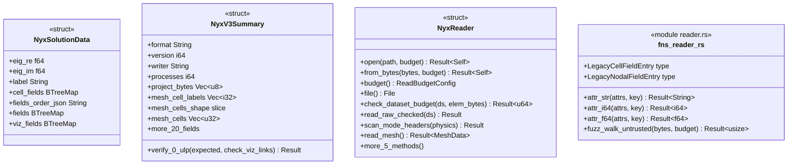

# Streaming HDF5 reader: code

C4 level 4 (code) of the component **Streaming HDF5 reader** (`storage.reader`) in the container **nyx-storage** (crate `nyx_storage`). [Component view of the container](../../3-components/storage.md) · [All code pages](../README.md)

> Bounded-memory streaming reader over hdf5_pure::File::open_streaming: checked_mul read-budget guards, O(1) mode-header scan, mesh reader (with optional curved edges), and transparent single-mode cell-field slicing across L2/L3 packed 5D and legacy L1/v3 files.

**Decisions:** [ADR 107](../../../adr/0107-pure-rust-hdf5-storage-and-packed-lzf-layout.md), [ADR 62](../../../adr/0062-results-are-stored-in-hdf5.md), [ADR 99](../../../adr/0099-figures-of-modes-and-one-node-order-in-the-results-file.md)  
**Size:** 1 file, 784 lines.

## Files

| File | Lines | What it says about itself |
|---|---:|---|
| `crates/nyx-storage/src/reader.rs` | 784 |  |

## What it uses

| Target | Modules | Items |
|---|---|---|
| container `resultsFile` (Results file) |  (declared: Streams and slices) |  |
| [Storage types and read budget](./types.md) | crate root | MeshData, ModeHeader, PackedComponentMeta, ReadBudgetConfig, assert_f64_bits_eq |

## Used by

| Component | Modules | Items |
|---|---|---|
| [Sweep checkpoint and atomic IO](./sweep.md) | reader | attr_i64, attr_str |
| [Storage types and read budget](./types.md) | reader | NyxReader, NyxSolutionData, NyxV3Summary, fuzz_walk_untrusted |
| [Packed and streaming HDF5 writer](./writer.md) | reader | NyxV3Summary, attr_i64, attr_str |

## Class diagram

Public types with their public fields (or variants) and methods, free functions per file as a `module` box; arrows are field types and `impl Trait`. Capped at 36 types and a few members each; the table below is complete.

## Public items

| Kind | Item | File:line | Signature or summary |
|---|---|---|---|
| fn | `attr_str` | `reader.rs:13` | `pub fn attr_str(attrs: &HashMap<String, AttrValue>, key: &str) -> Result<String>` —  Extracts a UTF-8 string attribute, handling both scalar strings (`as_str()`) and 1-element string arrays (`as_strings()`). |
| fn | `attr_i64` | `reader.rs:27` | `pub fn attr_i64(attrs: &HashMap<String, AttrValue>, key: &str) -> Result<i64>` —  Extracts an integer attribute as `i64` (accepting `I8`/`I16`/`I32`/`I64`/`U8`/`U16`/`U32`/`U64`). |
| fn | `attr_f64` | `reader.rs:35` | `pub fn attr_f64(attrs: &HashMap<String, AttrValue>, key: &str) -> Result<f64>` —  Extracts a scalar `f64` attribute. |
| type | `LegacyCellFieldEntry` | `reader.rs:41` |  Tuple `(name, unit, nloc, re, im)` for one legacy v3 cell-field component. |
| type | `LegacyNodalFieldEntry` | `reader.rs:44` |  Tuple `(name, unit, components_json, data)` for one legacy v3 nodal field. |
| struct | `NyxSolutionData` | `reader.rs:48` | fields: `eig_re`, `eig_im`, `label`, `cell_fields`, `fields_order_json`, `fields`, `viz_fields` —  Per-solution data in a legacy `nyx-results` v3 file. |
| struct | `NyxV3Summary` | `reader.rs:63` | fields: `format`, `version`, `writer`, `processes`, `project_bytes`, `mesh_cell_labels`, `mesh_cells_shape`, `mesh_cells`, `mesh_facet_labels`, `mesh_facets_shape`, `mesh_facets`, `mesh_points_shape`, ... —  Complete representation of a `nyx-results` v3 file for Gate 2 (`EC-01`) & Gate 3 (`EC-02`) 0-ULP verification. |
| struct | `NyxReader` | `reader.rs:204` |  Bounded-memory streaming HDF5 reader for `nyx-results` files (Layouts L1, L2, and L3). |
| fn | `fuzz_walk_untrusted` | `reader.rs:779` | `pub fn fuzz_walk_untrusted(bytes: &[u8], budget: ReadBudgetConfig) -> Result<usize>` —  Walks an untrusted HDF5 byte buffer enforcing [`ReadBudgetConfig`] (`checked_mul` byte ceiling |
| fn | `NyxV3Summary::verify_0_ulp` | `reader.rs:96` | `pub fn verify_0_ulp(&self, expected: &Self, check_viz_links: bool) -> Result<()>` —  Verifies exact 0-ULP (`to_bits()`) bitwise equality against another [`NyxV3Summary`]. |
| fn | `NyxReader::open` | `reader.rs:211` | `pub fn open(path: &Path, budget: ReadBudgetConfig) -> Result<Self>` —  Opens an `.h5` file in streaming (`pread`) mode without buffering datasets into RAM. |
| fn | `NyxReader::from_bytes` | `reader.rs:217` | `pub fn from_bytes(bytes: Vec<u8>, budget: ReadBudgetConfig) -> Result<Self>` —  Opens an in-memory `.h5` image with [`ReadBudgetConfig`] protection (used by untrusted fuzzing). |
| fn | `NyxReader::budget` | `reader.rs:223` | `pub fn budget(&self) -> ReadBudgetConfig` —  Configured read budget for dataset and group traversal operations. |
| fn | `NyxReader::file` | `reader.rs:228` | `pub fn file(&self) -> &File` —  Underlying `hdf5-pure` [`File`] handle. |
| fn | `NyxReader::check_dataset_budget` | `reader.rs:233` | `pub fn check_dataset_budget(&self, ds: &Dataset, elem_bytes: u64) -> Result<u64>` —  Enforces [`ReadBudgetConfig::max_dataset_bytes`] using checked multiplication across `ds.shape()`. |
| fn | `NyxReader::read_raw_checked` | `reader.rs:247` | `pub fn read_raw_checked(&self, ds: &Dataset) -> Result<Vec<u8>>` —  Reads raw dataset bytes only after checking datatype size and dataspace dimensions against [`ReadBudgetConfig`]. |
| fn | `NyxReader::scan_mode_headers` | `reader.rs:256` | `pub fn scan_mode_headers(&self, physics: &str) -> Result<Vec<ModeHeader>>` —  Fast O(1) metadata scan of eigenmode headers for `physics` (`"ems"`, `"sms"`, etc.). |
| fn | `NyxReader::read_mesh` | `reader.rs:304` | `pub fn read_mesh(&self) -> Result<MeshData>` —  Reads `/mesh` topology, connectivity, coordinates, and optional curved-edge geometry (`edge_node_pairs`, `edge_node_points`). |
| fn | `NyxReader::read_packed_components_meta` | `reader.rs:402` | `pub fn read_packed_components_meta(&self, physics: &str) -> Result<Option<Vec<PackedComponentMeta>>>` —  Reads `/results/<physics>/cell_fields_meta` component descriptors if present. |
| fn | `NyxReader::packed_logical_shape` | `reader.rs:415` | `pub fn packed_logical_shape(&self, physics: &str) -> Result<Option<[usize` —  Returns the logical 5D shape `[M, C, N_c, N_v, 2]` of `/results/<physics>/cell_fields_packed` |
| fn | `NyxReader::read_mode_cell_fields` | `reader.rs:462` | `pub fn read_mode_cell_fields(&self, physics: &str, mode_idx: usize) -> Result<Vec<f64>>` —  Bounded-memory single-mode slice reader (Gate 4 `EC-09` & `BM-2`). |
| fn | `NyxReader::read_nyx_v3_summary` | `reader.rs:555` | `pub fn read_nyx_v3_summary(&self, read_viz_links: bool) -> Result<NyxV3Summary>` —  Reads the complete `nyx-results` v3 structure for the first alphabetically sorted physics group under `/results`. |
| fn | `NyxReader::read_nyx_v3_summary_for_physics` | `reader.rs:564` | `pub fn read_nyx_v3_summary_for_physics(&self, physics: &str, read_viz_links: bool) -> Result<NyxV3Summary>` —  Reads the complete `nyx-results` v3 structure for a specific `physics` group under `/results`. |
