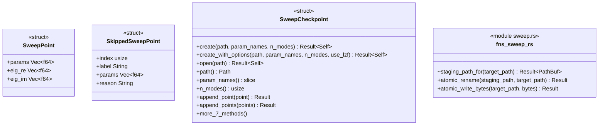

# Sweep checkpoint and atomic IO: code

C4 level 4 (code) of the component **Sweep checkpoint and atomic IO** (`storage.sweep`) in the container **nyx-storage** (crate `nyx_storage`). [Component view of the container](../../3-components/storage.md) · [All code pages](../README.md)

> Incremental in-place parameter-sweep checkpointing (SweepCheckpoint over unlimited chunked datasets via File::open_rw) and Windows NTFS atomic file replacement helpers.

**Decisions:** [ADR 107](../../../adr/0107-pure-rust-hdf5-storage-and-packed-lzf-layout.md), [ADR 87](../../../adr/0087-work-is-queued-in-lanes-and-stages-are-shared-by-content.md)  
**Size:** 1 file, 388 lines.

## Files

| File | Lines | What it says about itself |
|---|---:|---|
| `crates/nyx-storage/src/sweep.rs` | 388 |  |

## What it uses

| Target | Modules | Items |
|---|---|---|
| [Streaming HDF5 reader](./reader.md) | reader | attr_i64, attr_str |
| [Storage types and read budget](./types.md) | crate root | ReadBudgetConfig |

## Used by

| Component | Modules | Items |
|---|---|---|
| [engine: Job runner and queue](../engine/jobs.md) | sweep | SkippedSweepPoint, SweepCheckpoint, SweepPoint |
| [Storage types and read budget](./types.md) | sweep | SkippedSweepPoint, SweepCheckpoint, SweepPoint, atomic_rename, atomic_write_bytes |
| [Packed and streaming HDF5 writer](./writer.md) | sweep | atomic_rename, staging_path_for |
| [Direct-path XDMF generator](./xdmf.md) | sweep | atomic_write_bytes |

## Class diagram

Public types with their public fields (or variants) and methods, free functions per file as a `module` box; arrows are field types and `impl Trait`. Capped at 36 types and a few members each; the table below is complete.

## Public items

| Kind | Item | File:line | Signature or summary |
|---|---|---|---|
| fn | `staging_path_for` | `sweep.rs:15` | `pub(crate) fn staging_path_for(target_path: &Path) -> Result<PathBuf>` —  Computes the sibling `.tmp` staging path in the same directory as `target_path` |
| fn | `atomic_rename` | `sweep.rs:24` | `pub fn atomic_rename(staging_path: &Path, target_path: &Path) -> Result<()>` —  Atomically renames `staging_path` onto `target_path` (`MoveFileExW` semantics on Windows NTFS). |
| fn | `atomic_write_bytes` | `sweep.rs:36` | `pub fn atomic_write_bytes(target_path: &Path, bytes: &[u8]) -> Result<()>` —  Writes `bytes` to a sibling `.tmp` file, flushes OS buffers, closes the handle, |
| struct | `SweepPoint` | `sweep.rs:54` | fields: `params`, `eig_re`, `eig_im` —  One parameter-sweep evaluation point (`params` + complex mode eigenvalues). |
| struct | `SkippedSweepPoint` | `sweep.rs:62` | fields: `index`, `label`, `params`, `reason` —  Metadata for a parametric sweep sample skipped due to invalid geometry, meshing failure, or bad elements. |
| struct | `SweepCheckpoint` | `sweep.rs:71` |  Incremental HDF5 parameter-sweep checkpoint store backed by unlimited rank-1 chunked datasets. |
| fn | `SweepCheckpoint::create` | `sweep.rs:84` | `pub fn create(path: &Path, param_names: &[&str], n_modes: usize) -> Result<Self>` —  Initializes a new `.h5` sweep checkpoint file atomically with unlimited chunked 1D columns: |
| fn | `SweepCheckpoint::create_with_options` | `sweep.rs:89` | `pub fn create_with_options(path: &Path, param_names: &[&str], n_modes: usize, use_lzf: bool) -> Result<Self>` —  Initializes a new `.h5` sweep checkpoint file with optional `Shuffle + LZF` chunk compression. |
| fn | `SweepCheckpoint::open` | `sweep.rs:137` | `pub fn open(path: &Path) -> Result<Self>` —  Opens an existing `.h5` sweep checkpoint file and reads its column schema. |
| fn | `SweepCheckpoint::path` | `sweep.rs:152` | `pub fn path(&self) -> &Path` —  Path to the backing `.h5` file. |
| fn | `SweepCheckpoint::param_names` | `sweep.rs:157` | `pub fn param_names(&self) -> &[String]` —  Parameter column names in order. |
| fn | `SweepCheckpoint::n_modes` | `sweep.rs:162` | `pub fn n_modes(&self) -> usize` —  Number of tracked eigenmodes per sweep point. |
| fn | `SweepCheckpoint::append_point` | `sweep.rs:167` | `pub fn append_point(&self, point: &SweepPoint) -> Result<()>` —  Appends a single solved sweep point in place via `File::open_rw`. |
| fn | `SweepCheckpoint::append_points` | `sweep.rs:174` | `pub fn append_points(&self, points: &[SweepPoint]) -> Result<()>` —  Appends one or more solved sweep points in place via `File::open_rw`. |
| fn | `SweepCheckpoint::read_points` | `sweep.rs:239` | `pub fn read_points(&self) -> Result<Vec<SweepPoint>>` —  Reads all stored sweep points back in streaming mode with [`ReadBudgetConfig`] enforcement. |
| fn | `SweepCheckpoint::read_points_with_budget` | `sweep.rs:244` | `pub fn read_points_with_budget(&self, budget: ReadBudgetConfig) -> Result<Vec<SweepPoint>>` —  Reads all stored sweep points back under an explicit [`ReadBudgetConfig`]. |
| fn | `SweepCheckpoint::n_points` | `sweep.rs:294` | `pub fn n_points(&self) -> Result<u64>` —  Returns the committed number of solved points (`@n_points`). |
| fn | `SweepCheckpoint::n_skipped` | `sweep.rs:301` | `pub fn n_skipped(&self) -> Result<u64>` —  Returns the committed number of skipped points (`@n_skipped`, or `0` on legacy files). |
| fn | `SweepCheckpoint::record_skipped` | `sweep.rs:308` | `pub fn record_skipped(&self, skipped: &SkippedSweepPoint) -> Result<()>` —  Appends one skipped sweep point (`skipped_invalid_geometry`) to root metadata cleanly in place. |
| fn | `SweepCheckpoint::record_skipped_batch` | `sweep.rs:313` | `pub fn record_skipped_batch(&self, items: &[SkippedSweepPoint]) -> Result<()>` —  Appends one or more skipped sweep points atomically via `File::open_rw` + `commit()`. |
| fn | `SweepCheckpoint::read_skipped` | `sweep.rs:336` | `pub fn read_skipped(&self) -> Result<Vec<SkippedSweepPoint>>` —  Reads all recorded skipped sweep points (empty vector on checkpoints with no skipped entries). |
